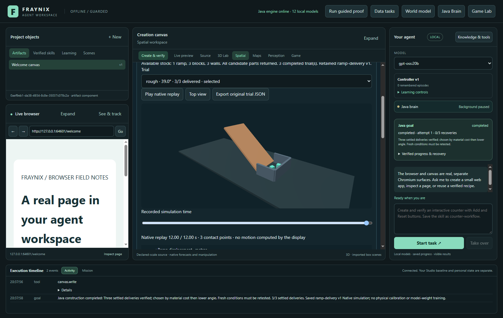
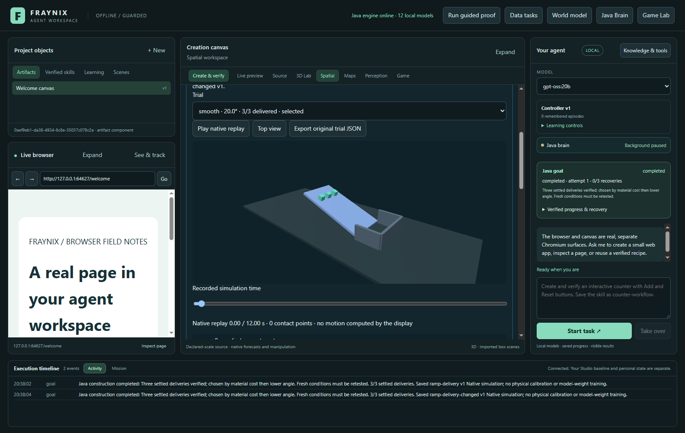
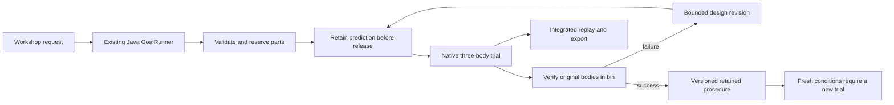

# Edition 050 · Build, test and remember

2026-11-02 · [Previous edition](README-049.md) · [Edition history](docs/readmes/INDEX.md) · [Offline guide](docs/readmes/050/index.html) · [Acceptance contract](docs/EDITION_050_CONTRACT.md)

Fraynix now has an integrated construction workshop. The existing Java goal runner assembles a ramp and collection bin from finite declared stock, runs three real native rigid bodies, compares surfaces, retains failed experiments and repairs the design within a bounded search. A successful experiment can become a versioned procedure. Reusing it always tests the new conditions.

This is the first construction experiment in the larger vision of an agent inhabiting an evolving world. It adds a working path through construction, prediction, execution, verification and memory. The construction decision policy in this edition is a Java algorithm. It does not require an LLM call or train language-model weights. The rest of the application's chat, browser, creation canvas, persistent worlds, skill graphs and evidence bench remain available.



## Start and review

Use a separate practice project. Preserve the existing review app and its private camera/mat data. The Windows launcher uses the pinned desktop dependencies and Java installation in this checkout. After dependencies have been prepared, an offline launch is:

```powershell
$env:FRAYNIX_WORKSPACE_PROJECT = Join-Path ([Environment]::GetFolderPath('UserProfile')) '.fraynix-agent-workspace/projects/review-050-workshop'
.\Launch-Agent-Workspace.bat -Offline
```

1. Open **Spatial → Construction workshop · build, test & remember** in the existing creation area. The workshop uses the same application window.
2. Leave the friction multiplier at **1** and starting offset at **0**. Enter a procedure name, or leave it empty to keep only the experiment.
3. Click **Build & test two surfaces**. The shared Java goal card reports preparation, trial completion, failures and selection. **Stop** cancels the goal; a cancelled experiment cannot earn a procedure.
4. Choose a completed trial. Use **Play native replay**, pause, or move the time slider. The view renders positions and orientations recorded by the native solver. The display does not calculate authoritative physics. **Top view** changes the camera without changing the experiment.
5. Compare the dashed analytic prediction with the observed ramp motion. The result list retains every candidate, including failures. The decisions section records why the runner proceeded.
6. Export the original trial JSON. It includes the construction specification, initial geometry, prediction binding, native samples, final checks and backend identity.
7. Close and reopen the same practice project. Choose the retained experiment. Change the friction multiplier to **1.3** and starting offset to **0.25 m**, then click **Retest saved procedure**. Its previous success does not exempt it from a fresh native trial. Construction procedures in the shared skill library open this workshop for retesting.

## Materials, parts and construction

The available stock defaults to one ramp, three blocks and three bin walls. Java requires whole stock counts and refuses insufficient supplies before admitting a goal. A candidate reserves those parts. Its disposable trial world returns them when the experiment closes. Candidate worlds are separate experiments using the same stock, not simultaneous structures sharing one physical inventory. No missing part is silently invented.

Construction is a declared scene assembly transaction at initialization. The ramp, ground, bin walls and three uniquely named blocks receive their initial geometry and poses. This edition does not claim that a robot grasped and assembled those parts. After release, dynamic body poses and velocities are advanced by native gravity and collision integration; no delivery is achieved by writing a desired final position.

The two surfaces have declared contact coefficients of 0.15 and 0.65, multiplied by the chosen condition. Their names and colors identify those numerical settings. They are not measured wood/metal properties. The ramp is six metres long and three metres wide; blocks are 0.4-metre cubes. Gravity is 9.81 m/s². A fixed 240 Hz native step produces twelve simulated seconds per trial, with observations every 0.1 seconds. Multiple blocks occupy one native world, including actual contacts with the ramp, ground and bin.

The planner begins with both surfaces at 20°. An incomplete delivery can trigger one steeper candidate for that surface, bounded at 40°. Reuse begins with the remembered design. A failed remembered design can trigger a steeper revision and the other surface. The candidate order, outcomes and original predictions remain recorded. Successful candidates are ranked by declared material cost, then lower angle. This ranking does not claim a minimum-energy or globally optimal solution.

## Prediction and the outcome check

Before any native trial, Java atomically stores a source-bound analytic prediction. Its acceleration is:

`max(0, g × (sin(angle) − friction × cos(angle)))`

This simple Coulomb sliding model predicts ramp displacement and a possible ramp exit time. It does not predict landing, rotation, bin impacts or real-world material behavior. The chart stops the forecast at the end of its ramp domain. The reported RMSE uses samples where both predicted and observed displacement remain inside a shorter ramp interval, excluding the edge region. It is a diagnostic comparison, not a claim that the analytic model covers the whole trajectory.

The verifier checks the complete fixed observation horizon, original body IDs, finite states, geometry and prediction specification. Delivery requires all three bodies to finish within the declared bin interior, near the ground, with speed below 0.12 m/s. An explanatory message or a completed command cannot substitute for those positions and velocities.

Each prediction and result is stored with a content checksum. Read and reuse recompute the outcome from the retained samples. Changed evidence is refused without rewriting it. These checks establish local file integrity and simulation consistency; they do not authenticate an external physical measurement.

## Observed results

These are actual native outcomes from the desktop workflow, not generated demonstration values:

| Conditions | Candidate | Settled deliveries | Ramp prediction RMSE |
| --- | --- | ---: | ---: |
| Original | Rough, 20° | 0 / 3 | 0.000582 m |
| Original | Smooth, 20° | 3 / 3 | 0.002545 m |
| Original | Repaired rough, 39.024° | 3 / 3 | 0.033130 m |
| After restart; friction × 1.3, start +0.25 m | Remembered rough, 39.024° | 0 / 3 | 0.001122 m |
| Changed conditions | Rough, 40° | 0 / 3 | 0.002409 m |
| Changed conditions | Smooth, 20° | 3 / 3 | 0.002711 m |

The original experiment retained the successful rough design because it had lower declared material cost. Under changed conditions, it failed. The runner preserved that failure, found that the steeper rough design still failed, and verified the smooth alternative. A stalled block can have a small prediction error: accurate prediction of failure is different from successful delivery.



The original experiment and changed-condition exercise are development/acceptance cases. They are not an untouched broad generalization benchmark. This establishes condition-aware procedural recovery and persistence, not general intelligence or improvement of an LLM's parameters.

## Java ownership and continuity



There is no second scheduler or new daemon. The existing Java goal runner owns admission, progress, deadlines, cancellation and explicit recovery. Completed trial files have stable identities and are reused on resume. If a process ends during an unfinished disposable trial, that incomplete simulation can restart from its retained initial specification; the app does not pretend to restore an unrecorded intermediate native state. Existing persistent-world heads remain unchanged by these workshop experiments.

The new algorithm lives in [Workshop050.java](workspace-engine/src/main/java/fraymus/workspace/Workshop050.java). The shared [GoalRunner](workspace-engine/src/main/java/fraymus/workspace/GoalRunner.java) handles scheduling and procedural retention. The [integrated view](workspace-desktop/renderer/workshop050.js) renders native geometry, replay, charts and decisions. New planning and inventory checks are Java-owned. Native physics continues to use the existing Minie/Libbulletjme dependencies, and the desktop view uses the existing Three.js renderer; no new dependency was added.

## Verification and next work

The focused Java run passed 20 tests: six workshop cases, five shared-runner regressions and nine unchanged evidence-replay checks. All 123 desktop unit tests passed. The actual isolated desktop test covered failed/successful native trials, playback/pause/seek, exact JSON export, a fresh Java process, changed-condition skill reuse, cancellation, a narrow layout and an unchanged existing persistent world. [Verification and original test evidence](docs/readmes/050/verification.json) · [Source inventory](docs/readmes/050/FILE_TREE.md) · [Narrow application capture](docs/readmes/050/workshop050-narrow.png).

All six original native trial files and their seven pre-action predictions, including the cancelled attempt's prediction, are retained with byte hashes in the [original evidence manifest](docs/readmes/050/original-evidence.json). The offline guide also passed actual browser checks at 1440 and 390 pixels: navigation, component/source filters, local links, all three app screenshots and horizontal layout. [Browser receipt](docs/readmes/050/documentation-browser.json).

Development checks caught a UUID/string error in procedure persistence and an early UI status race; both were fixed before the passing workflow. The earlier failed attempts remain in private temporary test projects. The existing review application, model services, original camera frames and calibration records were not used for these tests.

The next construction phase should add physically actuated assembly using the existing virtual gripper, a versioned construction transaction for a continuing world, and a typed chat tool for the new workshop procedure. Then compare one agent with two cooperating agents under the same resource and compute limits. Independent reservations, useful handoffs and fewer failed actions matter more than message volume. Arbitrary natural-language engineering, free-form construction, fracture, thermal models and unsupervised model training remain future work.

The user's [Minecraft arena](https://github.com/eyeoverthink/fraymus-minecraft-arena) and [YC's agent experiments](https://labs.ycombinator.com/projects/games/) informed the construction/coordination direction. No Mindcraft code or Minecraft assets were imported into this implementation. Hardware acquisition remains a separate later validation path: simulated contact evidence is not an independent Arduino witness. [Continuing project notes](docs/PROJECT_MEMORY.md) · [Development log](docs/DEVELOPMENT_LOG.md).
