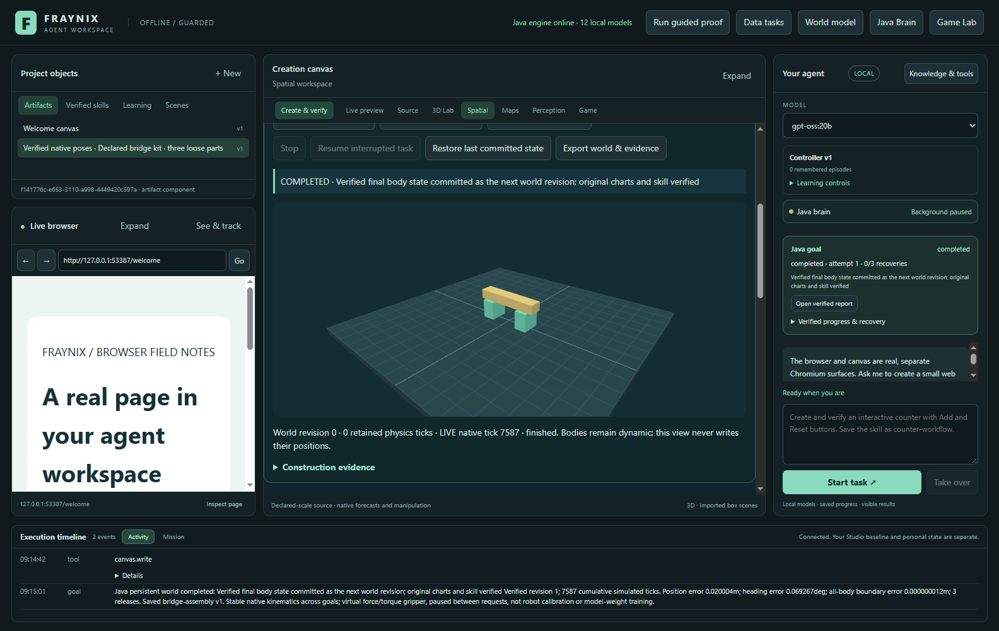
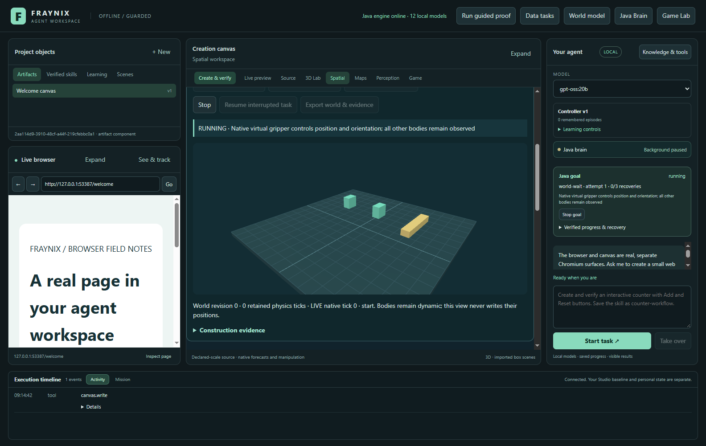
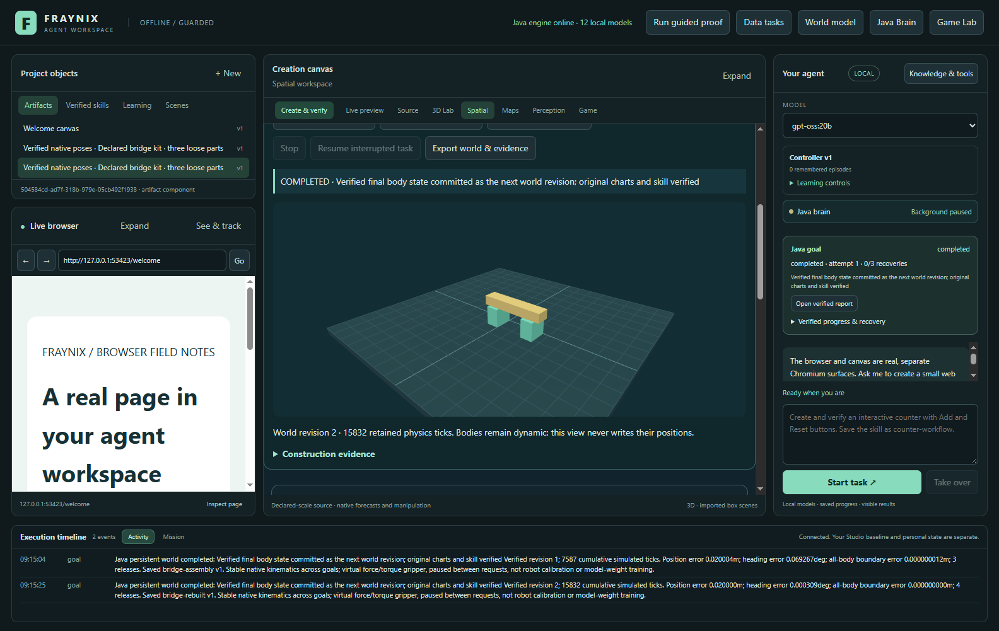
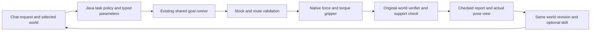
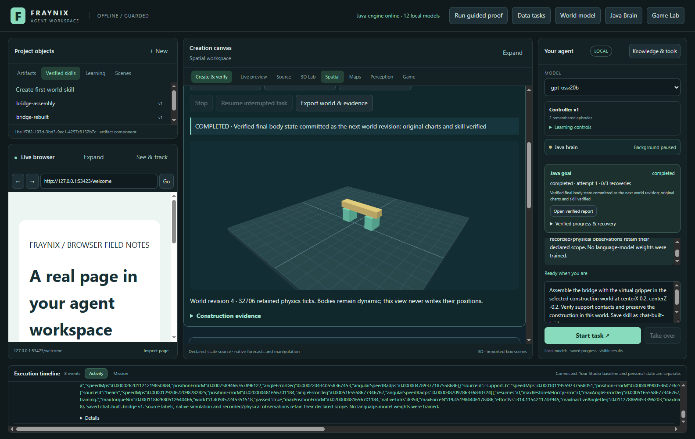
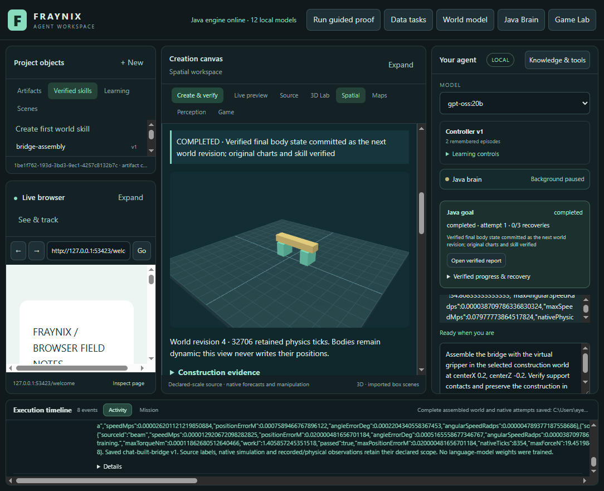

# Edition 051 · Assemble a world that remembers

2026-11-03 · [Previous edition](README-050.md) · [Edition history](docs/readmes/INDEX.md) · [Offline guide](docs/readmes/051/index.html) · [Acceptance contract](docs/EDITION_051_CONTRACT.md)

Fraynix can now use its virtual gripper to build a bridge, preserve that construction in the continuing world, and rebuild it somewhere else through chat. Two supports and a beam begin as loose dynamic bodies. Java plans the ordered movements, the existing native controller lifts and rotates each part through forces and torques, and the verifier checks the released structure before committing a world revision. A successful construction can become a versioned skill.

This extends the same application, Java goal runner, persistent world and skill library. The new assembly panel lives inside Spatial. There is no second application or separate construction scheduler. The display follows actual native states, including the held body and the released bridge. After restarting Java, a new goal begins with the retained poses, velocities and stable body identities. It does not secretly recreate the original loose kit.



## Review the working feature

Use a separate practice project. The existing review045 installation and its private camera, mat and world data remain preserved. Do not rebuild installed libraries while their Java owner is running. With JDK 21 and the existing desktop dependencies prepared, an offline launch from this checkout is:

```powershell
$env:FRAYNIX_WORKSPACE_PROJECT = Join-Path ([Environment]::GetFolderPath('UserProfile')) '.fraynix-agent-workspace/projects/review-051-gripper'
.\Launch-Agent-Workspace.bat -Offline
```

1. Open **Spatial → Gripper assembly · a world that keeps your construction**. Click **New bridge kit**. This explicitly creates a separate world with a floor, two supports and one beam. Existing worlds are not cleared.
2. Leave the centre at X **0**, Z **0**. Keep the suggested skill name, or clear it if you only want to preserve the world. Click **Assemble with gripper**.
3. Watch the native tick counter and controller phase. The beam begins turned through 90 degrees. It must be lifted, rotated, transported and lowered. The viewer highlights a held object; it never supplies a desired pose to the simulation.
4. When the task completes, inspect **Construction evidence**. It records actual grabs/releases, force, support contacts, source revision, committed revision and any saved skill. The completed bridge is revision 1 of the same world.
5. Close the practice app normally and reopen the same project. Select the world. Its exact retained frame is restored. Change the centre to X **0.45**, Z **0.3** and assemble again. The beam is first taken off the supports and staged; the supports move next; the same beam completes the new structure. This earns revision 2 after four releases.
6. Select an installed tool-capable model in chat. The local acceptance run uses **gpt-oss:20b**, with CPU-only planning. **Ask agent to assemble** submits the requested centre and optional skill name through the normal chat route. Java owns admission, execution and verification.
7. Open a retained bridge procedure in **Skills**, then choose **Ask agent to reuse skill**. The explicitly selected name and version stay selected while progress polling continues. A previous success does not bypass the checks on the new world state.
8. **Export world & evidence** saves the complete world lineage and referenced native attempts. **Stop** cancels the current goal. An uncommitted stopped attempt remains visible; **Restore last committed state** explicitly abandons it and restores the retained frame. That is a state restoration, not a claim that the gripper moved the objects back.

Useful chat requests after selecting the construction world include:

> Assemble the bridge with the virtual gripper at centerX 0.2, centerZ -0.2. Verify support contacts, preserve the construction, and save skill as chat-built-bridge.

> Reuse the procedure bridge-assembly version 1 to rebuild the bridge at centerX -0.35, centerZ 0.1.

The exact supported parameters are `centerX`, `centerZ`, `forceLimitN`, `torqueLimitNm` and an optional saved-skill name. The UI exposes the centre and name. Java requires centre X between −1 and 1 metres and centre Z between −0.5 and 0.8 metres. Requests outside that domain are refused. Stock geometry and materials are fixed in this first assembly skill; it is not an arbitrary CAD builder.

## What the gripper actually does

The declared kit has an eight-metre-square floor. Each support is 0.4 × 0.6 × 0.6 metres and weighs 1.2 kg. The beam is 2 × 0.3 × 0.4 metres and weighs 0.8 kg. Friction is declared as 0.8, restitution as zero and gravity as 9.81 m/s². These are synthetic, declared properties, not measured materials. The initial kit is created explicitly once; subsequent goals operate on its existing bodies.

The existing native virtual actuator applies bounded force and torque to a held body. Defaults are 40 N and 4 N·m. The native solver integrates gravity, collisions and motion. No body is teleported to its assembly target during execution. The gripper is a force/torque actuator abstraction, not articulated fingers, a contact-based jaw model or a hardware robot.

The Java planner checks the exact kit, settled velocities, upright stock, available floor and vertical pickup/lowering corridors. It chooses an overhead travel height from the current geometry and part radii. Supports are placed before the beam. Reassembly begins by removing an elevated beam so the support pickup columns are clear. Blocked corridors are refused rather than silently allowing an object through another one. These conservative rules cover the declared bridge kit; they are not a general obstacle-avoiding motion planner.

The supports remain dynamic bodies after placement. The beam remains dynamic after release. Nothing is welded or converted to a static object to force success. The target beam centre is 0.77 metres; gravity settles it onto the support tops near 0.75 metres. Native contact evidence, not proximity alone, must establish that both supports have carried the released beam.



## Checks that make a construction count

The original world verifier still checks native displacement, bounded wrench, contacts, ordered gripper events, release continuity and final pose/velocity thresholds. This edition adds a structure check on top of it. The final observation window must contain both actual beam-to-support contact pairs, at least six settled samples, a beam centre between 0.70 and 0.80 metres, maximum body speed below 0.08 m/s and an empty gripper. The current implementation examines the last 84 native ticks; these are simulation checks, not a structural load rating.

Reassembly exposed a useful verification defect during development: the beam has an intermediate staging target and a final bridge target. Comparing both targets against the single final beam position incorrectly rejected a physically successful sequence. The corrected verifier checks every ordered placement at its actual release, then checks the last placement of each body against its final state. Release pose and velocity limits were preserved. An intermediate move is not exempt from evidence simply because the same body moves again.

The goal must also pass the existing report and actual pose-view checks before it can retain a successful skill. A model's statement that it finished is insufficient. Weak force, a changed source, corrupted trace, stale revision or failed structure cannot earn a completed construction. Tests deliberately exercise those refusals.

## One world across successive goals

Every admitted construction binds a particular world ID, revision and head hash. The world ledger reserves that source for the owned native attempt. On success it appends the complete actual frame, native evidence identity and structure proof. A later goal receives that exact frame, including all dynamic poses and velocities. Object IDs and original geometry remain stable.

The acceptance sequence builds at the origin, restarts Java, rebuilds at a different centre, reuses a saved procedure through the local model, and starts another construction through chat. Each successful task advances the same world once. A stale request for revision 0 is refused after revision 1 exists. A stopped later attempt does not overwrite the last verified structure or earn a successful procedure.



Worlds are paused between goals. The application retains physical state; it does not claim that an unattended closed app continued simulating elapsed wall time. Bullet's internal solver caches are reconstructed on restart. An interrupted native run can resume from its compatible checkpoint, including held controller state and velocities, through the existing recovery mechanism. A changed engine identity cannot silently resume an old checkpoint.

An explicit compatibility operation permits inspection and upgrade of the exact known edition050 world identity. **Upgrade compatible saved world** appends an unchanged-frame upgrade revision and records old/new code identities. It refuses unknown identities and active pending owners. It does not rewrite previous history, grant old skills new verification or migrate an active native run. Finish an old pending attempt with its original engine first. Earlier world versions are not covered by this narrow upgrade.

## How chat reaches the physical workflow



The local model selects an allowed operation and provides semantic options. The construction tool schema excludes world IDs, arbitrary target arrays, executable code, commit instructions and success flags. The host supplies the selected-world binding. Java validates requested values, source freshness, native ownership and available stock before admitting movement. Reusing a procedure requires its actual saved name/version and a fresh selected-world binding; it does not copy a prior success label.

The integration uses the existing Java task/domain policy, procedure adapter, GoalRunner and desktop host. New work is concentrated in `Construction051.java`, its registered tool/schema and the integrated panel. Existing physics integration, complete frame handling and export algorithms remain in place. The desktop paints native observations and handles the user's controls. It is not the authoritative physics engine.



## Validation and reproducible evidence

The [verification receipt](docs/readmes/051/verification.json) gives exact source revisions, test invocations, counts and limits. The [case results](docs/readmes/051/case-results.json) retain the actual task outcomes. The [original evidence manifest](docs/readmes/051/original-evidence.json) links compressed original test-world data with byte counts and hashes. These are generated practice worlds; private review projects, webcam images, model weights and credentials are not published.

The focused Java run covers six new construction cases plus world persistence, complete export, Java domain routing and the existing construction workshop. It tests a real three-release build, four-release reassembly from the previous frame, insufficient-force failure, corrupted evidence refusal, exact legacy upgrade, held native checkpoint recovery, typed parameters and selected-source enforcement. Desktop unit tests cover the existing host. Actual Electron/Java tests operate the visible controls, restart Java, inspect the shared skill library, export evidence, check a narrower layout and exercise Stop/restoration.

The local-model run exercises both retained-skill reuse and fresh `construction.start`. Model calls and native checks run serially. The model is the installed gpt-oss:20b; no new weights or libraries are downloaded for this edition. The first successful native build takes 7,587 physics ticks, or 31.6125 simulated seconds, with three grabs and releases. Exact later-run metrics are retained in the receipt and original exports; wall-clock model latency is a different quantity from simulated movement time.

These are development and acceptance cases for a known bridge, not a held-out general construction benchmark. We have not demonstrated arbitrary assembly, hardware grasping, material strength, language-model weight training or broad autonomous learning. What is established is a complete local path from request to actual simulated manipulation, verified persistent state and reusable procedure.



## Measured acceptance results

| Actual workflow | World revision | Grabs / releases | Simulated seconds | Maximum force N | Beam centre height m |
| --- | --- | --- | --- | --- | --- |
| Initial assembly | 1 | 3 / 3 | 31.6125 | 19.452 | 0.749996 |
| Reassembly after restart | 2 | 4 / 4 | 34.3542 | 19.452 | 0.750000 |
| Actual chat skill reuse | 3 | 4 / 4 | 35.5000 | 19.452 | 0.749999 |
| Actual chat construction | 4 | 4 / 4 | 34.8083 | 19.452 | 0.750000 |

Both chat workflows used the installed model on the CPU. Reuse took 359.4 seconds of wall time and fresh construction took 355.2 seconds, including planning, native work, report verification and final model completion. This demonstrates working integration, not fast conversational latency. Native simulation time is reported separately above. Each completed construction had two actual support contacts and passed the settled-state check.

## Export, ownership and recovery

The export is the existing `fraynix.persistent-world-export-gzip-v1` JSON envelope. It contains the original raw byte count and SHA-256 plus base64 gzip data. Decoding produces the full `fraynix.persistent-world-export-v1` world history and referenced native attempts, not just a screenshot or selected summary. The original export limits remain 256 MB raw history and 20 MB transport; oversized histories must use individual attempt exports. This edition does not add a video encoder or an arbitrary CAD importer.

Failed and interrupted attempts remain evidence. State restoration is explicit and creates its own history event. A fresh project is separate from the user's existing project, and a new bridge world is separate from an existing world. The normal review045 app remains on its original source/installed runtime. Edition051 development and validation use an isolated checkout and temporary practice projects.

The source tree, system-map data, original tests and images are included in the [offline companion](docs/readmes/051/index.html). It works without remote scripts, fonts or CDNs and provides searchable components and source paths. The [Obsidian note](docs/obsidian/59-gripper-assembly.md) and [Canvas](docs/obsidian/gripper-assembly.canvas) connect the new pieces to the prior construction workshop. Published README editions001–050 remain unchanged.

## Direction and next acceptance gates

This is a concrete step toward an agent working inside a world with consequences. It can leave something behind, return to it and use a remembered procedure on current state. The value is the agreement between instructions, physical state, evidence and memory; a visual animation alone would not establish that agreement.

The next extension should grow the assembly domain carefully: additional part shapes, measured grasp candidates, explicit joints and obstructed routes. Each addition needs unseen arrangement tests and retained failure traces. A second useful step is a load experiment: predict how a released bridge responds, place a test mass through the same actuator, and compare native outcomes with the prediction. Passing assembly should remain distinct from passing a load test.

The measured CPU chat delay also deserves a focused pass: smaller stage-specific observations, fewer redundant model decisions after Java already knows the verified outcome, and a compact user-facing completion. Compare complete request latency and exact task preservation before changing the default. Faster narration must not weaken source binding or physical checks.

Cooperation belongs after that: two owned effectors, explicit shared-part reservations and measured collision/deadlock recovery. It should improve a declared task against the single-gripper baseline before becoming the default. Hardware sensors and the user's ESP32/Arduino boards can later provide independent observations, with timestamp, scale and uncertainty checks carried forward from the earlier observation work. A virtual bridge passing its solver checks is not evidence that a physical structure is safe.

Finally, useful learning should be evaluated on new tasks. A retained procedure already supplies continuity. Neural or model changes should earn promotion through separate held-out outcomes, resource measurements and rollback. The larger vision remains one Java-owned environment for observation, action, memory and evaluation, with the language model participating through those real interfaces.
