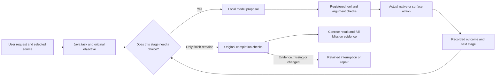
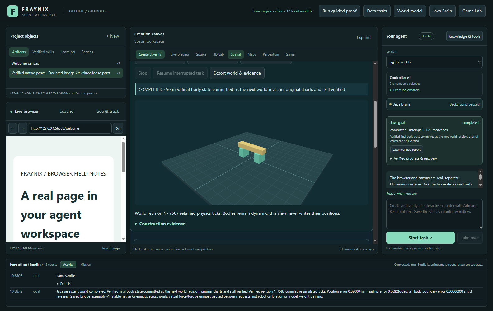
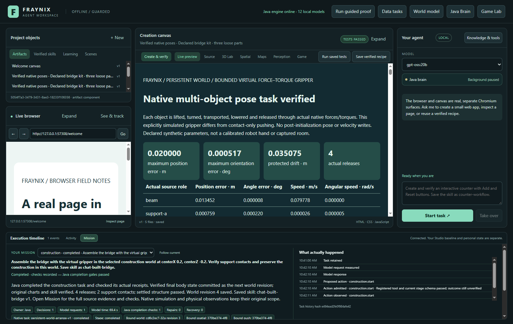
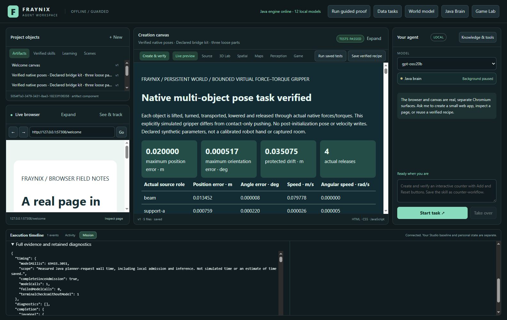
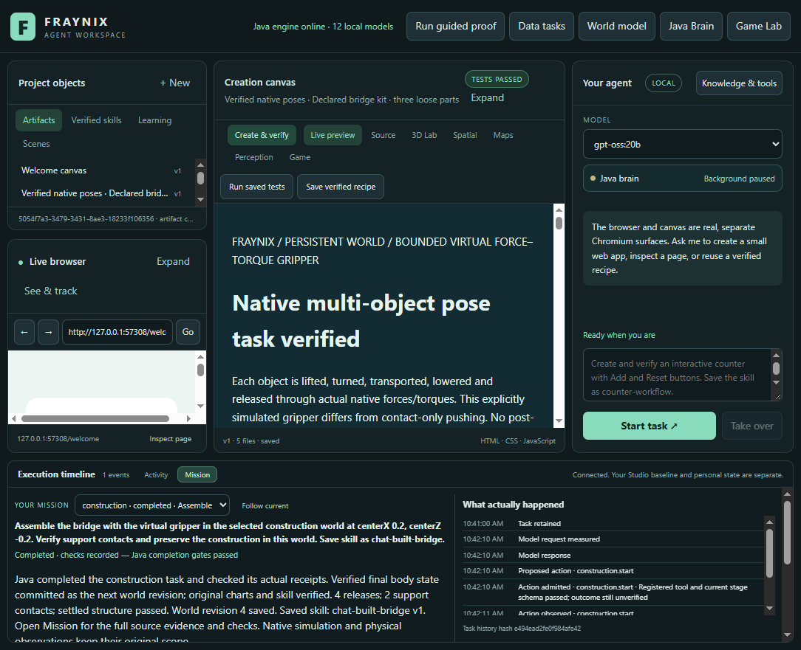
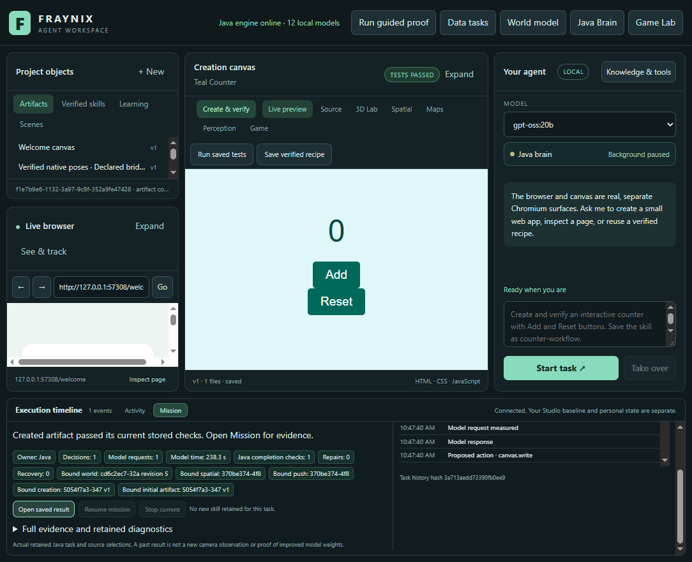

# Edition 052 · Faster chat, the same evidence

November 3, 2026 · Fraynix Agent Workspace

[Previous: gripper assembly051](README-051.md) · [Edition history](docs/readmes/INDEX.md) · [Offline guide](docs/readmes/052/index.html) · [Acceptance contract](docs/EDITION_052_CONTRACT.md) · [Logic Chain review](docs/REFERENCE_LOGIC_052.md)

The agent can now end a checked task without asking the language model to choose an obvious final action. Java still reads the actual child outcome, checks the current saved result and its assertions, records the learning episode and releases the owned task. The result in chat is short enough to read. The full metrics, source bindings and evidence remain available in the integrated Mission view.

This edition develops the same application. The game and native physics engine, persistent worlds, browser, creation canvas, Java goal runner, verified skills and continuing agent remain connected. There is no second chat scheduler or replacement physics system. The normal review045 installation and its private measured-camera project remain untouched; development and acceptance use an isolated052 checkout and independent practice projects.

## The problem this edition addresses

Edition051 demonstrated actual virtual gripper assembly and retained constructions. Its local CPU chat workflows took almost six minutes each. In both cases, the model first chose an action, Java completed the native task and checked its report, and then the model was called again to choose `finish`. That second request added latency even though the Java stage offered only that one action. The final message also included a large raw metrics object, obscuring the useful result.

The fix is deliberately narrow. When the current allowed action set is exactly `finish`, the existing Java owner calls its existing completion routine. That routine remains responsible for deciding whether the task can finish. A successful-looking model sentence, a previous task's report or a changed artifact cannot substitute for current evidence. Ordinary conversation still needs model interpretation; stages with choices still use the planner. Existing creation/workflow fast paths remain in place.

The result is less repeated inference and a clearer account of what happened. It is not a claim that a language model learned new weights or that fewer checks were required.

## What changed

| Change | User-visible benefit | Preserved boundary |
| --- | --- | --- |
| Java performs a terminal completion check | No extra model request solely to select `finish` | The original fresh child, report, version and assertion checks still run |
| Concise source-derived result | Read the construction outcome, world revision and saved skill immediately | Full original metrics are retained |
| Measured model time in Mission | See how many planner requests occurred and how long they took | Actual monotonic request timing; no invented progress percentage |
| Separate proposal and admission records | Distinguish what the model suggested from what Java permitted | Admission is not execution success |
| Original objective hash | A resumed task cannot silently acquire a different request | Existing checked task history remains the durable record |
| Retained diagnostic groups | Earlier failures remain available after the recent-action window advances | Duplicate display groups preserve every occurrence and hash |
| Compact discovery identities | Less optional catalog detail in the domain prompt | Bound selections, exact requested fields and warnings remain intact |
| Valid bounded domain context | No partial JSON prefix masquerading as a complete observation | Oversized essential context stops explicitly instead of silently losing requirements |

The first actual-model052 reuse completed its native task, but required three planner requests after two invalid numeric argument refusals. It failed the one-call acceptance target. That original task, screenshot and log are retained in the development evidence. The correction preserves the selected procedure’s full defaults and exposes controller overrides only when named in the request (`forceLimitN` or `torqueLimitNm`). Existing bounds still reject invalid values; errors now state the allowed range. Fresh construction keeps native controller defaults unless an override is explicitly requested.

## The working loop



Java owns the objective, stage, selected source, model identity, execution lease, progress and recovery. The desktop presents the task and performs its existing browser/canvas operations. The native controller handles physical timing. A model can propose only the registered actions available at that stage. Its proposal is recorded before schema admission; the action's result and the final completion witness are separate records.

The new timing record measures the complete Java planner request, including local model admission and inference. It includes failed calls, input sizes, request identity and available provider token/duration metadata. The displayed model time is not native simulated time. A terminal-check record counts an actual Java attempt to verify completion; it is not an estimate of seconds saved. Historical tasks without these records are not retroactively assigned inferred timings.

## Review it step by step

Use JDK21 and the prepared desktop dependencies. Start a separate practice project rather than sharing the live review database. Never rebuild an installation while its Java owner is using the installed libraries.

```powershell
$env:FRAYNIX_WORKSPACE_PROJECT = Join-Path ([Environment]::GetFolderPath('UserProfile')) '.fraynix-agent-workspace/projects/review-052-chat'
.\Launch-Agent-Workspace.bat -Offline
```

1. Open **Spatial → Gripper assembly**. Create a labelled bridge kit in the practice project. The two supports and beam are native dynamic bodies.
2. Assemble the kit directly once. Wait for the actual support/release checks and saved procedure. This establishes a world and reusable skill for the chat comparison.
3. Restart the practice app. Rebuild at a different centre. The same bodies start from the retained frame; the beam is staged before the supports move. Inspect the next world revision.
4. Select an installed tool-capable model. The acceptance run uses local **gpt-oss:20b**, CPU-only planning with four threads. No paid provider is required.
5. In **Skills**, choose the exact `bridge-assembly` version. Use **Ask agent to reuse skill** after choosing the new centre. The selected skill remains stable while the UI polls progress.
6. Open **Mission**. Watch the actual Java child stage. At completion, read the short result, request count and measured model time. Expand **Full evidence and retained diagnostics** to inspect the complete completion metadata.
7. Use **Open saved result** for the tested report. A later artifact revision cannot be opened as if it were the original checked result.
8. Try **Ask agent to assemble** with a different centre and a requested new skill name. The fresh construction must pass its native and report checks before its world revision and skill are retained.

Stop remains available through the existing controls. A cancelled build cannot earn a successful construction. Restoring the last committed world remains explicit. The test world is a known synthetic three-part kit; its virtual gripper does not imply a physical robotic hand or a calibrated material-strength model.

## Measured acceptance results

| Actual workflow | Historical051 wall time / model calls |052 wall time / model calls |052 measured model-request time |
| --- | --- | --- | --- |
| Exact saved-skill reuse | 359.4 s / 2 | 107.2 s / 1 | 86.7 s |
| Fresh chat construction | 355.2 s / 2 | 91.8 s / 1 | 69.4 s |

**456 distinct Java cases across 92 classes are validated across the full and final affected-case invocations.** The initial full run found six older observation-helper failures caused by forwarding the new requiresUpgrade051 status field to a strict request API. The helper now selects only the allowed fields; the API and all its rejection checks are unchanged. The corrected cases and changed chat classes pass in the final invocation. A seventh failure was the historical035 source lock: a separate052 regression lock pins the already-published051 extension while preserving the original035 lock and physical checks. Both original XML sets and logs are retained; this is not one all-green full-suite invocation. Original custom verification tasks are also retained in the log. All **123 desktop unit tests** pass. The actual Electron/Java workflow repeats the original three-release assembly, exact cold restart, four-release reassembly, two local chat requests, original full export and Stop/restoration checks. Each chat result passes the native support check and stored report assertions. The new UI assertions check short summaries, actual timing records and expandable full evidence.

Both local chat requests make one model call rather than the two recorded in051. The table compares the same scripted workflow and CPU-only/four-thread settings against a historical run; cache state, machine load and inference variation were not randomized or controlled. It supports the measured call-count reduction and these observed durations, not a universal speed factor. Physical simulated time is separate and the solver/controller code is unchanged.

The additional HTML-counter request completed in 343.7seconds with 1 measured model request(s). It passed the five original Chromium Add/Reset checks, finished without a terminal model call and retained exact timing/summary/world state after a cold restart. No historical counter timing comparison is claimed.

The original actual-model invocation completed all three chat tasks, then failed at the counter screenshot with Chromium UnknownVizError. Its failed record and log remain intact. A separate cold-restart review reopened the exact saved results, checked the counter, timing, summary and committed world, and captured the visible evidence. That review initially queried the counter before its saved page loaded; the harness now waits for the real counter element. The final review passes. These are combined, source-qualified checks, not a claim of one uninterrupted green UI invocation.

## Actual application views

These are dated captures from the actual052 Electron/Java application and local-model acceptance run, using a generated practice world. They are not mockups or private webcam images.











## Your Logic Chain and the Java brain

The latest [FRAYMUS-Logic-Chain](https://github.com/eyeoverthink/FRAYMUS-Logic-Chain) source was inspected at commit `7c15c783c784417977b0445eb086b2915025472d`. Its important contribution is structured continuity: preserve the objective, carry forward contradictions and unsupported claims, retain the origin of decisions, and distinguish a candidate procedure from one that actually passed its checks.

Those principles fit this application well. They now extend the existing Java task history and its domain-planning context. This is a direct implementation using the project's existing Java and JSON facilities. It does not add a new orchestration library, another database or an external model service. The original history remains available; the new diagnostic view is a projection of that evidence rather than a competing source of truth.

The reference's eight-role, two-pass design pipeline is more suitable for a deliberate research or design task than for every live manipulation request. Its JEV review machinery treats agreement as a stability signal, and its claim checker distinguishes support by a proposal ledger from truth in the world. Those distinctions should stay intact. We have not activated reference cloud adapters, demo responses or a voting panel in052. The [full review](docs/REFERENCE_LOGIC_052.md) lists what was adapted and what remains a candidate.

The reference test invocation reported269 passes while also logging five Windows background file-save failures. Both facts are retained. This is evidence about that invocation, not a declaration that its production persistence is flawless. The workspace continues to use its own existing checked stores and execution receipts.

## Evidence, scope and reproduction

The [verification receipt](docs/readmes/052/verification.json) records exact source identity, test counts, actual workflow assertions and the timing comparison. [Original evidence](docs/readmes/052/original-evidence.json) includes complete isolated task history, world ledger, native attempts and export bytes, with compressed and decompressed hashes. The [source inventory](docs/readmes/052/file-inventory.json) and [tree](docs/readmes/052/FILE_TREE.md) identify the implementation files.

The negative checks matter as much as the successful bridge. They cover changed artifact versions, malformed model responses, failed model calls, exact objective preservation, missing receipts, source-bound procedure selection and current execution authority. The existing native verification and export algorithms are unchanged. Test boundary fixtures are labelled as such; the local-model acceptance uses real inference and actual native movement, not a fixture planner.

The052 integration script is `workspace-desktop/test/chat052-integration.cjs`. It creates its own temporary project, runs the direct/native workflow, restarts Java, invokes both chat paths, checks the short result and expanded evidence, decodes the original complete export, checks the narrow layout and exercises Stop/restoration. `ChatChain052Test` and the existing task/domain tests exercise refusal and recovery independently. The full Gradle check and desktop test command are recorded with their original output. Dependency-backed rendering, native physics and model inference remain explicit; “owned Java logic” does not mean those existing dependencies vanished.

## Next phases and acceptance gates

1. **Task-sized design chains.** Add an explicit design skill that proposes alternatives, preserves objections and executes independent trials. Measure whether it solves new tasks better than a single proposal. Keep the ordinary action path short.
2. **A fair diagnostics experiment.** Freeze new tasks and compare retained-diagnostic context against the current baseline. Measure completion, unnecessary actions, recovery, model calls and elapsed time. Preserve rejected candidates and retain rollback.
3. **Broader construction.** Add unfamiliar part layouts, blocked routes and separately specified load experiments. The current bridge proof is a useful starting point, not general construction competence.
4. **Resource-aware local planning.** Measure smaller installed models and compact contexts against the same acceptance cases. Promote a faster configuration only when its verified completion and recovery remain adequate.
5. **Shared effectors and observations.** Extend one continuing world with separately owned agents or actuators, explicit conflict handling and witnessed outcomes. Keep observed camera data distinct from generated geometry and solver predictions.

The long-term value is a system in which chat can initiate work, tools act, skills complete checked tasks, and experience remains inspectable across sessions. Edition052 improves the responsiveness and clarity of that loop. Broader intelligence and useful learning need measured improvements on new cases, not only more internal activity or more model calls.

The [offline companion](docs/readmes/052/index.html) contains the system map, screenshots and searchable source inventory without external scripts or fonts. [Obsidian notes](docs/obsidian/60-checked-chat.md) and the [Canvas map](docs/obsidian/checked-chat.canvas) connect this edition to gripper assembly and the earlier typed skill graphs. Published editions001–051 and their snapshots remain unchanged.
