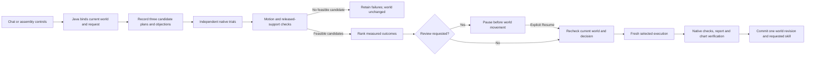
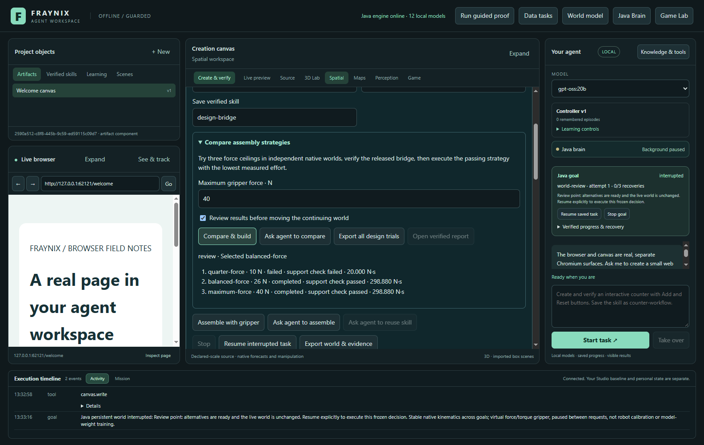
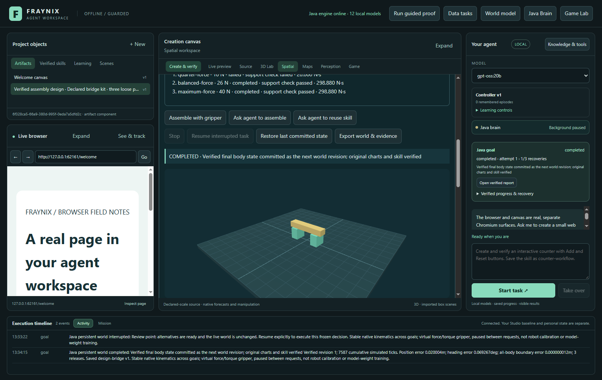
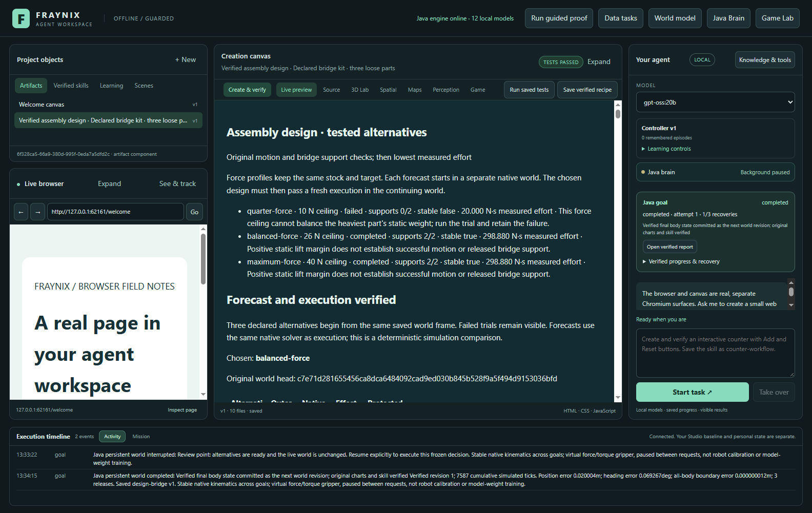
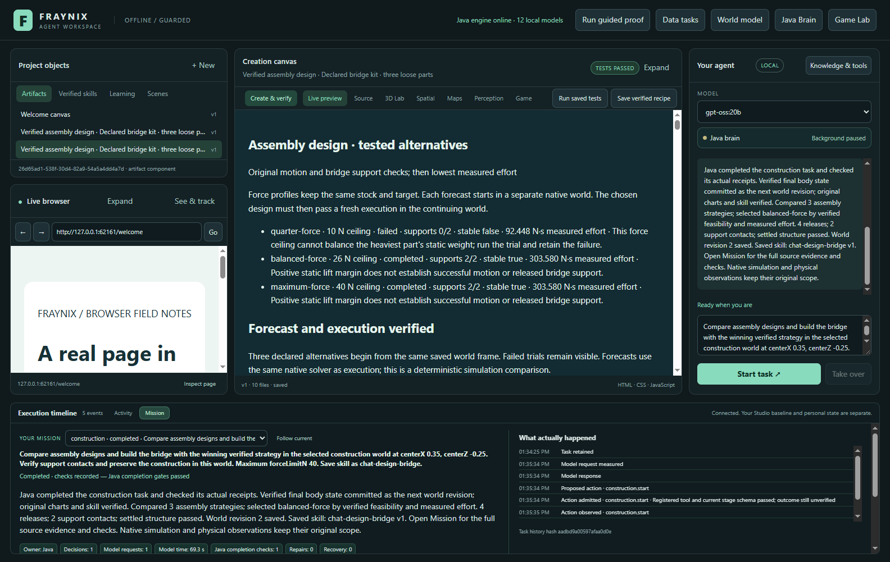
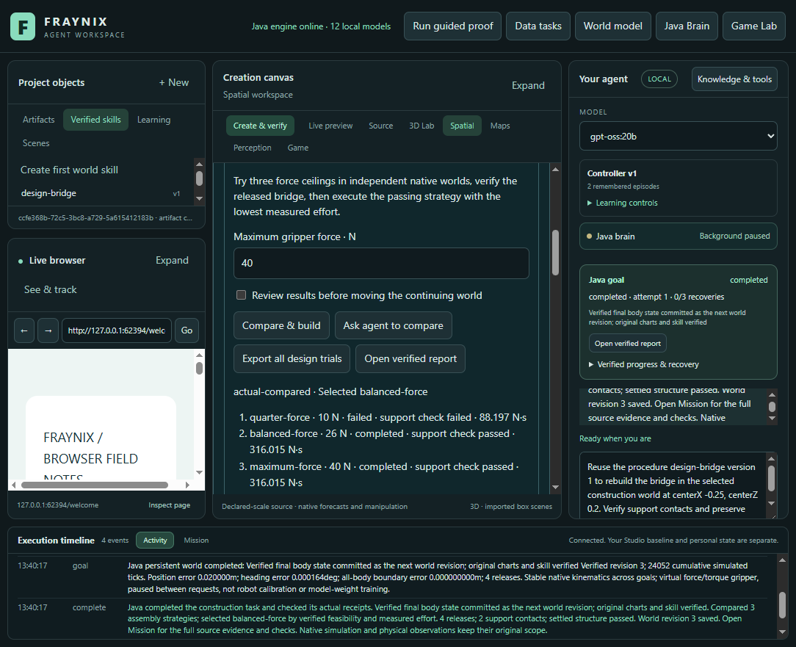

# Edition 053 · Assembly that compares before it acts

November 3, 2026 · Fraynix Agent Workspace

[Previous: faster checked chat (052)](README-052.md) · [Edition history](docs/readmes/INDEX.md) · [Offline guide](docs/readmes/053/index.html) · [Acceptance contract](docs/EDITION_053_CONTRACT.md)

The Java agent can now compare three assembly strategies in separate native worlds, retain the failures, select a feasible strategy from measured results, and execute it in the continuing world. The released bridge must pass its original support and motion checks before the world advances or the procedure is saved. Chat and the assembly controls use the same Java task owner.

This is a bounded design skill for the existing three-part bridge kit. It varies the gripper's force ceiling while preserving the requested bridge centre, stock, torque bound and source frame. It does not generate arbitrary new bridge geometry. The game's renderer, native physics, browser, creation canvas, persistent worlds and saved skills remain part of the same application.

The distinction between a tool and a skill is visible here. An action can start a construction. This skill records candidate assumptions, runs independent trials, checks feasibility, selects a candidate, verifies a fresh execution, preserves a world revision and retains a procedure that can repeat the entire process after restart.

## What the agent actually compares

For a maximum gripper force of 40 N, the frozen Java policy proposes 10 N, 26 N and 40 N ceilings: 25%, 65% and 100% of the admitted maximum. The existing minimum is 2 N. If clamping creates identical plans, they are explicitly labelled as duplicates and are not rerun. Every distinct candidate must remain within the admitted ceiling. The torque limit stays the same across candidates.

Before any trial, Java records each candidate's origin, force limit, admitted maximum, torque limit, largest static part weight, static lift margin and objection. A positive lift margin is only an initial calculation; it cannot establish that the controller reaches the poses, releases the objects correctly or leaves a supported bridge. The original candidate record remains intact after execution so an expectation cannot be rewritten to match the result.

Each candidate runs with the actual native solver in a separate branch of the saved source world. The comparison cannot reserve, mutate or advance the continuing world. Feasibility requires both the original native pose, wrench and release checks and the unchanged bridge support/stability checks. A completed motion with an unsupported beam cannot win.

Among feasible candidates, Java chooses the lowest measured force effort in N·s, then the fewest native ticks, then the declaration order. These are the criteria frozen in the acceptance contract. This is a choice among three declared alternatives, not a claim of a global optimum. The existing ordinary-world counterfactual procedure retains its original duration-first ranking.

## One continuing world, separate experiments



The existing counterfactual worker owns the isolated trials. The existing goal runner owns review, execution, source checks, interruption and recovery. The original native controller owns physical timing. The desktop displays progress and verifies the rendered report. There is no second scheduler or additional model framework.

The selected forecast is not copied into the live scene. Java starts a new actual execution from the still-current source frame. It compares the selected forecast and actual motion, verifies the original traces, checks the released structure, and requires the actual report and chart assertions before saving a world revision. Stable body identities and the previous committed state are preserved through the normal world mechanism.

The comparison uses the same native solver as execution. Agreement establishes consistency of this implementation and source binding. It does not calibrate a real robot, camera, material or physical bridge.

## Use it in the integrated app

Use JDK21 and the prepared desktop dependencies. Start an independent practice project. The original normal review045 installation and private camera/mat project remain preserved; do not rebuild its installed libraries while its Java owner is alive.

```powershell
$env:FRAYNIX_WORKSPACE_PROJECT = Join-Path ([Environment]::GetFolderPath('UserProfile')) '.fraynix-agent-workspace/projects/review-053-design'
.\Launch-Agent-Workspace.bat -Offline
```

1. Open **Spatial → Gripper assembly** and create a new bridge kit.
2. Choose the bridge centre and a name for the verified skill.
3. Open **Compare assembly strategies**. Set the maximum gripper force. The default is 40 N.
4. Enable **Review results before moving the continuing world** if you want to inspect the trials first.
5. Select **Compare & build**. The candidate list shows actual trial status, force ceiling, support outcome and measured effort.
6. At a review point, the original world remains unchanged. **Resume interrupted task** rechecks the frozen decision and source before executing the chosen strategy.
7. Use **Open verified report** to inspect the alternatives, measured effort and forecast/actual traces. **Export all design trials** retains the candidate definitions, decision and complete compressed original attempts.
8. Select the saved procedure from **Verified skills**, change the centre and use **Ask agent to reuse skill**. The retained design policy runs fresh trials from the current world before another execution.

The normal **Assemble with gripper** path remains useful when a direct build is intended. Comparison adds actual experimental work and therefore costs more than one direct native execution. It does not claim to reduce end-to-end latency for every task.

## Chat is involved in the work

**Ask agent to compare** submits a normal chat request containing the selected world, centre, force ceiling, review preference and requested skill name. For example:

> Compare assembly designs and build the bridge with the winning verified strategy at centerX 0.35, centerZ -0.25. Use maximum forceLimitN 40 and save skill as chat-design-bridge.

Java recognizes this as construction design. It preserves explicit numerical constraints, owns the comparison flag and review requirement, and supplies only the registered construction tool for that stage. Model output cannot silently replace the force ceiling or skip the original execution checks. Requests to compare only, or to review before executing, pause before live-world actuation. A request to create a website about bridges remains an artifact-creation task.

The model interprets the request; Java computes the declared alternatives and ranks the measured outcomes. This edition does not run a sixteen-call role pipeline for each assembly. It extends the useful part of the Logic Chain approach: preserve the objective, retain objections, distinguish a proposed action from admitted execution, and require an actual result before promoting a capability.

The edition052 timing and concise-result features remain in Mission. The design result identifies the comparison and selected candidate, then reports the actual world revision and saved skill. Full completion evidence remains expandable. Actual local-model validation, call counts and timings are recorded with source identity in this edition's evidence.

## What the saved skill remembers

The saved construction procedure includes the design policy, admitted force and torque bounds, original checked report, source goal, implementation identity and current procedure version. It retains the original maximum, not merely the force ceiling of the previous winner.

Reuse starts a new comparison from a fresh selected world revision. A different starting arrangement may require staging the beam before moving the supports. Fresh trials therefore observe the actual retained bodies and changed centre. A prior success cannot substitute for new motion, support and report evidence.

A retained design skill cannot silently disable its comparison. Changed implementation identity, stale world state, missing evidence or modified results refuse explicitly. Earlier counterfactual skills tied to an older counterfactual implementation also require a fresh reviewed version. The normal review045 runtime has been kept separately so its existing installation and private data are not silently migrated.

This is procedural retention and tested selection. It does not train Ollama weights or establish improvement on unfamiliar construction tasks.

## Measured results and source-qualified checks

| Initial candidate | Force ceiling | Native outcome | Ticks | Measured effort N·s | Support check |
| --- | --- | --- | --- | --- | --- |
| quarter-force | 10 N | failed | 481 | 19.999998 | fail |
| balanced-force | 26 N | completed | 7587 | 298.879693 | pass |
| maximum-force | 40 N | completed | 7587 | 298.879693 | pass |

The 26 N and 40 N trials had the same measured effort and native ticks in this initial case. The declared order selected26 N after that tie. This shows a lower ceiling can complete this case; it does **not** demonstrate an energy saving or improved trajectory. The10 N failure remains in the original evidence.

**80 distinct Java cases across 11 classes** pass across source-qualified targeted invocations, and **123 desktop unit tests** pass. This is not a full edition 053 suite run. The initial 55-case invocation had three failures in a new fixture that incorrectly initialized geometry before world creation. The original geometry guard refused it. The corrected seven native/policy cases pass, followed by 24 runner/graph/world cases and 14 final projection/chat cases. Existing physical verifiers were not weakened.

The first actual app invocation completed review, cold restart and native execution, then caught a missing design field in the public task projection. The panel could not show its retained alternatives. Java now includes that policy in the bounded view; a new regression covers it. The harness also reads the actual public comparison field and waits for the real candidate rows. A second invocation caught an incorrect test endpoint while reading retained procedures; the harness now uses the registered goals/procedures endpoint. A third completed assembly exposed a test-navigation timeout because verification had opened Live preview; the harness now returns to Spatial before inspecting its controls. Original failed records, images and traces remain archived. The repeated full app invocation passes.

The actual app test reviews all three independent trials without changing the source world, closes/restarts Java, resumes the frozen decision, checks the original native and support gates plus15 report assertions, and commits revision1. Actual local chat compares/builds at the changed centre and commits revision2. After another restart, exact saved design-bridge v1 reuse runs fresh trials against the current frame and commits revision3. Actual 6 N trials fail without reserving or moving the live world. Visible Stop cancels an active trial without changing that world. Complete exports are decompressed and force effort reconstructed independently from every integration tick.

Fresh local chat took **156.127s** with **1** model request(s); saved-skill reuse took **179.129s** with **1** request(s). These are observed CPU/four-thread task times including the additional native trials, not a controlled performance benchmark. No model weights were trained.

A final interface correction keeps **Export all design trials** available after cancellation. A separate cold-restart review on 696191d uses that visible button, independently checks the downloaded original compressed attempts and confirms no world mutation. It also reads all three saved report versions and confirms 15 passing assertions each. Its first test attempt read the revision from the history object instead of the observation; the original failure remains recorded. Java is unchanged from 7ccef97, and the final 123 desktop checks pass. The complete actual-model run and this later interface review are separately source-qualified.


## Actual application views

The final dated screenshots below come from the actual integrated application and its labelled synthetic practice world. They are not mockups or private webcam captures.











## Failure, interruption and evidence

If every candidate fails, the task retains the actual failures and interrupts without starting a live native run, committing a world revision or saving a successful skill. A low-force failure is visible evidence about that candidate and case. It is not removed from the report to make the selected procedure look uniformly successful.

Stop cancels owned work. A review restart retains the exact source and decision, and explicit continuation rechecks them. A changed source head requires a fresh comparison. Reports retain their original checked artifact version; a later edited report cannot be presented as the original success.

The complete export includes original attempts, their statuses, original compressed bytes and hashes, candidate definitions and the selected decision. The ordinary world export separately retains the actual committed executions. Validation independently decompresses these files and reconstructs measured force effort from every native integration tick.

The [verification record](docs/readmes/053/verification.json) distinguishes native regression checks, explicit boundary fixtures, actual Chromium observations and real local inference. [Original evidence](docs/readmes/053/original-evidence.json), [source inventory](docs/readmes/053/file-inventory.json) and [source tree](docs/readmes/053/FILE_TREE.md) make the implementation and its limits inspectable.

## Next development gates

1. **Broader design variables.** Introduce independently specified part layouts, support spacing or obstacles with new geometric and physical acceptance checks. Current stock and target geometry stay fixed during an edition 053 comparison.
2. **A frozen comparison against simpler control.** Compare complete tasks, failures, force effort, latency and resource use on newly declared cases. Retain a simpler policy when added trials do not improve outcomes enough to justify their cost.
3. **Diagnostic-retention evaluation.** Use a frozen set of repair tasks to compare the same model with and without retained earlier failures. Measure successful recovery and repeated mistakes before promoting a context policy.
4. **Independent load experiments.** Specify and test a separate load case after assembly. Released support contacts alone do not establish structural strength or real material behavior.
5. **Measured cooperation.** Give multiple effectors explicit ownership and shared-world conflict rules, then test joint tasks against a single-effector baseline.

The next level of this application comes from better complete tasks and stronger evidence. This edition provides a concrete cycle of proposals, separate experiments, selection, fresh execution and retained procedure within the same continuing world.

The [offline companion](docs/readmes/053/index.html) provides the system map, screenshots and searchable source inventory without external scripts or fonts. [Obsidian notes](docs/obsidian/61-assembly-design.md) and the [Canvas map](docs/obsidian/assembly-design.canvas) connect this edition to checked chat and gripper assembly. Published001–052 snapshots remain unchanged.
