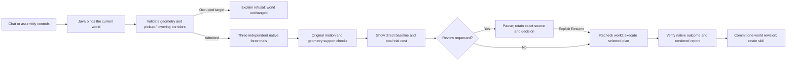
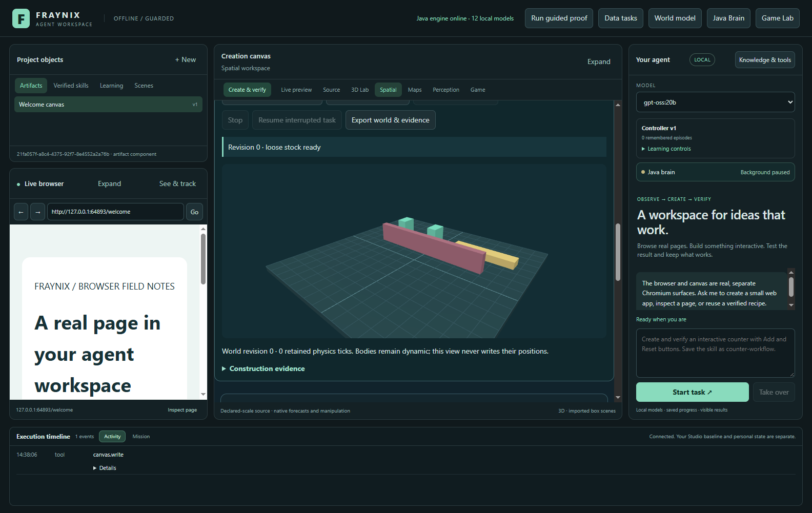
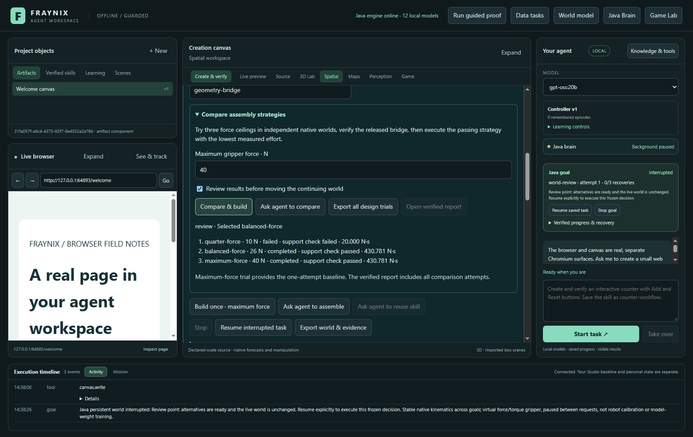
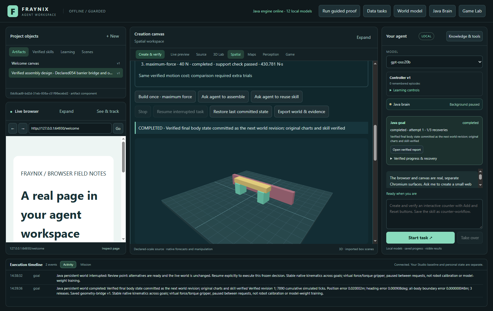
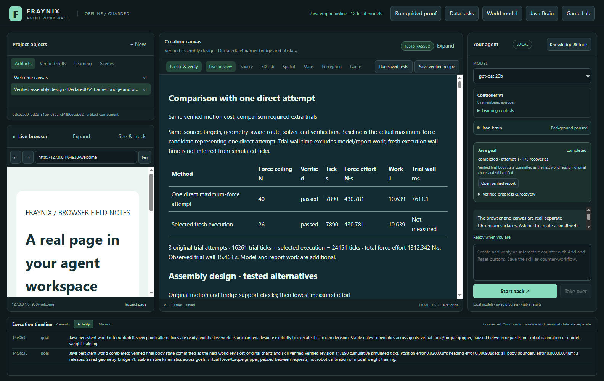
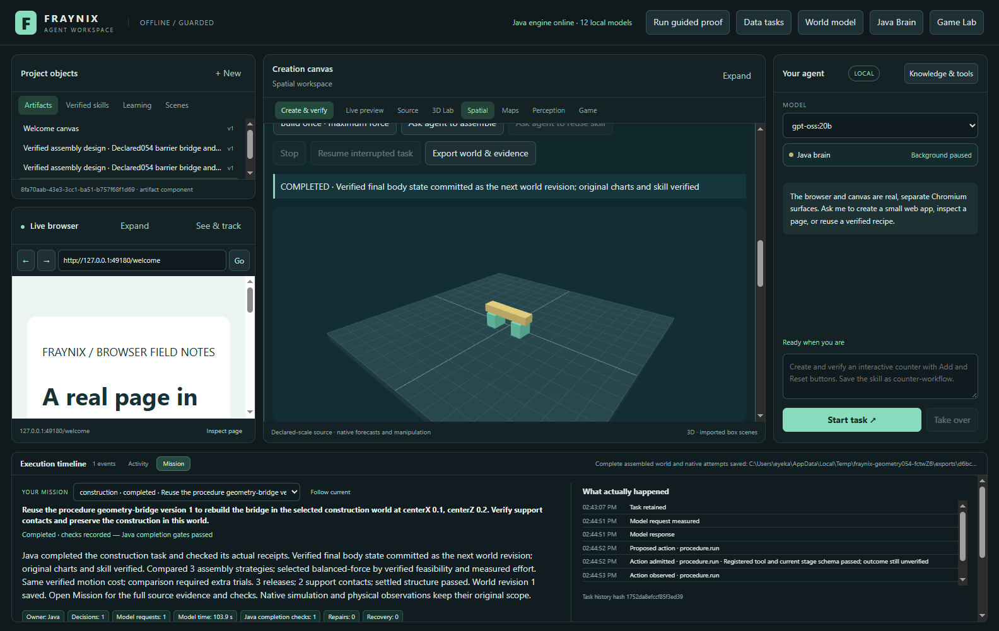
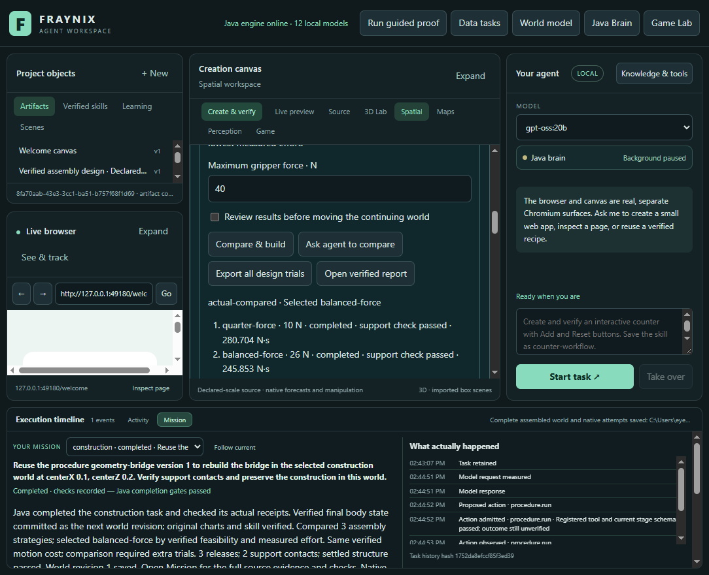
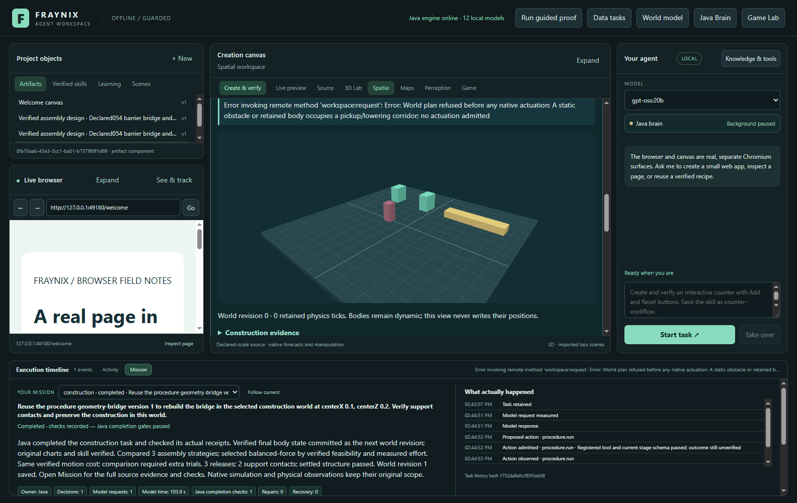

# Edition 054 · Different geometry, measured choices

November 3, 2026 · Fraynix Agent Workspace

[Previous: assembly design (053)](README-053.md) · [Edition history](docs/readmes/INDEX.md) · [Offline guide](docs/readmes/054/index.html) · [Frozen acceptance contract](docs/EDITION_054_CONTRACT.md)

The Java agent can assemble bridges with different declared dimensions, lift the parts over a fixed barrier, and refuse a target occupied by an obstacle. The same task can start from chat or the integrated assembly panel. It retains the verified construction in a continuing world and saves a procedure that runs fresh trials when reused with different stock.

This edition also makes the comparison honest and visible: one direct maximum-force attempt is shown alongside the selected execution, and the report charges all the work spent testing alternatives. In the frozen positive cases, the selected 26 N controller and the simpler 40 N controller produced the same measured motion cost. The comparison added computation; it did not establish an efficiency advantage. The demonstrated improvement is broader verified geometry, obstacle clearance and continuity.

## What changed in the working application

The original kit remains available. **Choose stock and obstacles** adds compact, wide, barrier and blocked-target presets supplied by Java. Beam length, support height, support spacing and obstacle height are bounded editable inputs. Geometry becomes immutable source data when the world is created. Replacing a selector does not secretly resize objects in an existing world.

The planner derives support and beam destinations from those dimensions. It checks pickup and lowering corridors against both fixed obstacles and retained dynamic parts. A conservative overhead route clears the highest current or planned object, the rotating part's bounding radius, and a 0.3 m margin. A route requiring more than 4 m overhead or leaving the fixed floor is refused. The stock must be settled, upright and match its declared dimensions and materials. This is a bounded box-assembly planner, not arbitrary mesh pathfinding.

Actual movement still comes from the existing native physics controller applying forces and torques. The renderer displays the resulting positions; it does not move objects by writing a successful final pose. After release, the beam must contact both supports, remain within the existing height tolerance relative to its declared support height, have enough settled samples and satisfy the existing speed limit. Any recorded contact between a part and a fixed obstacle rejects the new geometry construction. Original pose, wrench, release, source and forecast/actual checks remain in force.

The report now has a two-row comparison with the direct controller: feasibility, force ceiling, physics ticks, measured force effort in N·s, work in J and observed trial wall time. It also displays the total cost of **every original attempted trial plus the fresh selected execution**. Interrupted attempts count. If timing metadata is missing after interruption, the observed wall time is labelled incomplete; simulated time is never substituted for wall time. Model and report work are additional. N·s is a force-time measure, not energy.

## One request, one owned task

Java owns the source binding, trial lifecycle, selection, recovery, verification, commit and procedure version. The local LLM chooses the typed task and explains the result. The desktop hosts the controls, browser and canvas. The reusable skill repeats the verified procedure against the newly selected world; it does not reuse an old physical result as evidence that a new task succeeded.

The underlying application remains the same: chat, Java agent coordination, persistent memory and world history, physics experiments, observation workflows, embedded browser, creation canvas, procedural tools, neural experiments and saved procedures. This release extends that integrated system. It neither starts a second agent scheduler nor adds a new external dependency. Java owns the added geometry and accounting logic; the existing Bullet/Minie native solver, Electron desktop and Three.js presentation remain dependencies. “Ground up” here describes the application logic, not the replacement of those existing foundations.

## Try it step by step

1. Open a separate practice project. Keep an existing active review project in its original engine until it is closed through the app. This edition's checks use isolated synthetic projects.
2. In **Spatial → Gripper assembly**, expand **Choose stock and obstacles**. Select **barrier054**, inspect the dimensions and click **New bridge kit**. The coral barrier and loose dynamic stock appear in the same viewport.
3. Choose the bridge centre and a skill name. The declared barrier example uses centre X = 0, Z = 0. Leave the maximum force at 40 N for the published case.
4. Expand **Compare assembly strategies**. Choose **Review results before moving the continuing world**, then **Compare & build**. The three trials use independent branches; the continuing world stays unchanged.
5. Inspect the trial outcomes, including failures. Restarting the application at this point retains the exact decision and original frame. **Resume interrupted task** explicitly starts the selected fresh execution after rechecking the source.
6. Open the verified report. Compare the direct controller with the selected execution and inspect the total experiment cost. **Export all design trials** retains original compressed traces, hashes and the decision, including cancelled attempts.
7. To use chat, select a locally available model and choose **Ask agent to compare**. The generated request includes the requested centre, force ceiling, review preference and skill name. The original Java checks still decide completion.
8. Create a separate compact world, select the exact saved procedure in **Skills**, then choose **Ask agent to reuse skill**. The agent runs new trials against that compact source. The earlier barrier world remains preserved.
9. Create **blocked054** with centre X = 0, Z = 0. Its post occupies the first support destination. Comparison must refuse before native actuation. Inspect the reason rather than treating the refusal as a successful construction.
10. **Build once · maximum force** performs the simpler direct attempt under the same geometry and outcome checks. **Stop** cancels active work; recovery and exports remain visible. A cancelled trial does not earn a new world revision or skill.

The source controls accept beam lengths 1.4–2.6 m, support heights 0.35–0.9 m, spacing 0.8–2 m and obstacle heights 0.2–1.2 m, with additional spacing and clearance constraints. These admitted input bounds are not a claim that every combination has been physically tested. The fixed acceptance cases below establish the tested scope; arbitrary dimensions still have to pass admission and actual native verification.

## Measured results and verification

| Frozen case | Direct ticks / effort N·s | Selected ticks / effort N·s | All trials + execution ticks / effort N·s | Outcome |
| --- | --- | --- | --- | --- |
| legacy053 | 7587 / 298.880 | 7587 / 298.880 | 23242 / 916.639 | Verified |
| compact054 | 6646 / 239.672 | 6646 / 239.672 | 27472 / 993.540 | Verified |
| wide054 | 7890 / 430.781 | 7890 / 430.781 | 24151 / 1312.342 | Verified |
| barrier054 | 7890 / 430.781 | 7890 / 430.781 | 24151 / 1312.342 | Verified |
| blocked054 | No attempt | No attempt | 0 | Admission refused |

The independent maximum-force attempt and the comparison's maximum-force candidate have exactly matching original metrics in each positive case. The selected26N execution also ties40N on effort/ticks. Compact stock completes even at10N, but that lower ceiling takes more ticks/effort; the10N attempts fail for the original, wide and barrier cases. Those failures remain in the evidence. Wide and barrier have matching motion costs because the conservative route already clears the barrier; the obstacle case additionally verifies zero recorded part/obstacle contacts. The blocked case has zero native attempts.

**98 distinct Java cases across 16 classes** pass across the recorded targeted invocations. The frozen five-case matrix ran on `9842381`, before the explicit compatibility handoff change. Final goal/chat/world regression and real app checks cover the updated source. **123 desktop unit tests** pass. These are source-qualified runs, not a claim of one full Java suite invocation.

The actual Electron/Java/local gpt-oss:20b workflow verifies review before movement, exact cold restart, barrier construction, changed-centre chat, retained-skill reuse in a new compact world, unchanged earlier world, blocked-target refusal, active native-trial Stop, original exports and 1100-pixel layout. Each completed report passes 17 actual assertions. Fresh chat took **187.517s** and cross-geometry saved-skill reuse **190.545s**, with **1 / 1** model requests respectively, CPU/four threads. These are observed end-to-end times, not a randomized speed benchmark.

Two compatibility cases verify the exact published 053 synthetic ledger, unchanged prior frames/history, explicit upgrade, stale refusal, unknown-code refusal and pending-owner refusal. The interrupted-cost test reconstructs all original attempt metrics after restart and explicitly checks that missing timing remains unknown. Original source-qualified development failures are listed in the validation record and archived rather than removed.

## Actual application views

All captures below are from the working edition 054 application on November 3, 2026. They show labelled synthetic practice worlds and actual local execution. They are not generated mockups or camera measurements.

The world starts with three dynamic parts and a fixed obstacle. Geometry and current source remain inspectable in the existing panel.

Review keeps the original continuing world unchanged while the actual candidate results and failures are retained.

The resulting bridge must pass actual release, two-support contact, motion, stability and obstacle-contact checks.

The report connects the selected execution with its original alternative traces and simpler baseline, including the cost of experimentation.

Chat and direct controls share the same Java task and verification path. A textual claim alone cannot commit the world.

The integrated workspace remains usable at the tested 1100-pixel width.

The visible blocked-target example establishes a refusal boundary, not a completed assembly.

## Saved-world compatibility and recovery

The added geometry implementation changes the engine identity bound to native checkpoints and continuing worlds. A known, closed edition 053 world can be read without migration, then explicitly passed through **Upgrade compatible saved world**. The upgrade appends a labelled compatibility revision with the exact previous frame, ticks, bodies and history. It performs no simulated motion. An active pending owner must finish or recover in its original engine first; unknown engine identities and stale revision bindings refuse.

The compatibility test copies the exact published synthetic 053 ledger into a new temporary project. It does not manufacture an old engine identity or open the user's private review. Saved procedure and checkpoint source bindings remain enforced; this handoff does not silently rewrite their evidence. Preserve the original project and installation before choosing a closed-copy upgrade. The normal review 045 installation and private camera/mat data were not changed for this release.

The first live chat invocation exposed a Windows sharing denial during an atomic task checkpoint replacement. The original checkpoint and forced pending bytes remained available. The checkpoint writer now retries only access-denied replacement, with five bounded waits totalling at most 775 ms. It never falls back to a partial non-atomic write. Real Windows file-handle tests check a temporary lock, a prolonged lock and interruption during retry. A failed initial interruption test set the flag before writing the pending bytes; the corrected test interrupts the actual retry. Both records are retained. The complete app workflow was then rerun on the corrected build. Admission refusal messages also remain visible across status refreshes until the next assembly action.

A subsequent UI invocation completed its chat rebuild, then timed out while creating the compact world. Assembly refreshes had left controls visibly enabled during an in-flight action, allowing the next click to be ignored. Buttons and world selection now reflect that busy state immediately. Screenshot inspection also caught and corrected a Windows text-encoding error in the controls. Original failed records and the pre-correction capture remain archived. The final workflow and cold UI review use the corrected controls; earlier world histories are not rewritten to disguise those development attempts.

## Why this is a useful next step

The agent has a more useful relationship with its environment when dimensions, obstructions, predictions, actions and observed outcomes refer to the same persistent objects. It can now reuse an assembly task across declared geometry instead of depending on one fixed demonstration. It can explain why a route is inadmissible and distinguish an experiment from a committed world change.

The measured baseline is equally important. More reasoning does not automatically produce a better controller. Here the direct controller already handles the admitted cases well. The extra trials establish feasibility under alternative force limits and provide retained evidence, but the published numbers do not justify calling them a speed or energy improvement. That information gives the next policy a concrete question: when can it safely choose a direct attempt, and when do independent trials materially improve the outcome?

Retained procedures are useful memory. Reusing one across a changed scene establishes tested transfer within this declared family. It is not LLM-weight training, unrestricted self-improvement, consciousness or a general robotics result. No real gripper, load-bearing safety rating, material-strength model, automatic arbitrary-mesh assembly or physical calibration is claimed by these synthetic checks.

## Next phases and acceptance gates

1. **Measure when comparison is worth its cost.** Freeze new task distributions and a direct-first policy before implementation. Compare success rate, recovery, all attempted work and wall time against always-comparing and always-direct controls. Keep failed starts and held-out cases separate from tuning. Promote a policy only if the declared tradeoff improves.
2. **Broaden route choice.** Add lateral detours, varied pickup orientations and multiple obstacles with a frozen collision matrix. Preserve the same native trajectory/contact witnesses and explicit refusal where no admitted route exists. The current overhead route is deliberately narrow.
3. **Run separate load experiments.** After assembly, introduce declared loads or disturbances and measure support loss, deformation assumptions and recovery. A stable unloaded bridge is not proof of structural strength.
4. **Evaluate retained diagnostics.** Test whether source-qualified failure memory helps the agent choose or repair a future task, with a no-memory control and unseen geometry. Retention alone is not evidence of learning benefit.
5. **Return to measured observations.** Use calibrated visual/sensor evidence to estimate geometry and uncertainty, keeping inferred dimensions distinct from declared source truth. Do not promote a visual guess to a verified collision shape without a check.

These are proposed gates, not implemented features or delivery promises. The current release supplies the working geometry, continuity and measurement foundation needed to evaluate them.

## Source, evidence and reproducibility

- [Frozen contract and compatibility addendum](docs/EDITION_054_CONTRACT.md)
- [Source-qualified validation and timings](docs/readmes/054/verification.json)
- [Complete original evidence manifest](docs/readmes/054/original-evidence.json)
- [Source inventory and canonical hashes](docs/readmes/054/file-inventory.json)
- [Full source tree](docs/readmes/054/FILE_TREE.md)
- [Offline interactive guide](docs/readmes/054/index.html)
- [Obsidian note](docs/obsidian/62-geometry-comparison.md) and [canvas](docs/obsidian/geometry-comparison.canvas)
- [Java geometry and obstacle logic](workspace-engine/src/main/java/fraymus/workspace/Construction054.java)
- [Measured baseline comparison](workspace-engine/src/main/java/fraymus/workspace/Baseline054.java)
- [Frozen native acceptance matrix](workspace-engine/src/test/java/fraymus/workspace/Construction054Test.java)
- [Actual desktop and local-model workflow](workspace-desktop/test/construction054-integration.cjs)

Build with the existing JDK 21 Gradle wrapper and installed project dependencies. The actual validation commands, source revisions, logs, original XML, compressed native records and failed development attempts are archived with this edition. Native/model checks run serially. No model weights, private chat projects, webcam recordings, credentials or external website deployment are included in this release. Earlier numbered READMEs and their snapshot assets remain immutable.
