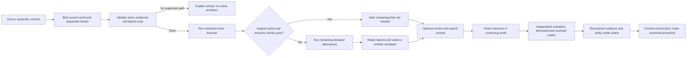
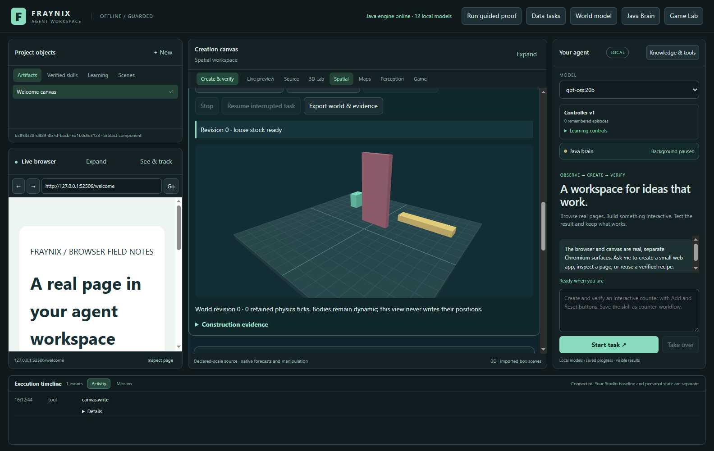
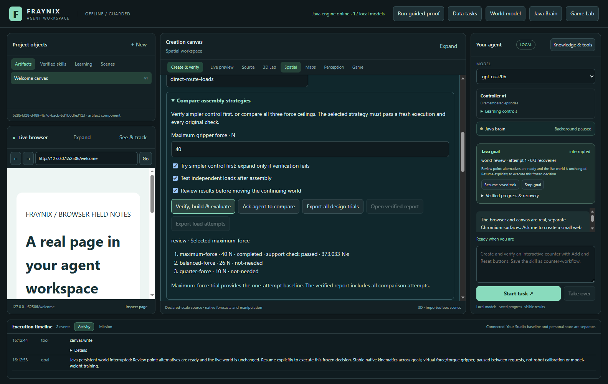
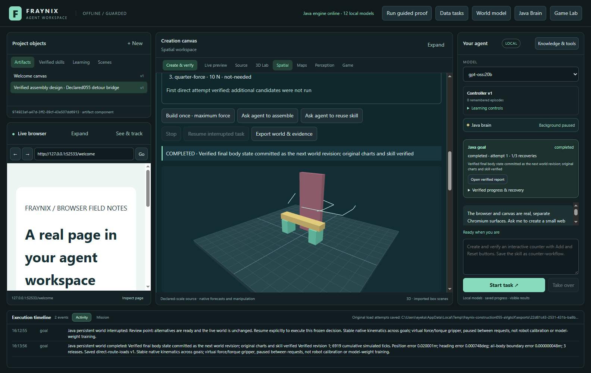
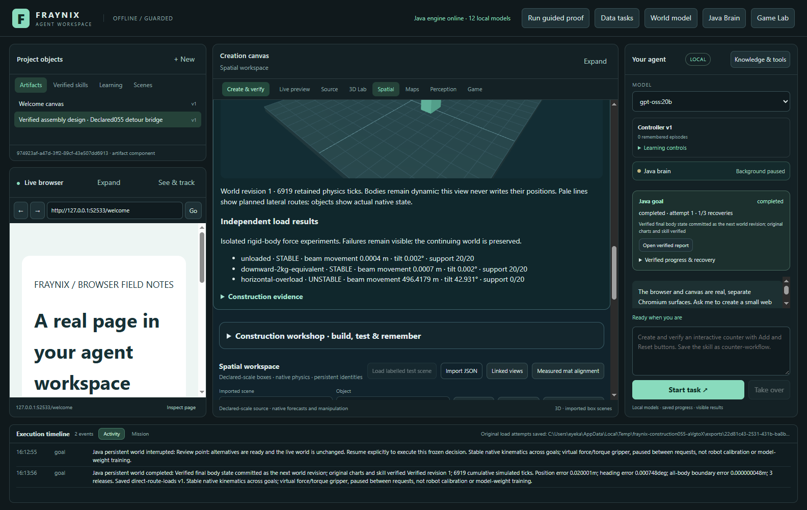
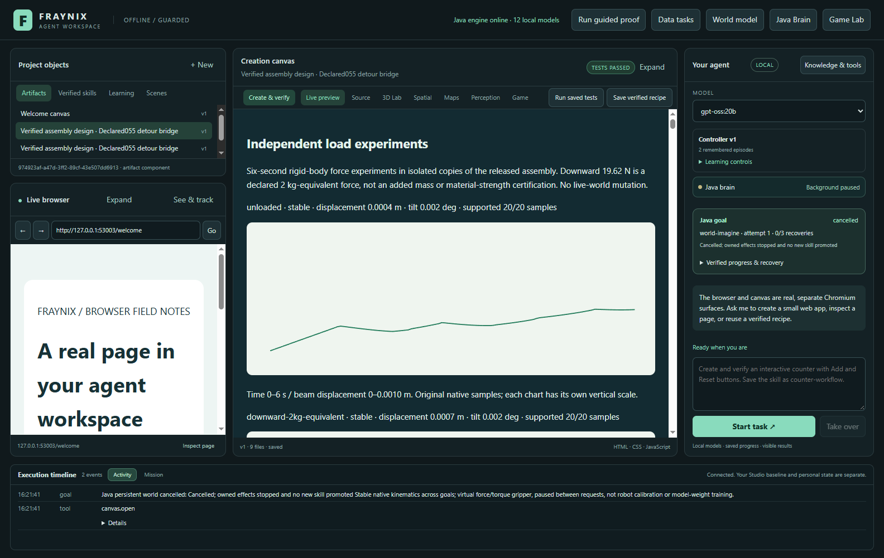
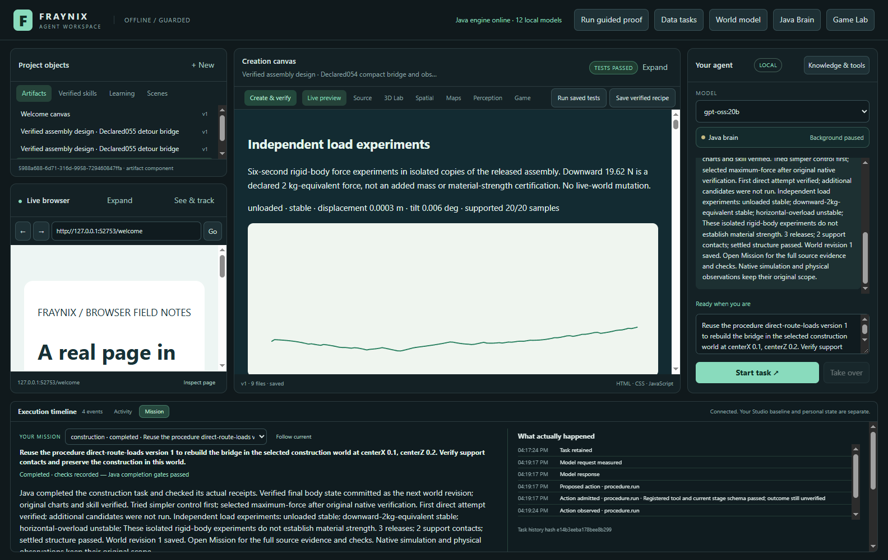
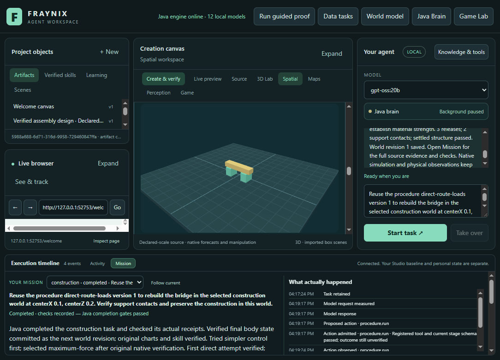
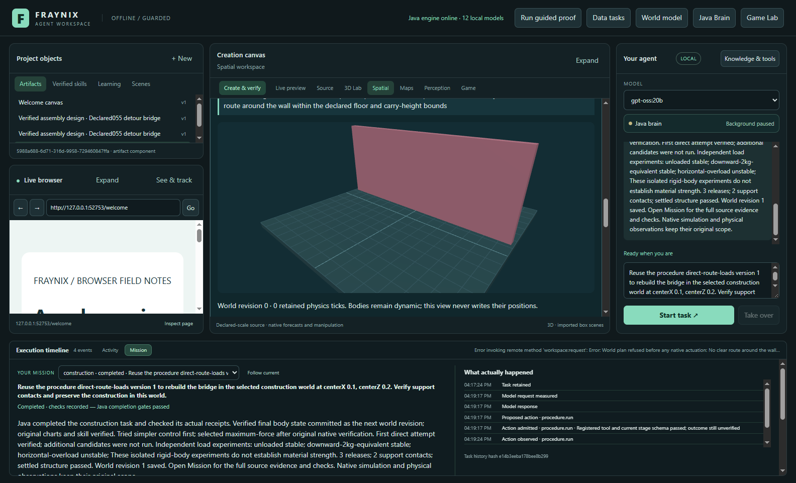

# Edition 055 — Try the simple route, measure the consequences

Fraynix Agent Workspace · November 3, 2026

[Previous edition: geometry and measured choices](README-054.md) · [Offline illustrated guide](docs/readmes/055/index.html) · [All editions](docs/readmes/INDEX.md) · [Operating the app](docs/JAVA_CHAT_044.md)

Edition 054 established a useful result: comparing three force profiles did not improve motion cost in the declared successful cases. Edition 055 acts on that evidence. The Java agent can try the simpler controller first, expand only when its actual verification fails, carry objects around a tall obstacle, and evaluate the released construction under independent loads. The same app shows the decisions, native motion, measurements, saved procedures and original evidence.

This is a working extension of the existing agent and world, with explicit limits. It is not a general robot planner, an engineering strength certificate, a new trained language model, or a demonstration of consciousness. The new routing and procedure logic are owned Java code. The application still uses its existing native Bullet/Minie physics, Electron/Chromium desktop and Three.js presentation. No new external library or cloud service was added for this edition.

## What changed

**Simpler control first.** The existing counterfactual worker now supports an explicit direct-first policy. It starts the maximum-force candidate and checks the original native pose, force/torque, release, support and stability evidence. When that candidate passes, the remaining two candidates are labelled **not-needed**. They have no native run, metrics or invented success. If the direct candidate fails, the worker evaluates the remaining declared force profiles, retains all failures and applies the existing feasibility/ranking checks. Exhaustive comparison remains available.

The forecast is still separate from execution. A passing trial does not move the continuing world. After optional review, the selected plan must run afresh, pass its native and rendered-report checks, and commit one world revision. The report charges both the forecast and actual execution. Direct-first therefore reduces unnecessary comparison work; it does not remove verification or make the entire task free.

**Lateral obstacle routes.** Two new declared scenes use wide bridge stock. The detour scene has a 1.4 m wide, 3.2 m tall wall between the loose parts and assembly target. The sealed scene extends that wall across 7.8 m of the 8 m floor. Carry height is limited to 2 m, so the new controller cannot solve either case by silently lifting over the wall. Java constructs a finite visibility graph around expanded obstacle rectangles and chooses a shortest clear path inside the supported floor bounds.

The plan contains explicit intermediate positions. The existing native force/torque gripper follows those positions, settles at each stage, lowers the part and releases it. The renderer displays actual body states. Pale route lines show the plan, not evidence that a body followed it. Actual recorded obstacle contacts still reject the structure. Occupied pickup/lowering corridors and the sealed passage refuse before native actuation.

**Independent load experiments.** After a released assembly passes its original checks, the Java goal runner evaluates three isolated native copies: unloaded control, a downward 19.62 N force at the beam centre, and an 80 N horizontal overload at the beam centre. Each experiment lasts six simulated seconds at 240 Hz, with force applied during seconds 1–3. The downward force is a declared 2 kg-equivalent load; it does not add a new body's mass or inertia.

The experiments preserve the continuing world. They record all-body native motion, force, work and solver contacts, and reconstruct their metrics before the report is accepted. A stable result requires support from both uprights throughout the sampled final second, beam displacement within 0.05 m, tilt within 5 degrees and settled speed within 0.08 m/s. These thresholds were fixed before implementation. An unstable overload result remains an unstable result; completion means the experiment was performed and checked, not that every load was supported.

## One integrated request



The local LLM selects a typed task and explains the result. Java owns policy, source identity, execution, recovery and completion. Native physics supplies the motion and contact observations. The desktop hosts the integrated controls, browser, canvas and reports. The same goal path serves direct controls, chat and exact saved-skill reuse; none of those entry points can replace native evidence with a textual success claim.

The model's tool catalog now describes direct-first control, supported obstacle routes and independent load evaluation. A request containing “try simpler control first” and “test loads” preserves those requirements in Java. A saved procedure retains its direct-first and load options, and cannot silently drop a required check when reused. Reuse generates new evidence against the newly selected world rather than presenting an old experiment as a new result.

## Try it step by step

For a separate Windows review project, run this once from the repository root:

```powershell
$env:FRAYNIX_WORKSPACE_PROJECT = Join-Path $env:LOCALAPPDATA ('Fraynix\practice-055-' + [guid]::NewGuid().ToString('N'))
.\scripts\Start-Agent-Workspace.ps1 -Offline
```

Keep that exact project path for restarts. In the same PowerShell window, rerun only the launcher line to reopen it; creating another random path starts another empty project. The offline option keeps browsing guarded while local model and native tools remain available. Dependencies must already be installed for a fully offline launch.

1. Start a separate practice project with the [normal workspace launcher](scripts/Start-Agent-Workspace.ps1). JDK 21 and the existing desktop dependencies are required; Docker and WSL are not needed. Use an installed local model for chat. Keep an active older review project in its original runtime until it is closed through the app.
2. Open **Spatial → Gripper assembly → Choose stock and obstacles**. Choose **detour055**, then **New bridge kit**. Inspect the tall fixed wall, loose supports and beam. The declared wall height is fixed; supported stock dimensions remain visible.
3. Set the bridge centre to X = 0, Z = 0, maximum force to 40 N, and enter a skill name. Expand **Compare assembly strategies**. Leave **Try simpler control first** and **Test independent loads after assembly** checked.
4. Select **Review results before moving the continuing world**, then **Verify, build & evaluate**. One actual maximum-force forecast should pass. The other candidates should say **not-needed**, with no fabricated trial metrics.
5. Inspect the review state. The original continuing world remains unchanged. Closing and reopening the app retains the exact decision and source. Choose **Resume interrupted task** when ready to execute that decision.
6. Watch the actual gripper movement around the wall. Planned paths appear as pale lines. After release, the assembly must earn its support, pose, force and stability checks. Independent load evaluation then runs on separate copies.
7. Open **Independent load results** and **Open verified report**. Inspect both stable and unstable outcomes, the simpler-control comparison, every original trial's cost and the load charts. Each load chart declares its own vertical scale; a small control drift and a large overload displacement must not be mistaken for equal motion.
8. Choose **Export all design trials**, **Export load attempts**, or **Export world & evidence**. The load export contains the original per-tick records and completed/interrupted attempts, not just a summary or screenshot. Report downloads also include the lossless load file.
9. To test chat, use **Ask agent to compare** with the direct-first/load options selected. The generated request carries those requirements. The final response should explain that overload instability is a measured result, rather than describing the bridge as universally load-bearing.
10. Restart, create a compact world and select the exact saved procedure. **Ask agent to reuse skill** runs new control and load experiments for that geometry. The earlier world remains preserved.
11. Create **sealed055**, keep the centre at (0,0), and request construction. The app must explain the missing route before any goal changes the world. To test insufficient force separately, use 6 N on wide stock: actual failed attempts should remain visible and no construction should be promoted.
12. **Stop** cancels active work. Partial native load traces are retained. Interrupted load evaluation resumes explicitly with a new attempt for an unfinished case; completed original cases are checked and retained. Restoring the last committed world remains an explicit action.

## Measured results

| Case | Direct-first total ticks | Exhaustive total ticks | Direct-first / exhaustive effort (N·s) |
| --- | ---: | ---: | ---: |
| compact | 13,292 | 27,472 | 479.344 / 993.540 |
| wide | 15,780 | 24,151 | 861.561 / 1312.342 |
| barrier | 15,780 | 24,151 | 861.561 / 1312.342 |

One forecast plus fresh execution versus three forecasts plus fresh execution. Both retain the same original physical checks. Additional load evaluation costs 4,320 ticks per completed task.

| Wide assembly load case | Maximum beam displacement | Stable |
| --- | ---: | --- |
| unloaded | 0.000304 m | True |
| downward-2kg-equivalent | 0.000321 m | True |
| horizontal-overload | 496.477094 m | False |

**60 distinct targeted Java checks across 14 classes**, **123 desktop checks**, and the actual Electron/Java/local-model workflow pass within the recorded invocation scope. The route test includes a cold restart while carrying a part around the wall; load recovery retains interrupted attempts and reconstructs original metrics. A sealed wall refuses before actuation. At6N, all three actual force candidates fail, and no failed construction is promoted.

Actual local gpt-oss:20b chat took **172.446s**; cross-geometry saved-skill reuse took **183.852s**, with one model request each, CPU/four threads. These observed full-task times include native forecasts, fresh execution, loads and verification. They are not randomized speed benchmarks. Actual app checks cover review/restart, detour, changed-centre chat, saved-skill reuse after restart, prior-world preservation, rendered-report verification, sealed refusal, Stop and independent reconstruction of original exports.


The direct-first comparison uses identical starting frames, targets, admitted force ceilings, native controller and outcome checks. The exhaustive run still performs its three declared candidates. These are fixed development/acceptance cases, not withheld generalization data. Native ticks and integrated force effort establish simulated computation/motion cost in those cases. End-to-end wall time includes other work and must be reported separately; lower tick counts are not automatically a language-model speedup or energy saving.

Load costs are additional to assembly. Each completed three-case evaluation contains 4,320 native ticks, plus any retained interrupted attempts. The original overloaded beam can leave the finite floor and continue moving/falling in the declared simulation. That is a failed support/load condition, not a realistic material-fracture model. No fracture, yielding, joints, stress field, fatigue curve or calibrated hardware is implemented by these experiments.

## Actual app views

These are dated captures from the edition 055 application on November 3, 2026, using clearly labelled synthetic practice worlds. They are not generated mockups or new camera measurements. The report was recaptured after waiting for its Live preview tab to become visible; the original early capture and the successful reopening check are retained with the evidence.











The saved verified report is reopened after the Stop test. Its report badge says tests passed; the separate Java goal panel shows the most recent cancelled task.







## Evidence, continuity and failure handling

The [acceptance contract](docs/EDITION_055_CONTRACT.md) and [numeric protocol](workspace-engine/src/main/resources/construction055-protocol.json) precede implementation. [Validation](docs/readmes/055/verification.json) records exact source revisions, test invocations, timings and qualifications. [Original evidence](docs/readmes/055/original-evidence.json) inventories compressed original records with byte counts and SHA-256 hashes for both compressed and decompressed content. Development failures remain available alongside corrected runs.

The first integrated app run also exposed a readiness race: selecting a saved procedure could enable Reuse while the newly created world was still loading, so an early click was ignored. The selection handler now uses the same readiness controls as the rest of the panel; the acceptance workflow waits for actual world readiness and is rerun in full. The original attempt remains retained. A separate test-harness navigation error—attempting to click the Spatial export button while the verified report was open—was corrected by navigating back to its visible panel; it did not change application or physical acceptance code.

The first native test found a real recording defect: metrics computed from in-memory numbers did not exactly match metrics reconstructed after JSON persistence. The correction computes verification from the exact canonical JSON representation that is saved. It does not loosen the physical acceptance thresholds. Subsequent checks cover save/reload consistency, interrupted attempts and rejection of changed force records, missing integration ticks or changed source state.

A later cold restart hit a canvas observation timeout while reopening a saved report. The visible diagnostic block is now concise; complete comparison JSON and lossless load records remain downloadable and subject to the same verification. Startup also isolates a failed artifact instead of closing the workspace. A separate real test reloads a deliberately nonterminating artifact, observes the bounded renderer stop, verifies that its original file/version remain preserved, and opens a working canvas in the same app. Normal saved reports must independently reopen without using this recovery path. A first display simplification also removed data used by the verifier; the original receipt checks refused that attempt, and its saved time budget stopped it without a world commit or skill. The corrected report keeps the complete structured data in a non-rendered JSON field, while the visible summary stays concise. Hidden canvases retain a usable layout width during startup. No verification check was removed.

Load recording uses forced atomic files with periodic snapshots every simulated second. Histories are bounded to 12 attempts and 32 MB per construction run. Reaching a budget refuses further work while preserving existing records. Those are engineering bounds on this implementation, not unlimited background agency. A process restart does not turn an unfinished case into success or erase its attempted work.

Existing closed edition 054 worlds have an explicit compatibility handoff. The exact published synthetic fixture checks that prior frames and revision history remain unchanged, with a new upgrade record explaining the change of engine identity. A pending owner must finish in its original engine; unknown identities or stale bindings refuse. The normal older review installation and its private camera/mat/project data remain preserved while this edition is developed and tested in isolated projects.

The new plan changes how the existing gripper constructs its intermediate stages. It does not replace the original world pose/force verifier or the native solver. The load evaluator is a separate Java-owned experiment using the same declared body parameters and native physics. Its force records and support criteria are explicit. Each procedure's source and code bindings remain part of its evidence.

## Implementation map

| Responsibility | Source |
| --- | --- |
| Direct-first admission and selection | [Simple055.java](workspace-engine/src/main/java/fraymus/workspace/Simple055.java) and [Counterfactual045.java](workspace-engine/src/main/java/fraymus/workspace/Counterfactual045.java) |
| Declared wall scenes and finite visibility graph | [Construction055.java](workspace-engine/src/main/java/fraymus/workspace/Construction055.java) |
| Actual native intermediate-stage control | [WorldPhysics.java](workspace-engine/src/main/java/fraymus/workspace/WorldPhysics.java) |
| Independent loads, recording and reconstruction | [Load055.java](workspace-engine/src/main/java/fraymus/workspace/Load055.java) |
| Durable task, recovery and skill requirements | [GoalRunner.java](workspace-engine/src/main/java/fraymus/workspace/GoalRunner.java) |
| Original report and visible load-chart checks | [CounterfactualReport045.java](workspace-engine/src/main/java/fraymus/workspace/CounterfactualReport045.java) |
| Integrated controls, routes and load results | [construction051.js](workspace-desktop/renderer/construction051.js) |
| Actual app/chat/restart acceptance | [construction055-integration.cjs](workspace-desktop/test/construction055-integration.cjs) |

The [source inventory](docs/readmes/055/file-inventory.json) and [file tree](docs/readmes/055/FILE_TREE.md) cover the retained application, not only these new classes. The [Obsidian note](docs/obsidian/63-simple-routes-loads.md) and [canvas](docs/obsidian/simple-routes-loads.canvas) connect this edition to the wider project. Earlier numbered READMEs and their snapshots remain historical records.

## Next steps and their acceptance gates

1. **Route choice under changed conditions.** Compare lateral and overhead routes on new frozen obstacle layouts. Measure path length, time, force effort, clearance and actual contacts. Refuse unsupported geometry; retain cases where the supposedly simpler path costs more or fails.
2. **Load envelopes rather than a single pass/fail.** Sweep declared downward and lateral forces on independent copies, with explicit application point and duration. Find stable/unstable boundaries and repeat near a boundary. Add realistic finite floors and load application geometry appropriate to the question. Keep rigid-body stability distinct from material strength.
3. **Task-level recovery.** Let an evaluated failure propose a bounded revision—different support spacing, orientation or geometry—then rerun from a verified source. Promote a new procedure only when the new outcome passes and its total experiment cost is visible.
4. **Useful experience retention.** Freeze unfamiliar tasks and compare reuse enabled versus disabled. Retained records and changed choices are necessary ingredients; measured improvement on those new tasks would establish the benefit. This edition does not train LLM weights.
5. **Measured observations and hardware.** Return to the existing source-qualified camera/mat work with independent measurements, calibration and uncertainty. Only after that should a virtual force experiment inform physical actions. The present load values are declared simulation inputs, not instructions sent to an Arduino, gripper or sensor.

The broader direction remains one local application where observation, action, creation, memory and evaluation share a continuing world. Edition 055 strengthens that direction by reducing a measured source of wasted trial work, adding a route that must genuinely go around an obstacle, and exposing failures under load. Its value is in the checked workflow and retained evidence; broader capability still has to earn its own tests.
