# Fraynix Agent Workspace · Edition 056

**Measured load limits and verified redesign after failure.** Java now asks a construction to earn its requested load before it can become a committed world state or a reusable procedure. A wider layout is a candidate, not a success, until independent native experiments and a fresh execution agree.

[Previous: Edition 055](README-055.md) · [Offline guide](docs/readmes/056/index.html) · [Edition history](docs/readmes/INDEX.md) · [Acceptance contract and contrary result](docs/EDITION_056_CONTRACT.md) · [Tests and timings](docs/readmes/056/verification.json) · [Original evidence](docs/readmes/056/original-evidence.json) · [Source tree](docs/readmes/056/FILE_TREE.md)

## What changed

Edition 055 introduced simpler-first control, native routes around obstacles and independent load experiments. This edition connects a measured requirement to the design decision. The agent can assemble the original layout, test a declared force range, retain the failure, try wider supports using the same stock, and select a layout only when it passes. It then builds that layout freshly in the continuing world and repeats the tests before saving anything as successful.

The same integrated app contains chat, the Java goal, the 3D world, the results and the saved procedure. The local language model chooses the typed task and explains the outcome. Java owns the force requirement, candidate admission, state, progress, receipts and verification. Native physics advances the bodies. A chart is checked against the original measurements; the model cannot make a failed result pass by describing it differently.

This is a focused improvement in task completion and evidence handling. It is not a claim of general intelligence, subjective awareness, material-strength analysis, physical certification or language-model weight training. The application still uses its existing native physics and presentation dependencies. The new load and redesign logic is handwritten Java; this edition adds no new library or cloud service.

## Start with the actual example

Use a separate practice project so existing worlds and private observations stay intact. Build the Java workspace engine using JDK 21, then start the desktop from this checkout. On a fresh clone, run `npm ci` in `workspace-desktop` first to install the pinned desktop dependencies. [Operation and chat guide](docs/JAVA_CHAT_044.md) describes the existing configuration. Local Ollama is required for the demonstrated model-driven chat; direct controls execute through the same Java goal without a model call.

```powershell
.\gradlew.bat :workspace-engine:installDist
cd workspace-desktop
npm start
```

1. Open **Spatial → Gripper assembly** and click **16 N redesign example**. It creates a labelled synthetic wide-stock world with 0.8 m initial support spacing. It explicitly selects the 16 N requirement; ordinary load tasks still default to 24 N.
2. Open **Compare assembly strategies**. Keep simpler-first control, independent loads and measured limits enabled. Keep **Allow up to two wider support layouts after failure** checked. Give the saved procedure a name.
3. Enable **Review results before moving the continuing world**, then click **Verify, build & evaluate**. The original and admitted alternative assemblies run in separate native copies. The continuing world stays unchanged during these trials.
4. Inspect the original failure and the wider candidate's measured result. A candidate never executed is labelled **not-needed** and has no invented metrics. Restarting at this review preserves the decision and source; resume explicitly.
5. Watch the fresh gripper assembly, release and settling. The selected result must satisfy the original motion/support checks, the forecast-versus-actual comparison and a fresh load envelope. The completed report and world revision appear only after those checks pass.
6. Open **Measured load limits** and **Open verified report**. Check both the stable prefix and first tested failure, the repeat agreement, the application point and the limits on the claim. Use **Export limits & redesign** for the originals.
7. Ask the agent to repeat the task at a changed centre. Restart and reuse the saved procedure in a new world. Reuse preserves the required force and policy and reruns evidence; it does not reuse a previous pass as proof about new geometry.

For the refusal example, leave the 16 N narrow layout selected and disable redesign. Its measured failure must remain a failure. For an obstruction example, select the sealed-wall world: no feasible route means no actuation or successful goal. These cases belong in the app alongside successful demonstrations. If no candidate qualifies, start a new request with explicitly reviewed conditions. The generic Resume control cannot turn a failed, cleaned-up comparison into a passing or resumable study.

## The experiment, precisely

The envelope uses the exact released assembly's poses, velocities, masses, dimensions and materials. Every force case starts in a separate copy of that state. It applies downward force at a body-fixed point 90% of the way from the beam centre to its positive end. The point rotates with the beam; native force and torque affect actual motion. There are no post-initialization pose writes to manufacture a result.

The declared sweep is **0, 8, 16, 24, 32, 48 and 64 N**. Each case runs six simulated seconds at 240 Hz; force is applied during seconds 1–3. Original per-tick records retain applied force, world offset and work, with motion and contact samples. The report reconstructs the measurements from those originals.

A stable case satisfies every existing 055 condition: maximum beam displacement at most 0.05 m, tilt at most 5 degrees, final-window speed at most 0.08 m/s, and both support contacts in all 20 final samples. The rigid bodies have no fracture or stress-strain material model. The force is not a payload mass rating. Different application points, durations, dynamics or materials would require new experiments.

The result is a **tested bracket**: the largest consecutive stable tested force and first unstable tested force. It does not interpolate an exact continuous limit. Each bracket endpoint and the requested force is repeated twice from the identical source; overlapping cases are deduplicated. Non-monotonic outcomes and disagreement remain explicit and prevent qualification. Repeating a deterministic simulation is a reproducibility check, not a confidence interval or independent real-world evidence.

## What the measurements actually showed

| Declared task | Support span | Stable tested prefix | First tested failure | Requested force verified |
| --- | ---: | ---: | ---: | --- |
| Original 24 N · maximum-force | 1 m | 16 N | 24 N | No |
| Original 24 N · wider-supports | 1.495 m | 16 N | 24 N | No |
| Original 24 N · widest-supports | 1.99 m | 16 N | 24 N | No |
| Separate 16 N · maximum-force | 0.8 m | 8 N | 16 N | No |
| Separate 16 N · wider-supports | 1.395 m | 16 N | 24 N | Yes |

The separately declared compact-stock comparison ended with status **cancelled**. maximum-force: requested load not verified; wider-supports: requested load not verified; widest-supports: requested load not verified. The goal owner marks its exhausted child study cancelled during cleanup; every candidate still retains its completed failing envelope. Its source world remained unchanged during the comparison.

The saved procedure was reused after a cold restart with new wide stock at a changed centre. Its original 1.9 m support span already passed the same 16 N requirement; both wider alternatives remained unexecuted. This checks conditional reuse rather than forcing the same redesign on every task.

**52 distinct targeted Java cases across 11 classes** pass across the recorded invocations, alongside **123 desktop checks** and the complete actual app/local-model workflow. Original failed expectations and defects are retained, not hidden. Actual CPU/four-thread gpt-oss:20b changed-centre chat took **510.886s** and saved-skill reuse took **405.505s**. These full-task timings include actual native work, persistence, reporting and verification; they are not randomized performance benchmarks.


In the separately declared 16 N experiment, the narrow baseline overturned: 180 degrees maximum tilt, 2.468107 m maximum beam displacement and 0/20 supported final samples. The 1.395 m layout retained 20/20 support samples, with 0.033950 m maximum movement and 0.002321 degrees tilt. This is a measured difference in native behavior; the same source, force and acceptance gates were used.

The original expectation that wider supports would pass the frozen 24 N task was wrong. That contrary result is retained with its original failing test invocation and complete traces. The separately declared 16 N narrow-source case was added before running it, with unchanged stability criteria. It is a development case, not held-out generalization and not a silent reduction of the 24 N task's requirement.

## Bounded redesign, with persistent state

Only support spacing can change in this edition. The same beam and supports are used, with the same mass, friction and force ceiling. The three possible layouts are the original span, halfway to the allowed maximum, and that maximum. The maximum remains bounded by 2 m and the existing beam-end margin. No replacement parts, stronger materials or hidden change to the environment is introduced.

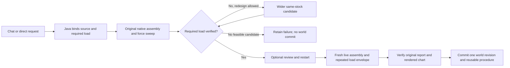

Candidates have actual assembly attempts and load attempts. The first qualifying layout stops further exploration. Every failed or interrupted attempt remains available and contributes to measured work. A fresh execution still has to earn the selected result; forecast success alone cannot advance the continuing world.

Stop is checked during load experiments. Forced atomic checkpoints retain completed cases and partial rows. Restart resumes from validated state, retaining previous attempts rather than rewriting them as successes. Load records are bounded to 20 attempts and 64 MB per assembly. Export/report budgets are also bounded; a refusal preserves the prior data rather than dropping evidence to fit. Unknown source identities, changed requirements, tampered forces, altered offsets, missing ticks or mismatched report rows refuse verification.

An explicit compatibility path accepts a known, closed edition 055 world while preserving prior frame and history. It does not silently migrate pending ownership or unknown native identities. The original installed review app and private mat/webcam projects remain separate from these synthetic validation projects.

## Tools become skills through evidence

A tool performs an action. A skill completes a task using actions, checks and recovery. The saved construction procedure retains measured-load mode, required force, redesign permission, control policy and original success checks. Its name and version bind reuse. New source geometry still requires new native execution and verification. Changing a saved load requirement is not an equivalent reuse of the same procedure.

Chat carries the typed required force into Java. The example request includes `measure load limits with requiredLoadN 16`. Java preserves the explicit value even if a model proposal omits it. The local model is a planner and explainer; its tokens are not evidence of motion or load capacity. The report distinguishes simulation ticks, force effort, work and observed duration. Total experiment costs include original and fresh assembly, forecast and fresh load sweeps, separate 055 loads and retained interrupted work. They are not electricity measurements or training progress.

## Actual application captures

All captures below come from the integrated app running a labelled synthetic practice world in this checkout. They are not generated mockups, photographs or a physical bench test.

### Labelled narrow support layout before trials

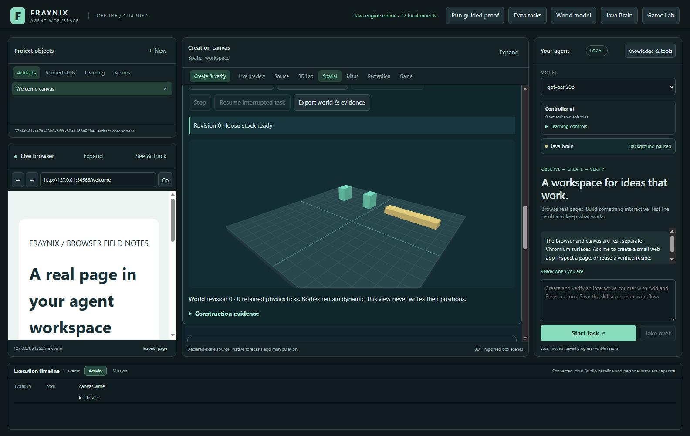

[Original capture](docs/readmes/056/construction056-stock.png) · November 3, 2026 · labelled synthetic world.

### Measured baseline failure and qualifying wider supports

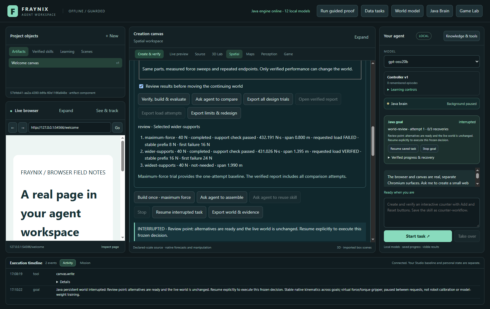

[Original capture](docs/readmes/056/construction056-review.png) · November 3, 2026 · labelled synthetic world.

### Fresh native gripper assembly after review and restart

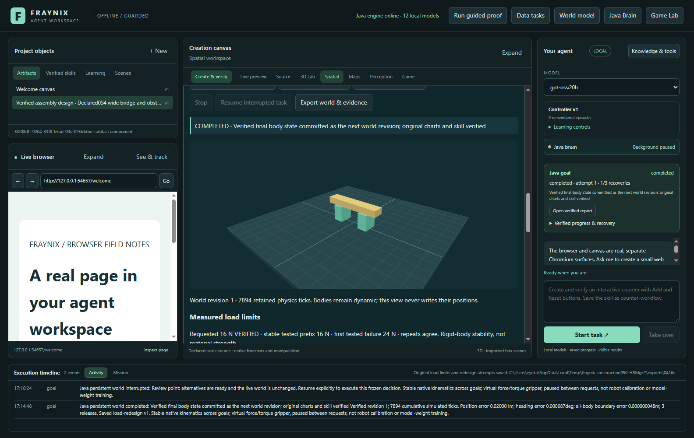

[Original capture](docs/readmes/056/construction056-built.png) · November 3, 2026 · labelled synthetic world.

### Fresh force sweep and repeated load bracket

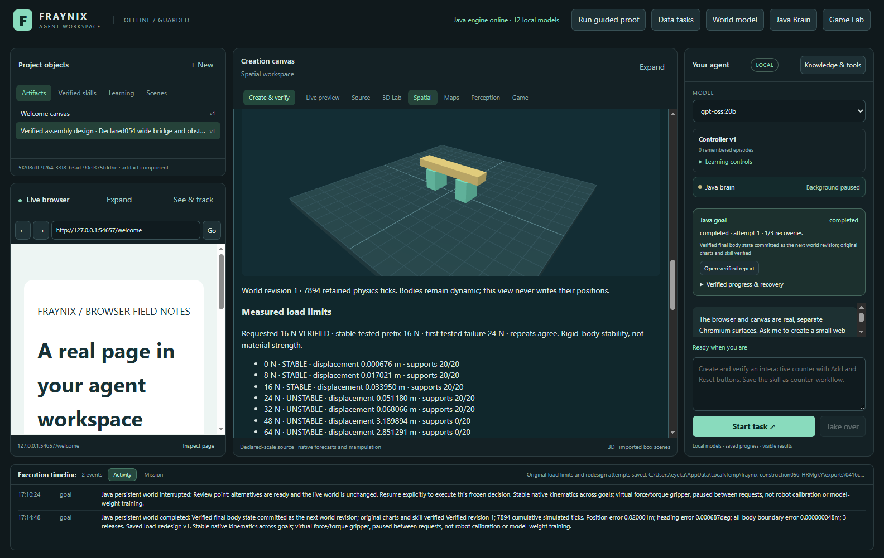

[Original capture](docs/readmes/056/construction056-loads.png) · November 3, 2026 · labelled synthetic world.

### Verified report and original measured load table

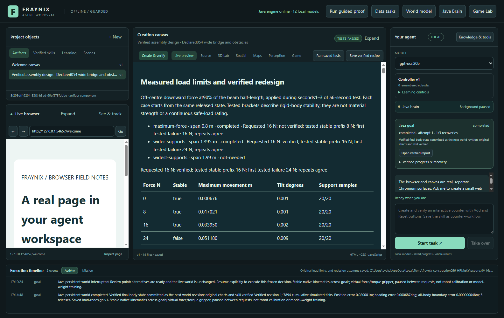

[Original capture](docs/readmes/056/construction056-report.png) · November 3, 2026 · labelled synthetic world.

### Original load curve, scales and complete experiment costs

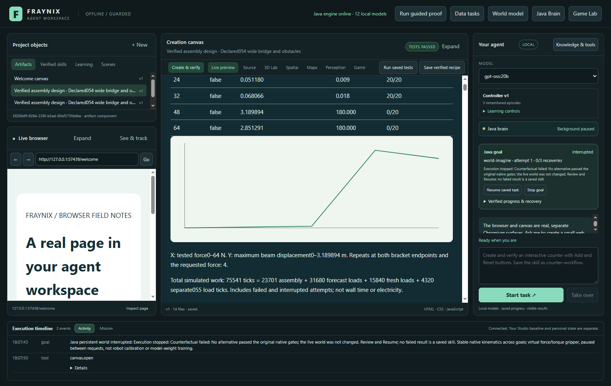

[Original capture](docs/readmes/056/construction056-chart.png) · November 3, 2026 · labelled synthetic world.

### Local-model completion and saved procedure reuse

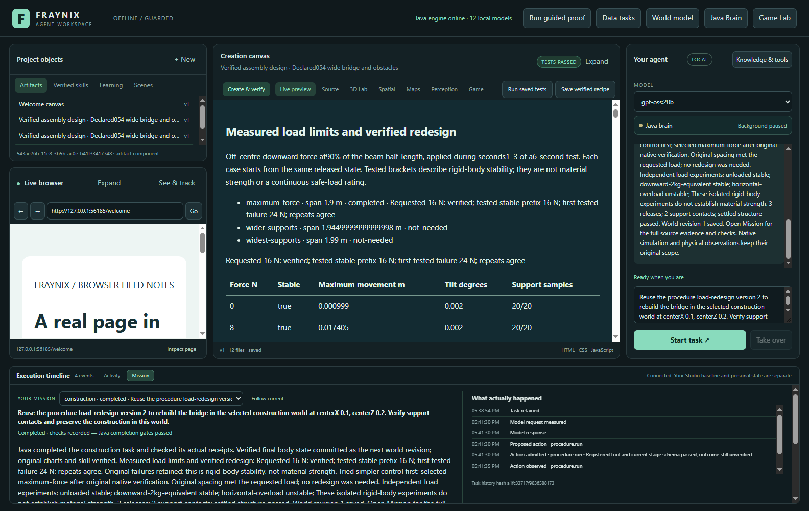

[Original capture](docs/readmes/056/construction056-chat.png) · November 3, 2026 · labelled synthetic world.

### Integrated controls at 1100 pixels

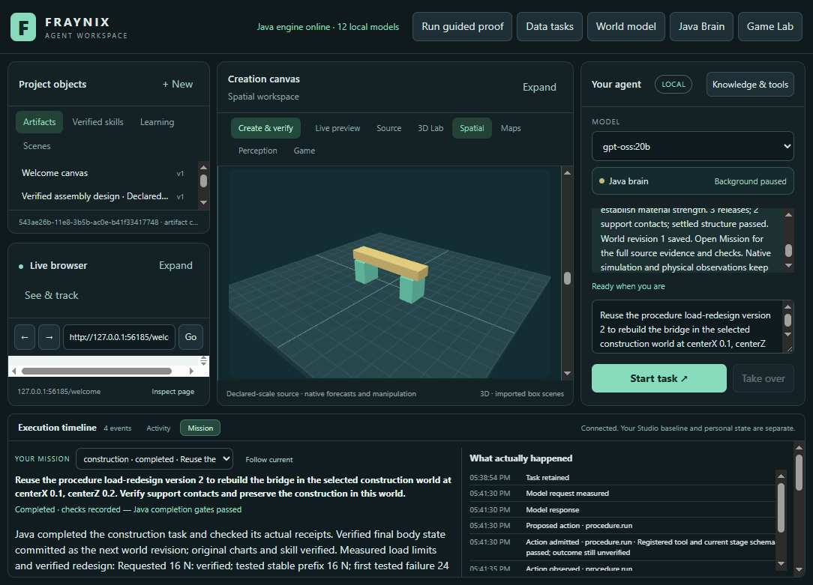

[Original capture](docs/readmes/056/construction056-narrow.png) · November 3, 2026 · labelled synthetic world.

### Obstructed route refused before actuation

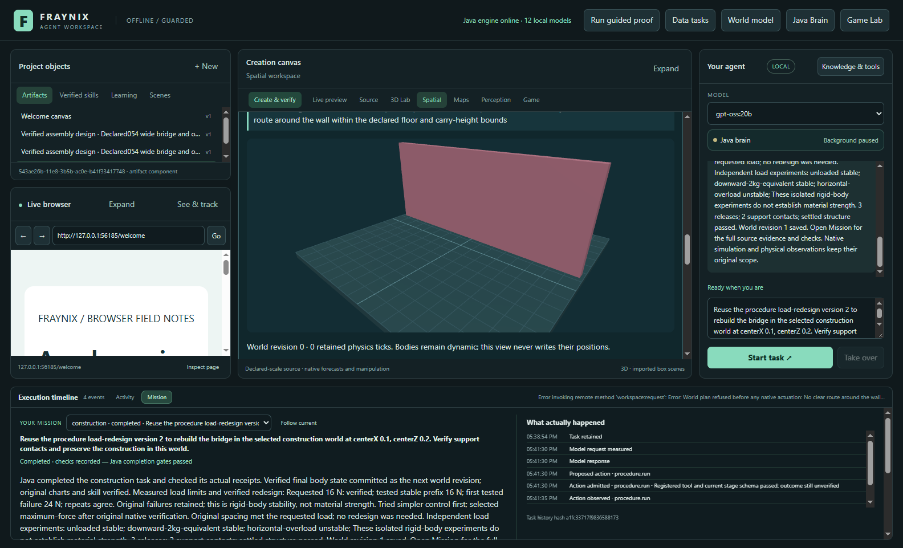

[Original capture](docs/readmes/056/construction056-sealed.png) · November 3, 2026 · labelled synthetic world.

### Redesign disabled: original load failure retained

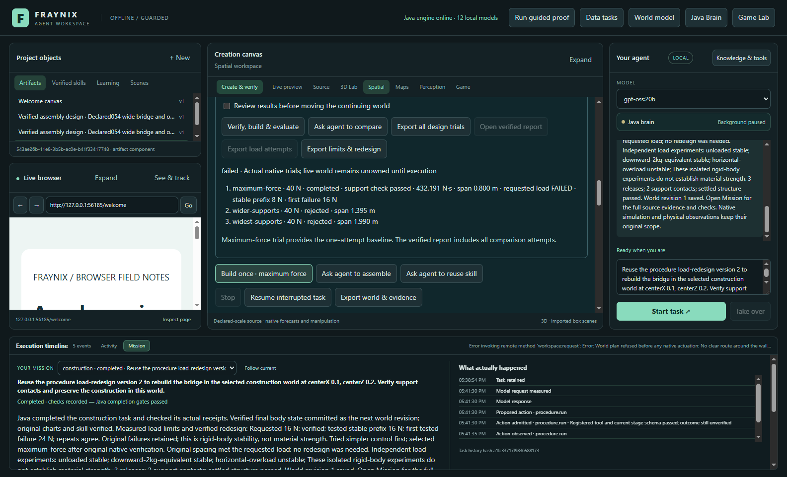

[Original capture](docs/readmes/056/construction056-refused.png) · November 3, 2026 · labelled synthetic world.

## Source and verification map

| Responsibility | Implementation |
| --- | --- |
| Frozen force protocol and bounded original load records | [Load056.java](workspace-engine/src/main/java/fraymus/workspace/Load056.java), [protocol](workspace-engine/src/main/resources/construction056-protocol.json) |
| Same-stock layout candidates and selection | [Design056.java](workspace-engine/src/main/java/fraymus/workspace/Design056.java) |
| Existing native force integration and reconstruction | [Load055.java](workspace-engine/src/main/java/fraymus/workspace/Load055.java) |
| Candidate ownership, restart, costs and originals | [Counterfactual045.java](workspace-engine/src/main/java/fraymus/workspace/Counterfactual045.java) |
| Durable task, fresh verification and saved procedure | [GoalRunner.java](workspace-engine/src/main/java/fraymus/workspace/GoalRunner.java) |
| Original tables, charts, files and visible receipts | [CounterfactualReport045.java](workspace-engine/src/main/java/fraymus/workspace/CounterfactualReport045.java) |
| Integrated controls and live result display | [construction051.js](workspace-desktop/renderer/construction051.js) |
| Actual app/local-model workflow | [construction056-integration.cjs](workspace-desktop/test/construction056-integration.cjs) |

To reproduce the focused native cases and the fresh app workflow:

```powershell
.\gradlew.bat :workspace-engine:test --tests fraymus.workspace.Load056Test --tests fraymus.workspace.Load056RecoveryTest --tests fraymus.workspace.Design056Test
.\gradlew.bat :workspace-engine:installDist
cd workspace-desktop
npm test
$env:JAVA_TOOL_OPTIONS='-Xmx768m'
node test/construction056-integration.cjs
```

The integration run creates a separate synthetic temporary project and requires the available local `gpt-oss:20b` model. It uses CPU planning with four threads. Do not run native/model validation jobs concurrently. `FRAYNIX056_RESUME_RECORD` is an optional evidence-preserving continuation used during development; leave it unset for a fresh run.

The [validation record](docs/readmes/056/verification.json) distinguishes source-qualified invocations, original failed attempts, targeted Java checks, desktop checks and actual local-model behavior. It does not claim a full Java test suite. The [original archive index](docs/readmes/056/original-evidence.json) records both compressed and decompressed hashes and sizes. Private camera frames, model weights and credentials are excluded.

## Next steps and acceptance gates

1. **Unfamiliar load conditions.** Freeze new force locations, directions, durations and geometry before controller changes. Evaluate previously unseen cases separately from development cases. Preserve all failures and total compute cost.
2. **Payloads and contact variability.** Add actual dynamic payload bodies and controlled variation in friction/contact parameters. Compare a simple controller and bounded redesign under identical requirements. Verify mass, contacts and motion from original state.
3. **Improved diagnosis.** Distinguish support loss, excessive translation, rotation and route failure in the user explanation. A proposed correction must be linked to a measured failure and tested, not merely narrated.
4. **Reusable design procedures.** Generalize only when a procedure succeeds on a declared range of new tasks and still refuses cases outside that range. Version changes and rollback must remain inspectable.
5. **Verification throughput.** Profile native simulation, original-evidence reconstruction, compression and report verification separately. Any caching must be tied to unchanged original bytes, source, code and requirements and tested against tampering; preserve every original check.
6. **Physical connection.** Treat calibrated observations or instrument data as a separate evidence source with units and uncertainty. A synthetic load bracket must never be relabelled a physical capacity rating.

The larger direction remains one continuing, visible environment where the agent can perceive state, propose an action, observe its consequences and retain a verified procedure. This edition adds a concrete part of that loop: failure can cause a bounded redesign, while evidence can also say that no tried design is good enough.
