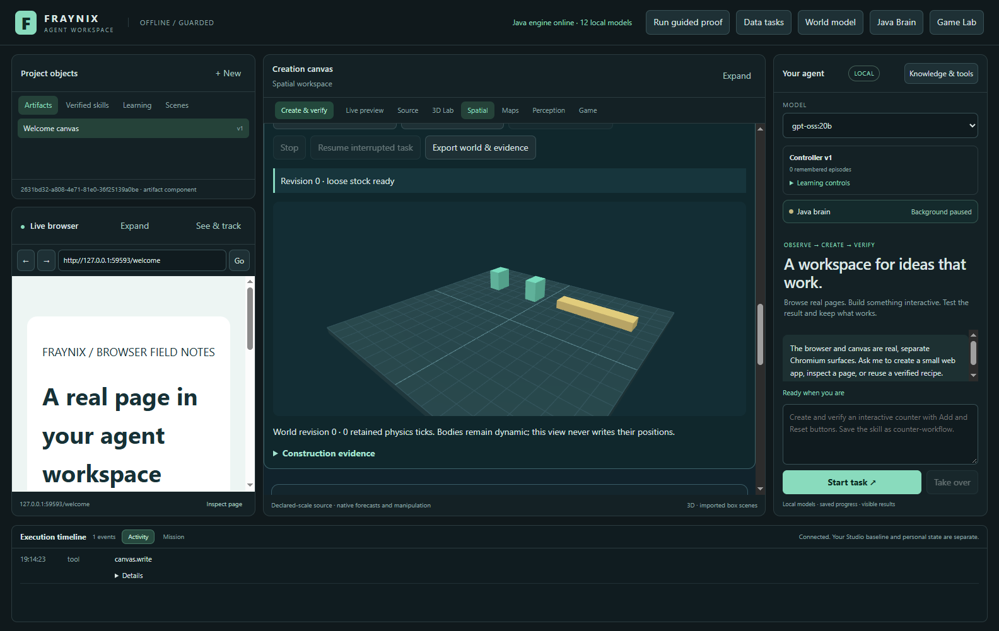
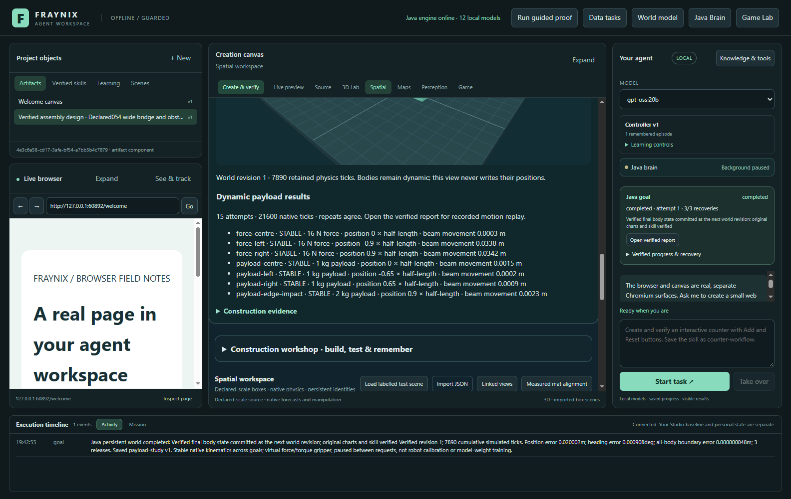
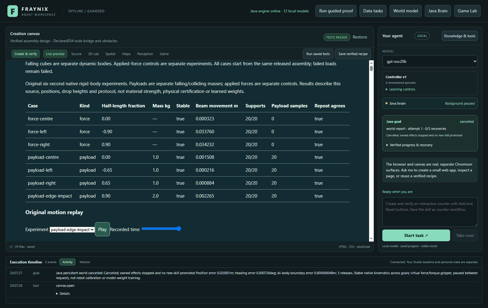
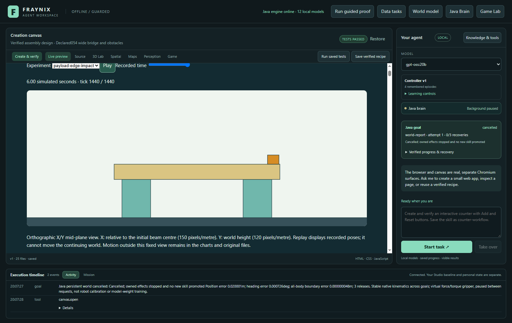
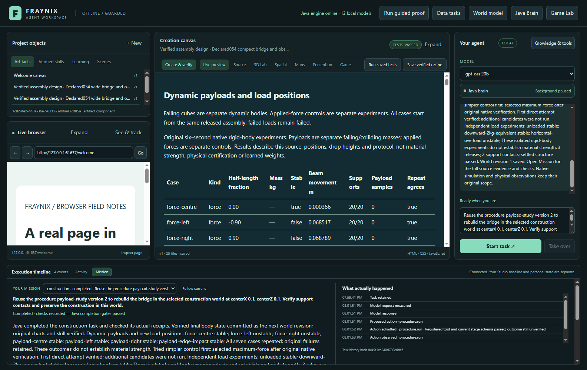
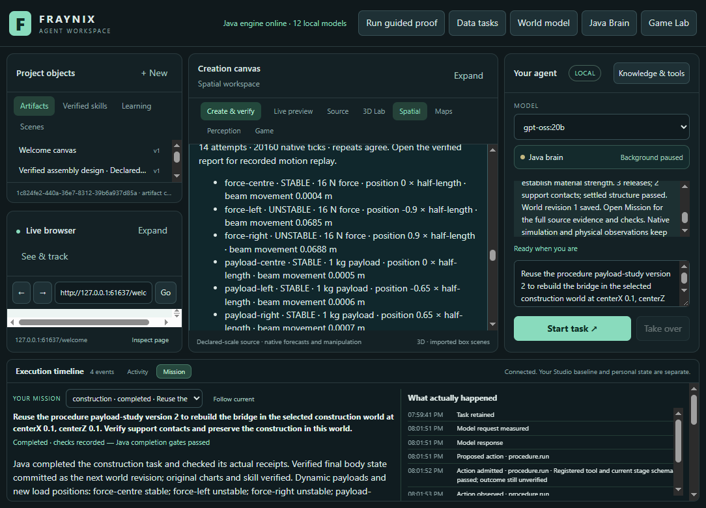

# Fraynix Agent Workspace · Edition 057

**Dynamic payloads, new load positions, recorded motion and retained procedures.**

[Previous edition 056](README-056.md) · [Tagged history](https://github.com/eyeoverthink/Fraynix-Agent-Workspace/tree/readme-056) · [Offline illustrated guide](docs/readmes/057/index.html) · [All editions](docs/readmes/INDEX.md) · [Frozen acceptance contract](docs/EDITION_057_CONTRACT.md)

Edition 057 asks a practical question: after the agent assembles a bridge, what actually happens when another moving object lands on it? Java now releases separate dynamic cubes above the beam, measures their fall, impact and settling, and repeats the experiments. It also applies the same force at three positions. Any unstable outcome remains visible alongside the stable cases.

The existing app stays integrated: chat chooses a typed task, Java owns execution and recovery, native physics supplies motion and contact measurements, and the app presents a verified report and replay. A successful diagnostic means all required experiments and checks completed. It does **not** mean every payload was supported.

## What this edition adds

- **Actual payload bodies.** Cubes have mass, collision shape, inertia, friction, restitution, linear velocity and angular velocity. Gravity and contact move them after their initial placement.
- **Position-sensitive tests.** Centre and off-centre force applications and drops compare motion and stability without moving the thresholds to obtain a favourable answer.
- **Repeated measurements.** Seven fixed experiments each run twice from the same released assembly. Repeats check deterministic reproducibility; they are not independent physical trials.
- **Preserved history.** Every native tick, body state, force, application offset and measured contact impulse is retained. Resuming skips verified completed cases and starts a fresh attempt for an unfinished case.
- **A checked visual replay.** Select an experiment, scrub recorded time or play its recorded poses. Java checks numbers, chart coordinates and displayed body polygons against original measurements before the goal can commit.
- **Chat and reusable skills.** An explicit dynamic-payload request survives planning. A saved procedure retains the exact versioned test policy and refuses silent removal of its checks.
- **Complete exports.** The visible export control saves originals with a byte count and SHA-256 receipt. The report includes original data and replay frames.

## Run it and follow one complete task

Use Java 21 and the existing project dependencies. Use a separate project directory when trying a new edition; do not point a new runtime at a private project that another instance is using.

```powershell
$env:JAVA_HOME = 'C:\Program Files\Eclipse Adoptium\jdk-21.0.10.7-hotspot'
$env:JAVA_TOOL_OPTIONS = '-Xmx768m'
.\gradlew.bat :workspace-engine:installDist --max-workers=1
$env:FRAYNIX_WORKSPACE_PROJECT = 'C:\Users\eyeka\FraynixProjects\edition057-review'
cd workspace-desktop
npm start
```

For a fresh clone, install desktop dependencies with the repository lockfile before starting. The development checkout used a pre-existing dependency junction; never reinstall or delete through that junction. [General setup and architecture](README.md).

1. Open **Spatial → Gripper assembly → Dynamic payload example**. This creates a separate, labelled synthetic world with wide stock and a 1.9 m support span.
2. Leave **Try simpler control first** and **Test falling payloads and new load positions** enabled. The older independent-load and measured-redesign options remain separate.
3. Set a skill name, then choose **Verify, build & evaluate**, or **Ask agent to compare** with a running local model selected.
4. Watch actual gripper assembly. The agent must release the beam and verify its support before testing independent copies.
5. Inspect **Dynamic payload results**. Failed cases remain **UNSTABLE**, even when the diagnostic task completes.
6. Open the **verified report**. Compare the table, beam-displacement charts and payload-height charts. Select a replay case and scrub through its six seconds.
7. Choose **Export payload originals** to save all original attempts and measured results.
8. Reuse the saved skill in another declared world. It repeats tests against that world's actual released geometry.

Example chat request:

> Compare assembly designs and build the bridge; try simpler control first; test dynamic payloads and new load positions in the selected construction world at centerX 0.2, centerZ 0.2. Maximum forceLimitN 40. Save skill as payload-study.

A runtime interruption preserves the same task and source. **Resume interrupted task** explicitly continues compatible retained work. Stop/cancellation does not silently commit a partially evaluated world. Completed experiments and incomplete originals remain distinct.

## Frozen experiment protocol

Every case runs for 6 simulated seconds at 240 Hz, twice. Force experiments apply 16 N downward during seconds 1–3. Payload cubes are 0.18 m on each side, with friction 0.55 and restitution 0.05. Gravity comes from the source scene.

| Case | Position as a fraction of beam half-length | Dynamic mass | Release clearance |
| --- | ---: | ---: | ---: |
| Force centre | 0 | No payload | Applied force |
| Force left | −0.90 | No payload | Applied force |
| Force right | +0.90 | No payload | Applied force |
| Payload centre | 0 | 1 kg | 0.15 m |
| Payload left | −0.65 | 1 kg | 0.15 m |
| Payload right | +0.65 | 1 kg | 0.15 m |
| Payload edge impact | +0.90 | 2 kg | 0.35 m |

Unchanged beam criteria: displacement at most 0.05 m, tilt at most 5°, final-window speed at most 0.08 m/s, and both supports present in all 20 sampled final-window frames. A payload must also remain in measured contact with the beam and meet the speed limit. Initial free fall and actual payload/beam impact are separately checked. A repeat disagreement prevents verified promotion.

Twenty attempts and 64 MB bound one source's experiment history. A payload-enabled goal has a 15-minute owner budget; an interruption requires explicit continuation. Reports retain per-attempt original downloads within a 64 MB artifact budget. Reports count completed and interrupted native ticks, plus prior assembly/load work. Wall durations are measured, not inferred from simulated time.

## Measured results and validation

| Experiment | Wide source | Changed centre | Compact stock |
| --- | --- | --- | --- |
| force-centre | Stable | Stable | Stable |
| force-left | Stable | Stable | **Unstable** |
| force-right | Stable | Stable | **Unstable** |
| payload-centre | Stable | Stable | Stable |
| payload-left | Stable | Stable | Stable |
| payload-right | Stable | Stable | Stable |
| payload-edge-impact | Stable | Stable | Stable |

The compact beam moved **0.068517 m under the left load** and **0.068789 m under the right load**, exceeding the unchanged **0.05 m** limit. Both repeats agreed. The other five compact cases passed; all seven cases passed in both wide-world tasks.

All seven cases were repeated in each reported geometry; failed outcomes remain failed. See the JSON for displacements, tilt, speeds, support counts, impact impulses, free-fall acceleration and complete costs.

**50 distinct targeted Java cases across 8 classes**, **124 desktop checks**, and the actual app/local-model workflow pass across the source-qualified records. This is not a full-suite claim. After the status-read fix, four recorded desktop reopens reached usable world controls in 3.854–4.307 seconds; these are observations on this project and machine, not a general startup benchmark. Changed-centre chat took **415.090s**; saved-skill reuse took **368.259s**. These task timings include native work, persistence and verification, not just inference.

wide: 15 attempts / 21600 payload-position ticks; changedCentre: 14 attempts / 20160 payload-position ticks; compact: 14 attempts / 20160 payload-position ticks. Prior assembly/load costs are separately included in each verified report.


[Source-qualified validation](docs/readmes/057/verification.json) · [Original evidence manifest](docs/readmes/057/original-evidence.json) · [Source inventory](docs/readmes/057/FILE_TREE.md)

The first development run reached the 64 MB history limit. The next revealed excessive heap use while hashing a complete history. Original failures are retained. Contact identities now use lossless indexes into the original object list, and canonical evidence hashing streams its input. These changes preserve measurements and physical thresholds. Later desktop checks exposed export and chat readiness races during view changes; selection now keeps the affected buttons disabled, and chat waits for an active view operation before applying the existing ownership checks. A larger retained history also exposed expensive reparsing during status polling. Java now indexes committed goal summaries for routine reads, while preserving full original reports in durable storage. Historical payload measurements are summarized in planning context with their hashes and contrary outcomes, while all execution requirements remain exact. Original records distinguish product defects, test-harness corrections and deliberately stopped diagnostic invocations.

## Actual application screenshots

### Labelled synthetic stock before assembly



November3,2026 · actual app capture · labelled synthetic scene. [Original image](docs/readmes/057/construction057-stock.png).

### Measured force and dynamic-payload outcomes



November3,2026 · actual app capture · labelled synthetic scene. [Original image](docs/readmes/057/construction057-results.png).

### Actual verified results table — reopened after Stop



November3,2026 · actual app capture · labelled synthetic scene. [Original image](docs/readmes/057/construction057-report.png). The canvas shows the earlier verified wide study; the right sidebar shows the later, deliberately cancelled Stop test.

### Recorded edge-impact motion at the selected time — reopened after Stop



November3,2026 · actual app capture · labelled synthetic scene. [Original image](docs/readmes/057/construction057-replay-edge.png). The canvas shows the earlier verified wide study; the right sidebar shows the later, deliberately cancelled Stop test.

### Local-model completion and retained skill reuse



November3,2026 · actual app capture · labelled synthetic scene. [Original image](docs/readmes/057/construction057-chat.png).

### New compact stock and integrated narrow layout



November3,2026 · actual app capture · labelled synthetic scene. [Original image](docs/readmes/057/construction057-compact.png).

## How the parts connect

| Responsibility | Implementation |
| --- | --- |
| Frozen experiments | [construction057-protocol.json](workspace-engine/src/main/resources/construction057-protocol.json) |
| Bodies, contacts, interruption and verification | [Payload057.java](workspace-engine/src/main/java/fraymus/workspace/Payload057.java) |
| Charts, replay and visual checks | [PayloadReport057.java](workspace-engine/src/main/java/fraymus/workspace/PayloadReport057.java) |
| Shared tasks and saved procedures | [GoalRunner.java](workspace-engine/src/main/java/fraymus/workspace/GoalRunner.java) |
| Typed intent and concise completion | [Domain044.java](workspace-engine/src/main/java/fraymus/workspace/Domain044.java), [ChatChain052.java](workspace-engine/src/main/java/fraymus/workspace/ChatChain052.java) |
| Integrated controls and canvas observation | [construction051.js](workspace-desktop/renderer/construction051.js), [goals.cjs](workspace-desktop/goals.cjs) |
| Native and actual-app validation | [Payload057Test.java](workspace-engine/src/test/java/fraymus/workspace/Payload057Test.java), [construction057-integration.cjs](workspace-desktop/test/construction057-integration.cjs) |

No new external library was introduced. Java owns the new algorithms and policies; the existing native Bullet/Minie backend supplies rigid-body integration, and the existing desktop hosts the interface. This is not a claim that the entire application has no dependencies.

Contact entries contain object-list indexes, distance and normal impulse. Full body IDs remain in the same record. Exported JSON includes its format and source/code identity. SHA-256 detects changed evidence; it is not a digital signature.

The replay is an orthographic X/Y mid-plane projection of recorded box poses. Its fixed view may clip motion; originals and charts retain it. It is not a camera reconstruction or separately simulated animation. Per-case chart scales are stated explicitly.

## What this establishes—and what remains

The agent can assemble, test, observe failure, preserve evidence and repeat a versioned procedure under changed declared conditions. Edition 056's force requirement and verified support redesign remain available; edition 057 adds diagnostic moving payloads. It does not automatically redesign for arbitrary falling objects.

Results concern idealized rigid bodies with declared geometry and materials. They do not establish real material strength, joint failure, hardware lifting capacity, universal handling, consciousness or training of Ollama weights. A saved skill is a verified procedure with retained requirements.

## Next development steps

1. Freeze a **payload-aware design objective** before testing: supported mass, landing region, clearance and impact speed. Admit redesign only after real failure, with all attempts retained.
2. Evaluate reserved positions and masses. Compare the simplest fixed geometry with proposed redesigns, including full experiment and execution costs.
3. Add measured horizontal approach velocity and collision-rich payload shapes. Verify momentum and contact changes, not only final appearance.
4. Connect request, assembly, drop, contact, failure and recovery in one navigable timeline with direct access to original evidence.
5. Relate calibrated physical observations to the simulated scene through explicit units and uncertainty. Label measurements, inferred properties and synthetic parameters separately.

The direction remains one evolving local world: the agent understands its tools, acts through owned Java procedures, observes consequences, and earns improvements through checks that survive a restart.
