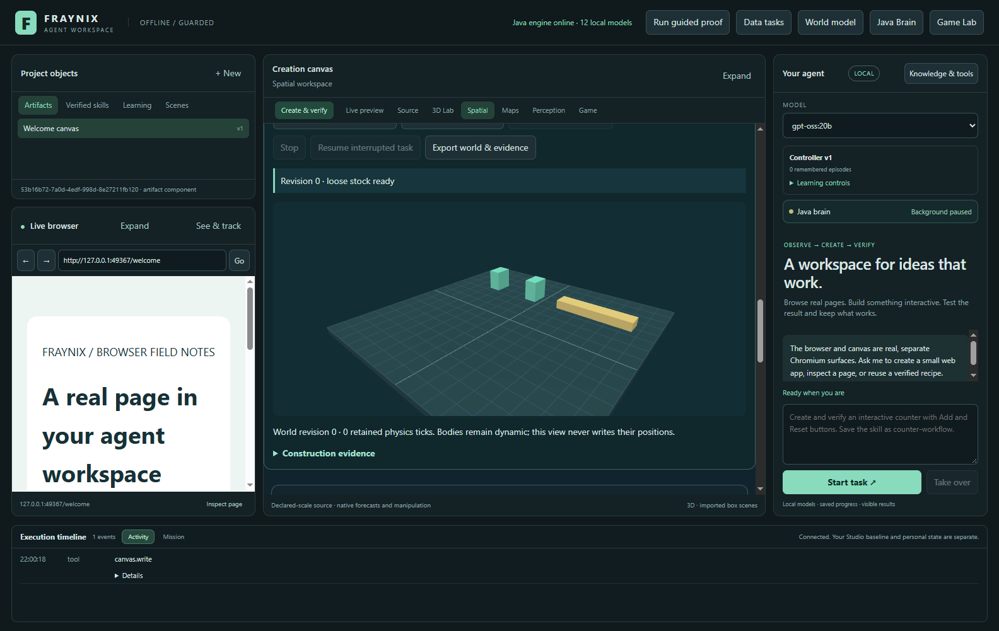
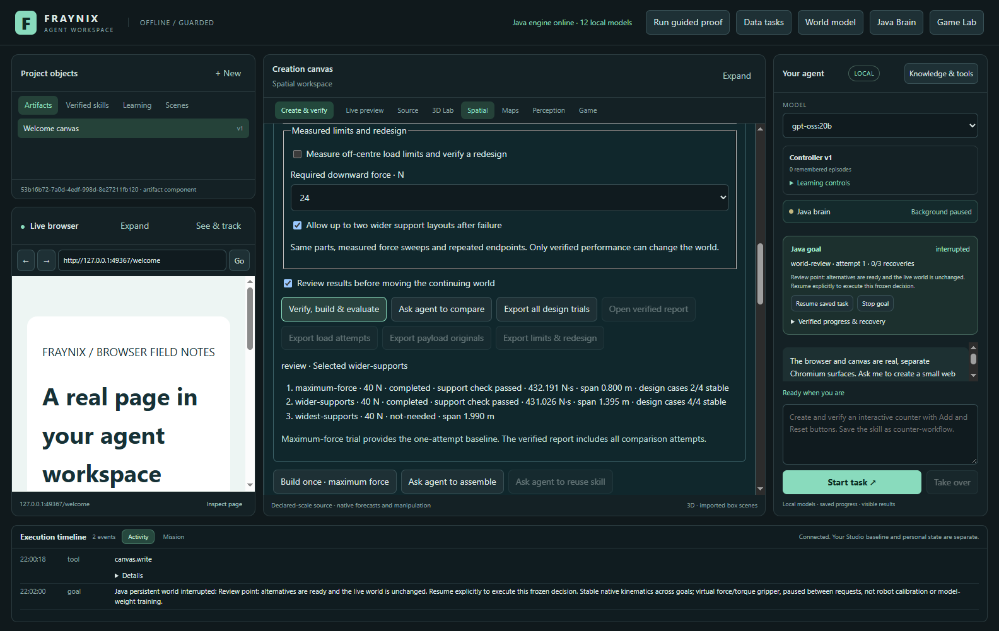
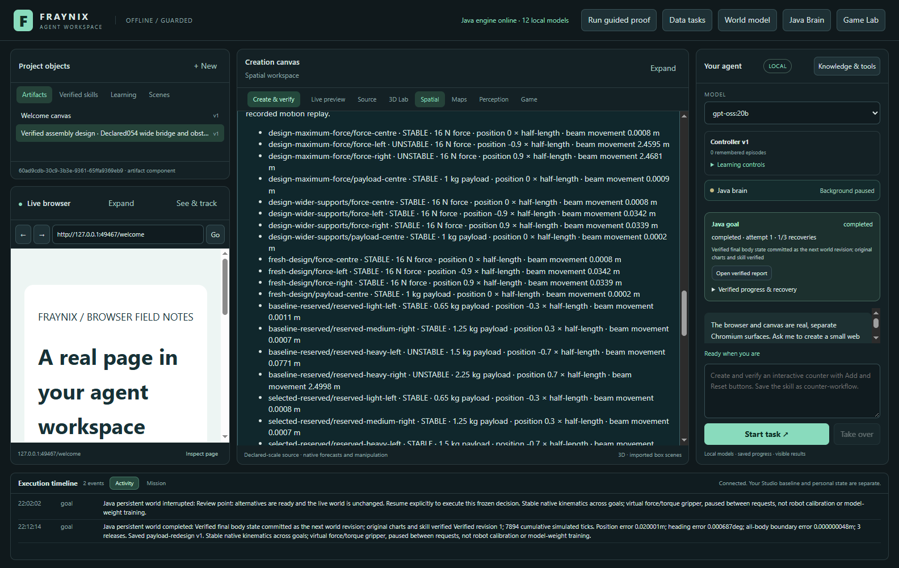
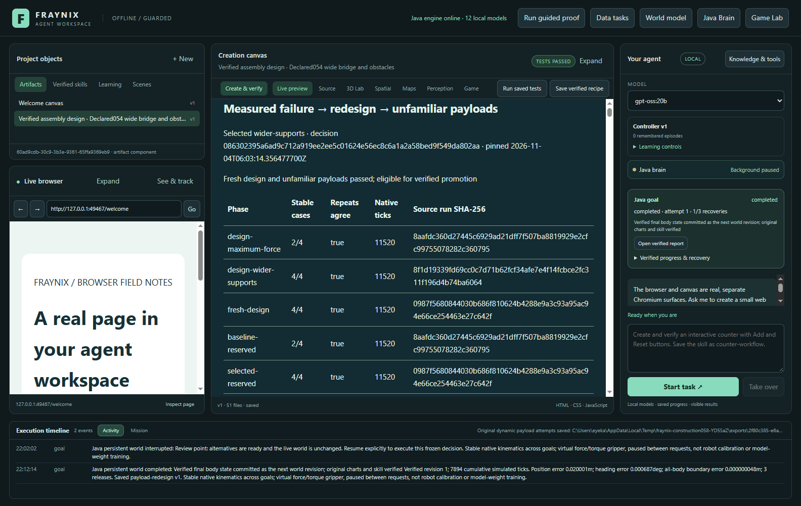
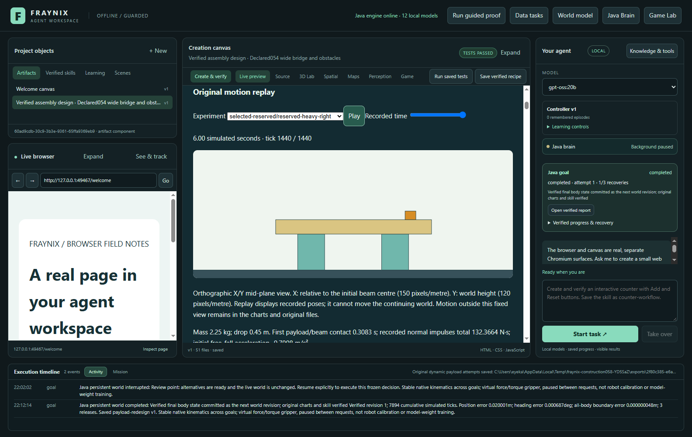
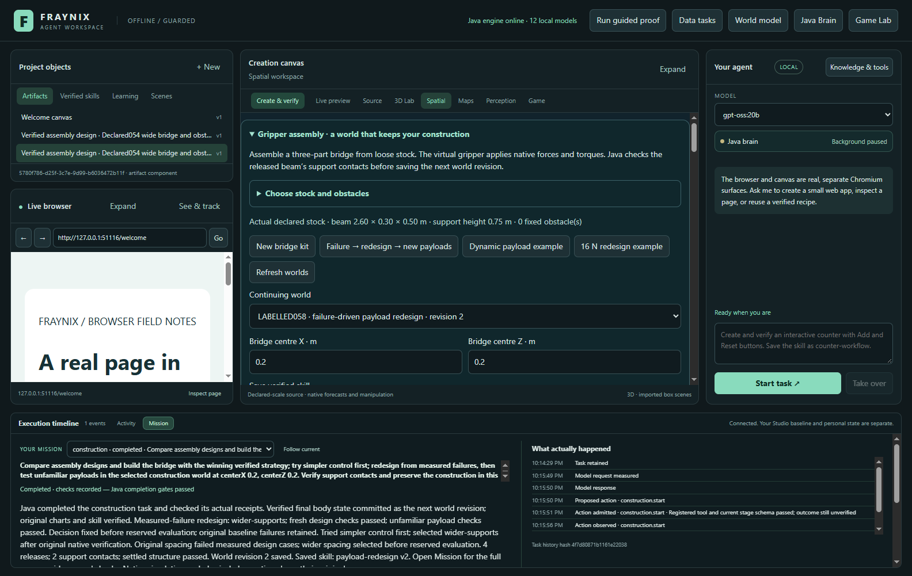
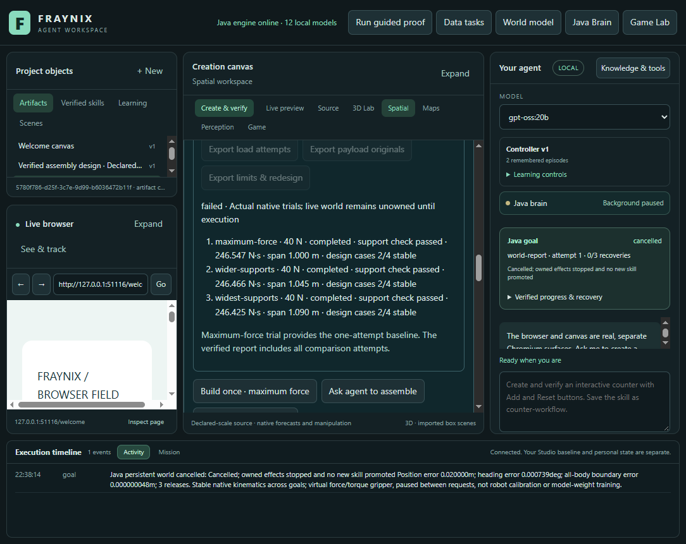

# Fraynix Agent Workspace · Edition 058

**Measure the failure. Redesign the construction. Test what the decision has not seen.**

[Previous edition 057](README-057.md) · [Frozen 057 release](https://github.com/eyeoverthink/Fraynix-Agent-Workspace/tree/readme-057) · [Offline illustrated guide](docs/readmes/058/index.html) · [Edition history](docs/readmes/INDEX.md) · [Acceptance contract](docs/EDITION_058_CONTRACT.md)

Edition 057 could assemble a bridge, drop actual moving payloads onto it, apply forces at different positions and retain stable and unstable results. Edition 058 makes those measurements part of the design decision. Java tries the original support spacing, measures the result, and admits a wider arrangement only after failure. It then fixes the decision, rebuilds the selected arrangement and evaluates payload conditions that were excluded from selection.

This remains one integrated application. The local language model selects a registered task and explains its result. Java owns the source world, bounded alternatives, execution, recovery and procedural memory. The existing native rigid-body engine supplies motion, impact and contact measurements. Actual report checks precede a successful world update or retained skill.

A tool performs an action. A skill completes a task using actions, checks and recovery. In this edition the saved skill includes the design and evaluation policy, rather than merely remembering a successful support spacing.

## What the app does

1. **Measures a baseline.** The virtual gripper assembles the original layout through forces and torques. Native motion, release, both support contacts and settling must pass before load experiments begin.
2. **Uses failures to admit a repair.** Four design cases test centre and edge forces and a centre payload. If the layout fails, Java tries the next declared support spacing using the same stock and actuator limits.
3. **Fixes its choice before unfamiliar cases.** The selected candidate, original source, implementation, complete design evidence and decision hash are retained. Optional review pauses here while the continuing world remains unchanged.
4. **Rebuilds and rechecks.** The chosen plan is executed freshly. It must pass the original assembly gates and all design cases again.
5. **Compares unfamiliar payloads fairly.** The original released baseline and fresh selected layout receive the same four reserved masses, positions and drop heights. Each case runs twice. These results cannot send selection back to another candidate.
6. **Verifies the display and preserves the evidence.** The report separates design, fresh execution and reserved evaluation. Java checks actual table values, chart coordinates and replay polygons against original native records. Exports retain all attempts, including interrupted and failed ones.
7. **Promotes only a verified result.** The fresh design cases and selected reserved cases must pass before the next world revision and successful procedure are saved. A failed evaluation remains an inspectable diagnostic.

```mermaid
flowchart LR
    A[Chat or construction controls] --> B[Java freezes source and policy]
    B --> C[Original layout and design cases]
    C -->|Measured failure| D[Next declared wider layout]
    D --> C2[Design cases on that layout]
    C -->|All design cases pass| E[Save decision]
    C2 -->|All design cases pass| E
    C2 -->|Failure and candidate budget remains| D
    E --> F[Fresh assembly and design checks]
    F --> G[Paired reserved payload evaluation]
    G --> H[Verify original report and replay]
    H -->|Fresh and reserved checks pass| I[Commit world and retain skill]
    H -->|Reserved failure| J[Retain diagnostic without promotion]
```



The arrows represent implemented Java stages. The construction and payloads are virtual. A successful simulation is not a material-strength certificate or evidence of physical-world accuracy.

## Run and review a complete task

Use Java 21 and the project's existing dependencies. Create a separate project directory; do not attach a new runtime to a private project another instance is using.

```powershell
$env:JAVA_HOME = 'C:\Program Files\Eclipse Adoptium\jdk-21.0.10.7-hotspot'
$env:JAVA_TOOL_OPTIONS = '-Xmx768m'
.\gradlew.bat :workspace-engine:installDist --max-workers=1
$env:FRAYNIX_WORKSPACE_PROJECT = 'C:\Users\eyeka\FraynixProjects\edition058-review'
cd workspace-desktop
npm start
```

For a fresh clone, install desktop dependencies using the repository lockfile. The development checkout uses an existing dependency junction; never install or delete dependencies through that junction. [General setup](README.md).

1. Open **Spatial → Gripper assembly → Failure → redesign → new payloads**. This creates a clearly labelled practice world with wide stock and an original 0.8 m support span.
2. Keep **Redesign from measured failures, then test unfamiliar payloads** enabled. The example selects its dedicated protocol. The older 056 load envelope and 057 diagnostic modes remain separate choices.
3. Choose a skill name. Enable **Review results before moving the continuing world** to pause after design selection.
4. Select **Verify, build & evaluate**, or choose an installed local model and **Ask agent to compare**.
5. Inspect the original failed case and the selected candidate. If review is enabled, explicitly resume when ready. Restarting the app preserves that decision and requires explicit continuation.
6. Inspect the grouped results and **Open verified report**. Compare baseline and selected reserved outcomes, then select a recorded experiment and scrub through its motion.
7. Use **Export payload originals** to save the complete records. Larger exports use checked parts with a reconstruction manifest.
8. Reuse the exact saved skill in another declared world. The original stock, pose and source checks still apply. Changed geometry gets new experiments; an old successful result is never copied into the new world.

Example chat request:

> Compare assembly designs and build the bridge. Try simpler control first; redesign from measured failures, then test unfamiliar payloads in the selected construction world at centerX 0.2, centerZ 0.2. Maximum forceLimitN 40. Save skill as payload-redesign.

The model does not need to generate a physics implementation or fabricate test results. It requests the actual registered procedure; Java resolves the current world and runs the checked stages.

## Fixed design and evaluation conditions

The [contract](docs/EDITION_058_CONTRACT.md) was committed before implementation and before these experiments. All cases last six simulated seconds at 240 Hz and run twice from their respective released assembly. Repeats establish deterministic reproducibility, not independent physical trials.

| Design case | Force or mass | Position, fraction of beam half-length | Drop clearance |
| --- | ---: | ---: | ---: |
| Centre force | 16 N downward | 0 | Applied during seconds 1–3 |
| Left force | 16 N downward | −0.90 | Applied during seconds 1–3 |
| Right force | 16 N downward | +0.90 | Applied during seconds 1–3 |
| Centre payload | 1 kg | 0 | 0.15 m |

The declared spacing candidates are the original span, the midpoint between that span and the permitted maximum, and the maximum. The maximum retains the existing 0.08 m beam-end margin and 2 m span limit. The agent cannot substitute stronger stock, add supports, increase its force ceiling or change the acceptance thresholds. A first passing candidate ends selection; later candidates remain explicitly unexecuted.

| Reserved case | Mass | Position, fraction of beam half-length | Drop clearance |
| --- | ---: | ---: | ---: |
| Light left | 0.65 kg | −0.30 | 0.10 m |
| Medium right | 1.25 kg | +0.30 | 0.25 m |
| Heavy left | 1.50 kg | −0.70 | 0.30 m |
| Heavy right | 2.25 kg | +0.70 | 0.45 m |

Payloads are separate 0.18 m cubes with friction 0.55 and restitution 0.05, initially at rest. Gravity comes from the source world. After initialization, the engine controls all motion through actual integration and collisions.

The unchanged beam criteria require displacement at most 0.05 m, tilt at most 5°, final-window speed at most 0.08 m/s and both supports in all 20 sampled final-window frames. Payload cases also require retained beam contact and settled payload speed. Initial free fall and actual payload/beam impact are checked separately. Failed outcomes remain failed even if all diagnostic stages finish.

## Measured results and validation

| Reserved payload | Original layout | Selected fresh layout | Original movement m | Selected movement m |
| --- | --- | --- | ---: | ---: |
| reserved-light-left | Stable | Stable | 0.001068 | 0.000758 |
| reserved-medium-right | Stable | Stable | 0.000688 | 0.000704 |
| reserved-heavy-left | **Unstable** | Stable | 0.077052 | 0.015008 |
| reserved-heavy-right | **Unstable** | Stable | 2.499799 | 0.038382 |

The original 0.8 m spacing failed the edge-force design cases. The selected wider layout used a 1.395 m span, preserving the same parts and limits. Its decision was fixed before reserved evaluation. Every case was repeated.

**53 distinct targeted Java cases across 9 classes**, **125 desktop checks**, and the actual app/local-model workflow pass with source-qualified evidence. The changed-centre chat took **872.804 seconds**; compact saved-skill reuse ended **interrupted** after **293.921 seconds**. These are complete task observations, including computation, persistence and verification; not model-only latency.

- **wide:** completed. Fresh design passed: True; selected reserved passed: True. 40 payload attempts, 57600 design/reserved ticks and 81301 total recorded native ticks.
- **changedCentre:** completed. Fresh design passed: True; selected reserved passed: True. 40 payload attempts, 57600 design/reserved ticks and 85579 total recorded native ticks.
- **compact:** interrupted. Execution stopped: Counterfactual failed: No alternative passed the original native gates; the live world was not changed. Review and Resume; no failed result is a saved skill. No successful world or skill promotion.


Compact stock tested spans of **1.000, 1.045 and 1.090 m**. Each passed only **2/4 design cases**, so no fresh construction or reserved evaluation was admitted, and no new world revision or successful skill was created. The previous world and version 2 skill remained intact. The separate Stop test retained an interrupted fresh-design attempt with **480 native ticks** and committed no world change.

Byte-identical archived captures are stored once with their source aliases; all distinct original bytes, measured failures and development failures remain available.

[Source-qualified validation](docs/readmes/058/verification.json) · [Complete original evidence](docs/readmes/058/original-evidence.json) · [Implementation inventory](docs/readmes/058/FILE_TREE.md)

The result supports a narrow, useful claim: a fixed same-stock redesign selected from measured failures can be tested against unused payload conditions. It does not establish general intelligence, arbitrary engineering design, optimality, a continuous load rating or real-world reliability. The reserved set is public after this release; future improvement claims need newly reserved conditions.

## Actual application screenshots

### Labelled synthetic stock before assembly



November 3, 2026 · actual app capture · labelled synthetic practice scene. [Original image](docs/readmes/058/construction058-stock.png).

### Measured baseline failure and a decision awaiting review



November 3, 2026 · actual app capture · labelled synthetic practice scene. [Original image](docs/readmes/058/construction058-review.png).

### Fresh design and unfamiliar payload results



November 3, 2026 · actual app capture · labelled synthetic practice scene. [Original image](docs/readmes/058/construction058-results.png).

### Verified phase comparison and source identities



November 3, 2026 · actual app capture · labelled synthetic practice scene. [Original image](docs/readmes/058/construction058-report.png).

### Recorded motion of the unfamiliar heavy payload



November 3, 2026 · actual app capture · labelled synthetic practice scene. [Original image](docs/readmes/058/construction058-replay.png).

### Actual local-model task and retained skill



November 3, 2026 · actual app capture · labelled synthetic practice scene. [Original image](docs/readmes/058/construction058-chat.png).

### Compact geometry and narrow application layout



November 3, 2026 · actual app capture · labelled synthetic practice scene. [Original image](docs/readmes/058/construction058-compact.png).

## Ownership, recovery and retained skills

Java keeps the existing single native-work owner. Design alternatives run in independent worlds; they cannot reserve or advance the continuing world. The chosen plan receives a fresh native execution only after its decision is verified against the current source. Original candidate attempts, partial experiments and measured failure records remain available after interruption.

Completed cases are verified before reuse. Incomplete cases become new attempts, preserving their old rows. The same source-and-suite history is bounded to 20 attempts and 64 MB. At most three design candidates are admitted. The goal has an explicit 20-minute owner budget; an interrupted task requires explicit continuation. The report/export path has its own bounded file and byte budgets. Full task cost includes all recorded assembly, design and reserved integration ticks; simulated time is distinct from wall time.

A retained skill binds the exact policy and implementation. It cannot silently disable redesign checks or change its allowed-repair setting. Historical metrics are summarized for planning with source hashes and contrary outcomes, while executable requirements remain intact. Every reuse checks the new world and produces fresh evidence. This is procedural retention and measured design adaptation; Ollama model weights are unchanged.

**Stop** ends the owned experiment without a successful world or skill promotion. A failed reserved evaluation leaves its verified diagnostic available and preserves the last committed world revision. A pending unsuccessful execution requires explicit recovery or restoration; the interface does not pretend the attempted motion never occurred.

## Where the implementation lives

| Component | Responsibility |
| --- | --- |
| [Design058](workspace-engine/src/main/java/fraymus/workspace/Design058.java) | Design-only selection, pinned evaluation, original/baseline pairing and promotion eligibility |
| [PayloadSeries058](workspace-engine/src/main/java/fraymus/workspace/PayloadSeries058.java) | Versioned design/reserved series, exact continuation, original attempts and measured costs |
| [Payload057](workspace-engine/src/main/java/fraymus/workspace/Payload057.java) | Shared native payload integration and original evidence verification |
| [Counterfactual045](workspace-engine/src/main/java/fraymus/workspace/Counterfactual045.java) | Existing bounded candidate worker and durable decision |
| [GoalRunner](workspace-engine/src/main/java/fraymus/workspace/GoalRunner.java) | Java task ownership, fresh execution, report verification, world commit and exact saved procedures |
| [PayloadReport057](workspace-engine/src/main/java/fraymus/workspace/PayloadReport057.java) | Grouped actual results, checked charts and recorded-pose replay |
| [Construction controls](workspace-desktop/renderer/construction051.js) | Integrated example, task controls, outcomes and original export |
| [Actual app validation](workspace-desktop/test/construction058-integration.cjs) | Local-model chat, review/restart, saved skill, real report/export and Stop |

No new dependency was added. Java owns the orchestration, procedure logic and evidence checks; the existing Bullet/Minie native solver and Electron/Chromium surfaces remain part of the application. This release does not claim those existing components were rewritten in Java.

## Next development steps

The next useful extension is a richer repair space with predeclared costs: moving both supports independently, adding a permitted brace, or choosing among finite stock. Each alternative should state its material and motion cost before evaluation. Reserve new geometry, asymmetric loads and disturbances before implementing selection changes.

The complete evidence path is computationally expensive. Profile repeated reconstruction and verification, then introduce immutable evidence handles and incremental report delivery without dropping original records or source checks. Keep measured wall time visible alongside simulation ticks.

After that, compare this fixed wider-support policy with a controller that predicts failure from contact, rotation and displacement traces. Measure whether that controller needs fewer experiments while retaining the same checks. Keep its incumbent policy, all failures and rollback available. A better-looking trajectory is not sufficient; the candidate must improve a declared task measure on reserved cases.

Physical hardware remains a separate validation phase. Camera/mat alignment and independent sensors can eventually connect measured real observations to these tasks, but virtual contact impulses and rigid-body load limits must not be presented as physical material properties. The app's value is that it can observe, act, preserve evidence and reject an attractive but unsupported answer in one continuing workflow.

The first actual-app run retained all passing native results but stopped when its combined report exceeded edition 057’s file limit. The measured report was 77,151,249 serialized characters, with a largest file of 8,246,754. Edition 058 report storage now permits at most 16 million characters per file and 96 million in total; ordinary artifacts, earlier reports, the 64 MB original-export transport and experiment budgets retain their existing bounds. Resume must preserve the decision and every original attempt. This fixes report packaging, not the physical acceptance gates.

A second packaging check found excessive temporary memory copies. Size accounting, SHA-256 and HTTP JSON now stream the identical representation within the original 768 MB heap. A pending edition 058 report can return up to 24 MB of actual display-verification data; ordinary acknowledgement validation remains at 8.1 MB. The original development project and its three exhausted explicit resumes are retained. A separate fresh project validates the complete corrected workflow with the same frozen physical protocol, including all contrary outcomes.
