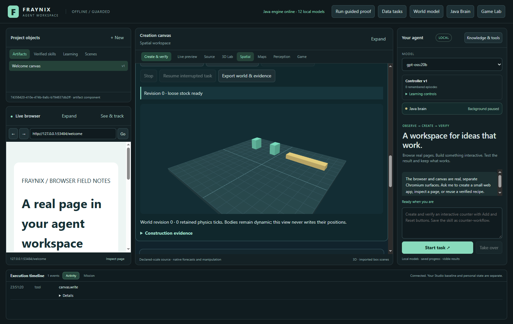
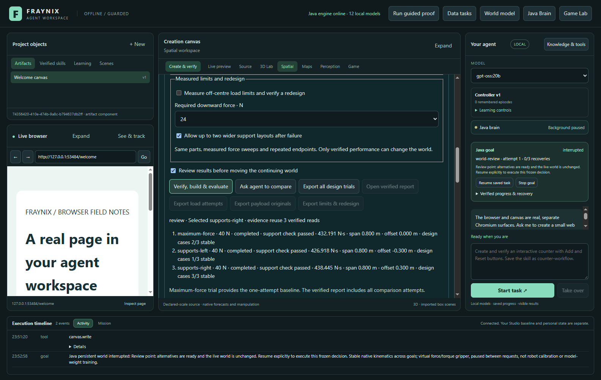
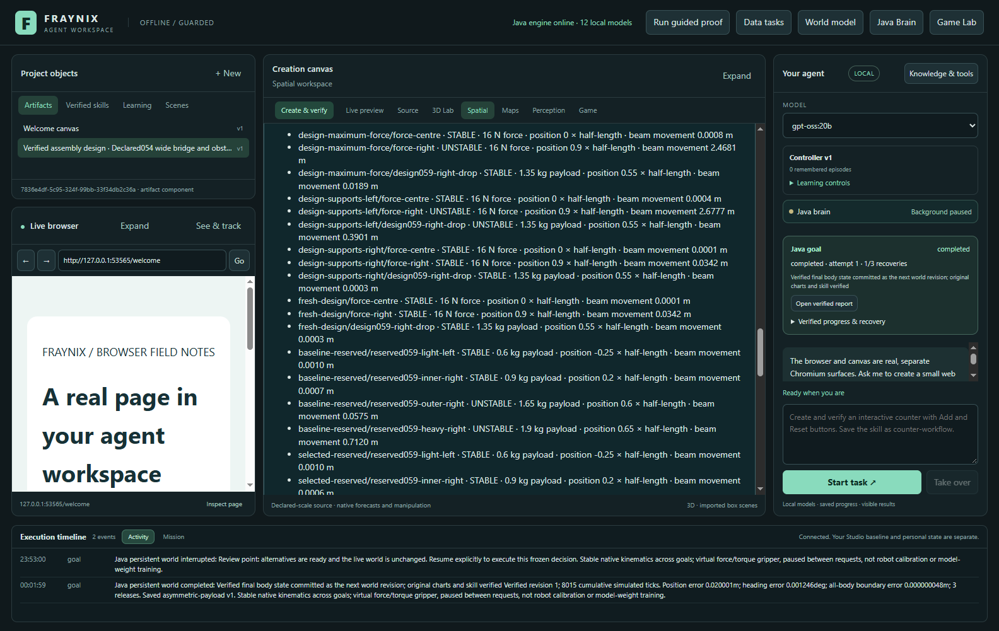
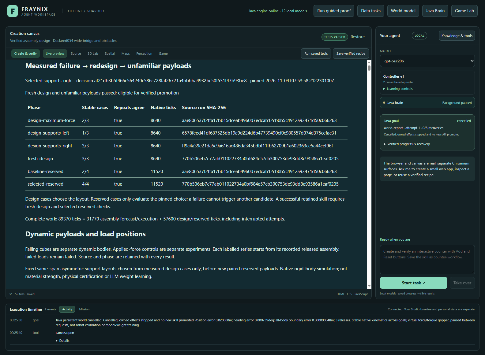
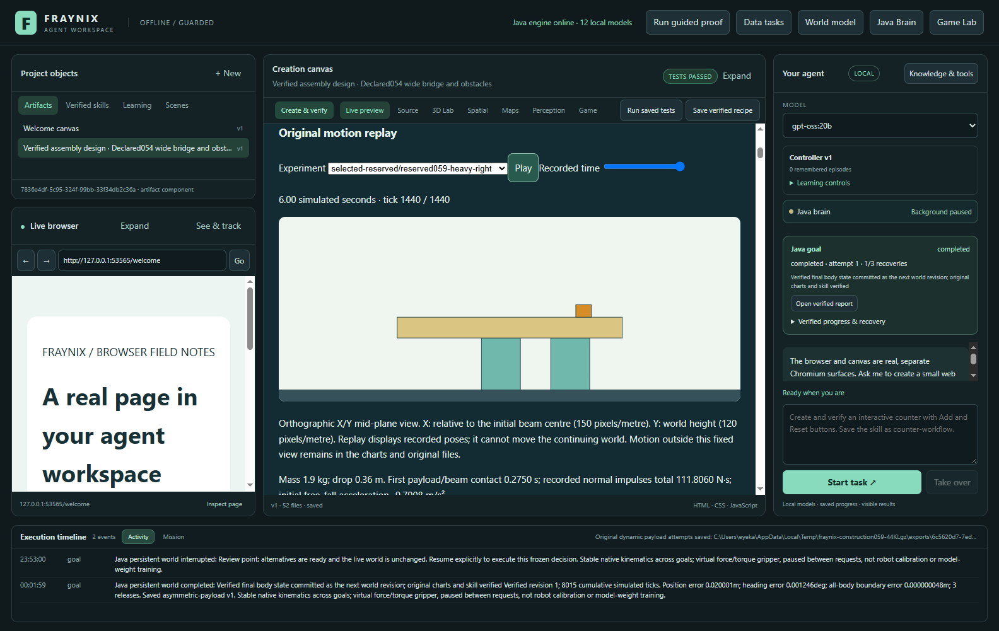
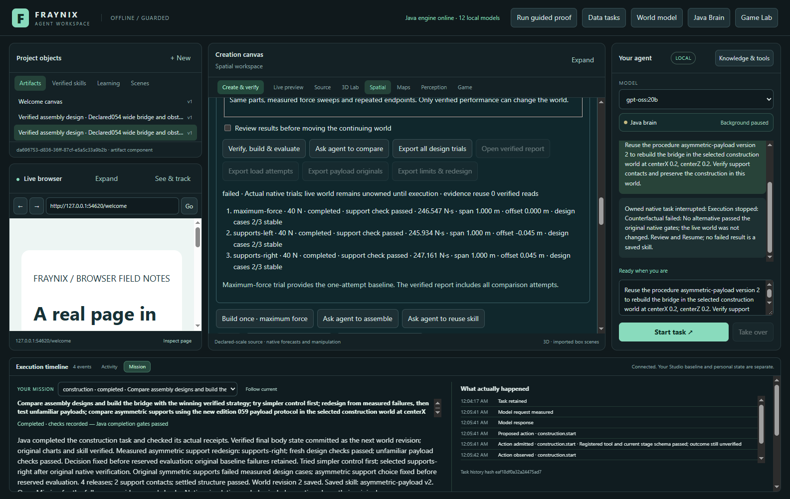
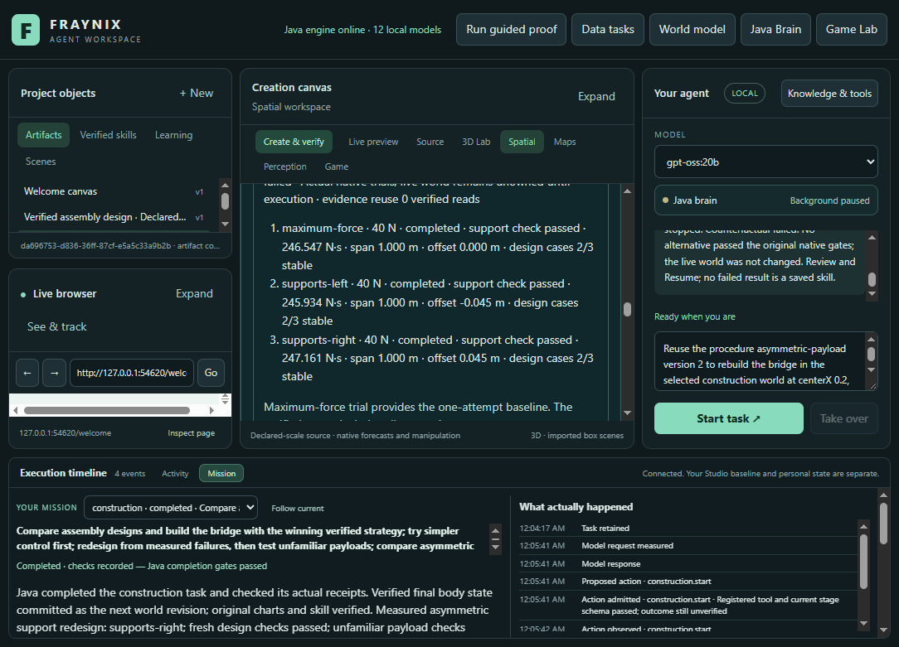
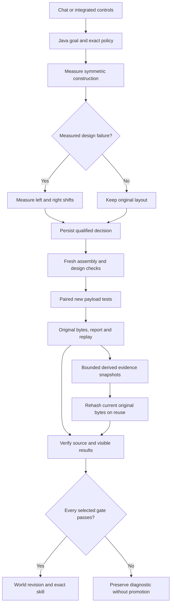

# Fraynix Agent Workspace · Edition 059

## Faster evidence. Asymmetric supports. New payloads.

Edition 059 extends the integrated Java agent workspace with two concrete changes: reuse of verified evidence without trusting file timestamps, and a finite comparison of asymmetric support layouts using the same parts. Chat, the Java goal runner, native physics, reports and saved procedures remain one workflow.

[Previous: edition 058](README-058.md) · [Edition history](docs/readmes/INDEX.md) · [Offline illustrated guide](docs/readmes/059/index.html) · [Source tree](docs/readmes/059/FILE_TREE.md) · [Frozen acceptance contract](docs/EDITION_059_CONTRACT.md)

All scenes in this edition are **labelled synthetic rigid-body simulations**. A passing result establishes the declared simulation checks, not real material strength, a general physical law or model-weight learning.

## What changed

### Evidence processing

The previous flow repeatedly parsed full native histories, recomputed their derived measurements and reconstructed motion frames or original exports. Java now retains bounded copies of derived evidence in memory. Before using one, it reads and hashes the **complete current original file bytes** and includes the source run, implementation and frozen protocol in the lookup identity. Identical file size and timestamp cannot conceal edited evidence.

Cold reads still perform the original checksum, identity, physics and measurement checks. A failed check never enters the cache. Callers receive independent copies. The cache has a 32 MB encoded budget and at most 32 entries, evicts old entries and rebuilds after restart. It holds derived data, not authority to skip a changed source or change a world.

Private typed snapshots preserve number types and signed zero. An initial development attempt using JSON round trips failed the exact-output benchmark; that failed invocation is retained. The corrected implementation is checked against the same uncached native records, including exact serialized output hashes. No original experiment is deleted to improve timing.

### Asymmetric supports

The optional **Edition 059** mode compares three declared layouts: symmetric supports, the same pair shifted left, and the same pair shifted right. Span, stock geometry, masses, beam position, friction, gravity and gripper limits stay fixed. The pair shifts by at most 0.30 m, reduced when necessary to preserve the existing 0.08 m beam-end margins.

Only a measured failure in the original design cases admits the alternatives. Both admitted alternatives are measured, even when one passes. The first fully qualified layout in the declared order is selected. Reserved results cannot select or revise it. Additional planned support travel and actual assembly effort/ticks remain visible in the original candidate evidence.

### Continuing worlds and exact skills

The selected layout is built freshly and rechecked. Original and selected constructions then face the same new reserved payloads. A successful world revision and procedure require all selected checks, actual displayed report receipts and original-source verification.

Saved procedures retain the 059 policy and cannot silently switch to the older 058 suite. Closed published 058 worlds have an explicit upgrade action that preserves their frames and history. Pending owners and unknown engine identities refuse upgrade. This release does not automatically migrate private projects or restart the user's earlier review installation.

The isolated app launcher now applies the same 768 MiB Java heap limit as the normal launcher. An earlier development run exposed the missing limit; it was stopped through the app, retained its unfinished evidence, and promoted no skill. The complete workflow was then rerun in a separate bounded project. This limit covers the Java heap, not total process or graphics memory.

## Measured results

| Reserved payload | Original layout | Selected fresh layout | Original movement m | Selected movement m |
| --- | --- | --- | ---: | ---: |
| reserved059-light-left | Stable | Stable | 0.001003 | 0.000994 |
| reserved059-inner-right | Stable | Stable | 0.000664 | 0.000636 |
| reserved059-outer-right | **Unstable** | Stable | 0.057454 | 0.000550 |
| reserved059-heavy-right | **Unstable** | Stable | 0.712043 | 0.001977 |

The original symmetric 0.8 m span passed 2/3 design cases; shifting the pair left passed 1/3; shifting right by 0.30 m passed 3/3. The span, parts, beam position and actuator limits stayed fixed. Its decision was fixed before reserved evaluation. Every case was repeated.

The initial wide-stock task took **637.629 seconds**, including its intentional review and cold desktop restart.

**56 distinct targeted Java cases across 11 classes**, **126 desktop checks**, and the actual app/local-model workflow pass with source-qualified evidence. The changed-centre chat took **825.751 seconds**; compact saved-skill reuse ended **interrupted** after **249.292 seconds**. These are complete task observations, including computation, persistence and verification; not model-only latency.

**Evidence reconstruction benchmark:** median 1563.601 ms uncached versus 183.582 ms cached, **8.52× faster** on this actual six-attempt record. Five alternating pairs after warmup; serialized output hashes match. Each lookup still reads and hashes the original bytes. This measures reconstruction, not full chat or simulation speed.

- **Original wide stock:** completed. Fresh design and all selected reserved cases passed. 40 payload attempts, 57,600 design/reserved ticks and 89,370 total recorded native ticks.
- **Changed centre:** completed. Fresh design and all selected reserved cases passed. 40 payload attempts, 57,600 design/reserved ticks and 94,890 total recorded native ticks.
- **Compact stock:** interrupted. Execution stopped: Counterfactual failed: No alternative passed the original native gates; the live world was not changed. Review and Resume; no failed result is a saved skill. No successful world or skill promotion.

**Compact-stock contrary result:** the available beam-end clearance permits only a 0.045 m pair shift at its original 1.0 m span. All three layouts passed 2/3 design cases; none qualified. The app stopped before reserved evaluation, kept revision 0, and saved no new procedure. The previously completed wide-stock world remained unchanged.

## Frozen experiment design

The [contract](docs/EDITION_059_CONTRACT.md) was committed before implementation and experiments. Development stock is the wide kit with a 0.8 m original support span, beam centre (0,0), and a 40 N / 4 N·m virtual gripper. Further app checks use centre (0.2,0.2) and compact stock with its original 1.0 m span.

Design cases are a 16 N centre force, a 16 N force at +90% of beam half-length, and a new 1.35 kg cube dropped 0.22 m at +55%. Forces act during seconds 1–3. Each case runs six simulated seconds at 240 Hz, twice.

| New reserved case | Mass kg | Half-length fraction | Drop m |
| --- | ---: | ---: | ---: |
| Light left | 0.60 | -0.25 | 0.16 |
| Inner right | 0.90 | +0.20 | 0.12 |
| Outer right | 1.65 | +0.60 | 0.30 |
| Heavy right | 1.90 | +0.65 | 0.36 |

Payloads are separate 0.18 m cubes, friction 0.55 and restitution 0.05, released at rest. Native gravity, impulses and contacts determine subsequent motion. Every reserved case is repeated on both the original released construction and the freshly executed selected construction. These are new relative to the 058 suite; deterministic repeats test reproducibility, not independent real-world trials.

Unchanged gates include maximum beam displacement of 0.05 m, tilt of 5°, final speed of 0.08 m/s and both support contacts in all 20 final samples. Payload retention, free fall and impact are checked separately. Failures remain failures. No post-evaluation tuning or automatic increase in available material is permitted.

## Try the actual app

1. Start the Java-backed workspace using the [existing setup guide](README-005.md). Use a separate project for experimental work.
2. Open **Spatial → Gripper assembly → Asymmetric supports · new payloads**. This creates labelled stock in a separate world.
3. Open **Compare assembly strategies**. Edition 059 enables direct-first design and its own frozen payload suite.
4. Choose **Review results before moving the continuing world**, then **Verify, build & evaluate**. Inspect the symmetric, left and right results, including failed cases.
5. Resume the reviewed decision. Java performs fresh construction, design rechecks and paired reserved evaluation.
6. Open the verified report for phase tables, original motion curves and recorded payload replay. Export payload originals or all design trials.
7. Use **Ask agent to compare** with an available local model. Chat selects the typed task; Java owns execution and verification.
8. Select the saved procedure in a new world. Its exact protocol remains attached; changed conditions require fresh evidence. Stop retains partial work and prevents a world/skill promotion.

Example request: “Compare asymmetric supports using the new edition 059 payload protocol, test unfamiliar payloads, and save the verified procedure.” This is a bounded experiment, not permission for unrestricted self-modification.

## Actual application screenshots

### Labelled synthetic stock before assembly

November 4, 2026 UTC · actual app capture · labelled synthetic practice scene. [Original image](docs/readmes/059/construction059-stock.png).

### Measured baseline failure and a decision awaiting review

November 4, 2026 UTC · actual app capture · labelled synthetic practice scene. [Original image](docs/readmes/059/construction059-review.png).

### Fresh design and unfamiliar payload results

November 4, 2026 UTC · actual app capture · labelled synthetic practice scene. [Original image](docs/readmes/059/construction059-results.png).

### Retained first report; the side panel shows the later stopped task

November 4, 2026 UTC · actual app capture · labelled synthetic practice scene. [Original image](docs/readmes/059/construction059-report.png).

### Recorded motion of the unfamiliar heavy payload

November 4, 2026 UTC · actual app capture · labelled synthetic practice scene. [Original image](docs/readmes/059/construction059-replay.png).

### Completed chat mission beside the later compact-stock rejection

November 4, 2026 UTC · actual app capture · labelled synthetic practice scene. [Original image](docs/readmes/059/construction059-chat.png).

### Compact rejection at narrow width; earlier completed mission remains selected below

November 4, 2026 UTC · actual app capture · labelled synthetic practice scene. [Original image](docs/readmes/059/construction059-compact.png).

## How the parts connect

| Responsibility | Implementation |
| --- | --- |
| Finite same-stock support hypotheses and new protocol | [SupportDesign059.java](workspace-engine/src/main/java/fraymus/workspace/SupportDesign059.java), [protocol](workspace-engine/src/main/resources/construction059-protocol.json) |
| Decision, fresh execution and paired evaluation | [Design058.java](workspace-engine/src/main/java/fraymus/workspace/Design058.java), [Counterfactual045.java](workspace-engine/src/main/java/fraymus/workspace/Counterfactual045.java) |
| Original native histories and derived series | [PayloadSeries058.java](workspace-engine/src/main/java/fraymus/workspace/PayloadSeries058.java), [Payload057.java](workspace-engine/src/main/java/fraymus/workspace/Payload057.java) |
| Bounded reuse and exact numeric snapshots | [Evidence059.java](workspace-engine/src/main/java/fraymus/workspace/Evidence059.java), [EvidenceValue059.java](workspace-engine/src/main/java/fraymus/workspace/EvidenceValue059.java) |
| Persistent goals, exact procedures and promotion | [GoalRunner.java](workspace-engine/src/main/java/fraymus/workspace/GoalRunner.java), [WorldLedger.java](workspace-engine/src/main/java/fraymus/workspace/WorldLedger.java) |
| Integrated interaction | [construction051.js](workspace-desktop/renderer/construction051.js), [Domain044.java](workspace-engine/src/main/java/fraymus/workspace/Domain044.java) |
| Full actual app validation | [construction059-integration.cjs](workspace-desktop/test/construction059-integration.cjs) |

No new runtime dependencies were introduced. Existing native rigid-body integration remains in use; the new design, evidence and scheduling logic is owned Java code.

## Verification and original evidence

[Source-qualified results](docs/readmes/059/verification.json) · [Original evidence inventory](docs/readmes/059/original-evidence.json) · [Actual desktop workflow](docs/readmes/059/desktop-live.json) · [Performance measurements](docs/readmes/059/performance.json) · [System map](docs/readmes/059/system-map.json) · [Obsidian canvas](docs/obsidian/asymmetric-evidence.canvas)

Targeted tests cover cache tampering, identical timestamp/size edits, numeric fidelity, bounded retention, caller mutation, failed checks, geometry margins, explicit policy, distinct reserved cases, cold world handoff, exact skill requirements and native experiments. The full app test uses actual local-model calls and actual displayed report checks. Counts and source commits are reported with the results; this is not a claim that every repository test was run.

## Next steps and limits

1. Profile remaining full-task delays separately: local-model planning, native simulation, disk persistence, report construction and display verification. Keep the original checks and report measured results rather than assuming a cache makes every stage faster.
2. Declare a richer finite repair space, such as individually placed supports or braces, with explicit material and action costs. Freeze the proposal and selection rules before new experiments.
3. Evaluate less directional objectives and new stock, obstacle and payload combinations. A useful asymmetric design for one load distribution is not universal.
4. Connect verified simulated designs to measured camera/sensor observations only with explicit scale, uncertainty and independent checks. Existing camera limitations remain; this release does not establish hardware control or real-world load limits.

The larger direction remains an integrated local agent that proposes, executes, observes, verifies and retains useful procedures within a persistent world. This edition improves two measurable parts of that loop. It does not establish consciousness, general intelligence or training of the language model's weights.
