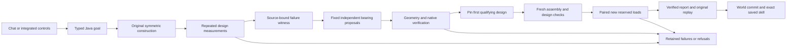
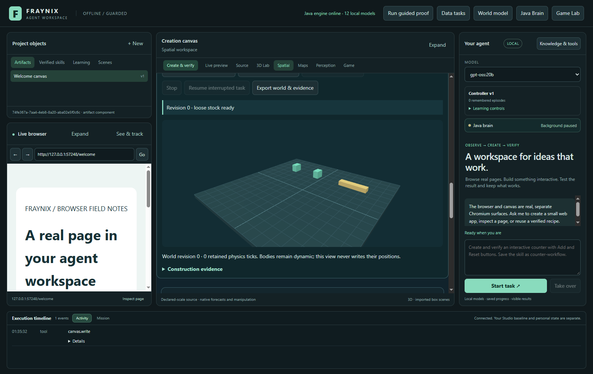
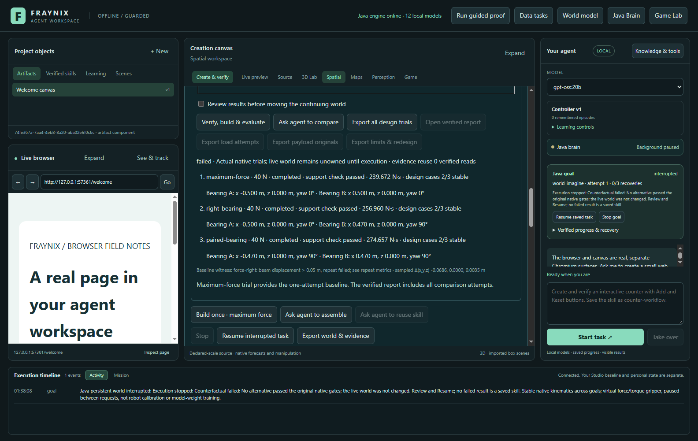
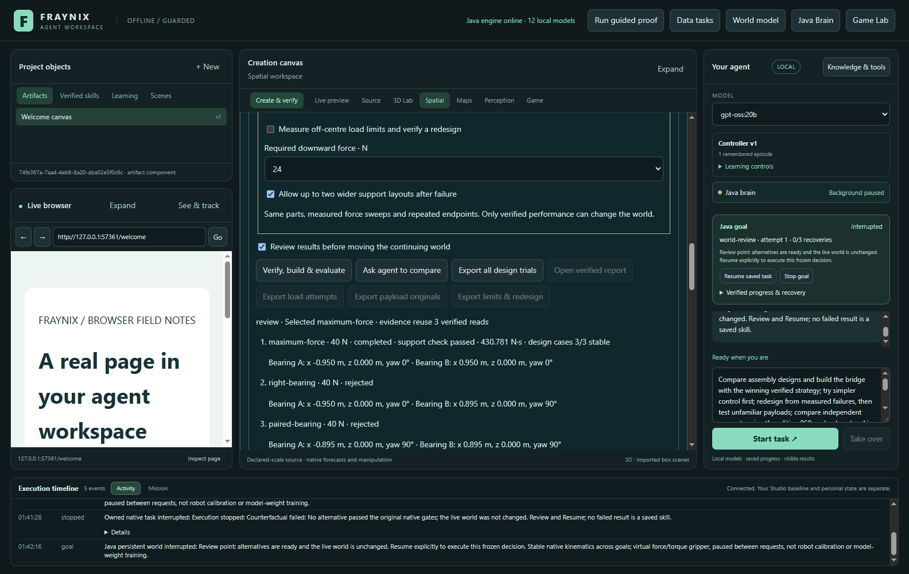
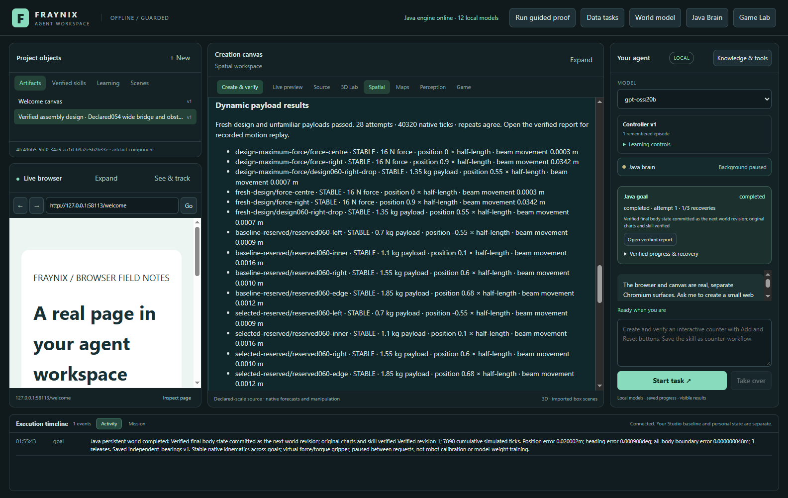
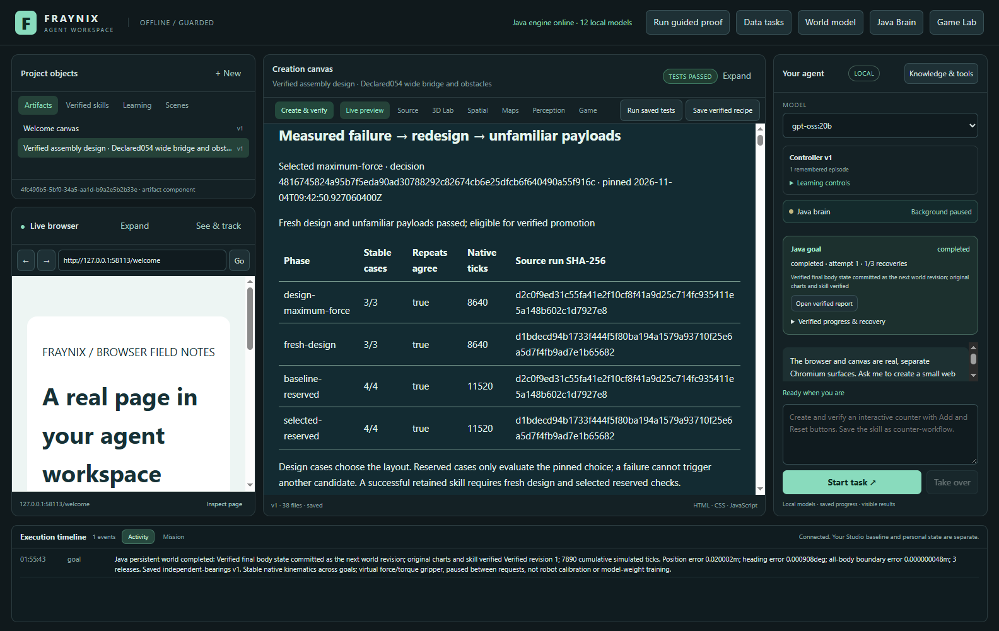
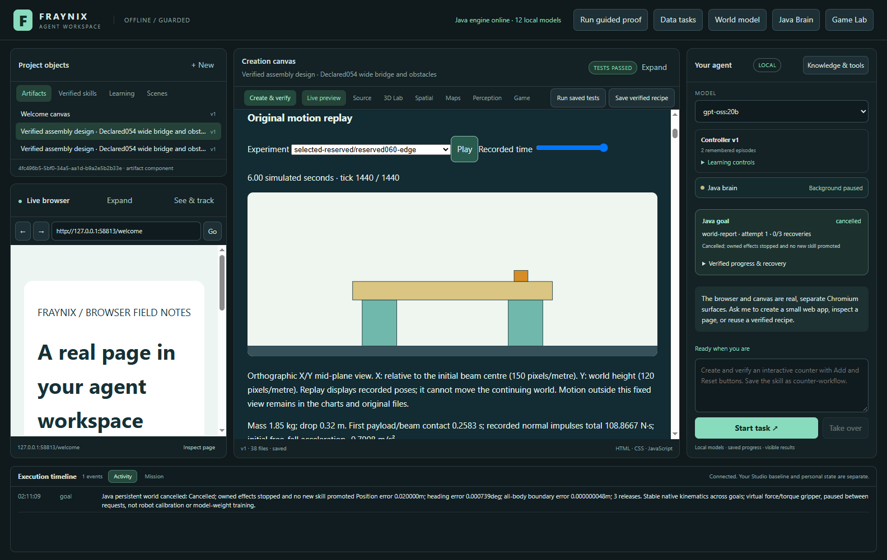
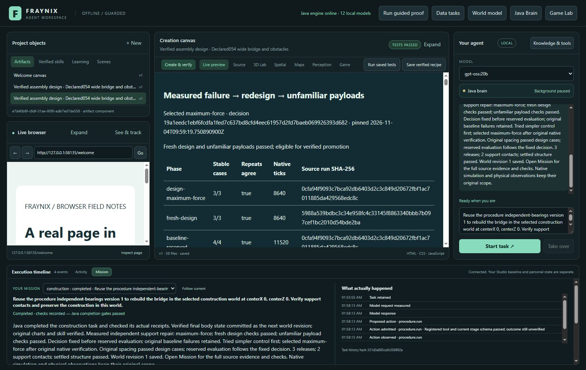
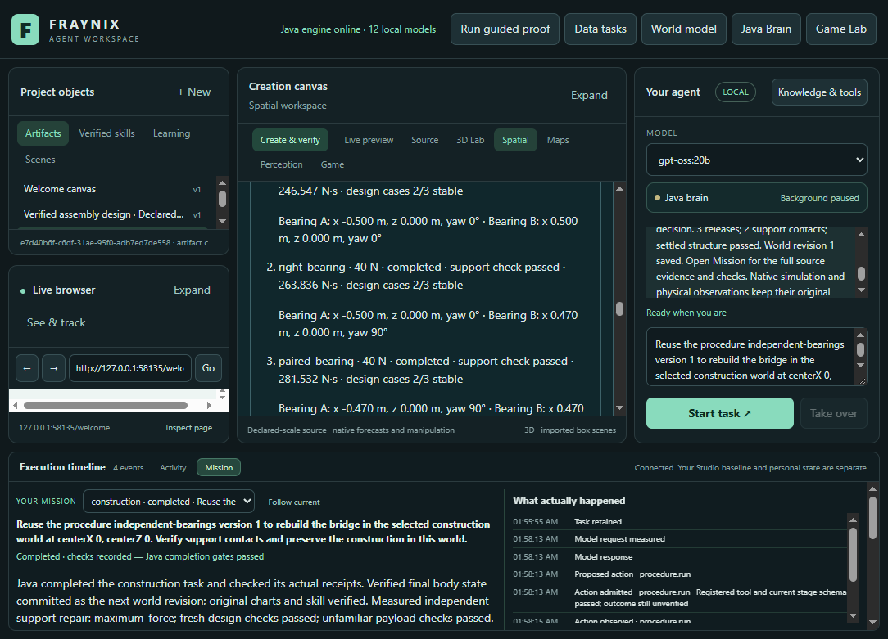

# Fraynix Agent Workspace · Edition 060

**Independent support placement, measured repair witnesses, and compact-stock limits.**

[Previous: Edition 059](README-059.md) · [Edition history](docs/readmes/INDEX.md) · [Offline illustrated guide](docs/readmes/060/index.html) · [Source tree](docs/readmes/060/FILE_TREE.md) · [Original evidence](docs/readmes/060/original-evidence.json)

This edition gives the existing Java construction agent two independently positioned and rotated bearings. The same virtual gripper must pick up, move, turn, release and settle the real simulated bodies. It retains every unsuccessful layout, rejects geometrically invalid proposals, and verifies a fresh execution before saving a reusable procedure. Chat, the continuing world, original reports and saved skills remain in the existing integrated application.

The compact-stock experiments are deliberately capable of failing. The requested improvement is working independent placement and honest repair evaluation, not a promise that three fixed layouts can carry every load. **No failed compact repair is relabelled as a successful design.** The original wider stock supplies a separately verified complete workflow when compact stock cannot qualify.

## What changed

- Each support can have its own relative X/Z position and 0° or 90° yaw. Typed Java inputs require both placements, reject mixed legacy span/offset options, and check the actual rotated footprints.
- A finite repair policy tests the original symmetric layout, a rotated right bearing, and two rotated bearings. Actual baseline failure is required before either repair can be executed. Both admissible alternatives are measured, even if the first succeeds.
- A measured repair witness records failed gates, original attempt identifiers, source hashes and the largest sampled translation vector. This is a diagnostic, not an assertion of causation or success. Audit and original export reconstruct it from verified records.
- Invalid geometry is retained as an explicit refusal with no executable route. The wider beam, for example, cannot be fully covered by the stock's narrower face after a 90° rotation. The original valid layout can still be tested.
- Chat requests, exact saved policies, replay, exports and the integrated controls carry the new independent-support mode. Edition 058 and 059 remain distinct policies.
- Closed edition 059 worlds require an explicit compatibility handoff. Tests preserve all old frames and revisions and refuse pending owners or unknown engine identities.

No runtime library, second brain service or additional application window was introduced. This is new owned Java planning, validation and evidence logic using the existing native rigid-body solver and desktop surfaces. It does not remove the application's existing dependencies or replace its solver with a newly written pure-Java physics engine.

## The compact repair experiment

The acceptance contract was committed before implementation and new native trials: [frozen edition 060 contract](docs/EDITION_060_CONTRACT.md). The compact starting layout uses a 1.0 m support span, a 1.6 m beam, the original stock and a 40 N / 4 N·m virtual gripper. The beam's target centre remains fixed.

| Candidate | Bearing A relative X / yaw | Bearing B relative X / yaw | Extra declared support translation | Extra declared rotation |
| --- | --- | --- | ---: | ---: |
| Original symmetric | −0.500 m / 0° | +0.500 m / 0° | 0 m | 0° |
| Right bearing | −0.500 m / 0° | +0.470 m / 90° | 0.030 m | 90° |
| Paired bearings | −0.470 m / 90° | +0.470 m / 90° | 0.060 m | 180° |

Z is zero in these fixed candidates. The underlying typed placement input supports separate valid Z values; it is not a claim of arbitrary 3D construction planning. Declared extra travel compares target positions with the original layout; actual native motion, effort, duration and complete task cost remain in the evidence.

Every support must retain a 0.08 m longitudinal beam-end margin, cover the beam transversely and maintain at least a 0.20 m clear gap. The planner also checks floor limits and pickup/lowering corridors. It never changes masses, dimensions, friction, gravity, beam centre or actuator limits to make a trial pass.

Design cases are the same three physical challenges used in 059: a 16 N central force, a 16 N force at +90% of beam half-length, and a 1.35 kg cube dropped 0.22 m at +55%. Each runs six seconds at 240 Hz, twice. Force applies during seconds one through three. The published policy names this edition's drop case separately so records cannot be silently confused with earlier protocols.

The unchanged pass gates include maximum beam displacement 0.05 m, tilt 5°, final speed 0.08 m/s, both support contacts in all 20 final samples, and payload retention, free-fall and impact checks. Failures stop promotion; they do not automatically justify another unbounded repair attempt.

## New reserved conditions

The first qualifying design is pinned before these cases become evaluation evidence. A fresh assembly repeats the design cases, then original and selected constructions receive the same new reserved cases. The selection is never changed in response to reserved results.

| Case | Mass | Position as beam half-length fraction | Drop |
| --- | ---: | ---: | ---: |
| Left | 0.70 kg | −0.55 | 0.18 m |
| Inner | 1.10 kg | +0.10 | 0.20 m |
| Right | 1.55 kg | +0.60 | 0.28 m |
| Edge | 1.85 kg | +0.68 | 0.32 m |

Each cube is 0.18 m on a side, with friction 0.55 and restitution 0.05. Every case is repeated. Repeated deterministic simulation is a consistency check, not two independent physical measurements or a real material-strength certification.

## Measured results and validation

| Reserved payload | Original layout | Selected fresh layout | Original movement m | Selected movement m |
| --- | --- | --- | ---: | ---: |
| reserved060-left | Stable | Stable | 0.000872 | 0.000872 |
| reserved060-inner | Stable | Stable | 0.001618 | 0.001618 |
| reserved060-right | Stable | Stable | 0.001014 | 0.001014 |
| reserved060-edge | Stable | Stable | 0.001229 | 0.001229 |

| Compact candidate | Centre-force movement m | Edge-force movement m | Drop movement m | Stable design cases |
| --- | ---: | ---: | ---: | ---: |
| maximum-force | 0.000707 | 0.068871 | 0.001470 | 2/3 |
| right-bearing | 0.000135 | 0.068638 | 0.003599 | 2/3 |
| paired-bearing | 0.000348 | 0.068787 | 0.002436 | 2/3 |

Compact stock retained all three measured design failures. The wide workflow uses its original 1.9 m spacing; rotated alternatives are geometrically refused because the rotated stock cannot cover the wider beam. That is successful validation of the original wide layout, not evidence that compact repair succeeded.

**62 distinct targeted Java cases across 12 classes**, **127 desktop checks**, and the actual app/local-model workflow passed with source-qualified evidence.

The first wide workflow took **397.019 seconds**, including intentional review and restart. Changed-centre compact chat took **182.172 seconds** and ended **interrupted**; cold saved-skill reuse took **490.362 seconds** and ended **completed**. These include persistence and verification, not just model generation.

- **wide:** completed. Fresh design: True; selected reserved: True. 28 payload attempts, 40320 design/reserved ticks, 56100 complete native ticks.
- **changedCompact:** interrupted. Execution stopped: Counterfactual failed: No alternative passed the original native gates; the live world was not changed. Review and Resume; no failed result is a saved skill. No successful world or skill promotion.
- **compact:** interrupted. Execution stopped: Counterfactual failed: No alternative passed the original native gates; the live world was not changed. Review and Resume; no failed result is a saved skill. No successful world or skill promotion.
- **reuseWide:** completed. Fresh design: True; selected reserved: True. 28 payload attempts, 40320 design/reserved ticks, 56100 complete native ticks.

The compact native runs and actual app attempts retain their displacement, contact and repeat measurements. Failed development checks are also preserved: the initial wide candidate planner incorrectly aborted the valid baseline when a rotated alternative was geometrically invalid. The corrected planner retains that alternative as a refusal with no route or actuation.

The detailed [validation record](docs/readmes/060/verification.json) identifies source commits, test invocations, complete native work, local-model timing, development failures, restarts and original projects. [Original evidence](docs/readmes/060/original-evidence.json) indexes compressed original bytes with both archive and decompressed hashes. These are labelled synthetic practice worlds; private webcam images, live projects, model weights and credentials are excluded.

Tests cover independent geometry and rotations, rejected combinations, explicit geometry refusals, exact policy separation, original stock preservation, measured-failure admission, cold review and continuation, changed-centre chat, saved-skill reuse, refusal to remove checks, altered diagnosis rejection, original export reconstruction, report receipts, recorded replay, narrow layouts and visible Stop with retained partial evidence. The recorded Java count is targeted coverage, not a claim that every historical test was rerun.

The publication verifier now reads JSON explicitly as UTF-8 in Windows PowerShell and streams binary hashes. The first documentation check exposed two copied-review links and a legacy-shell decoding mismatch; its report is retained. All frozen hash and reference checks remain enabled.

## Try it in the application

1. Start the isolated edition's Java engine and desktop using the existing [operations guide](docs/JAVA_CHAT_044.md). Keep a separate project from an older installed runtime. Do not point concurrent versions at the same mutable project.
2. Open **Spatial → Gripper assembly → Independent bearings · compact stock**. This creates a clearly labelled separate practice world with the original dimensions. It does not alter your saved world.
3. Expand **Compare assembly strategies**. Independent supports selects the measured design/reserved policy. Choose a skill name if you want a successful procedure retained, and optionally enable review before execution.
4. Choose **Verify, build & evaluate** or **Ask agent to compare**. Java owns the durable task and physics timing; the local model chooses and explains the typed request. Each proposal's actual position, yaw, outcome and diagnostic remain visible.
5. Read the result. If all compact layouts fail, the world remains uncommitted and no successful skill is saved. A failed design is useful evidence, not a completed construction task.
6. Create the separate **wide** stock at its original **1.9 m spacing** to exercise a verified complete workflow. Keep the same explicit mode; invalid rotated alternatives are shown as refused rather than forced into the scene.
7. Open the verified report for the pinned decision, phase table, paired payload outcomes, witness, charts and original recorded-motion replay. Export the originals through the visible export button.
8. Restart and choose the saved procedure on a fresh world. Its exact independent-support policy remains mandatory. Fresh evidence is required; reuse does not bypass tests or replay a success claim.

A useful chat request is:

> Compare independent supports on this compact stock. Use measured design failures, test unfamiliar payloads, preserve the construction only if all checks pass, and save the successful procedure.

The selected construction world supplies actual object IDs and stock. The agent does not infer permission to edit arbitrary files, remove checks or run imported instructions from this sentence. To test a changed centre, specify `centerX 0.2, centerZ 0.2`; those values are bound into the typed request and range-checked by Java.

## How the pieces fit

The LLM does not control a physics step directly or decide that its own explanation proves a repair. `SupportRepair060` supplies strict geometry, finite hypotheses and a witness reconstructed from actual measurements. `Counterfactual045` owns independent experiments and a fixed decision. `Design058` and `PayloadSeries058` execute the distinct versioned protocol using the original verifier. `GoalRunner` owns interruption, continuation, report acknowledgement and promotion. The existing evidence cache still hashes original bytes before reusing derived values.

The world remains persistent across successful goals. Counterfactual branches and load tests do not secretly mutate it. A cancelled or failed goal retains its evidence without saving an unverified construction. Imported scene state, chat text, proposed code and a model's confident answer remain data until the appropriate owned validator accepts them.

## Your Java, organism and Processing ideas

The five documents contain useful connections to persistent memory, sparse encoders, HDC retrieval, recurrent prediction, state machines, clocks and versioned binary records. The full [idea assessment](docs/IDEAS_060_REVIEW.md) maps them to the existing application, identifies concrete code issues, and proposes staged adoption. [Source hashes and probe provenance](docs/IDEAS_060_PROVENANCE.json) identify the supplied versions without publishing the private conversations.

Edition 060 adopts their strongest operational mechanism: **a witnessed failure can propose a change, but a separate verifier must approve its result**. This improves the system's inspectability without installing a second autonomous brain loop or allowing untested generated kernels to replace the running controller.

The review also found snippets that cannot substantiate their advertised behavior: invalid Java syntax, a purported VM execution returning a fixed value, an absent SQLite driver hidden by a RAM fallback, and an HDC second vote that preserves the original Hamming distance. An exact enumeration of the supplied binary code found minimum distance seven, rather than the advertised extended distance eight; distance seven still supports unique correction through three bit errors. These findings do not discard the ideas. They define the work needed to turn them into dependable components.

There was no wholesale compilation of every supplied program, no neural-training claim, no ESP32 flashing and no new network service. The next useful brain addition is a small, measurable predictor or retrieval mechanism with a simple baseline, frozen unseen cases, resource budgets and rollback—not a score labelled intelligence without an external task measure.

## Screenshots from the actual edition

### Compact stock before assembly

November 4, 2026 UTC · actual app capture · labelled synthetic practice scene. [Original image](docs/readmes/060/construction060-stock.png).

### Measured compact failure; no world promotion

November 4, 2026 UTC · actual app capture · labelled synthetic practice scene. [Original image](docs/readmes/060/construction060-compact.png).

### Wide original layout awaiting review

November 4, 2026 UTC · actual app capture · labelled synthetic practice scene. [Original image](docs/readmes/060/construction060-review.png).

### Fresh wide design and unfamiliar payload results

November 4, 2026 UTC · actual app capture · labelled synthetic practice scene. [Original image](docs/readmes/060/construction060-results.png).

### Actual verified report and phase table

November 4, 2026 UTC · actual app capture · labelled synthetic practice scene. [Original image](docs/readmes/060/construction060-report.png).

### Recorded motion under the new edge payload

The completed wide report was reopened after the Stop check for this capture. The replay shows its original recorded poses; the sidebar shows the separate latest cancelled goal.

November 4, 2026 UTC · actual app capture · labelled synthetic practice scene. [Original image](docs/readmes/060/construction060-replay.png).

### Completed local-model saved-skill reuse

November 4, 2026 UTC · actual app capture · labelled synthetic practice scene. [Original image](docs/readmes/060/construction060-chat.png).

### Changed-centre compact outcome at narrow width

November 4, 2026 UTC · actual app capture · labelled synthetic practice scene. [Original image](docs/readmes/060/construction060-narrow.png).

## Files, continuity and publication

- [Source inventory](docs/readmes/060/file-inventory.json) and [file tree](docs/readmes/060/FILE_TREE.md) identify the canonical implementation used by this edition.
- [Offline guide](docs/readmes/060/index.html) provides a searchable system map, results and original screenshots without a CDN.
- [Obsidian note](docs/obsidian/68-independent-bearings.md) and [canvas](docs/obsidian/independent-bearings.canvas) connect the implementation, acceptance contract, idea review and evidence.
- [Project memory](docs/PROJECT_MEMORY.md) and [development log](docs/DEVELOPMENT_LOG.md) record verified outcomes, limitations and the next step. The previous numbered READMEs and their snapshot assets remain immutable.
- The publication target is the independent private `eyeoverthink/Fraynix-Agent-Workspace` repository. Main, the edition branch and the numbered README tag are pushed without force; an actual fresh GitHub fetch and blob audit precede the publication receipt. Local preparation alone is not a published release.

## Next steps

1. First check contact/timestep sensitivity and a simple equilibrium reference before attributing the measured sideways drift to a physical cause. Then use the compact failure witness to define the next finite repair family. Options include a mechanical restraint, an additional support or another stock choice, each with explicit part/action cost. Freeze the alternatives and new evaluation cases before running them. Do not change this edition's stock or pass criteria retrospectively.
2. Retrieve prior measured failures and successful procedures by geometry and load. Compare retrieval-assisted selection with the current fixed-order baseline on new scenes. Revalidate every retrieved candidate against the current world.
3. Evaluate one bounded sparse/HDC or recurrent predictor against a simple CPU reference. Measure prediction error, uncertainty coverage, total resource cost and successful physical task outcomes separately from neural activity.
4. Promote only repeatable improvements under a declared rule, retaining source, original traces and a rollback version. Show those real processes in the existing integrated world and canvas.

The direction remains one coherent, local, inspectable agent system: Java owns goals, state and evidence; models propose and explain; controllers act; verifiers determine what can be retained. This edition expands the actions it can genuinely execute and makes an unsuccessful repair legible instead of hiding it.
