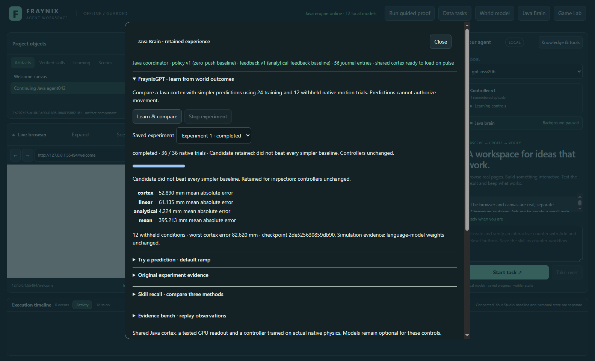
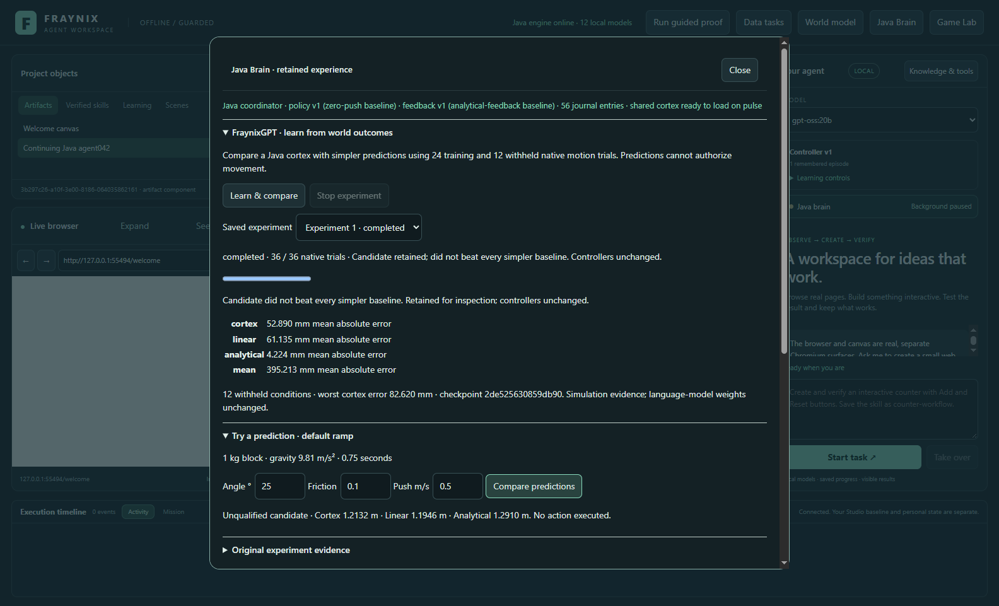
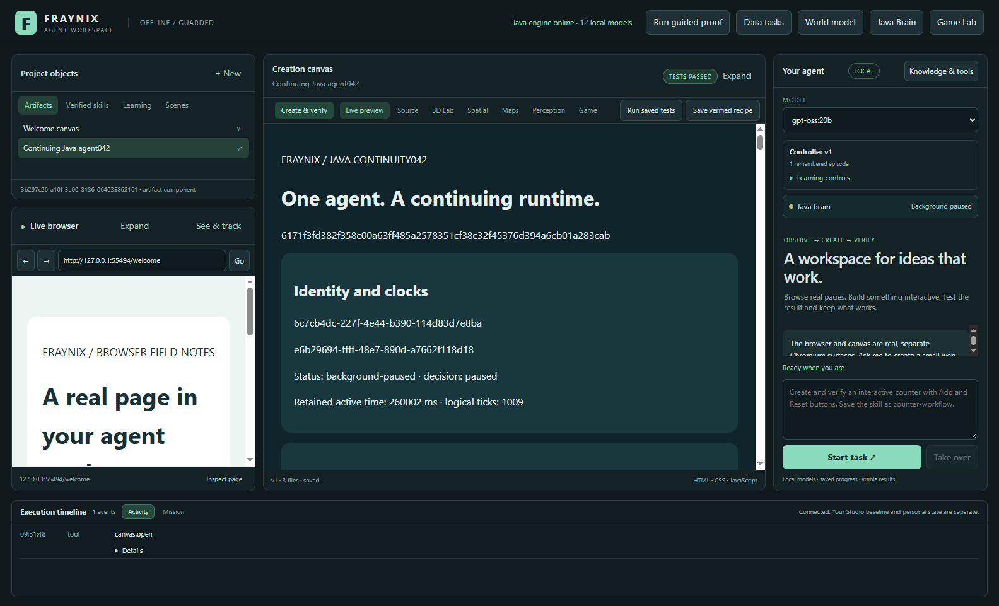
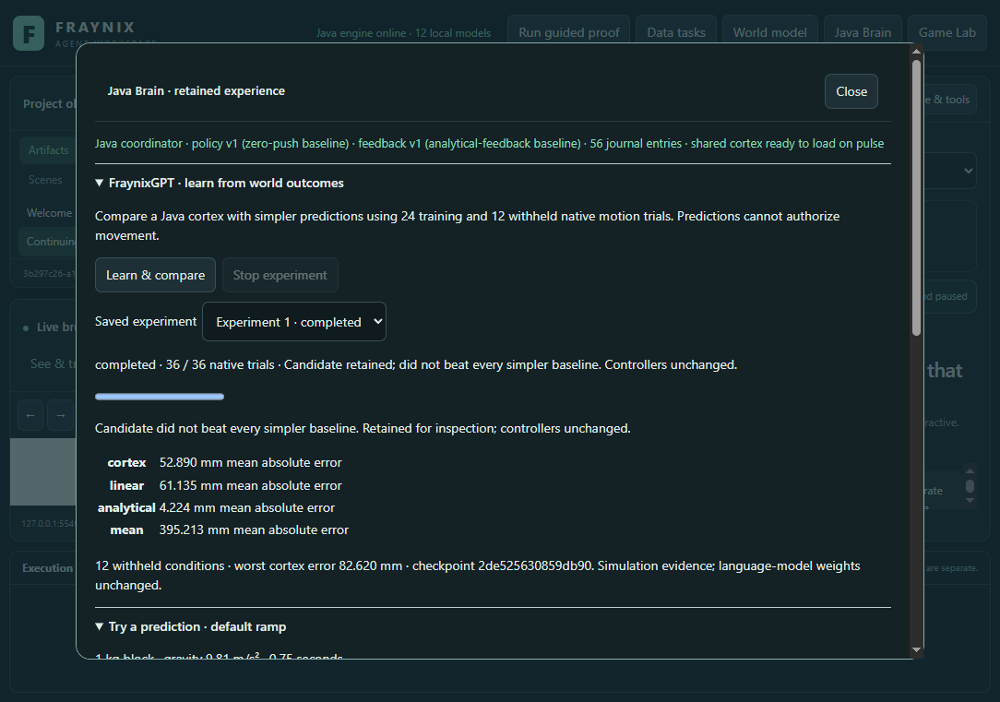

# Edition 061 · FraynixGPT meets measured outcomes

**2026-11-04 · A Java cortex that learns from native motion, retains its complete state, and exposes its limits.**

[Previous: independent support repair](README-060.md) · [Current app](README.md) · [Edition history](docs/readmes/INDEX.md) · [Offline interactive guide](docs/readmes/061/index.html) · [Frozen acceptance contract](docs/EDITION_061_CONTRACT.md)

## What changed

FraynixGPT's numerical brain components now run inside the existing Java application. The Java coordinator can collect real native physics outcomes, update the imported cortex algorithms, fit an outcome readout, freeze it, and compare its predictions on withheld conditions. The existing Brain window shows progress, the measured comparison, bounded prediction controls and the original experiment. The continuing agent's state includes those results, so chat can inspect and report what actually happened.

This edition also repairs the three specific defects found in the supplied FraynixGPT review: silent small sparse encoders, incomplete continuation checkpoints, and acceptance of unsupported checkpoint versions. Those repairs are in the workspace port. The separate upstream FraynixGPT repository is unchanged.

The measured result matters more than the component names. The learned cortex improves over the simple linear readout on these cases, but loses to the analytical model. It is retained as **unqualified**, and no controller is replaced. That is a working evaluation path: actual computation, actual outcomes and an explicit refusal to overstate improvement.

Actual app capture, 2026-11-04, using a separate synthetic review project. These are native simulation measurements, not webcam observations or physical calibration.

## The comparison

| Predictor | Mean absolute endpoint error | Interpretation |
| --- | ---: | --- |
| Training-set mean | 395.213 mm | A constant baseline |
| Linear readout | 61.135 mm | Same physical inputs, without the cortex |
| FraynixGPT cortex + readout | 52.890 mm | About 13.5% lower error than the linear readout |
| Analytical Coulomb model | 4.224 mm | Best of the four on this experiment |

The cortex's worst withheld error was **82.620 mm**. Qualification required at least 5% better mean error than **every** baseline and worst error at most 100 mm. The candidate passed the worst-error limit and failed the analytical comparison. It remains inspectable; actuation authority stays with the original controllers and verifiers.

The design was committed before collecting outcomes. Training uses 24 combinations: angles 10/20/30/40°, friction 0/.15/.30, and initial tangent pushes 0/1 m/s. Evaluation uses 12 separate combinations: angles 15/25/35°, friction .05/.25 and pushes .25/.75 m/s. Each case uses a 1 kg block, gravity 9.81 m/s², the default 12 × 3 m ramp, and 180 native integration ticks at 240 Hz. No model or threshold was tuned after the reserved outcomes.

All methods predict the same 0.75-second endpoint. This is interpolation within a narrow simulated domain. It does not establish unfamiliar-material performance, uncertainty calibration, manipulation competence, real-world accuracy or language-model learning. The analytical model's strong result is useful evidence for keeping physics knowledge in the system.

## Try it

1. Start this checkout with **Launch-Agent-Workspace.bat**, using JDK 21 and the existing desktop dependencies. Docker and WSL are unnecessary. Keep this edition's review data separate from older private projects.
2. Open **Java Brain**, then **FraynixGPT · learn from world outcomes**.
3. Select **Learn & compare**. The Java coordinator saves progress and original records as it completes the 36 trials. **Stop experiment** cancels further computation and retains the partial record.
4. Read the comparison. A completed experiment is not automatically a qualified predictor. The result identifies whether the declared gate passed.
5. Expand **Try a prediction · default ramp**. Enter an angle from 10–40°, friction from 0–.3, and push from 0–1 m/s. **Compare predictions** verifies the saved evidence before returning estimates. It does not move a body.
6. Use **Saved experiment** to reopen an earlier completed result, including after a later experiment was cancelled. Expand **Original experiment evidence** to read the retained inputs, samples, model, prediction and evaluation. Java's existing brain job history also retains cancelled and interrupted records.
7. Close and restart the review app. A completed candidate reproduces its saved prediction without training again. An interrupted experiment is marked interrupted and does not silently continue or qualify.

For chat, ask: **“Inspect FraynixGPT cortex outcome learning. Read the actual Java agent state and create its verified report.”** Java routes that request through the existing agent-state/report procedure. The report contains the saved candidate status and errors. Chat does not gain permission to train models or move objects from this request.

## The three repaired gaps

### Small sparse encoders

The supplied Fly encoder selected cells strictly above its 90th-percentile threshold. At small dimensions the threshold could equal the maximum, leaving no winner. The port selects a deterministic positive top-k: at least one eligible cell, otherwise floor(size/10), with index order breaking ties. Zero activity stays zero. The input and output dimensions and numeric values are bounded. Tests cover sizes 1, 2, 4, 8, 10, 32 and 128, repeatability, zero input and invalid input.

The projection still uses the source's deterministic sparse weights. We changed selection semantics to make small encoders functional; this is not a claim that sparse activity by itself produces useful intelligence.

### Complete continuation

The old seal retained weights and activation but omitted lifecycle fields that influence later behavior. The new versioned checkpoint preserves active columns and fossils, weights, activations, predictions, parent lineage, generation, role, phase, frequency, accumulated and latest surprise, stress/idle/flash counters, lifecycle counters, logical tick, coherence, mean phase and retained snapshots.

Continuation tests deliberately include nonempty fossils and nondefault counters and frequencies. After restore, uninterrupted and split executions produce identical snapshots and complete checkpoint bytes through further lifecycle and consolidation steps. The history is bounded to 64 snapshots and 32 fossils; normal active columns are capped, with the original master consolidation allowance. No wall-clock time or hidden random generator determines the resumed trajectory.

This is full continuation of the ported numerical hive. It is not a replacement for the app's durable task store, nor a second background daemon. The existing Java coordinator owns the experiment. The pre-existing heartbeat, identity and sensory cortex remain separate established responsibilities in the same process.

### Strict checkpoint admission

The codec admits only its supported magic and version, bounded dimensions and counts, finite numeric state, valid identities and exact byte consumption. Unknown versions fail even if someone recomputes the checksum. Truncation, changed bytes, excessive counts, nonfinite values and trailing bytes are rejected. Restore constructs a candidate object before the caller replaces anything, so rejected data does not alter the running brain.

Legacy FRAYSEAL v19 is not silently upgraded into a complete continuation. It never contained all the required state. SHA-256 establishes byte integrity, not authorship or trust. External data still needs the application's source and capability checks.

## Where the learning happens

```mermaid
flowchart LR
    U[Brain controls or chat inspection] --> J[Existing Java coordinator]
    J --> P[Native Bullet ramp trials]
    P --> V[Trace and source verification]
    V --> C[FraynixGPT Chronos plasticity]
    C --> R[Training-only readout fit]
    R --> F[Frozen candidate]
    F --> E[Withheld native evaluation]
    E --> G[Comparison against three baselines]
    G --> S[Durable evidence and advisory prediction]
    S --> A[Agent state and verified report]
```

Each training record has a unique outcome ID. The verifier checks the source implementation fingerprint, record hash, complete sampled clock, native positions and their endpoint projection. The readout's learned weights and the cortex checkpoint can be reconstructed from the exact training records. Duplicate records, partition changes, altered predictions, changed evaluations and inconsistent learned state are refused. Evaluation records never train the candidate. Predictions for those records are saved before the corresponding native trials execute.

The hive adapts the verified training input patterns without supervised endpoint labels. The readout learns the observed endpoints: it is ridge regression implemented in Java. Its input includes normalized physical inputs, the trained hive's frozen projections and the repaired sparse encoder. The linear ablation uses the same physical inputs without the cortex. This comparison tests whether the additional features help; it does not equate a changing weight with a successful policy.

Native Bullet uses single-precision positions. The first cold audit found a difference between those binary32 values and their shortest serialized decimal representations. The repair decodes them back to binary32 before reconstructing the double-precision endpoint projection. The original failed audit is preserved. Neither the motion nor the 100 mm qualification limit was changed to accommodate it.

## Source map and ownership

| File | Responsibility |
| --- | --- |
| [FraynixCortex061.java](fraynix-modules/brain-core/src/main/java/fraymus/neural/FraynixCortex061.java) | Owned Chronos/Fly algorithms, bounded state and complete codec |
| [OutcomeReadout061.java](fraynix-modules/brain-core/src/main/java/fraymus/neural/OutcomeReadout061.java) | Feature composition and deterministic readout fitting |
| [FraynixOutcome061.java](workspace-engine/src/main/java/fraymus/workspace/FraynixOutcome061.java) | Native experiment, source binding, verification and evaluation |
| [BrainService.java](workspace-engine/src/main/java/fraymus/workspace/BrainService.java) | Existing single Java job owner, durable progress, cancellation and prediction access |
| [AgentRuntime042.java](workspace-engine/src/main/java/fraymus/workspace/AgentRuntime042.java) | Continuing agent state includes measured outcome status |
| [cortex061.js](workspace-desktop/renderer/cortex061.js) | Integrated controls, comparison and retained evidence |
| [Native/core tests](workspace-engine/src/test/java/fraymus/workspace/FraynixOutcome061Test.java) | Real native outcomes, cold reload, altered evidence and cancellation |
| [Actual app test](workspace-desktop/test/cortex061-integration.cjs) | Visible controls, restart, prediction, local-model chat and Stop |

The original numerical algorithms were reviewed at [FraynixGPT commit f81d58a](https://github.com/eyeoverthink/fraynix-gpt/tree/f81d58a07790256c07b30c0d12958748b0ec329d). This port deliberately excludes demonstration role strings that purported to be compiler/security tools. Tool authority remains in the real workspace dispatcher. Internal HDC voting and replay are numerical mechanisms, not independent world witnesses.

No new runtime library was added. The numerical port uses JDK classes. The application continues to use its already installed JSON, Electron/Chromium and native physics dependencies. Java ownership does not mean these existing components disappeared.

## Validation and evidence

[Verification inventory](docs/readmes/061/verification.json) · [Original compressed records](docs/readmes/061/original-evidence.json) · [Canonical source inventory](docs/readmes/061/file-inventory.json) · [File tree](docs/readmes/061/FILE_TREE.md)

**50 distinct targeted Java checks across seven classes and 127 desktop checks passed.** Actual app workflows and the final saved-experiment review are recorded separately. The new Java tests exercise encoder activity, deterministic continuation, unsupported formats, malformed checkpoints, actual native learning, evidence reconstruction, cold prediction, out-of-domain refusal and cancellation. Focused regressions cover the existing brain, durable policies, continuing agent, chat routing and domain verification. Desktop and actual-app checks are recorded separately; these are not presented as a full Java suite or one combined invocation.

The actual UI test retains its first failed attempt: the test used an exact button name that omitted the visible arrow on **Start task ↗**. The corrected locator continued with the same experiment rather than discarding its original measurements. Screenshots and logs identify their source and scope. Existing frozen editions 001–060 remain unchanged.

## What this makes possible next

The useful foundation is now an inspectable chain: computation → prediction → observation → comparison → retained state. It can support more capable agents without letting an impressive internal diagram stand in for measured performance.

1. **Learn residuals where the analytical model is weak.** Keep physics as the baseline and learn its error on contact, friction transitions and changing loads. Predeclare fresh evaluation cases before fitting.
2. **Use verified construction outcomes as a second domain.** Extend the same typed observation contract to support/load traces. Preserve failed repairs, source geometry and counterfactual isolation. A ramp readout must not be applied to a bridge simply because both are physics.
3. **Add calibrated uncertainty and abstention.** Evaluate interval coverage on new conditions. Outside the observed domain, request a new experiment rather than return a confident extrapolation.
4. **Evaluate retrieval and continual learning.** Separate replay from new measurements, prevent duplicates, and compare updates against frozen earlier capabilities. Promote only after new and retained evaluations pass; retain a rollback point.
5. **Only then test decision utility.** An advisory predictor can propose which bounded experiment to try next. Measure total native work, failure rate and completion quality against simpler selection. Existing verifiers must remain final authority.

These are next-phase acceptance gates, not installed features. Edition 061 provides the working numerical bridge and the evidence needed to choose the next experiment honestly.
