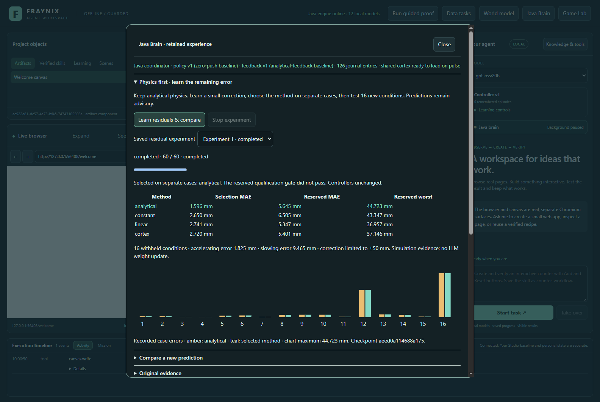
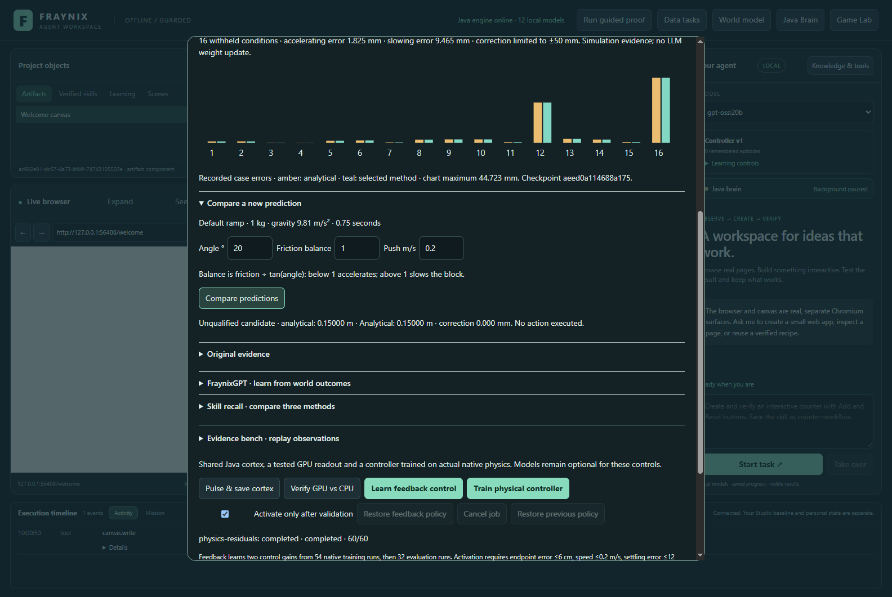
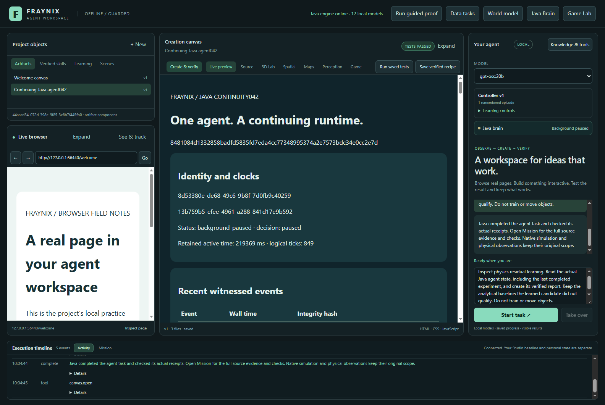
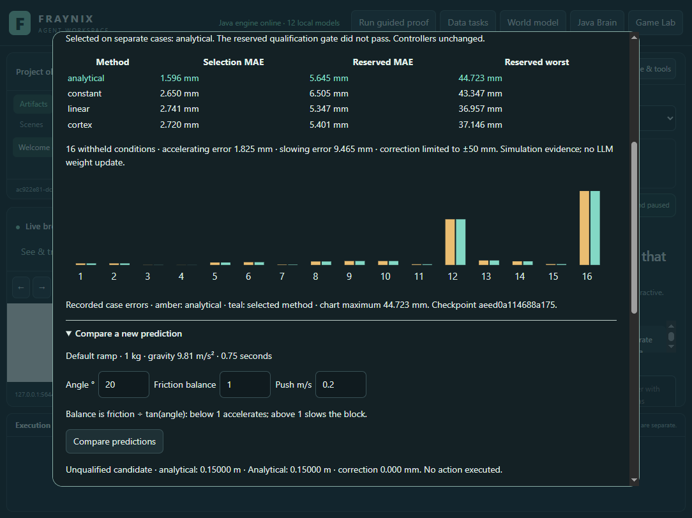

# Edition 062 · Physics first, learned residuals

November 4, 2026 · Fraynix Agent Workspace · local Java implementation

[Previous: FraynixGPT and verified outcomes](README-061.md) · [Edition history](docs/readmes/INDEX.md) · [Interactive offline guide](docs/readmes/062/index.html) · [Original evidence](docs/readmes/062/original-evidence.json) · [Verification](docs/readmes/062/verification.json)

The Java brain can now learn a bounded correction to analytical physics, choose a method using separate observations, and evaluate that frozen choice on new conditions. It saves the original predictions, native observations, model and decision, so a later session can check what actually happened. Chat can read those results through the existing Java agent workflow.

**The measured outcome is that analytical physics won selection. No learned correction qualified.** The experiment is functional, including fitting, independent evaluation, restart, cancellation and local-model reporting. Its result does not justify replacing the current controller. Keeping that distinction visible is part of making this an agent that improves from evidence.



Actual app capture, November 4, 2026, in an isolated synthetic review project. Values come from native Bullet executions. The teal and amber chart bars coincide because the selected method is analytical.

## Why this follows edition 061

Edition 061 repaired the owned FraynixGPT numerical port and connected it to verified motion outcomes. Its numerical cortex readout beat a simple linear endpoint model, but analytical physics was substantially better. Asking the learned model to rediscover the entire motion equation was not justified by that evidence.

Edition 062 keeps the equation and learns only its remaining error:

```text
prediction = analytical endpoint + bounded learned correction
training target = observed native endpoint − analytical endpoint
```

This preserves the useful structure already available in Java. A constant correction, a linear correction and the existing cortex feature expansion all compete against the unchanged analytical prediction. Correction magnitude is limited to ±50 mm. That bound limits the size of a correction; it is not an accuracy guarantee or a calibrated uncertainty interval.

The [experiment contract](docs/EDITION_062_CONTRACT.md) was committed as `68403e9` before implementation and native testing. Neither the partition definitions nor the acceptance limits were changed after inspecting the reserved results.

## What the app does now

Open **Java Brain → Physics first · learn the remaining error**. The panel is part of the current app, alongside the earlier cortex and brain tools.

1. **Learn residuals & compare** runs 32 native training trials, fits the numerical models, runs 12 method-selection trials, pins the chosen method, and runs 16 reserved trials.
2. Progress advances as original native observations are saved. **Stop experiment** cancels through the existing Java worker.
3. The result table shows every method's selection error, reserved error and worst reserved error. The chart shows each reserved case against the selected method.
4. Saved experiments remain selectable. Starting and stopping a newer experiment preserves the last completed result and its model identity in live agent facts.
5. **Compare a new prediction** checks the retained evidence, reconstructs the fitted model and decision, and returns an advisory endpoint inside the declared input domain.
6. **Read retained records** exposes the actual job data. Original arrays, hashes, predictions, samples and decision remain available for inspection.

The experiment does not alter the user's persistent scene or activate a new control policy. Its numerical output is advisory even if a future experiment passes these gates. A separate decision and control evaluation would be required before that output should influence actuation.



Actual November 4 prediction after reading the stored result. The selected analytical method has zero learned correction. Unsupported input is refused by Java, not merely constrained by the visible number fields.

## What was measured

The experiment uses the existing native ramp and a 1 kg block, gravity 9.81 m/s², 180 simulation ticks at 240 Hz, and a 0.75-second prediction horizon. Every record contains 46 samples: the initial sample and every fourth tick thereafter. The default ramp is 12 m by 3 m.

Inputs are angle, initial push speed and **friction balance**, defined as friction coefficient divided by `tan(angle)`. Below one, the analytical tangential acceleration is positive. Above one, it is negative and a moving block slows toward rest. This lets the test cross the sliding/stopping boundary while keeping the original physical solver.

| Partition | Angles in degrees | Friction balances | Initial speeds, m/s | Cases |
| --- | --- | --- | --- | ---: |
| Training | 8, 16, 24, 32 | 0.5, 0.9, 1.1, 1.3 | 0, 0.4 | 32 |
| Method selection | 12, 20, 28 | 0.8, 1.2 | 0.1, 0.3 | 12 |
| Reserved evaluation | 10, 18, 26, 30 | 0.7, 1.05 | 0.05, 0.25 | 16 |

All combinations within a row are executed. The partitions are distinct; edition 061 observations are not reused for training. The input domain for later advisory queries is angle 8–32°, balance 0.5–1.3 and push 0–0.4 m/s, with the same mass, gravity and horizon.

The linear readout uses eight owned numerical features, including analytical acceleration, estimated moving time and the contact regime. The cortex expansion uses the same inputs after the existing numerical cortex adapts to training inputs. Supervised readout weights fit observed residual targets; selection and reserved targets never update those weights. This is numerical learning, not an update to the chat model's language-model weights.

### Results

| Method | Selection MAE | Reserved MAE | Worst reserved error |
| --- | ---: | ---: | ---: |
| **Analytical — selected** | **1.596 mm** | **5.645 mm** | **44.723 mm** |
| Constant correction | 2.650 mm | 6.505 mm | 43.347 mm |
| Linear correction | 2.741 mm | 5.347 mm | 36.957 mm |
| Cortex correction | 2.720 mm | 5.401 mm | 37.146 mm |

The linear correction is about 5.28% better than analytical on the reserved average, but it lost method selection. Switching to it after seeing those results would invalidate the declared experiment. It would also miss the 10% improvement and 20 mm maximum-error requirements. The cortex correction likewise does not justify promotion.

For the selected analytical method, reserved mean error is **1.825 mm in accelerating cases** and **9.465 mm in slowing cases**. Mean error alone hides the difficult tail; the full table and per-case evidence are retained for that reason.

The declared selection order is analytical, constant, linear, cortex, with ties within 1e-12 m going to the simpler method. Qualification requires a learned selection winner with at least 10% lower selection MAE and at most 20 mm worst error. On reserved cases it must again improve MAE by at least 10%, stay within 20 mm worst error, and keep each regime's MAE within 110% of the analytical regime error. Passing would remain advisory. This run is unqualified.

## Evidence, memory and the Java brain

```mermaid
flowchart LR
    A[Declared cases] --> B[Analytical prediction]
    B --> C[Original native observations]
    C --> D[Train residual readouts]
    D --> E[Freeze learned state]
    E --> F[Separate method selection]
    F --> G[Pin method and selection hash]
    G --> H[Reserved native observations]
    H --> I[Reconstruct and verify]
    I --> J[Stored result and Java agent facts]
    J --> K[Chat and checked report]
```



Java owns the complete experiment. Predictions are persisted before the associated native run. The selected method and selection evidence hash are persisted before reserved observations. The model is bound to the training record IDs and implementation identity.

The audit checks the declared manifest, source identity, complete partitions, unique record identities, physical parameters, timestamps, sample clocks and position-derived distances. It reconstructs the learned model from training records, checks saved predictions, recomputes selection, and recomputes the qualification result. Altered evidence is refused even in several tested cases where the local hash was also recomputed. These integrity checks support reproducibility; local hashes are not independent proof against a fully compromised host.

On a cold app and Java restart, the saved prediction was reproduced exactly without retraining. After starting and cancelling another experiment, chat still received the last completed result rather than treating the newer cancellation as loss of history. The published edition 061 original also still passes its own audit and reproduces its saved prediction.



Actual November 4 `gpt-oss:20b` workflow, CPU-only with four threads. Chat read the Java agent state after restart and cancellation, produced the existing checked continuity report, and retained the completed experiment's model identity. The report's generic “tests passed” label refers to report checks, not qualification of the residual model.

Try: **“Inspect physics residual learning. Read the actual Java agent state, including the last completed experiment, and create its verified report.”** This uses the existing facts-and-report procedure. It does not schedule training or move objects through chat. Training is explicitly started from Java Brain in this edition.

## Implementation and checks

| Area | Main source |
| --- | --- |
| Cases, native observations, fitting, selection and audit | [ResidualOutcome062.java](workspace-engine/src/main/java/fraymus/workspace/ResidualOutcome062.java) |
| Existing worker, history and prediction service | [BrainService.java](workspace-engine/src/main/java/fraymus/workspace/BrainService.java) |
| Numerical cortex and checkpoint | [FraynixCortex061.java](fraynix-modules/brain-core/src/main/java/fraymus/neural/FraynixCortex061.java) |
| Live Java facts | [AgentRuntime042.java](workspace-engine/src/main/java/fraymus/workspace/AgentRuntime042.java) |
| Integrated controls and charts | [residual062.js](workspace-desktop/renderer/residual062.js) |
| Native and integrity tests | [ResidualOutcome062Test.java](workspace-engine/src/test/java/fraymus/workspace/ResidualOutcome062Test.java) |
| Actual application, restart and local-model test | [residual062-integration.cjs](workspace-desktop/test/residual062-integration.cjs) |

The [complete source inventory](docs/readmes/062/FILE_TREE.md) includes 945 canonical implementation files and assets. No new external dependency was introduced. Java owns the new algorithms, while existing Bullet, Electron, Chromium, JSON support and the local Ollama service retain their established roles. This is not a claim that the entire application has zero dependencies.

**55 distinct targeted Java checks across eight classes and 127 desktop checks passed.** The Java total combines separate source-qualified runs, not a fresh full repository suite. New coverage includes the complete 60-case native experiment, deterministic reconstruction, changed-input refusal, duplicate records, changed model and decision, altered prediction, timestamp order, physical parameter binding, tie selection, qualification gates, cancellation/history and historical compatibility. Existing brain, persistence, agent, routing and cortex checks were also run. Source isolation passed.

The actual Electron app ran all 60 trials through visible controls, showed 32 chart bars, refused an unsupported balance, reproduced prediction after app/Java restart, retained the old result after visible Stop, and completed a real local-model report. Desktop captures were checked at 1600 and 1100 px. The offline guide is additionally checked at 1440 and 390 px, including navigation, filters, case/method exploration and local asset loading.



Actual November 4 capture at 1100 px. This is the integrated app with its panel scrolled, not a separate mockup.

The first native run exposed a timestamp representation mismatch: an in-memory `Instant` was read as a string during the final audit. Its failed test and complete original observations are retained. The correction stores ISO timestamps explicitly as strings. The physical protocol, learning features and gates were unchanged. Corrected native and actual-app runs produced the same numerical comparison. See [source-qualified invocations](docs/readmes/062/verification.json) and [exact archived originals](docs/readmes/062/original-evidence.json).

## Next steps and the wider direction

The most useful next phase is **understanding the failure before adding more complexity**. The worst analytical case uses 30°, balance 1.05 and a 0.25 m/s initial push. Its native endpoint is 0.073801 m, about 44.723 mm from the analytical estimate. Saved samples show contact by tick four and a nearly stopped final velocity. Those facts locate a useful investigation; they do not establish its cause.

1. **Inspect stopping dynamics.** Record and compare contact, tangential speed, rotation, position and stopping time in new declared cases. Test whether contact onset, finite block geometry, rotation or solver behavior explains the difference. Avoid fitting away an unexamined simulation artifact.
2. **Calibrate uncertainty.** Freeze a predictor and test intervals on separate new cases, reporting coverage and width by regime. The current ±50 mm correction limit must not be presented as confidence.
3. **Connect prediction to useful choices.** Compare a simple analytical controller with a candidate that uses a verified model. Measure task success, recovery, cost and failure under unfamiliar conditions before promoting anything.
4. **Extend to typed construction outcomes.** Only after the narrower proof, apply the same training/selection/evaluation separation to support placement and load tasks. Keep geometry, material assumptions, force history and observation source explicit. Reuse the construction system rather than replacing it.

This advances the original vision of one continuing agent that observes, predicts, acts, checks and remembers within the same environment. A successful loop can improve the procedures available to the agent. A failed loop should leave an intelligible result and a sharper next experiment. Edition 062 establishes that separation without claiming broad intelligence, real-world calibration, consciousness, automatic self-modification or language-model training.

Normal review installations and private runtime data remain untouched. Earlier README editions and evidence snapshots remain frozen. The [offline guide](docs/readmes/062/index.html), [Obsidian note](docs/obsidian/70-physics-residuals.md) and [canvas map](docs/obsidian/physics-residuals.canvas) connect this edition to the existing system and its next measured steps.
