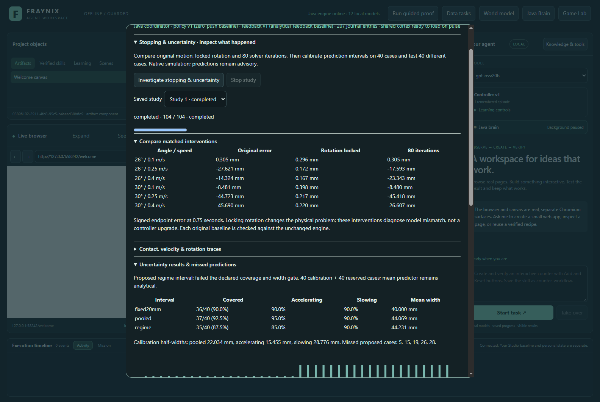
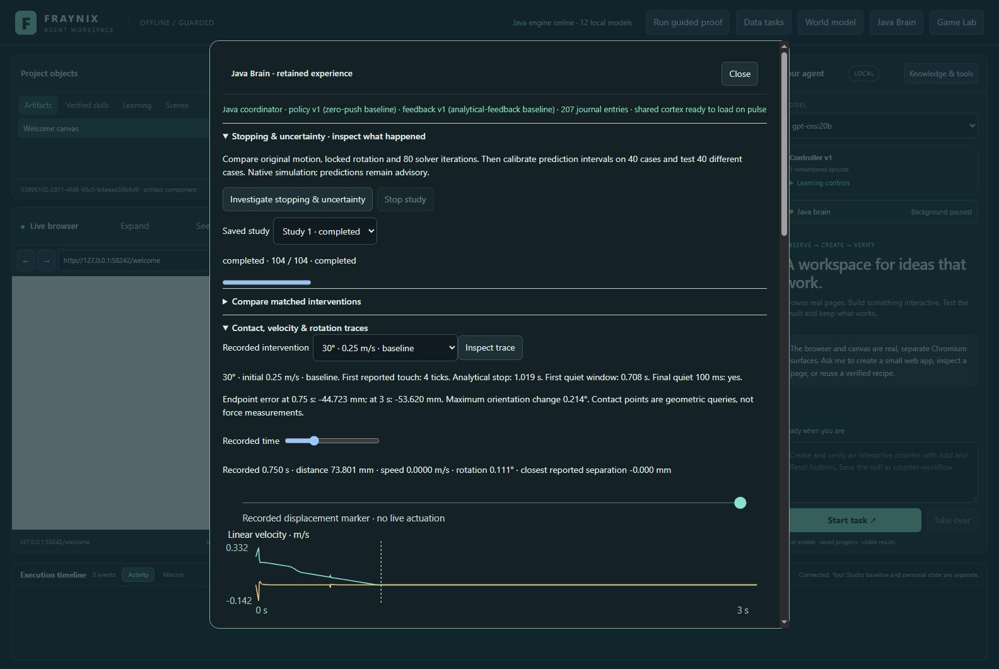
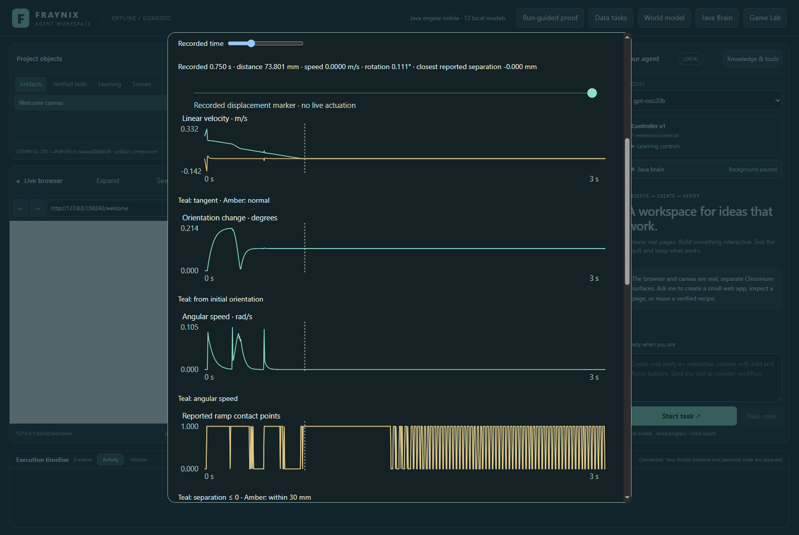
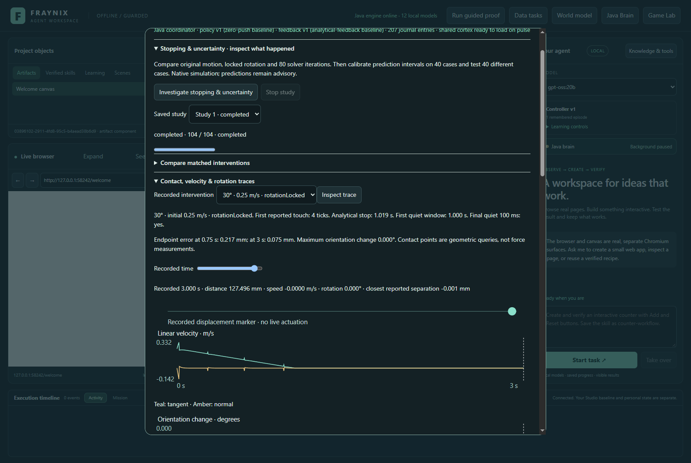
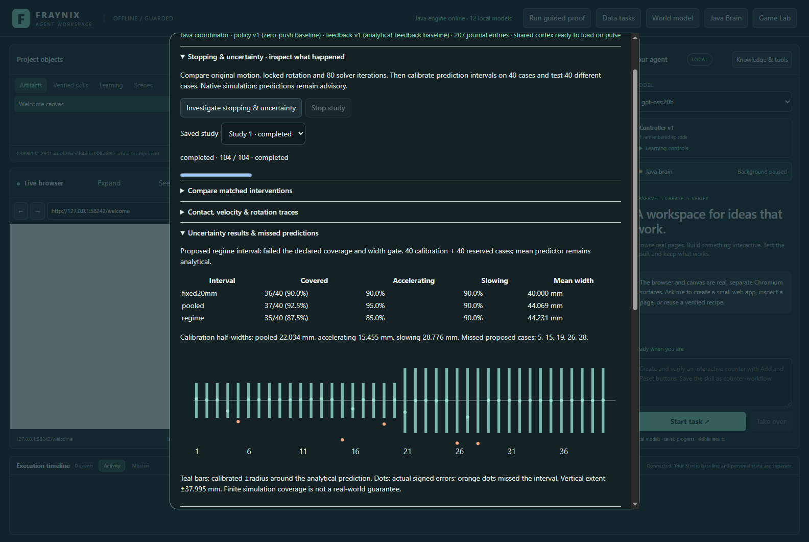
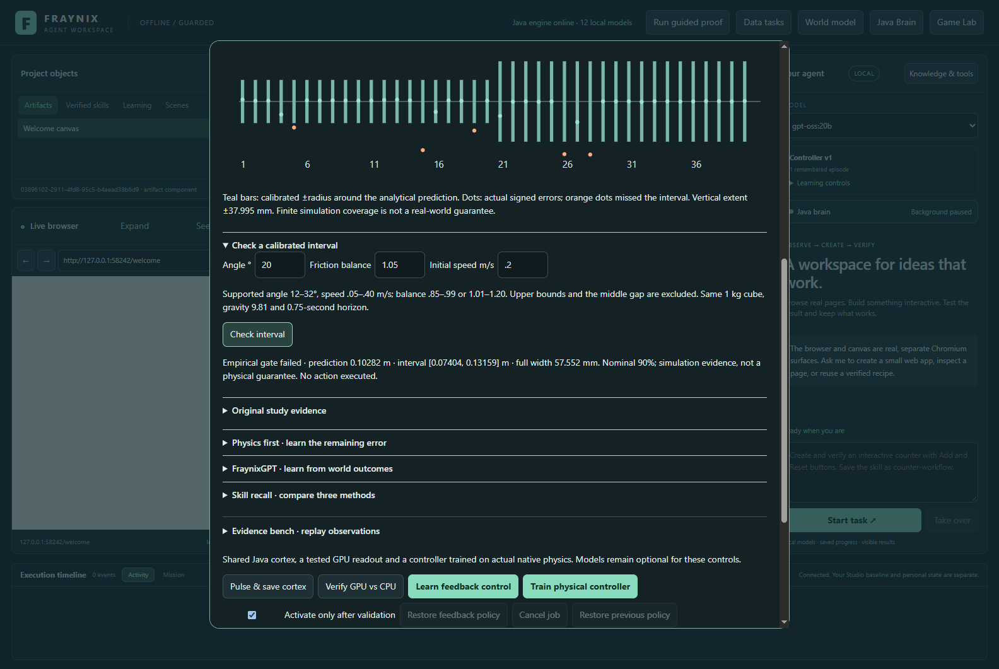
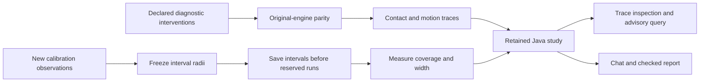
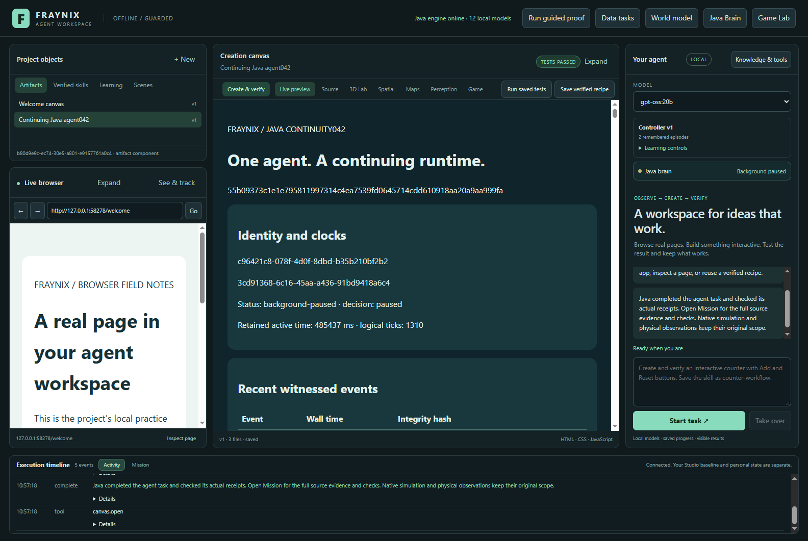
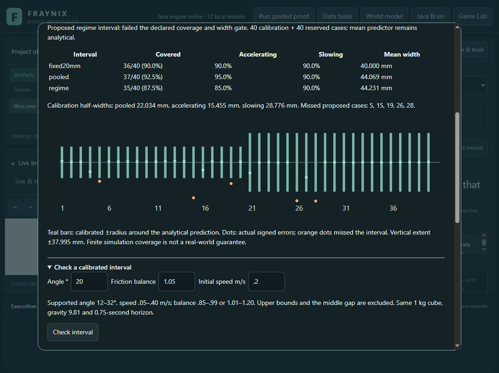

# Edition 063 · Stopping traces and measured uncertainty

November 4, 2026 · Fraynix Agent Workspace · local Java implementation

[Previous: physics first, learned residuals](README-062.md) · [Edition history](docs/readmes/INDEX.md) · [Offline trace explorer](docs/readmes/063/index.html) · [Verification](docs/readmes/063/verification.json) · [Original evidence](docs/readmes/063/original-evidence.json)

The Java brain now investigates stopping with recorded contact separation, linear velocity, angular velocity and rotation. It compares matched interventions, keeps the original engine as a reference, and calibrates prediction intervals before testing new conditions. The results, trace scrubber, charts, interval checks and chat access stay inside the current app.

Two findings matter. **Locking rotation greatly reduced the stopping discrepancy in the six diagnostic cases. Increasing solver iterations had mixed effects.** Separately, the proposed uncertainty intervals covered **35 of 40 reserved cases, or 87.5%**, missing the declared 90% target. The app retains that failed qualification and the simpler comparisons. No controller is promoted from these observations.

Actual application capture, November 4, 2026, in an isolated synthetic project. These are native physics executions, not illustrations or camera measurements. Signed errors are native endpoint minus analytical prediction.

## Why stopping needed its own investigation

Edition 062 found that analytical physics won method selection, while learned residuals failed the declared qualification gates. Its worst reserved case stopped much earlier than the simple analytical prediction. Another fit could conceal that discrepancy without explaining it.

The old `contacts` field counted query points within **30 mm**. That is useful proximity information, but does not establish physical contact onset. Edition 063 records the actual signed separations returned by the native geometric query. It distinguishes nearby points from points with separation at or below zero, and retains missing contact geometry as unknown rather than inventing a zero distance.

The [contract](docs/EDITION_063_CONTRACT.md), committed as `6dda526` before new observations, fixed the interventions, definitions, uncertainty partitions and acceptance rules. The original `BulletRamp`, its physics and historical source identity remain unchanged. An isolated instrumented adapter reproduces that setup and adds the readings needed for this investigation.

## Inspect it in the app

Open **Java Brain → Stopping & uncertainty · inspect what happened**.

1. **Investigate stopping & uncertainty** runs 18 intervention traces, six separate original-engine parity checks, 40 uncertainty-calibration trials and 40 reserved trials: 104 native executions.
2. **Compare matched interventions** displays the same six conditions under the three declared settings.
3. Choose a recorded intervention and click **Inspect trace**. The app requests Java-derived readings from the retained original, then displays contact, velocity, orientation and angular-speed charts.
4. Scrub **Recorded time** from zero to three seconds. The marker, chart cursor and numerical readings follow the saved sample. This is inspection of recorded motion, not live actuation.
5. **Uncertainty results & missed predictions** shows coverage, coverage by regime, interval widths and every missed reserved case.
6. **Check a calibrated interval** reconstructs the evidence and returns the analytical prediction with calibrated bounds inside the supported domain.
7. **Stop study**, saved history and **Read original study** use the existing Java job owner. A newer cancellation preserves the previous completed study.

Actual November 4 trace view. Tangential and normal velocity are shown separately. Orientation change is measured from the original quaternion, and angular speed comes from the native rigid body. The geometric contact queries do not measure force or impulse.

Actual November 4 chart view at the 0.75-second sample. The retained trace shows transient angular motion and changing geometric contact queries, even though the final motion is quiet.

Actual November 4 view of the matched rotation-locked intervention. Its zero angular speed is an explicitly imposed constraint, not evidence that an unconstrained physical block would behave this way.

## Diagnostic conditions and results

The six anchors combine angles **26° and 30°**, initial speeds **0.10, 0.25 and 0.40 m/s**, and friction balance **1.05**. Balance is friction coefficient divided by `tan(angle)`. These are diagnostic revisits, including the earlier failure conditions; they are not presented as unseen generalization cases.

Each uses the original 1 kg, 0.5 m cube, 12 × 3 m ramp, gravity 9.81 m/s², zero damping and the existing native solver. All runs cover three seconds at 240 Hz, retaining **721 samples**. The three variants are:

| Variant | Deliberate change |
| --- | --- |
| Baseline | Original setup; native default 10 solver iterations |
| Rotation locked | Angular factors set to zero; other settings preserved |
| 80 iterations | Solver iterations increased from 10 to 80; rotation remains free |

The instrumented baseline's 0.75-second endpoint matched a separate original-engine run within the declared **1 micrometre numerical tolerance in all six cases**. That establishes numerical parity for these cases; it is not a physical accuracy claim.

| Angle / initial speed | Original error at 0.75 s | Rotation locked | 80 iterations |
| --- | ---: | ---: | ---: |
| 26° / 0.10 m/s | +0.305 mm | +0.296 mm | +0.305 mm |
| 26° / 0.25 m/s | −27.621 mm | +0.172 mm | −17.593 mm |
| 26° / 0.40 m/s | −14.324 mm | +0.167 mm | −23.343 mm |
| 30° / 0.10 m/s | −8.481 mm | +0.398 mm | −8.480 mm |
| 30° / 0.25 m/s | −44.723 mm | +0.217 mm | −45.418 mm |
| 30° / 0.40 m/s | −45.690 mm | +0.220 mm | −26.607 mm |

All 18 runs first reported touch at **tick 4**, approximately **16.7 ms**. All satisfied the final quiet-window check by three seconds. The original 30° / 0.25 m/s case had a maximum orientation excursion of approximately **0.214°**, a first quiet window beginning at **0.708 s**, and an analytical stop prediction of **1.019 s**. The locked version's first quiet window began at **1.000 s**.

“Quiet” means speed at most 0.005 m/s and angular speed at most 0.02 rad/s for a sampled 100 ms window. Its start is not the exact mathematical instant of stopping. A first quiet window and a quiet final window are separate fields: a block can become quiet and move again. The tests explicitly check that distinction.

The controlled change strongly implicates rotational/contact coupling in this simulated discrepancy. It does not yet identify the precise contact-friction mechanism, establish a solver defect or reproduce real tabletop behavior. Locking rotation changes the physical problem. The analytical model assumes translational sliding; a finite free-rotating block has additional dynamics. Simply increasing iteration count is not a consistent remedy in these results.

## Uncertainty is tested separately

The mean predictor remains the analytical endpoint at **0.75 seconds**. This edition does not retrain the cortex, tune that equation or borrow edition 062 outcomes to calibrate uncertainty.

Two separate reproducible random streams generate 40 calibration and 40 reserved cases. Each contains 20 accelerating and 20 slowing conditions. Angles are drawn from 12–32°, initial speeds from 0.05–0.40 m/s, and friction balances from 0.85–0.99 or 1.01–1.20. Exact values and seeds are retained. The uncertainty trials preserve 46 samples each, through tick 180; the finer 721-sample traces belong to the diagnostic intervention study.

Absolute calibration errors set the interval radii at nominal 90% coverage. The finite-sample rank is `ceil((n+1) × 0.9)`, using a one-based index: rank 37 of 40 for the pooled interval and rank 19 of 20 for each regime. This rank convention follows [Angelopoulos and Bates' conformal-prediction guide](https://arxiv.org/abs/2107.07511). Its statistical interpretation depends on assumptions such as exchangeability; reproducible simulation draws and a small evaluation sample do not prove coverage under arbitrary real conditions.

The proposed method was **regime-specific intervals**, declared before data collection. Pooled intervals and a fixed ±20 mm interval were comparisons. Calibration records and radii were frozen before reserved observations, and every reserved interval was saved before its native execution.

Actual November 4 result. The proposed interval is unqualified. Teal bars show its bounds around the analytical mean; orange dots mark missed observations.

| Interval | Reserved coverage | Accelerating | Slowing | Mean full width |
| --- | ---: | ---: | ---: | ---: |
| Fixed ±20 mm | 36/40 · 90.0% | 90.0% | 90.0% | 40.000 mm |
| Pooled calibration | 37/40 · 92.5% | 95.0% | 90.0% | 44.069 mm |
| **Proposed regime calibration** | **35/40 · 87.5%** | **85.0%** | **90.0%** | **44.231 mm** |

Calibrated half-widths were **22.034 mm pooled**, **15.455 mm accelerating** and **28.776 mm slowing**. The proposed method missed cases **5, 15, 19, 26 and 28**. Its gate required at least 90% total coverage, at least 85% in each regime, and mean full width no greater than 80 mm. It passed the width and subgroup limits but failed total coverage.

The pooled comparison performed better here. Switching the proposed method after reading those reserved outcomes would be a new selection decision, not a clean validation of the original proposal. A next edition can declare and evaluate that simpler choice on fresh cases. Likewise, 87.5% empirical coverage in 40 cases does not refute the calibration method's statistical theory; it fails this edition's specified practical threshold.

Actual November 4 interval query. Java refuses the uncalibrated balance gap and out-of-range inputs. Nominal 90% is not a guarantee that a particular future physical measurement will fall within these bounds. Negative lower bounds are retained if produced by the symmetric error interval; they are not silently clipped to change coverage.

## How the result becomes usable memory

The existing Java coordinator owns execution, progress, Stop, persistence and recovery. The study records source identity, original parameters, actual native settings, native sample clocks, signed contact separations, quaternions and velocities. The verifier reconstructs derived traces, stopping summaries, calibration radii, saved intervals and evaluation results.

It checks partition definitions, unique record identities, source hashes, parameter binding and ordering of predictions, calibration freeze and observations. Tests alter summaries, parameters, sample ticks, duplicate records, interval bounds, model radii, timestamps and qualification. Those altered records are refused, including tested changes with recomputed local hashes. Hashes support integrity and reproducibility; they are not an independent witness against a fully compromised machine.

Cold restart preserves the original study and reproduces its interval without new training. Stop preserves previous completed history. The published originals from both editions 061 and 062 still pass their original audits. The diagnostic adapter leaves their classes and byte identities intact.

Chat can read the current and last completed study through the existing Java agent-state and checked report procedure. Try: **“Inspect the stopping study. Report its uncertainty coverage, widths and matched interventions, keeping simulation evidence separate from physical guarantees.”** This route reads and reports; the experiment itself is started explicitly from Java Brain.

The first actual chat attempt correctly stopped at the existing 12,500-character context limit: all 18 trace summaries made its planning context too large. Edition 063 now projects those historical details into an exact comparison matrix and retains a hash/reference for the omitted witness history. The full task context, original receipts and report data remain intact; requirements, failure results and verification checks are not truncated. The interrupted task is resumed against the same saved experiment. Its original failed attempt is archived with the final result.

Actual November 4 local `gpt-oss:20b` workflow, CPU-only with four threads. A successful report check is distinct from the failed uncertainty qualification.

## Source, validation and continuity

| Responsibility | Source |
| --- | --- |
| Instrumented native world | [StoppingRamp063.java](workspace-engine/src/main/java/fraymus/workspace/StoppingRamp063.java) |
| Definitions, traces, calibration and audit | [Stopping063.java](workspace-engine/src/main/java/fraymus/workspace/Stopping063.java) |
| Durable study and query APIs | [BrainService.java](workspace-engine/src/main/java/fraymus/workspace/BrainService.java) |
| One integrated trace/interval view | [stopping063.js](workspace-desktop/renderer/stopping063.js) |
| Bounded planning evidence without erasing originals | [StoppingContext063.java](workspace-engine/src/main/java/fraymus/workspace/StoppingContext063.java) |
| Native, numerical and integrity checks | [Stopping063Test.java](workspace-engine/src/test/java/fraymus/workspace/Stopping063Test.java) |
| Actual app, restart, Stop and chat | [stopping063-integration.cjs](workspace-desktop/test/stopping063-integration.cjs) |

Native access uses the existing pinned Minie/Bullet dependency. Its [rigid-body API](https://stephengold.github.io/Minie/javadoc/master/com/jme3/bullet/objects/PhysicsRigidBody.html) provides the angular velocity/factor access used here; [PhysicsSpace](https://stephengold.github.io/Minie/javadoc/master/com/jme3/bullet/PhysicsSpace.html) provides solver controls. No new external library, model provider or separate agent process was introduced. Java owns the new numerical and verification logic.

**57 distinct targeted Java checks across eight test classes and 127 desktop checks passed.** This combines separate source-qualified invocations, not a fresh full repository suite. The native study passed on its first run. Additional unit cases check finite-sample ranks, coverage and width gates independently, domain refusal, quaternion sign equivalence, unknown separation, transient quiet windows and historical compatibility. Planning-projection tests preserve original records, exact outcome values, failure verdicts, selected requirements and the context limit. Existing brain persistence, agent and routing tests also passed. Source isolation passed.

Actual app verification covers visible execution, matched comparisons, four trace charts, the 721-sample time control, all 40 reserved intervals, unsupported-input refusal, exact cold interval restoration, visible Stop, retained history and a real local-model report. Captures are checked at 1600 and 1100 px. The offline guide is checked at 1440 and 390 px for filters, case selection, chart controls, links, assets and overflow. Full invocation scopes and originals are in the [verification record](docs/readmes/063/verification.json).

Actual November 4 app capture at 1100 px. The existing workspace design and previous tools remain available. Normal review installations and private runtime data were preserved; test projects are separate and explicitly synthetic.

## Next steps

1. **Explain the contact transition more precisely.** Use new declared cases to inspect contact-point evolution and friction impulses, and compare changes in initial clearance, block geometry and time step. Keep a matched original control. These tests can distinguish contact initialization, rotation coupling and discretization effects more clearly.
2. **Evaluate the simpler uncertainty choice prospectively.** Freeze pooled calibration versus the fixed-width comparator before collecting fresh reserved cases. Report coverage, width and sampling uncertainty, including failures and distribution shifts. Do not reuse this reserved set as a new test.
3. **Test decision value.** Use a qualified interval to decide when a task needs another observation or a more conservative action, then compare actual task outcomes against the simple controller. Better plots alone do not establish better agency.
4. **Transfer only after that proof.** Extend the same observation and evaluation discipline to construction loads, support placement and later real-camera measurements with explicit units and calibration. The stopping-study interval is not transferable to those domains without new evidence.

The broader vision is still one continuing agent that can observe, predict, investigate, act, verify and remember within the environment it uses. This edition adds the ability to inspect a physical assumption and preserve a failed uncertainty test in a form both the user and the agent can review. It establishes useful experimental behavior without claiming automatic general intelligence, real-world precision or language-model weight improvement.

[Complete source tree](docs/readmes/063/FILE_TREE.md) · [Offline explorer](docs/readmes/063/index.html) · [Obsidian note](docs/obsidian/71-stopping-uncertainty.md) · [Canvas map](docs/obsidian/stopping-uncertainty.canvas)
