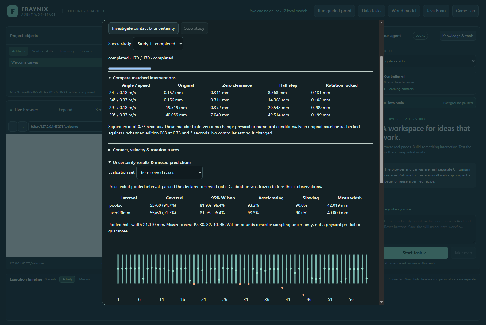
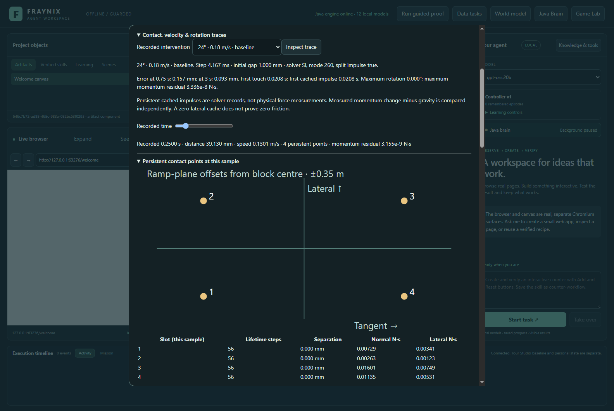
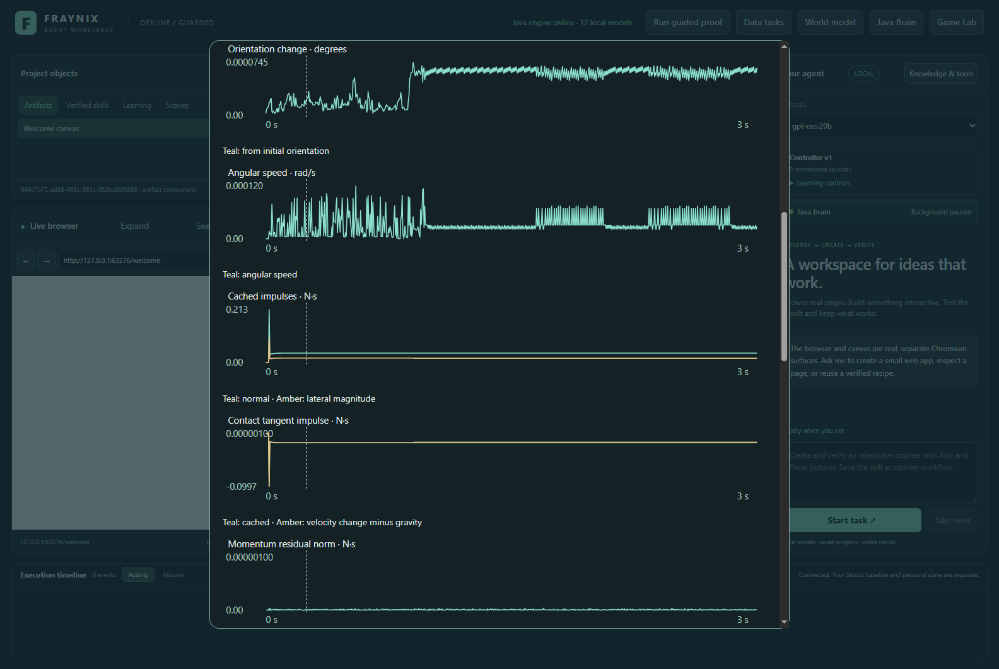
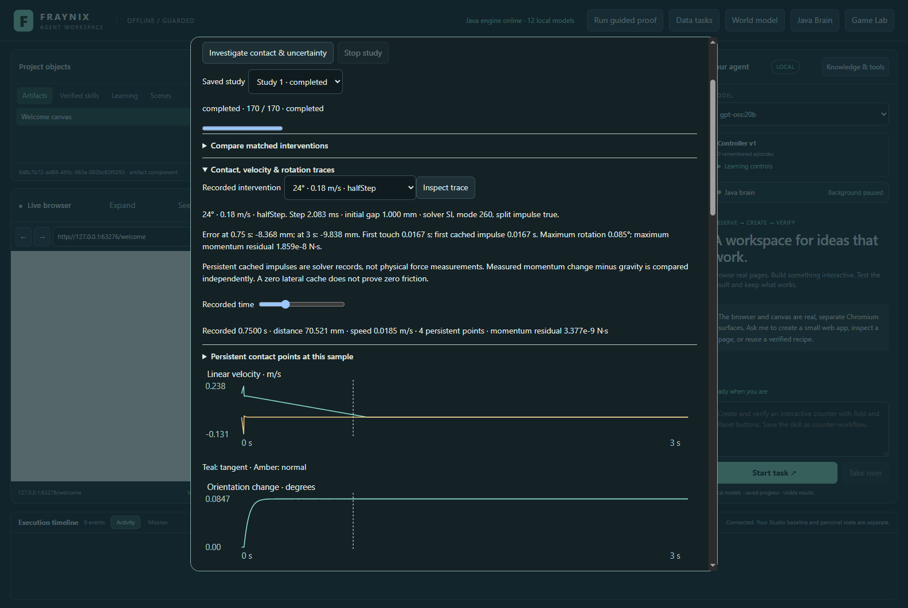
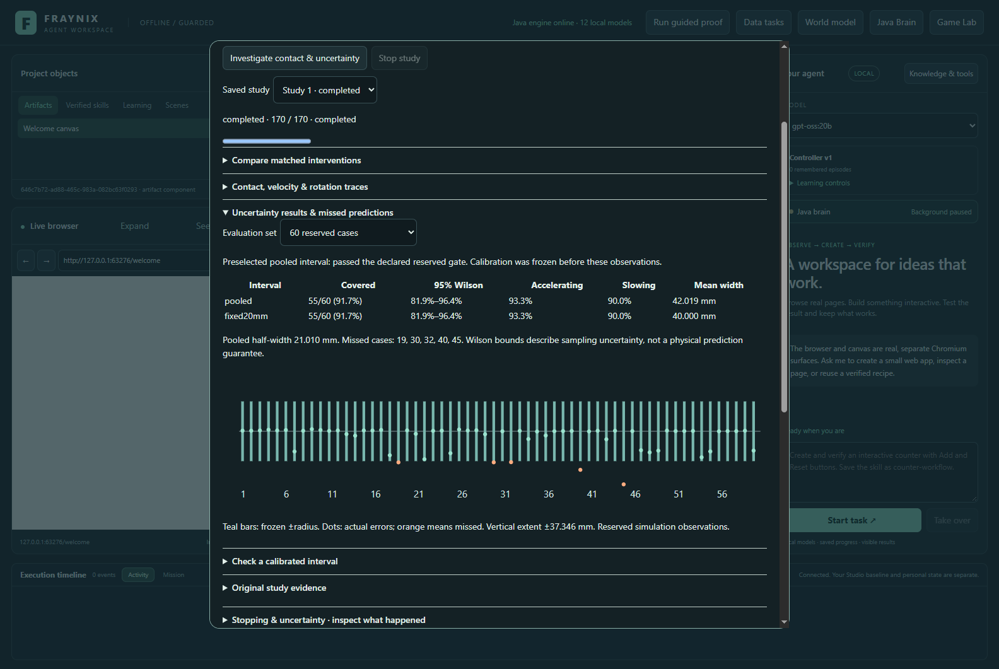
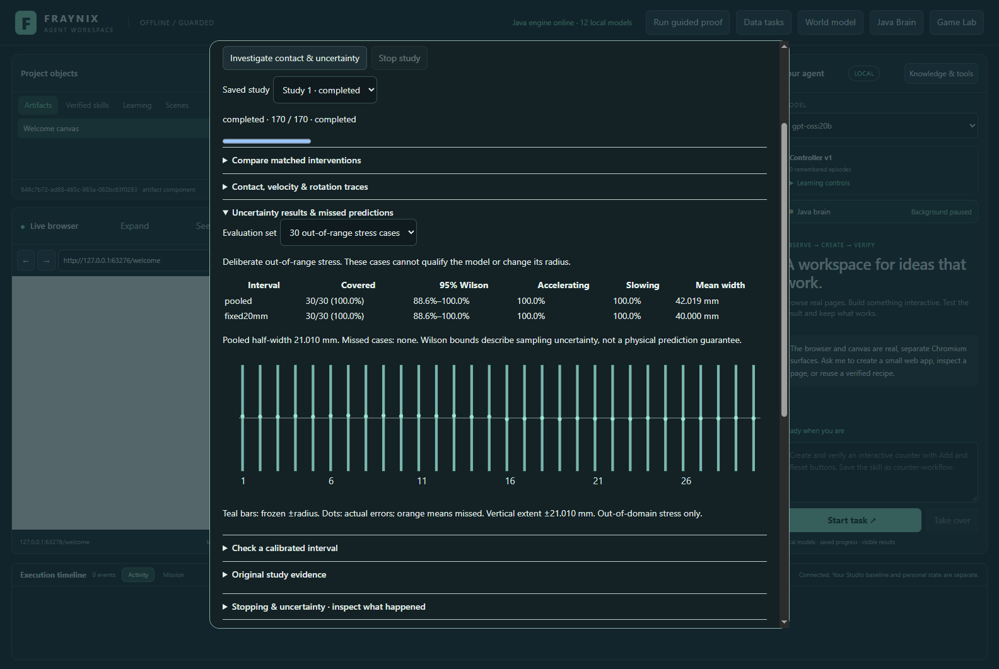
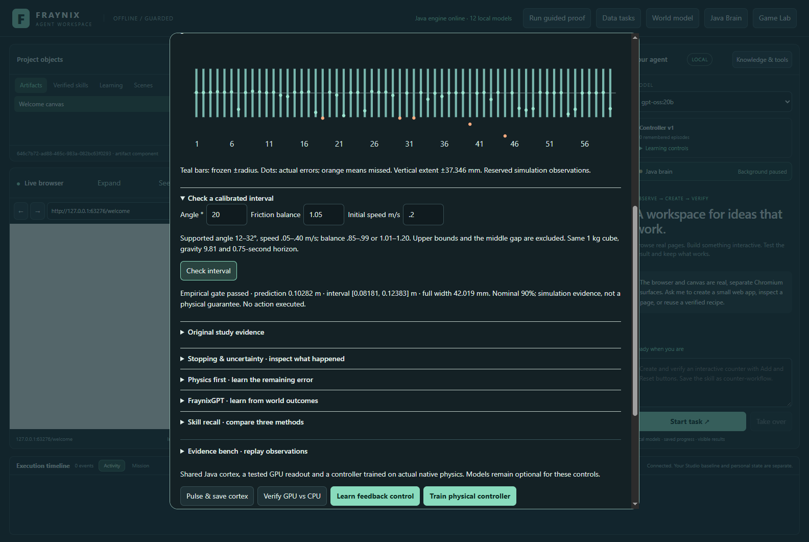
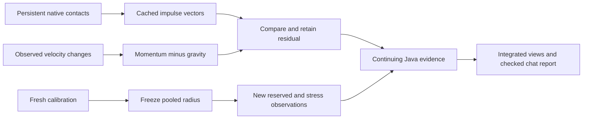
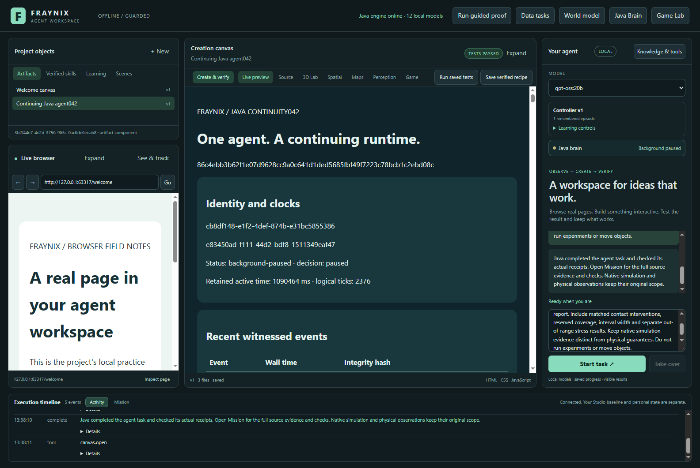
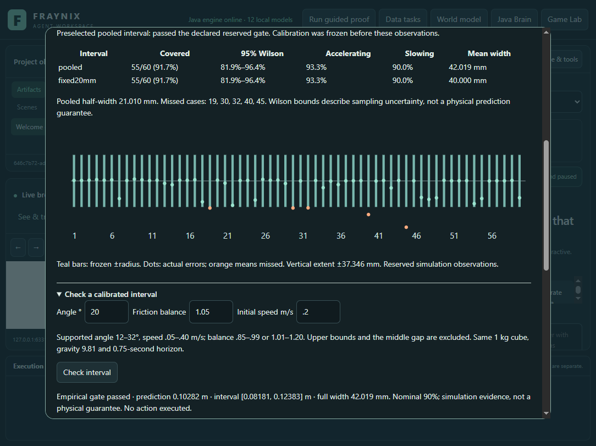

# Edition 064 · Persistent contact impulses and prospective uncertainty

November 4, 2026 · Fraynix Agent Workspace · continuing local Java runtime

[Previous: stopping traces](README-063.md) · [Edition history](docs/readmes/INDEX.md) · [Offline explorer](docs/readmes/064/index.html) · [Verification](docs/readmes/064/verification.json) · [Exact originals](docs/readmes/064/original-evidence.json)

The app now inspects persistent contact points and cached solver impulses, compares them with observed momentum, and tests a simpler uncertainty method on fresh cases. These tools live in **Java Brain**, alongside the existing world, browser, canvas, memory and agent controls. Chat can read the shared evidence and create its checked report.

The preselected pooled interval covered **55/60 reserved cases (91.7%)** with a **42.019 mm full width**. It **passed** the declared empirical gate. The fixed ±20 mm comparison covered 55/60. Out-of-range stress is reported separately and never changes the calibration or the qualification decision. Predictions remain advisory; this edition does not change the active controller.

Actual application capture, November 4, 2026, in an isolated synthetic project. These are native simulation observations, not camera measurements or illustrations.

## What changed

Edition 063 showed that constraining rotation substantially reduced one stopping discrepancy, while increasing solver iterations had mixed effects. It also found that the proposed regime-specific uncertainty intervals failed their reserved coverage target. Edition 064 follows those findings with declared experiments instead of adjusting the earlier test until it passes.

The previous contact trace used geometric queries. The new recorder reads the solver's **persistent block/ramp manifolds after each completed time step**. Each retained point includes its signed separation, lifetime, normal, two lateral directions, cached normal and lateral impulses, world positions and combined friction. Solver mode, iteration count, split-impulse setting, angular factors, time step and initial clearance are retained too.

Java sums the cached impulse vectors with the correct sign for whether the block is body A or B. Independently, it computes the contact impulse implied by the change in linear momentum after subtracting gravity. Their difference is shown as a vector-residual norm. A zero lateral cache does not establish zero friction, and a cached impulse is not a physical force sensor reading.

The [contract](docs/EDITION_064_CONTRACT.md) was frozen before new observations: initial commit `cd4babb`, with the stress range clarified in `b3e79fc` to remain inside the unchanged native adapter's admitted domain. The final choices, partitions and gates preceded every new outcome. The original edition 063 implementation remains unchanged and its published evidence still audits.

## Use it in the app

Open **Java Brain → Contact impulses & new uncertainty · edition 064**.

1. **Investigate contact & uncertainty** runs the 170-execution study with visible progress and Stop.
2. **Compare matched interventions** shows signed endpoint errors under all four settings.
3. Select an intervention and **Inspect trace**. Scrub its recorded samples, including the 1,441-sample half-step run.
4. **Persistent contact points** displays positions projected onto the ramp plane, point lifetimes, separations and cached impulse magnitudes. Slot numbers identify points only within that sample; they are not persistent object identities.
5. Scroll through seven charts: tangent/normal velocity, orientation, angular speed, cached normal/lateral impulses, cached versus momentum-derived tangent impulse, momentum residual, and persistent/touching point counts.
6. Switch the uncertainty view between **60 reserved cases** and **30 out-of-range stress cases**. Both interval methods, sampling bounds, misses and widths remain visible.
7. **Check interval** returns the saved pooled bounds inside their admitted domain. Unsupported inputs are refused. **Read original study** exposes the complete retained record.

Actual November 4 contact-point inspection. The projection is a view of saved world positions relative to the block centre. It is not a live command or a reconstructed physical object.

Actual November 4 recorded impulse view. Numerical units are N·s. The displayed momentum comparison excludes sample zero, where there is no preceding velocity sample.

## New matched contact experiments

Four new anchors combine **24° and 29°**, initial tangent speeds **0.18 and 0.33 m/s**, and friction balance **1.05**. Balance is the friction coefficient divided by `tan(angle)`. Geometry remains the existing 1 kg, 0.5 m cube on a 12 × 3 m ramp, with gravity 9.81 m/s².

| Variant | Declared change |
| --- | --- |
| Original | Existing 1 mm initial geometric clearance, 1/240 s time step, free rotation |
| Zero clearance | Shift the initial block 1 mm toward the ramp along its normal |
| Half step | 1/480 s time step; other original settings preserved |
| Rotation locked | Angular factors set to zero; other original settings preserved |

Each run lasts three simulated seconds and retains every step: 721 samples normally, or 1,441 at the smaller time step. Four additional unchanged edition 063 runs check both 0.75-second and 3-second endpoint parity against the instrumented baseline. All four comparisons passed the declared 1 μm numerical tolerance.

| Angle / speed | Original error | Zero clearance | Half step | Rotation locked |
| --- | ---: | ---: | ---: | ---: |
| 24° / 0.18 m/s | 0.157 mm | -0.311 mm | -8.368 mm | 0.131 mm |
| 24° / 0.33 m/s | 0.156 mm | -0.311 mm | -14.368 mm | 0.102 mm |
| 29° / 0.18 m/s | -19.519 mm | -0.372 mm | -20.543 mm | 0.209 mm |
| 29° / 0.33 m/s | -40.059 mm | -7.049 mm | -49.514 mm | 0.199 mm |

Errors are observed endpoint minus analytical prediction at 0.75 seconds. Across these four diagnostic anchors, mean absolute errors were **14.973 mm original**, **2.011 mm zero-clearance**, **23.198 mm half-step**, and **0.160 mm rotation-locked**. These are comparisons on the declared diagnostic anchors, not an independently selected new controller.

Removing the initial 1 mm clearance sharply reduced the two 29° discrepancies, while locking rotation reduced all four to sub-millimetre errors. Halving the time step did **not** improve these anchors: all four absolute errors increased. This points toward sensitivity to contact initialization and rotational dynamics, but does not isolate a unique friction mechanism. Rotation locking changes the physical system; it is a diagnostic intervention, not a correction silently applied to the app.

The largest recorded momentum-residual norm across all 16 intervention traces was **5.72443e-08 N·s**. 0 of the 16 traces had a zero summed cached lateral-impulse magnitude. The cached impulse vectors matched the velocity-derived contact momentum to roughly floating-point precision in these runs. This supports the recorder's sign and timing interpretation for this configuration; it does not validate the simulation against a real experiment. Full traces retain the individual points and changing directions, so the user and agent can inspect where agreement or disagreement occurs. Solver-cache semantics, finite time steps and changes in contact geometry still limit causal interpretation. A smaller endpoint error alone does not establish the correct physical model.

Actual November 4 view. The time control uses the saved sample count and actual step duration, so the finer run is not relabelled as a 240 Hz trace.

## A prospective uncertainty comparison

The mean predictor remains the analytical 0.75-second endpoint. The proposed method is now **pooled absolute-error calibration**, selected before collecting any edition 064 outcomes. Fixed ±20 mm is the comparison. There is no after-the-fact switch to whichever scores better.

The study draws 60 new calibration and 60 new reserved cases from independent Java Random streams (64001 and 64002). Each contains 30 accelerating and 30 slowing conditions. Angles lie in 12–32°, initial speeds in 0.05–0.40 m/s, and friction balances in 0.85–0.99 or 1.01–1.20. Upper bounds and the central gap are excluded from queries. Exact seeds and values are in the manifest.

The radius uses the one-based absolute-error rank `ceil((60+1) × 0.9) = 55`. Calibration records and the resulting **21.010 mm half-width** are frozen and hashed before reserved or stress observations. Every interval is persisted before its native trial. The rank follows the finite-sample convention described by [Angelopoulos and Bates](https://arxiv.org/abs/2107.07511); its statistical interpretation depends on assumptions such as exchangeability.

Thirty additional stress cases use seed 64003, angles 8–12° and friction balances 0.70–0.85 or 1.20–1.30. They deliberately lie outside the calibration domain while staying inside the existing native adapter's physical input limits. They are not used for fitting, selection or qualification.

Actual November 4 reserved results. Orange dots identify observations missed by the frozen interval.

| Set | Method | Covered | Accelerating | Slowing | Mean full width | Descriptive 95% Wilson |
| --- | --- | ---: | ---: | ---: | ---: | ---: |
| Reserved | pooled | 55/60 · 91.7% | 93.3% | 90.0% | 42.019 mm | 81.9%–96.4% |
| Reserved | fixed20mm | 55/60 · 91.7% | 93.3% | 90.0% | 40.000 mm | 81.9%–96.4% |
| Out-of-range stress | pooled | 30/30 · 100.0% | 100.0% | 100.0% | 42.019 mm | 88.6%–100.0% |
| Out-of-range stress | fixed20mm | 30/30 · 100.0% | 100.0% | 100.0% | 40.000 mm | 88.6%–100.0% |

Both methods covered exactly the same 55 reserved cases. The fixed interval was about 2 mm narrower in full width, so this experiment does not show an advantage for pooled calibration over the simpler comparison. The declared pooled method remains the advisory method; no posthoc switch is made. Both covered all 30 shifted cases, which demonstrates only these particular sampled conditions, not safe extrapolation.

The proposed method must cover at least 90% of reserved cases, at least 85% in each regime, with mean full width no greater than 80 mm. Its observed verdict is **qualified for this empirical advisory gate**. Wilson intervals summarize sampling uncertainty around observed proportions; the stratified sample and finite simulation do not create a universal predictive or physical guarantee. A nominal 90% prediction interval is also different from a 95% interval describing an estimated coverage proportion.

Actual November 4 stress results. A successful stress case does not expand the supported query domain, and a failed case remains part of the evidence.

Actual November 4 saved-model query. The active controller remains unchanged. Negative lower bounds, if produced by the symmetric interval, are retained rather than silently clipped.

## Evidence, responsiveness and continuity

The first native invocation exposed an operational issue: routine state polling repeatedly parsed the growing full evidence record while holding the Java coordinator lock. A captured thread trace confirmed the progress reader was parsing JSON while the coordinator waited. That invocation was intentionally interrupted, and its exact checkpoint, journal, log and thread trace are archived. The experiment was rerun under the same declared cases and rules; the physics implementation did not change.

The completed 170-execution run then exceeded the default 512 MB test heap while opening duplicate full records. The original study was preserved and remaining verification resumed against those same observations at the existing app limit of 768 MB. That resume exposed mixed Instant/string timestamps in the compact history cache; metadata is now normalized to its persisted JSON form. All failed invocations remain archived separately from passing results. No case, gate, native physics or observation was replaced.

Java now indexes compact progress headers and contact summaries after successful saves. Returned views are copied, so editing a response cannot change the retained evidence. Full records remain available through explicit reads and audits. Large contact payloads use a versioned, bounded, lossless gzip envelope with original byte length and SHA-256. Legacy plain JSON remains readable. On the retained completed study, the exact-text round trip reduced 38,242,778 bytes to a 9,540,389-byte stored envelope. Twenty completed-state polls took 164.54 ms in one measured invocation. These are recorded local measurements, not a controlled end-to-end speed benchmark. Decompression limits, corruption checks and exact Unicode/numeric-text round trips are tested; compression does not round or discard observations.

The first actual-app pass caught a study-selection race at the time scrubber. Inspection buttons now disable synchronously when a study changes, and pending trace replies are invalidated. The same completed app study was reused for the corrected UI checks; no physics result was replaced. Tiny momentum residuals now use scientific notation, and an unused empty plot container was removed.

The coordinator still owns Stop, recovery, saved history and advisory queries. Cold restart reproduces the saved interval. A newer cancelled study preserves the last completed one. The verifier reconstructs derived contact summaries, clock counts, calibration radius, frozen intervals and evaluation results, and checks original parity, unique identities, source hashes and prediction-before-observation ordering. Hashes support integrity, not an independent witness against a fully compromised machine.

Try: **“Inspect the contact study and pooled uncertainty. Report the matched interventions, reserved coverage and separate stress results. Keep simulation evidence distinct from physical guarantees.”** The existing Java procedure reads the shared facts and verifies the report. Planning omits repeated historical witness rows with an explicit count and hash; the original task facts, report evidence, requirements and checks remain intact. The experiment itself is started explicitly in Java Brain.

Actual November 4 local `gpt-oss:20b` report workflow, CPU-only with four threads. A passing report check is distinct from the interval's empirical qualification.

## Validation and source map

**55 distinct targeted Java checks across 8 classes and 127 desktop checks passed**, across separately recorded invocations. This is not a fresh full-repository-suite claim. Actual app checks cover the full visible study, point counts, seven charts, half-step scrubber, reserved/stress separation, extrapolation refusal, exact cold interval restoration, Stop, retained history and the real local-model checked report.

Tests independently check impulse orientation and gravity subtraction, known Wilson bounds, the finite-sample rank, coverage/width/subgroup gates, immutable planning views, legacy storage, byte-exact compression and tampered records. Published edition 063 originals still audit. The interrupted, memory-failed and timestamp-failed invocations are retained separately from passing results. Full scopes and source identities are in the [verification record](docs/readmes/064/verification.json).

| Responsibility | Source |
| --- | --- |
| Persistent native manifold access | [ContactRamp064.java](workspace-engine/src/main/java/fraymus/workspace/ContactRamp064.java) |
| Momentum reconstruction and Wilson bounds | [ContactMath064.java](workspace-engine/src/main/java/fraymus/workspace/ContactMath064.java) |
| Declared study, calibration and audit | [ContactStudy064.java](workspace-engine/src/main/java/fraymus/workspace/ContactStudy064.java) |
| Durable coordinator and compact progress | [BrainService.java](workspace-engine/src/main/java/fraymus/workspace/BrainService.java) |
| Lossless contact-record storage | [BrainPayload064.java](workspace-engine/src/main/java/fraymus/workspace/BrainPayload064.java) |
| Integrated inspection controls | [contact064.js](workspace-desktop/renderer/contact064.js) |
| Actual app workflow | [contact064-integration.cjs](workspace-desktop/test/contact064-integration.cjs) |

The native recorder uses the existing pinned Minie/Bullet dependency. Its [collision documentation](https://stephengold.github.io/Minie/minie/minie-library-tutorials/collision.html) distinguishes persistent manifolds from overlap queries, and its [manifold-point API](https://stephengold.github.io/Libbulletjme/javadoc/master/com/jme3/bullet/collision/ManifoldPoints.html) documents cached impulse fields. No new library or model provider was added. Java owns the experiment, mathematics, admission rules, persistence and verification.

Actual November 4 app capture at 1100 px. The offline guide is also tested at 1440 and 390 px, with readable horizontally scrollable charts on narrow screens. Existing review installations and private project data were preserved; all new test projects are explicitly synthetic.

## Next steps

1. **Use the measured evidence to narrow the mechanism.** Compare persistent contact transitions, impulse-cache agreement and time-step sensitivity before changing the physical model. Any new causal intervention needs fresh declared cases and an unchanged control.
2. **Test decision value.** Compare a controller using the supported uncertainty bounds with a simpler controller on fresh tasks. Measure successful outcomes, extra observations, conservative refusals and recovery costs. An advisory qualification alone is not permission to replace a controller.
3. **Keep domain shifts explicit.** Out-of-range requests should trigger new calibration or an explicit limitation, rather than quietly inheriting a coverage claim from different conditions.
4. **Transfer after proof.** Apply the same discipline to construction loads and real-camera observations with their own units, sensors and calibration. This ramp study cannot supply uncertainty guarantees for those domains.

The continuing aim is one agent that observes, predicts, investigates, acts, checks and remembers in its own environment. This edition makes its internal physical evidence more inspectable and its uncertainty comparison prospective. It adds no claim of physical calibration, general intelligence or language-model weight training.

[Complete source tree](docs/readmes/064/FILE_TREE.md) · [Offline explorer](docs/readmes/064/index.html) · [Obsidian note](docs/obsidian/72-contact-impulses.md) · [Canvas map](docs/obsidian/contact-impulses.canvas)
