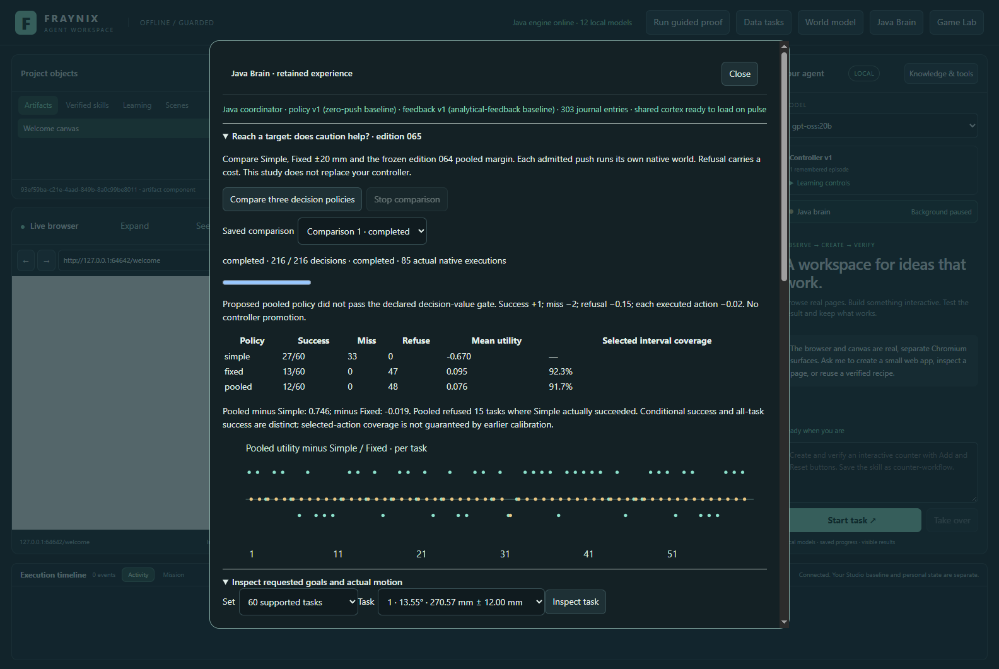
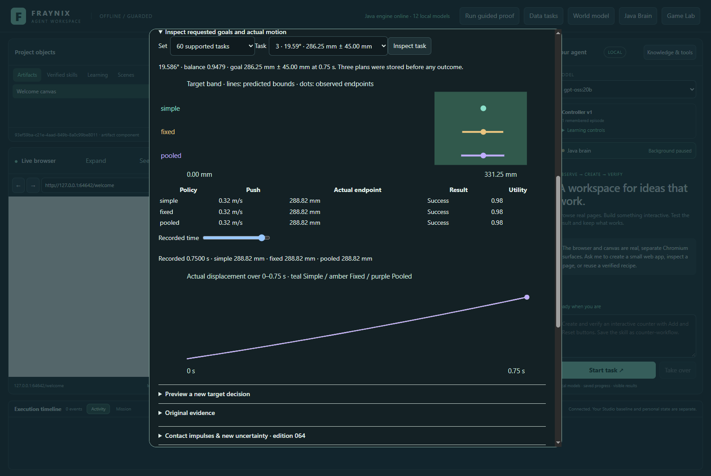
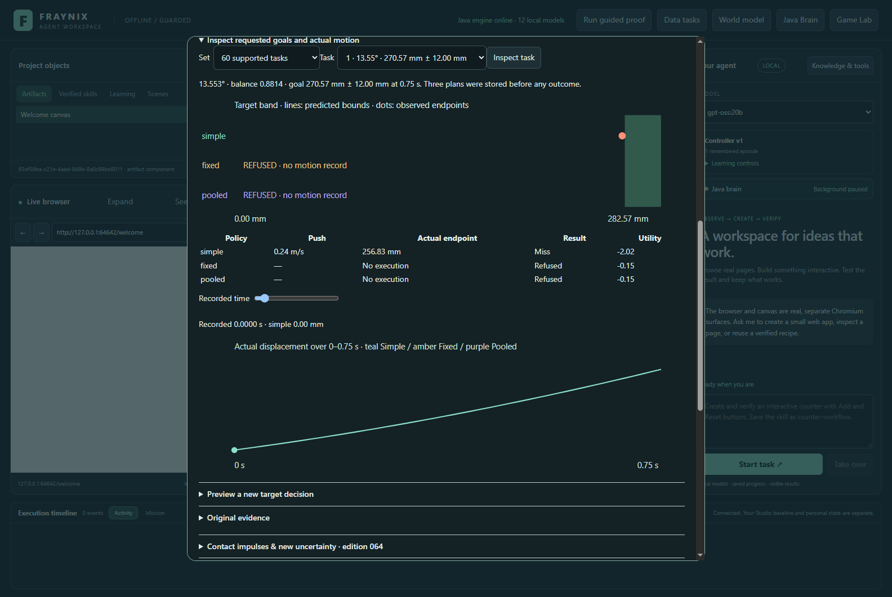
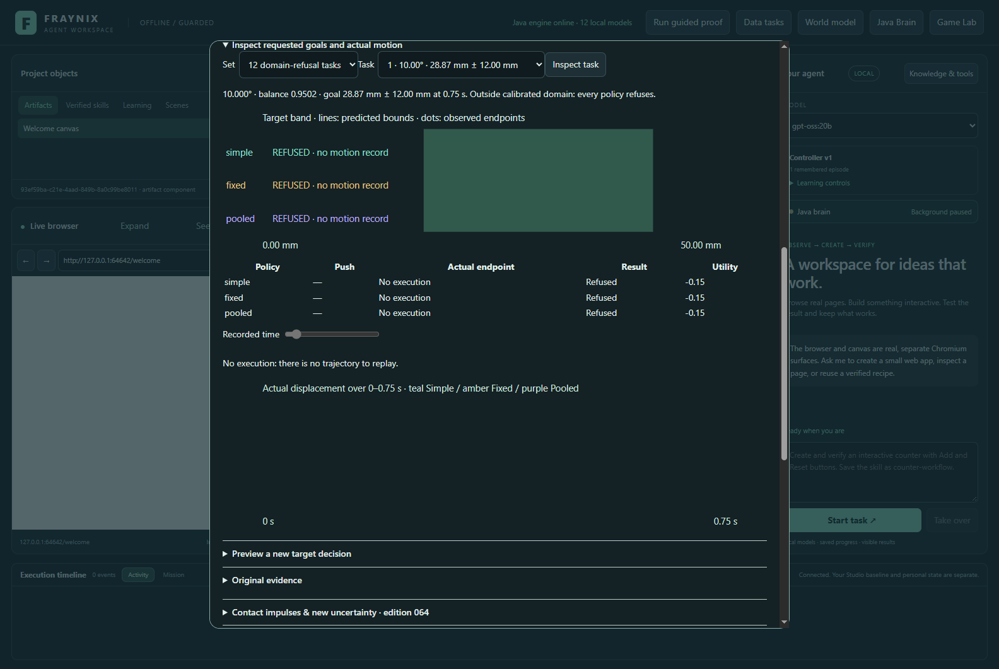
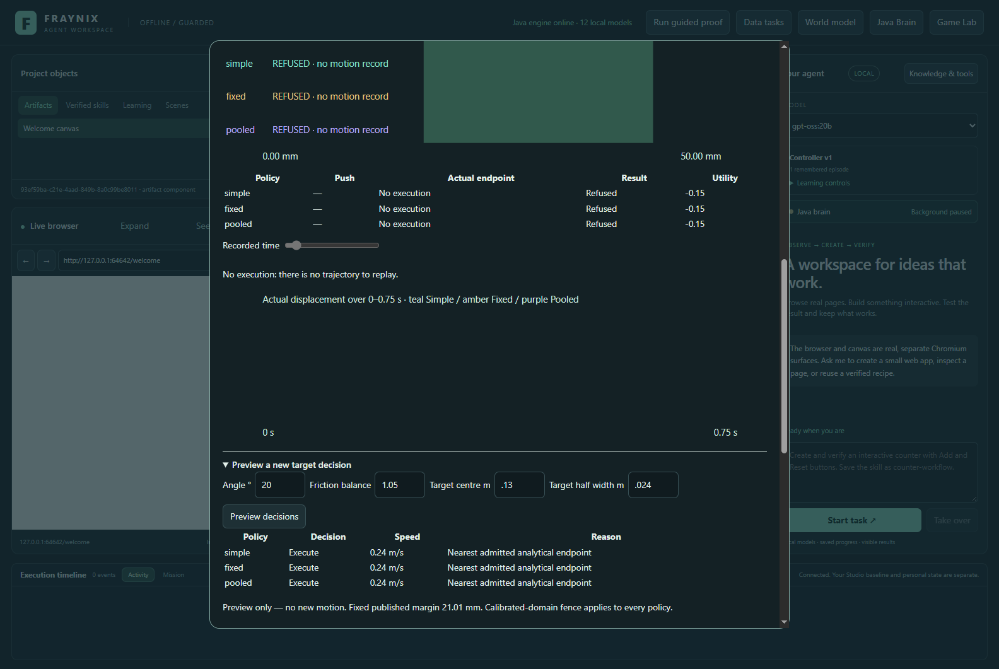
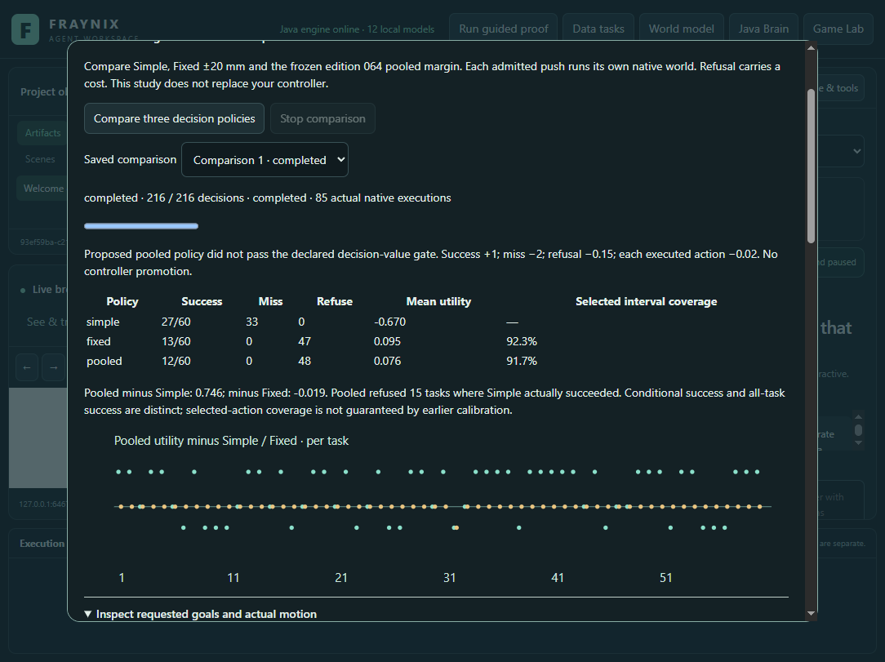
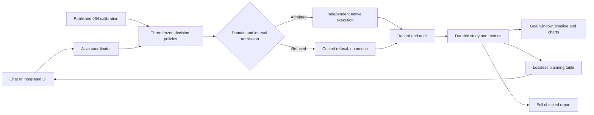
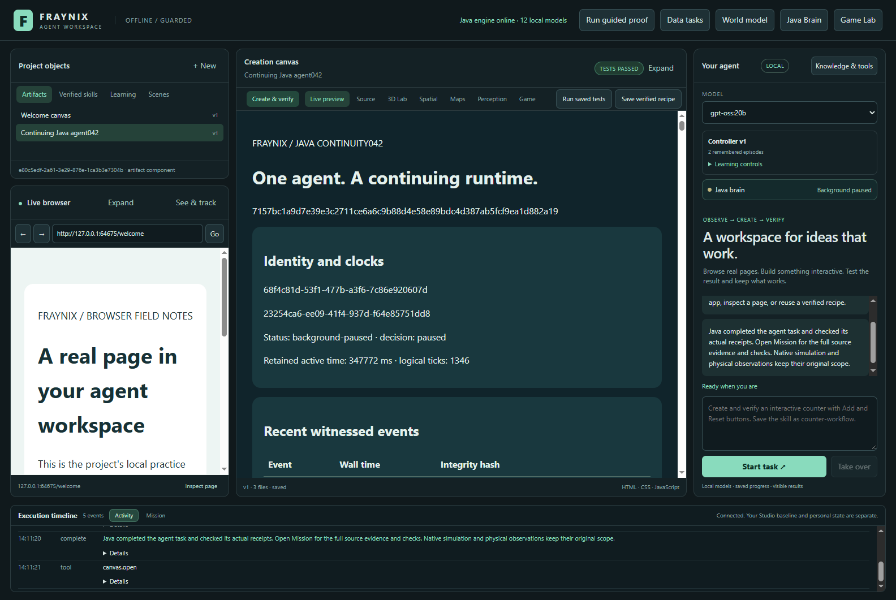

# Fraynix Agent Workspace · Edition 065

**Reaching a target: does calibrated caution improve the agent’s decisions?**

November 4, 2026 · Local Java decisions, real native simulation, retained evidence, integrated review.

[Previous: edition 064](README-064.md) · [Edition history](docs/readmes/INDEX.md) · [Offline interactive guide](docs/readmes/065/index.html) · [Verification](docs/readmes/065/verification.json) · [Original evidence](docs/readmes/065/original-evidence.json) · [Declared experiment](docs/EDITION_065_CONTRACT.md)

## What changed—and what the result says

The app can now choose a push for a requested target window, execute that decision in its native physics world and compare its actual outcome with two simpler alternatives. The three plans are saved before any outcome is observed. Refusal is recorded as a decision with a cost; it does not generate a pretend trajectory.

The proposed pooled policy **did not pass** its declared usefulness gate. On 60 fresh supported tasks, Simple succeeded 27 times and missed 33; Fixed succeeded 13 times and refused 47; Pooled succeeded 12 times and refused 48. Both cautious policies avoided every miss in this sample. Pooled nevertheless completed fewer tasks than Fixed and far fewer than the required 50% of tasks. The result remains in the app and in the original evidence. No controller or model weights were promoted.

This advances the system from “the uncertainty interval covered the answer” to “did using that interval help complete the task?” Those questions have different answers here. The earlier pooled interval passed its edition 064 advisory coverage gate. Selecting actions with it now produces a concrete, mixed decision result.

Actual Electron/Java app capture, November 4, 2026, isolated synthetic project. The darkened surrounding workspace remains the existing application; the new explorer lives inside Java Brain. This is not a generated mockup.

## Measured outcomes

| Policy | Success | Miss | Refuse | Mean utility | All-task success | Selected interval coverage |
| --- | ---: | ---: | ---: | ---: | ---: | ---: |
| Pooled | 12/60 | 0 | 48 | 0.076000 | 20.0% | 91.7% |
| Simple | 27/60 | 33 | 0 | -0.670000 | 45.0% | — |
| Fixed | 13/60 | 0 | 47 | 0.094833 | 21.7% | 92.3% |

The denominator for all-task success is always 60. Selected interval coverage uses only executed actions: Fixed covers 12/13; Pooled covers 11/12. These coverage figures are **not** a new guarantee of 90% performance after action selection. Neither is conditional success—13/13 or 12/12—equivalent to completing all requested tasks.

Pooled utility minus Simple is **+0.746000** per task: 33 wins, 12 ties and 15 losses. Pooled minus Fixed is **−0.018833**: zero wins, 59 ties and one loss. Pooled refused 15 tasks for which Simple actually succeeded; Fixed refused 14. This “missed opportunity” count uses observed Simple outcomes. It is not an oracle proving that every other refusal could have succeeded.

There are **216 decision slots**: 60 supported tasks × three methods, plus 12 unsupported tasks × three methods. There are **85 actual native executions**: 60 Simple, 13 Fixed and 12 Pooled. Every admitted method receives a fresh independent native world, even when it selects the same push. All 36 unsupported decisions refuse before prediction or actuation. They are reported separately and excluded from qualification.

### The costs were fixed first

The declared utility is +1 for success, −2 for a miss, −0.15 for refusal and −0.02 for each executed action. Thus a successful action scores +0.98, a miss −2.02 and refusal −0.15. These values represent this experiment’s stated preferences. They are not measured energy, money, injury risk or general-purpose economic costs.

The proposed Pooled policy must gain at least +0.10 over Simple and +0.05 over Fixed, have no greater all-task miss fraction than Simple, and succeed on at least half of all supported tasks. It clears the Simple comparison and miss requirement, but fails the Fixed comparison and task-completion requirement. These are empirical gates, not statistical significance claims. There is no posthoc switch to calling Fixed the promoted winner.

### Predeclared subgroup results

| Subgroup | Simple successes | Fixed successes | Pooled successes | Pooled refusals | Tasks |
| --- | ---: | ---: | ---: | ---: | ---: |
| width24mm | 9 | 3 | 2 | 18 | 20 |
| width45mm | 13 | 10 | 10 | 10 | 20 |
| slowing | 11 | 5 | 4 | 26 | 30 |
| accelerating | 16 | 8 | 8 | 22 | 30 |
| width12mm | 5 | 0 | 0 | 20 | 20 |

“width12mm”, “width24mm” and “width45mm” identify **half-widths**. The full windows are 24, 48 and 90 mm. The complete subgroup metrics and paired comparisons remain in [verification.json](docs/readmes/065/verification.json), the Java state and the checked chat report. The offline explorer exposes these groups directly.

## The task, precisely

This release asks for displacement along the ramp at **0.75 seconds**, not a final resting position. The native solver runs 180 ticks at 1/240 second and records every four ticks, producing 46 samples including time zero. It retains the existing cube, ramp, mass, gravity, clearance, free rotation and native contact behavior. The preceding contact investigation remains intact.

Each policy chooses from the same five initial tangent speeds: 0.08, 0.16, 0.24, 0.32 and 0.38 m/s. Simple picks the analytical endpoint nearest the requested center, even if the prediction lies outside the target. Fixed requires prediction ±20 mm to fit wholly inside the target window. Pooled uses the exact frozen edition 064 margin, **±21.009609197 mm**, with the same admission rule. Both cautious policies choose the nearest admitted candidate, or refuse when none fits. Exact ties retain the first ascending candidate.

The requested goals are generated independently of native outcomes. Seed 65001 creates 30 accelerating and 30 slowing tasks: slope 12–32°, friction ratio 0.85–0.99 or 1.01–1.20, target center 0.02–0.36 m, cycling half-widths 0.012/0.024/0.045 m. Some goals may be unreachable with the finite candidate set. That is part of this task distribution, not a reason to delete the case.

Seed 65002 supplies 12 separate unsupported cases. Angle 10°, angle 34° or friction ratio 1.00 falls outside the shared calibrated domain. All methods use the same refusal fence. Unsupported goals never become extra successes or useful-looking zero-error records.

The three curves can overlap because independent deterministic worlds received the same action. The app preserves separate native execution identities. The dots are observed endpoints; the horizontal bounds were computed before execution.

## How to review it

1. Start `Launch-Agent-Workspace.bat` with the existing JDK 21 and desktop prerequisites. Docker and WSL are unnecessary. Keep personal projects separate from test projects.
2. Open **Java Brain → Reach a target: does caution help? · edition 065**.
3. Choose **Compare three decision policies**. Progress counts decision slots and actual native executions separately. The Stop button cancels the active comparison while preserving a completed one.
4. Select a saved comparison. Read the method table, qualification and paired utility chart before inspecting an individual example.
5. In **Inspect requested goals and actual motion**, choose a supported or unsupported task. Scrub recorded time; the displayed endpoint and trajectory come from the retained native record.
6. Open **Preview a new target decision**. Change the slope, friction balance, center or half-width. Preview runs the real Java policy without moving anything. An unsupported request displays refusal.
7. Ask chat: “Inspect the decision study and target window results. Read actual Java state and create its verified report. Include Simple, Fixed and Pooled successes, misses, refusals, costs and whether the gate passed. Do not run experiments or move objects.”
8. Restart and reopen the saved comparison. The completed study and identical preview survive the Java/app restart. The actual-app check also confirms the active controller remains version 1.

The [offline guide](docs/readmes/065/index.html) needs no CDN or running model. It includes all 60 tasks and 12 domain refusals, actual sampled displacement/speed/rotation, target windows, subgroup tables, source navigation and the real screenshots. It visualizes audited records; it does not execute a replacement physics solver in the browser.

## Java owns the decision and its evidence

| Component | Implemented responsibility |
| --- | --- |
| [Calibration065.java](workspace-engine/src/main/java/fraymus/workspace/Calibration065.java) | Verify the published model, resource hash and all 60 original calibration records; recompute the exact margin. |
| [DecisionPolicy065.java](workspace-engine/src/main/java/fraymus/workspace/DecisionPolicy065.java) | Strict task fields, finite candidates, shared domain fence, admission, outcomes and declared costs. |
| [DecisionStudy065.java](workspace-engine/src/main/java/fraymus/workspace/DecisionStudy065.java) | Frozen case generation, prior plans, independent native executions, exact audits, subgroups and qualification. |
| [BrainService.java](workspace-engine/src/main/java/fraymus/workspace/BrainService.java) | Durable jobs, compact progress and history, cancellation, preview and trace APIs. |
| [ContactContext064.java](workspace-engine/src/main/java/fraymus/workspace/ContactContext064.java) | Planning-only metric tables that preserve every number, null, subgroup and paired result. |
| [decision065.js](workspace-desktop/renderer/decision065.js) | Actual integrated review, history, target selection, charts and timeline. |
| [Decision065Test.java](workspace-engine/src/test/java/fraymus/workspace/Decision065Test.java) | Calibration identity, decisions, utility, qualification, cold state, tamper refusal and lossless context. |
| [Actual-app harness](workspace-desktop/test/decision065-integration.cjs) | Visible workflow, local model, restart, Stop, narrow view and retained evidence. |

No new external dependency or inference framework was introduced. The policies and audits are handwritten Java. The application still uses its existing native physics engine, JSON support and Electron/Chromium surfaces; “owned Java logic” does not mean those existing dependencies disappeared. There is no transformer training or new LLM weight update in this release.

The full [source tree](docs/readmes/065/FILE_TREE.md), [canonical hashes](docs/readmes/065/file-inventory.json), [system map](docs/readmes/065/system-map.json), [Obsidian note](docs/obsidian/73-decision-value.md) and [JSON Canvas](docs/obsidian/decision-value.canvas) preserve the wider application context.

## Verification, including what initially failed

The contract was committed as `73ec4dc` before outcomes. The native implementation after admission repair is `00bd43430f210c78359df5786772540cfb59389c`. Invocation source identities, individual test names and exact logs are recorded in [verification.json](docs/readmes/065/verification.json).

- **62 distinct targeted Java checks across 9 classes passed**, combining new native decisions, existing persistence/chat/contact regressions and the later context test. These are source-qualified invocations, not a claim that every repository test was freshly rerun.
- **127 desktop checks passed**. The actual app separately completed its 216-slot/85-execution study, inspected 46-sample traces, handled refusals, restored a cold preview, stopped a new comparison and retained the completed one.
- **Actual local `gpt-oss:20b`, CPU-only with four threads**, completed its checked report after resuming the original interrupted task. Report completion is distinct from qualification: the report truthfully includes the rejected candidate.
- The original edition 064 native study was verified through a separate closed synthetic copy for regression. Its published original remains unchanged; that regression did not replace it with new outcomes.

The first native invocation exposed an admission-order bug: angle 34° reached the narrower physical-definition validation before it could become a recorded domain refusal. The attempt had already collected all 60 supported tasks. The fix routes unsupported inputs to refusal before prediction or execution. A retained comparison verifies **all 60 supported plans are identical** before and after the fix. No case, threshold, margin, cost or native physics setting was tuned from those observations. The failed checkpoint, journal, XML and log are archived beside the successful run.

The first actual chat request hit the existing 12,500-character planning-context guard. The app retained the full completed study and interrupted task. The fix replaces repeated metric labels with a shared column definition and lossless rows only for planning. A round-trip test restores every original value and rejects a mismatched metric schema. Full task facts, native receipts and checked reports remain unchanged. The same study and same chat task resumed; no native outcomes were regenerated to resolve this chat failure.

A preliminary calibration test also caught a test-source syntax error before new native observations; its compiler log remains archived. Retaining small failures matters because it separates implementation repair from unexplained changes to experimental evidence.

The original archives include the failed and successful attempts, XML, logs, native records, saved plans and actual-app checkpoints. [original-evidence.json](docs/readmes/065/original-evidence.json) records compressed and decompressed byte counts and SHA-256. The Java export verifies the study before deriving offline traces. Hash integrity establishes correspondence to retained bytes, not independent physical truth.

## What this establishes—and the next phase

The system now links a requested goal, an explicit policy choice, an actual simulation outcome, a cost and a durable explanation. That is useful agency infrastructure: the app can inspect what its own choice achieved and preserve evidence that a more cautious method was less useful than expected.

The experiment remains narrow. It uses one body and one ramp, fixed candidate pushes, fixed method order, short open-loop trials and a declared random goal distribution. It does not measure physical-world uncertainty, resting placement, closed-loop recovery, arbitrary obstacles, sensing cost or broad generalization. The prior calibration distribution differs from this selected-action distribution. Small selected samples and descriptive comparisons do not establish reliable future coverage or general intelligence.

The next proposed edition is **066: bounded observation and replanning**. Before observing its outcomes, define when an agent may take one extra measurement or choose a revised action, account for sensing/time/action costs, and reserve fresh tasks. Compare completion, misses, refusals and total utility with the same simpler controls. Keep unreachable cases visible. A candidate should improve task completion after costs while satisfying its miss constraint; otherwise retain the failure and investigate why.

After that, expand to changed geometry and multiple bodies only when the simpler task is understood. Transfer a verified procedure to a persistent world through the existing Java goal/skill interfaces, then retest after restart and changed conditions. Real-camera validation remains a separate measured step, using the earlier calibration and occlusion history rather than treating native coordinates as camera truth.

The broader vision stays intact: one local application where Java maintains goals, state, memory, observations, actions and verification; the model chooses and explains within those capabilities; and the user can see the process and its consequences. This edition adds a necessary discipline to that vision: retaining a useful negative result instead of mistaking caution for intelligence.
