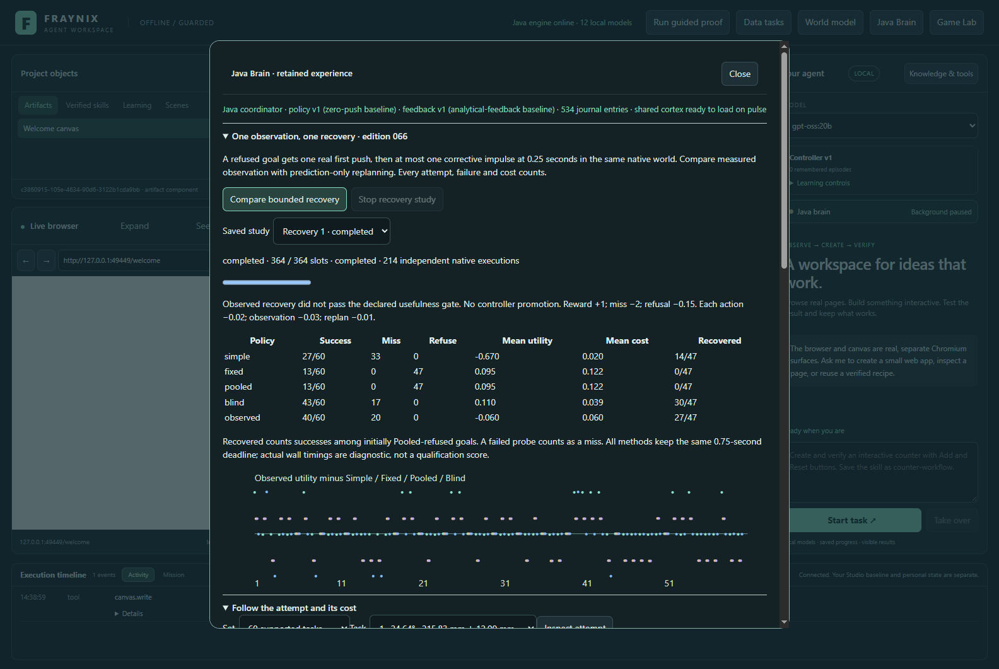
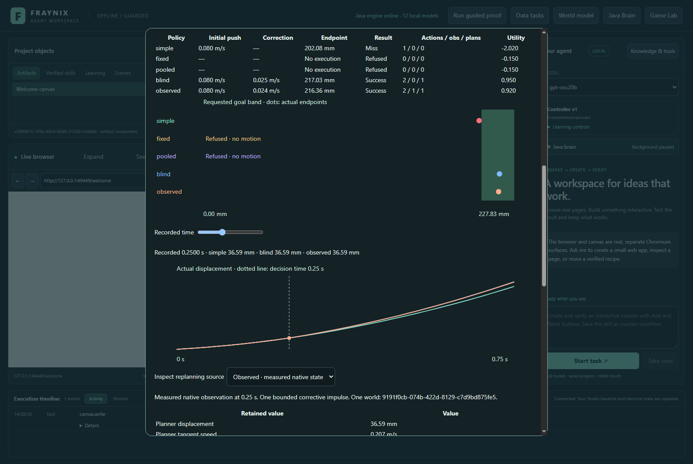
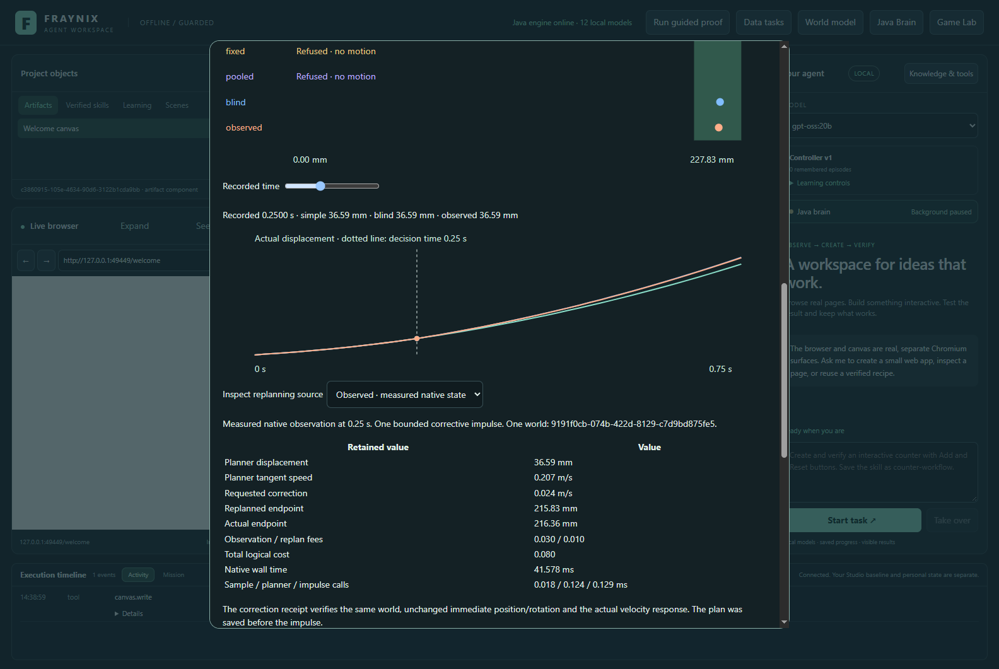
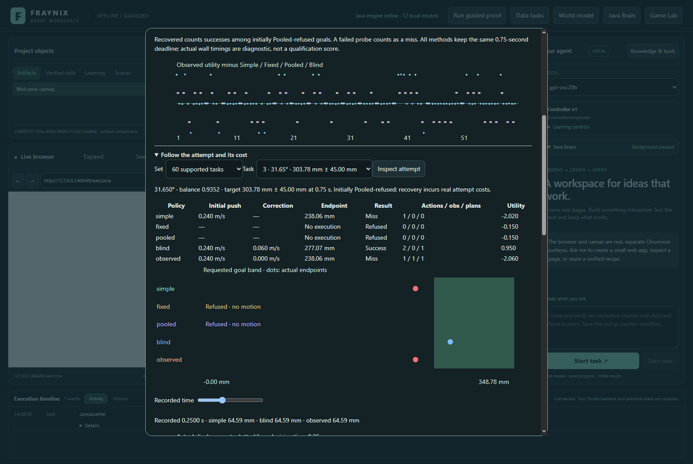
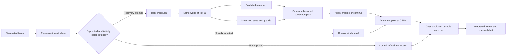
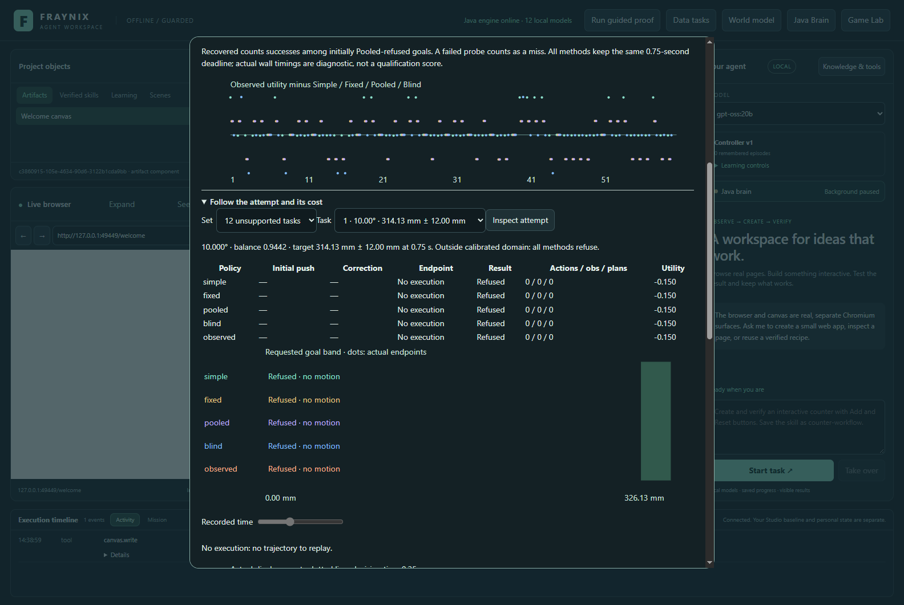
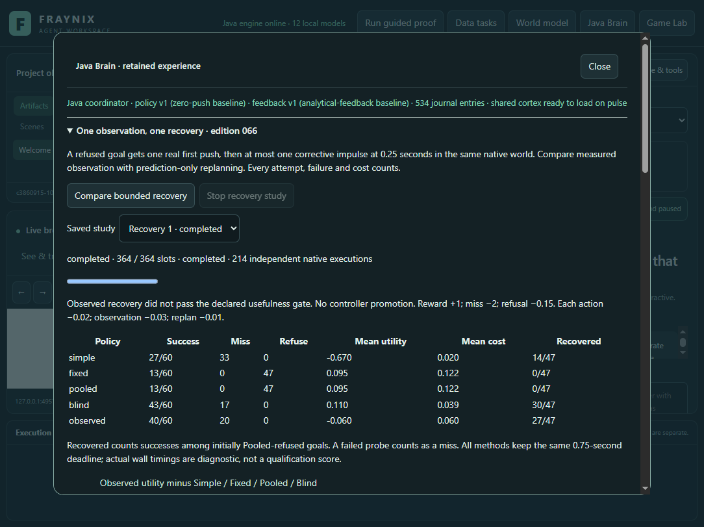
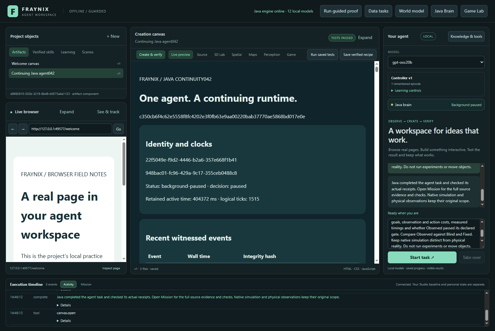

# Fraynix Agent Workspace · Edition 066

**Bounded observation and replanning: recover a refused goal, then count the cost.**

November 4, 2026 · One native world, a real corrective impulse, complete outcomes and continuing Java ownership.

[Previous: edition 065](README-065.md) · [Edition history](docs/readmes/INDEX.md) · [Offline interactive explorer](docs/readmes/066/index.html) · [Verification](docs/readmes/066/verification.json) · [Original evidence](docs/readmes/066/original-evidence.json) · [Frozen experiment contract](docs/EDITION_066_CONTRACT.md)

## What the app can now do

When the original pooled policy refuses a supported target, the new Java recovery procedure makes one real first push, waits until the same world's clock reaches **0.25 seconds**, and considers **one bounded corrective impulse**. It uses measured displacement, velocity, rotation and contact evidence. It then continues that body to the original 0.75-second deadline and scores the actual outcome, including every observation, replan and action fee.

There is no reset between sensing and correction, no pose rewrite and no repeated hidden search. The plan is saved before the impulse. The native record verifies the same world identity, unchanged immediate position/rotation/angular velocity, and the actual linear-velocity response. The integrated Java Brain panel exposes the goal, initial push, correction, costs and recorded motion.

The implementation works, but its proposed measured-state policy **did not pass the declared usefulness gate**. It recovered **27 of 47 initially refused tasks**, completing **40 of 60** goals overall. A simpler prediction-only replanning policy recovered 30 and completed 43. Both outperform the original first push on task completion, but the measured policy incurred 20 misses and lower utility after costs. The result is retained, and the active controller remains unchanged.

Actual app capture, November 4, 2026, from an isolated synthetic project. The experiment is integrated into the existing Java/Electron workspace. It is not a generated mockup or a detached replacement application.

## The measured comparison

| Policy | Success | Miss | Refuse | Successes among initially Pooled-refused goals | Mean utility |
| --- | ---: | ---: | ---: | ---: | ---: |
| Simple | 27/60 | 33 | 0 | 14/47 | -0.670000 |
| Fixed | 13/60 | 0 | 47 | 0/47 | 0.094833 |
| Pooled | 13/60 | 0 | 47 | 0/47 | 0.094833 |
| Blind | 43/60 | 17 | 0 | 30/47 | 0.110500 |
| Observed | 40/60 | 20 | 0 | 27/47 | -0.060333 |

Simple, Fixed and Pooled retain the exact edition 065 initial-decision rules. These are **new edition 066 tasks**, so their totals should not be interpreted as repeated measurements of the old 065 cases. Fixed and Pooled happen to make identical choices in this new sample.

Blind and Observed use the admitted Pooled action directly when available. On a Pooled refusal, both start with Simple's chosen push. Blind computes its later correction from the analytical predicted state; Observed uses the actual native state and measured guards. A probe that fails to reach its goal is a **miss**, not a refusal. All requested tasks remain in the denominator.

Observed improves mean utility over Simple by **+0.609667**, but loses **0.155167** against both Fixed and Pooled and **0.170833** against Blind. Against Blind it has two utility wins, 13 ties and 45 losses. Many losses reflect an observation fee on the same task outcome; there are also five cases where Blind succeeds and Observed misses, versus two with the reverse outcome. Three fewer successes contribute −0.15 to the mean gap; the remaining −0.020833 is the mean cost difference.

There are **364 progress slots**: four parity comparisons plus 72 tasks × five decisions. The study contains **214 independent native executions**: eight parity runs, 60 Simple, 13 Fixed, 13 Pooled, 60 Blind and 60 Observed. Unsupported cases produce **60 refusals**, zero native executions and no fabricated endpoints. Each admitted policy has its own fresh world. Each individual recovery attempt keeps that world continuously through its correction.

### The usefulness gate stays unchanged

The contract requires Observed to improve mean utility by at least +0.10 over Fixed and Pooled and +0.05 over Blind, succeed on at least 50% of all tasks, miss at most 20%, and recover at least 30% of initially Pooled-refused goals. It passes the completion and recovery fractions. It fails the comparative-utility requirements and the miss limit: **20/60 = 33.3%**.

These are declared empirical gates, not statistical significance claims. Blind is a comparison, not a posthoc promoted winner. Neither new policy replaces the active controller or trains the LLM.

## A concrete recovered task

One retained task asks for **215.83 ± 12.00 mm** displacement at 0.75 seconds on a 24.636° ramp. Simple's first push finishes at **202.08 mm**, outside the window. Fixed and Pooled initially refuse it.

Observed starts the same first push. At 0.25 seconds its measured displacement is **36.59 mm**. It saves a plan and applies a **0.023784 m/s** tangent-velocity change through a real central impulse. The same body finishes at **216.36 mm**, inside the goal. Blind also succeeds, at **217.03 mm**. Observed pays 0.08 total logical cost; Blind pays 0.05.

The dotted line marks the decision time. Samples at that time describe the state before correction; the separate immediate before/after receipt records the impulse response. Displacement continues smoothly because the action changes momentum, not position.

## Costs: assumed utility and measured time are different

The frozen score is +1 for success, −2 for a miss, −0.15 for refusal, −0.02 per actual initial or corrective action, −0.01 per replan and −0.03 per measured observation exposed to the planner. A successful two-action Observed attempt scores **+0.92**; the corresponding Blind attempt scores **+0.95**. A measured probe that withholds its correction and misses scores **−2.06**. Its first action, observation and replan still happened.

| Policy | Actions | Observations | Replans | Mean logical cost | Sum absolute impulse, N·s | Sum instrumented trial wall time |
| --- | ---: | ---: | ---: | ---: | ---: | ---: |
| Simple | 60 | 0 | 0 | 0.020000 | 16.020000 | 0.352 s |
| Fixed | 13 | 0 | 0 | 0.121833 | 3.240000 | 0.077 s |
| Pooled | 13 | 0 | 0 | 0.121833 | 3.240000 | 0.076 s |
| Blind | 95 | 0 | 47 | 0.039500 | 18.116255 | 11.654 s |
| Observed | 87 | 47 | 47 | 0.060333 | 17.543408 | 12.058 s |

Mean logical cost includes the refusal penalty for tasks that never execute. It should not be read as a pure computation bill. Observed's 87 actions comprise 60 initial pushes and 27 corrective impulses. Blind uses 60 initial pushes and 35 corrections. Both replan 47 times; only Observed receives those 47 measured states.

The app records monotonic wall time for the complete instrumented trial, the decision-time sample read, planner computation and corrective impulse call. Whole-trial timing includes recording and saving the pre-action plan. It excludes some surrounding study bookkeeping and is **not** a pure solver, camera-sensor or algorithm benchmark. Fixed method order, warm-up, checkpoint growth and machine load affect these timings. Refusal-planning latency is not separately benchmarked. Actual timings remain in every native record and the inspector.

All methods share the same simulated 0.75-second deadline. There is no invented extra waiting-time charge. Native simulation is not paced as a real-time hardware experiment. The score's fees are assumptions fixed before outcomes, not measured energy, money or physical risk.

Recorder telemetry is collected for verification across all methods. “Observed” means the state is exposed to that controller's planner. Blind receives no measured sample; its correction function is given only the analytically predicted state. Paying the observation fee therefore represents planner access, not proof of an extra physical sensor acquisition.

## What the failures reveal

Observed requests 27 corrective impulses, with 25 successful final outcomes among those cases. It withholds 11 corrections because its measured guard lacks a near-contact point; two of those attempts still succeed from the first push. Nine more cases cannot predict arrival inside the goal under the bounded correction and all miss. These counts come from retained evidence, not from another experiment.

All 11 measured guard refusals are triggered by the instantaneous near-contact callback count. **A missing callback does not establish loss of physical support.** Five of those cases are Blind successes and Observed misses. This suggests investigating contact persistence and observation timing, but it does not establish the mechanism. The published rules remain fixed.

Observed differs from Blind in both its numerical state and measured guard eligibility. The comparison tests that whole policy package; it cannot isolate the causal value of measurement alone. The more conservative guard can discard a useful correction, while a real first push has already made the attempt irreversible.

The [posthoc diagnostic record](docs/readmes/066/posthoc-diagnostics.json) lists every guarded case, observed state and correction reason. It is labelled descriptive analysis. No task, contact threshold, impulse limit, utility weight or qualification gate was changed to improve the result.

### Predeclared subgroup outcomes

| Group | Simple successes | Fixed successes | Blind successes | Observed successes | Observed misses | Tasks |
| --- | ---: | ---: | ---: | ---: | ---: | ---: |
| width24mm | 10 | 0 | 14 | 13 | 7 | 20 |
| width45mm | 13 | 13 | 17 | 15 | 5 | 20 |
| slowing | 10 | 5 | 17 | 17 | 13 | 30 |
| accelerating | 17 | 8 | 26 | 23 | 7 | 30 |
| width12mm | 4 | 0 | 12 | 12 | 8 | 20 |

The width labels refer to half-widths: 12, 24 and 45 mm correspond to full windows of 24, 48 and 90 mm. Complete metrics and paired comparisons are retained in [verification.json](docs/readmes/066/verification.json) and the offline explorer.

## How the Java procedure works

The task generator uses seed 66001 for 60 fresh supported goals: 30 accelerating and 30 slowing cases, with the same declared slope/friction family as 065. Goal centers are independent random draws; windows may be unreachable under the finite initial push grid and bounded correction. Seed 66002 creates 12 separate unsupported goals using angle 10°, angle 34° or friction ratio 1.00. They all refuse before native execution and do not count toward qualification.

The initial pushes remain 0.08, 0.16, 0.24, 0.32 and 0.38 m/s. Only an initial Pooled refusal opens the recovery path. At tick 60, Java uses the remaining half-second to solve the analytical displacement equation for a nonnegative target tangent speed. It clamps the requested velocity change to **±0.16 m/s** and permits it only if resulting tangent speed lies in [0, 0.8] m/s and the predicted endpoint fits the requested window.

Observed additionally requires a near-contact point, rotation ≤10°, absolute normal speed ≤0.10 m/s, angular speed ≤2 rad/s and nonnegative tangent speed. Otherwise it continues without a correction and scores the actual endpoint. A target already behind the state also receives no correction. Blind assumes the nominal contact/orientation state and labels that input as predicted.

The old pooled interval is used only for initial admission. It is **not a calibrated interval for the later controlled trajectory**. The corrected prediction is an analytical estimate, not a new learned world model or uncertainty guarantee.

The [policy](workspace-engine/src/main/java/fraymus/workspace/RecoveryPolicy066.java), [native adapter](workspace-engine/src/main/java/fraymus/workspace/RecoveryRamp066.java), [trial recorder/auditor](workspace-engine/src/main/java/fraymus/workspace/RecoveryTrial066.java), [study coordinator](workspace-engine/src/main/java/fraymus/workspace/RecoveryStudy066.java) and [lossless chat projection](workspace-engine/src/main/java/fraymus/workspace/RecoveryContext066.java) are handwritten Java. The [integrated view](workspace-desktop/renderer/recovery066.js) renders actual Java evidence. No new external dependency was added; the existing Bullet-based physics, JSON support and Electron/Chromium surfaces remain.

## Review it in the application

1. Start `Launch-Agent-Workspace.bat` using the existing JDK 21 and desktop prerequisites. Docker and WSL are unnecessary.
2. Open **Java Brain → One observation, one recovery · edition 066** and choose **Compare bounded recovery**.
3. Read all five policy totals and costs. Progress distinguishes 364 comparison slots from actual native executions.
4. Select a supported task in **Follow the attempt and its cost**. Inspect the first push, correction, actual endpoint and success/miss/refusal.
5. Scrub the 46 native samples. Select **Observed** or **Blind** to inspect the planner's actual input source, predicted endpoint, fees and recorded timings.
6. Select an unsupported task to confirm that no trajectory or observation is fabricated. Stop a new comparison; the completed comparison remains available.
7. Restart and reopen the retained study. Exact plans, impulse receipts, costs and motion persist.
8. Ask chat to “Inspect the bounded recovery study, compare all five policies and their costs, and create its verified report. Do not run experiments or move objects.” Java routes the actual state through the existing checked reporting path.

The [offline explorer](docs/readmes/066/index.html) includes all tasks, failures, domain refusals, cost details, measured/predicted source selection and displacement/speed/rotation traces. It runs without a model or CDN and visualizes audited records. It does not substitute a browser approximation for native physics.

## Verification and preservation

The offline explorer passed interaction checks at 1440 and 390 pixels, including all eight screenshots, 240 paired utility points, 60 supported and 12 unsupported cases, sample scrubbing, three motion quantities, source selection, fees, filters and local links. [Browser checks](docs/readmes/066/documentation-browser.json) and [visual review](docs/readmes/066/documentation-review.json) are separate records.

The contract was committed as `41c68b7` before new outcomes. Native implementation `51ee6ef5949d54823ca6a3a57b15501553167ae7` is source-qualified in the evidence. Four parity comparisons against the original runtime have **zero maximum difference** across all 46 samples of position, velocity, angular velocity and rotation. Parity precedes the fresh tasks; a mismatch blocks the experiment.

**68 distinct targeted Java checks across 11 classes passed**, together with **127 desktop checks**. The checks cover unchanged initial policies, inverse planning, action bounds, observation isolation, full failure costs, qualification, exact context reconstruction, native impulses, altered-evidence refusal, cold state and Stop. A compatibility test restores the exact published 065 original through the current Java owner twice. The original 064 study is also audited from a separate closed synthetic copy.

The real app completes the 214-execution comparison, inspects motion/cost/source views, rejects unsupported goals, restores exact cold traces, preserves completed history after Stop, and uses actual CPU-only/four-thread `gpt-oss:20b` for its checked report. These are recorded invocations, not a claim that the entire repository test suite was rerun or that every model will perform identically.

The [original archive inventory](docs/readmes/066/original-evidence.json) includes compressed and decompressed byte counts and SHA-256 for native records, XML, logs and actual-app checkpoints. The Java export audits the original study before deriving the offline traces. Integrity checks establish correspondence to stored bytes, not independent physical truth. Personal worlds, normal045/qa046 installations and all prior frozen README editions remain preserved.

See the complete [source tree](docs/readmes/066/FILE_TREE.md), [canonical inventory](docs/readmes/066/file-inventory.json), [system map](docs/readmes/066/system-map.json), [Obsidian note](docs/obsidian/74-bounded-recovery.md) and [Canvas map](docs/obsidian/bounded-recovery.canvas). Publication is checked by fetching the pushed source, frozen snapshots and original archives back from GitHub.

## Next: improve evidence before granting more authority

Edition 067 should first test whether contact evidence over a bounded time window makes a better decision than one instantaneous callback. Compare persistent contact state, geometric separation and observed motion without treating any single source as unquestionable. Declare the sampling budget, deadline and guards before fresh outcomes.

Then evaluate whether a goal is worth attempting **before** the initial irreversible push. Recovery adds useful capability, but knowingly attempting an unrecoverable goal can cost more than an honest refusal. Compare the complete procedure with Blind, Fixed and Simple under the same fees and include unreachable goals.

Only after those tests should a candidate become a reusable active control skill, with cold-restart checks and unfamiliar conditions. Physical-camera transfer, multiple bodies and broader geometry remain separate evaluation steps. This edition establishes bounded, observable control in the existing local app; it does not establish real-world calibration, broad autonomous competence or LLM-weight learning.
