# Fraynix Agent Workspace · Edition 067

**Contact evidence over time, and recovery value before the first push.**

November 4, 2026 · One continuing native world, declared decisions, actual corrections and complete costs.

[Previous edition 066](README-066.md) · [Edition history](docs/readmes/INDEX.md) · [Offline interactive explorer](docs/readmes/067/index.html) · [Frozen contract](docs/EDITION_067_CONTRACT.md) · [Verification](docs/readmes/067/verification.json) · [Exact original evidence](docs/readmes/067/original-evidence.json)

## What changed

Edition 066 could recover a refused target with one observation and one corrective impulse. Its instantaneous contact check sometimes withheld a useful correction, and attempting every refused task incurred expensive misses. Edition 067 addresses both decisions in the existing Java-owned application.

**Temporal** checks three recent native samples at ticks 52, 56 and 60. It combines contact callbacks with motion limits and the oriented cube's geometric clearance above the ramp. **Value** uses that same controller, but first estimates whether attempting recovery is worthwhile through nine declared analytical scenarios. A declined screen stops before any first push.

Both additions are implemented, persisted and inspectable in Java Brain. The original five policies remain unchanged for comparison. The agent can inspect the actual study through the existing checked chat reporting route. No separate replacement app, unrestricted action handler or new external dependency was added.

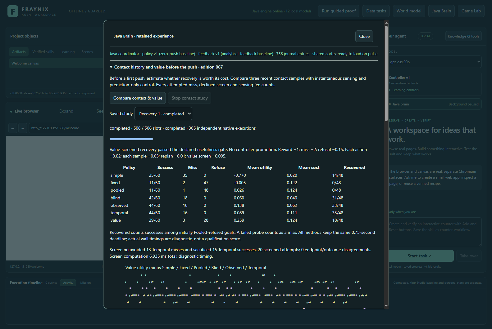

All captures show the real Java/Electron app in an isolated synthetic project. The body moves through native physics, and its recorded trajectory is displayed in the existing panel.

## Results, including the price of refusal

| Policy | Success | Miss | Refuse | Successes among initially Pooled-refused goals | Mean utility |
| --- | ---: | ---: | ---: | ---: | ---: |
| Simple | 25/60 | 35 | 0 | 14/48 | -0.770000 |
| Fixed | 11/60 | 2 | 47 | 0/48 | -0.005167 |
| Pooled | 11/60 | 1 | 48 | 0/48 | 0.026000 |
| Blind | 42/60 | 18 | 0 | 31/48 | 0.060000 |
| Observed | 44/60 | 16 | 0 | 33/48 | 0.137667 |
| Temporal | 44/60 | 16 | 0 | 33/48 | 0.089000 |
| Value | 29/60 | 3 | 28 | 18/48 | 0.259333 |

There are 60 fresh supported tasks and 12 separate unsupported cases. All 84 unsupported decisions refuse without motion or screening. The experiment completes **508 progress slots** and **305 independent native executions**, including eight parity runs. Each policy execution starts a separate fresh world; each individual attempt keeps its one world continuously through observation and correction.

Temporal completed **44/60**, versus Observed's **44/60**. It succeeded on 0 cases that Observed missed, while the reverse happened on 0 cases. These policies differ in history, geometry and fees, so this does not isolate history alone. In native validation, cases 8 and 53 allowed two additional Temporal impulses after an instantaneous callback dropout; both were already successful under Observed. That is real additional control, without a completion gain on these cases.

Value completed **29/60**, with **3 misses** and **28 refusals**. Its screen avoided **13 Temporal misses** but sacrificed **15 Temporal successes**. Among 20 screened attempts, 0 outcomes or endpoints disagreed with the corresponding unscreened Temporal run. This separates selection from control behavior.

The proposed Value policy **passed** its predeclared usefulness gate. It must gain at least +0.05 mean utility over each of Fixed, Pooled, Blind and Temporal, complete at least 40% of all goals, miss at most 15%, and recover at least 20% of initially Pooled-refused goals. These are empirical acceptance criteria, not significance or generalization claims. **No active controller or LLM weights were promoted or changed.**

| Value compared with | Mean utility difference | Wins | Ties | Losses |
| --- | ---: | ---: | ---: | ---: |
| Blind | +0.199333 | 15 | 12 | 33 |
| Pooled | +0.233333 | 18 | 12 | 30 |
| Simple | +1.029333 | 32 | 12 | 16 |
| Fixed | +0.264500 | 18 | 12 | 30 |
| Temporal | +0.170333 | 13 | 12 | 35 |
| Observed | +0.121667 | 13 | 12 | 35 |

Every task stays in the denominator. A failed probe is a miss even if the guard withholds its later correction. A pre-push refusal has no native endpoint. The task set and fees were declared before new outcomes; neither was adjusted to make the result pass.

## Contact is evidence across time

The contact window spans approximately 33.3 milliseconds, from 0.216667 to 0.25 seconds. At least one of the three samples must contain a near ramp-contact callback. Every sample must also satisfy rotation ≤10°, normal speed magnitude ≤0.10 m/s, angular speed ≤2 rad/s and nonnegative tangent speed.

Java computes the lowest point of the **oriented** cube against the known ramp plane. Clearance must stay within −30 to +30 mm in all three samples. Quaternion rotation changes the cube's support extent; this is not an axis-aligned approximation. Geometry is known from the native scene, not inferred from a webcam image.

The tick-60 near-point count is preserved exactly, even when earlier evidence allows a correction. There is no fabricated contact callback. The three source samples retain their ticks, hashes, clearances, orientation and motion. Future samples cannot enter this decision.

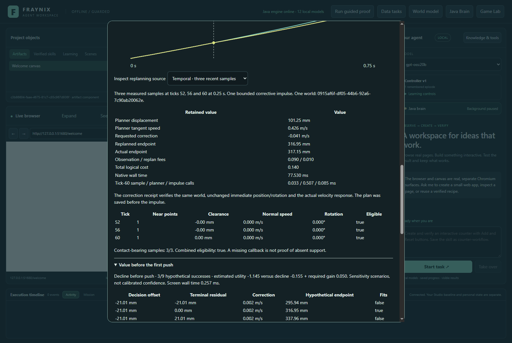

A missing callback by itself does not prove loss of physical support. Conversely, an old callback cannot excuse a current unsafe motion or geometry state. The implementation tests both brief callback dropout and persistent absence, lifted geometry and excessive angular motion.

One retained task asks for 316.95 ± 12.00 mm displacement at 0.75 seconds. At the decision time, Temporal measures 101.25 mm and retains 3/3 contact-bearing samples. Its actual corrective velocity change is -0.040686 m/s; the same body finishes at 317.15 mm.

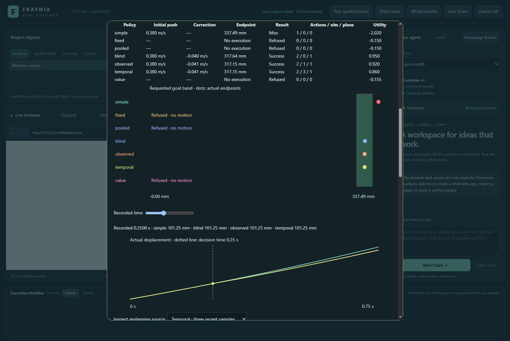

The correction is a real central impulse. Position, rotation and angular velocity are unchanged immediately across that action; linear velocity changes by the recorded impulse response. The plan is saved before execution. There is no teleport, world reset, extra deadline or hidden retry.

## Estimate value before committing

The screen takes the task, Simple's initial push and the existing analytical prediction. It uses the published 064 radius—21.010 mm—as a sensitivity scale. At the predicted decision time it tries displacement offsets of −radius, zero and +radius, crossed with those same three terminal residuals.

For each of the nine scenarios, it applies the unchanged bounded correction formula and checks the hypothetical endpoint. It holds predicted tangent speed fixed and assumes eligible contact. The resulting fraction is **not a calibrated probability**. The old endpoint interval does not establish confidence for an actively corrected trajectory, and nominal contact can be optimistic.

Let p be the fraction of those nine hypothetical endpoints in the goal. Estimated utility is **3p − 2 − 0.145**, conservatively charging two impulses, three sample accesses, one replan and the screen. Declining scores −0.155, including screening. Value attempts only when the estimate exceeds decline by at least 0.05.

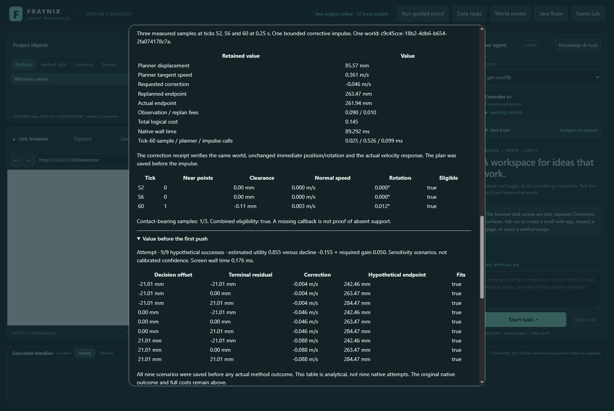

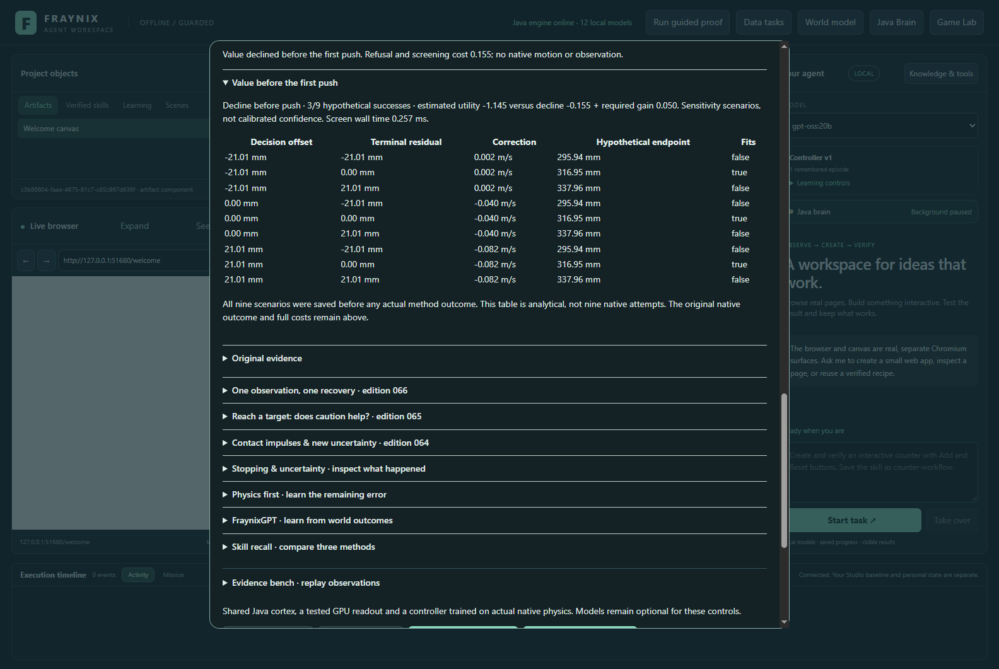

These are nine analytical calculations, not nine candidate physics runs. All seven initial decisions and the screen are saved before any actual policy outcome. The screen selects whether to attempt; it does not secretly select a different initial speed.

## Costs and measured computation

Success scores +1, a miss −2 and refusal −0.15. Each actual impulse costs 0.02, each measured sample exposed to the planner 0.03, each replan 0.01 and each screen 0.005.

A successful two-impulse Temporal attempt scores +0.86. Value's corresponding attempt scores +0.855. Blind's two-impulse success scores +0.95; Observed's scores +0.92. Value that starts, receives three samples, replans, withholds correction and misses still scores −2.125. Screening never erases the first action's cost.

| Policy | Actions | Sample accesses | Replans | Screens | Mean logical cost | Sum instrumented trial wall time |
| --- | ---: | ---: | ---: | ---: | ---: | ---: |
| Simple | 60 | 0 | 0 | 0 | 0.020000 | 0.329 s |
| Fixed | 13 | 0 | 0 | 0 | 0.121833 | 0.075 s |
| Pooled | 12 | 0 | 0 | 0 | 0.124000 | 0.064 s |
| Blind | 96 | 0 | 48 | 0 | 0.040000 | 14.661 s |
| Observed | 91 | 48 | 48 | 0 | 0.062333 | 14.276 s |
| Temporal | 93 | 144 | 48 | 0 | 0.111000 | 14.279 s |
| Value | 50 | 60 | 20 | 48 | 0.124000 | 5.912 s |

Screen computations took 6.935 ms in total in this actual-app run. Each screen's time is retained beside its initial plan. Native records separately measure the tick-60 sample call, planning and impulse call. Earlier samples already exist in the recorder; three planner accesses are not a claim of three additional hardware-camera captures.

Whole-trial timing includes instrumentation and saving the pre-action plan, but not all surrounding study bookkeeping. Fixed execution order, warm-up and machine load affect it. The logical fees are declared assumptions, not measured money, energy or physical risk. All policies keep the same simulated 0.75-second deadline.

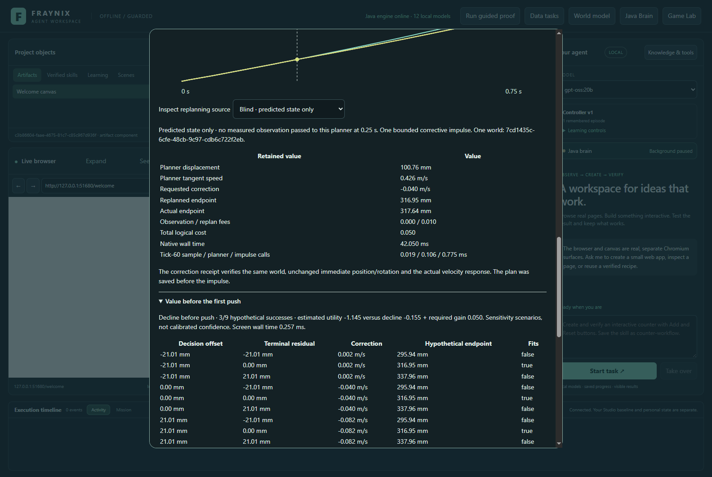

## Failures and persistence are part of the result

The first native invocation failed while atomically replacing its Windows journal, after 280 native executions and 392/508 progress slots. Its complete partial job, checkpoint, journal, pending bytes, XML and logs are retained.

The repair retries only access-denied replacement, with the same forced bytes and the existing cross-process lock held. Retry is bounded; prolonged failure retains the prior journal and pending evidence. It never falls back to a partial non-atomic save. Actual Windows deny-delete tests cover a temporary reader, a persistent reader and interruption. The first interruption test targeted an earlier operation because of timing; its failure is retained, and the corrected test waits for the real retry before interrupting it. The original journal continuity/tampering/concurrent-writer harness also passes.

The unchanged experiment was rerun after that persistence repair. **272 completed task records** from the partial invocation have identical sample arrays and correction plans in the completed native run. Initial plans and logical outcomes also match. [Exact comparison](docs/readmes/067/first-invocation-comparison.json). This is disclosed repeated validation, not additional independent performance evidence.

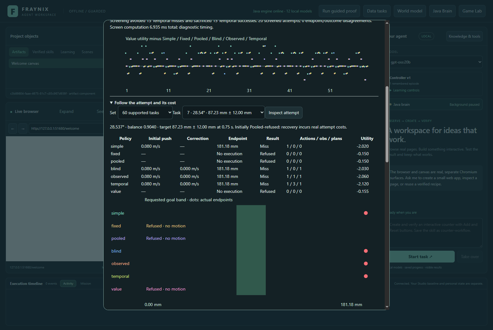

[Contact diagnostics](docs/readmes/067/contact-diagnostics.json) retain all temporal decisions and their original three-sample evidence. Analysis of these cases does not alter the frozen gate. Native verification, actual-app validation and the interrupted invocation are separate runs with their own timings and provenance.

## Subgroups

| Group | Observed successes | Temporal successes | Value successes | Value misses | Value refusals | Tasks |
| --- | ---: | ---: | ---: | ---: | ---: | ---: |
| width24mm | 14 | 14 | 14 | 1 | 5 | 20 |
| width45mm | 15 | 15 | 15 | 2 | 3 | 20 |
| slowing | 20 | 20 | 12 | 3 | 15 | 30 |
| accelerating | 24 | 24 | 17 | 0 | 13 | 30 |
| width12mm | 15 | 15 | 0 | 0 | 20 | 20 |

The width labels are half-widths. Complete per-method metrics, paired utility, refusals, source-qualified records and actual traces are available offline.

## Review it in the app

1. Start Launch-Agent-Workspace.bat with the existing JDK 21 and desktop prerequisites. Docker and WSL are unnecessary.
2. Open **Java Brain → Contact history and value before the push · edition 067**.
3. Choose **Compare contact & value**. Progress distinguishes 508 slots from native executions.
4. Inspect all seven totals, the gate, misses avoided and successes sacrificed.
5. Select a task, scrub its 46 samples and choose Temporal, Value, Observed or Blind. Inspect the actual planner source, three-sample contact table, impulse and costs.
6. Expand **Value before the first push** to inspect the nine saved scenarios. A declined task has no Value trajectory.
7. Select unsupported tasks to confirm all methods refuse. Stop a new study; the completed history remains available.
8. Restart and reopen the saved study. Exact initial plans, contact evidence, impulses and outcomes persist.
9. Ask chat: “Inspect temporal contact and pre-push recovery value. Create its verified report, including avoided misses, sacrificed successes and all costs. Do not run another experiment or move objects.”

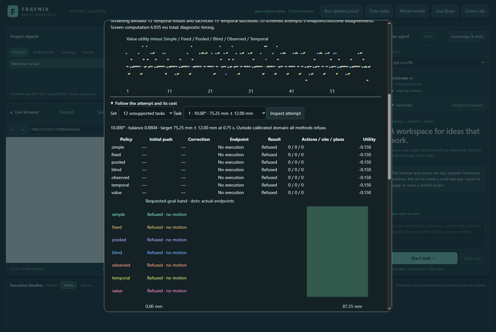

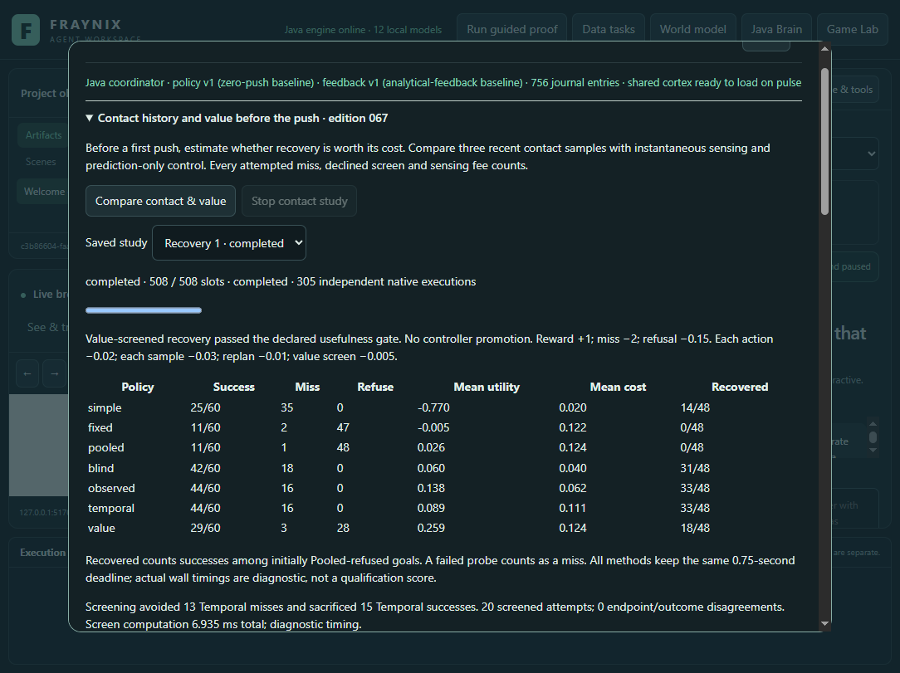

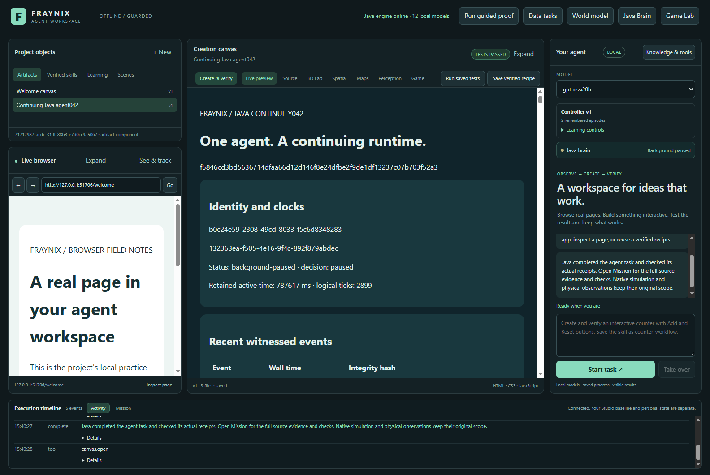

The chat route uses real Java state and the existing reporting checks. It does not grant a new unrestricted physical-action tool. Original evidence remains complete. The first real chat hit the unchanged 12,500-character planning guard: its lossless tables still produced a 14,921-character context. Java now keeps all aggregate metrics, paired comparisons, costs and diagnostics in planning; when necessary, subgroup detail becomes an explicit hashed reference to the original study. The same failed context then fits in 11,156 characters. Every subgroup remains in the original task facts and checked report. Oversized execution requirements still refuse. The same interrupted chat resumed against the same completed study; its original failure is archived, and no experiment was rerun for this repair. An intermediate UI harness edit also corrupted its degree-symbol expectation; that replay was stopped, its failure retained, and the assertion repaired using an explicit Unicode escape. App text and native evidence were unchanged.

## Java ownership and verification

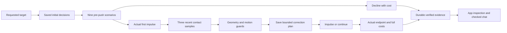

The [contact estimator](workspace-engine/src/main/java/fraymus/workspace/TemporalContact067.java), [value screen](workspace-engine/src/main/java/fraymus/workspace/ValueScreen067.java), [policy](workspace-engine/src/main/java/fraymus/workspace/TemporalPolicy067.java), [trial recorder/auditor](workspace-engine/src/main/java/fraymus/workspace/TemporalTrial067.java) and [study owner](workspace-engine/src/main/java/fraymus/workspace/TemporalStudy067.java) are handwritten Java. The existing RecoveryRamp066 adapter and earlier decision implementations remain unchanged.

Contract commit 9af32f4 preceded new native outcomes. Four comparisons against the original runtime have maximum sample differences [0, 0, 0, 0]. **77 distinct targeted Java checks across 14 classes**, **127 desktop checks**, actual app/restart/Stop/local CPU-only four-thread gpt-oss:20b reporting, and the journal integrity harness pass. Earlier published evidence is restored through the current owner. This is not a claim of a fresh full-repository test run. A preliminary regression command placed its test filters after the wrong Gradle task; it ran no tests. That command failure is retained separately from the passing checks.

The [offline explorer](docs/readmes/067/index.html) uses audited Java-exported motion and works without a model or CDN. It includes all 60 supported tasks, 12 unsupported tasks, seven methods, three motion quantities, contact samples, scenario screens and original screenshots. See the [source tree](docs/readmes/067/FILE_TREE.md), [canonical inventory](docs/readmes/067/file-inventory.json), [system map](docs/readmes/067/system-map.json), [Obsidian note](docs/obsidian/75-temporal-value.md) and [Canvas map](docs/obsidian/temporal-value.canvas).

All prior numbered READMEs and snapshots remain frozen. Personal worlds and the normal045/qa046 installed runtimes are preserved. Original archives have compressed and decompressed byte counts and SHA-256; integrity establishes correspondence to stored evidence, not independent physical truth. Publication is verified by freshly fetching and auditing the pushed Git tree.

## Next: test the value estimate itself

Edition 068 should compare the screen's assumed success fraction with actual outcomes on separately reserved tasks. Vary the scenario assumptions prospectively, include real native disturbances and contact loss, and retain the misses avoided and successes sacrificed. Select any candidate using separate development cases before evaluating unfamiliar conditions.

Then test broader geometry and multiple bodies before transferring claims to a calibrated camera or physical actuator. Temporal evidence and pre-action selection now form working parts of the app, but useful learning still requires a measured improvement that persists after restart and survives conditions it did not select for itself.
