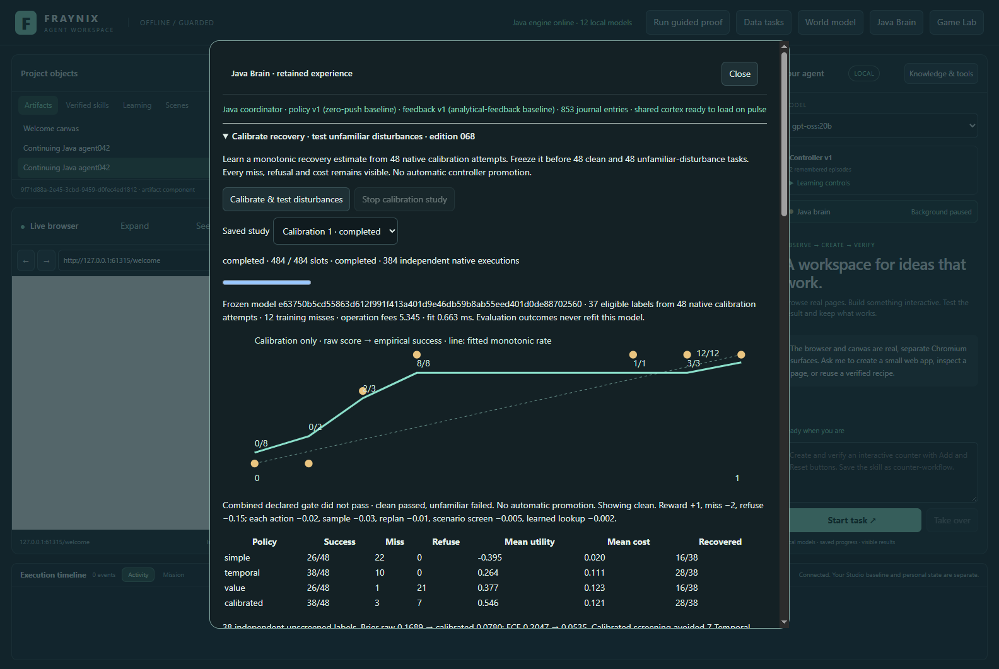
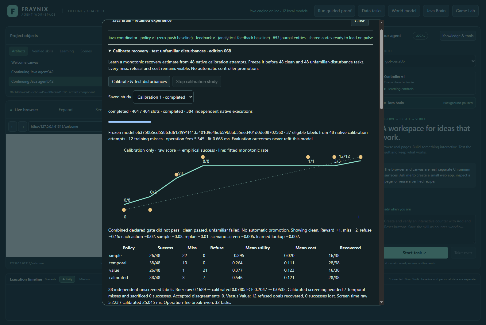
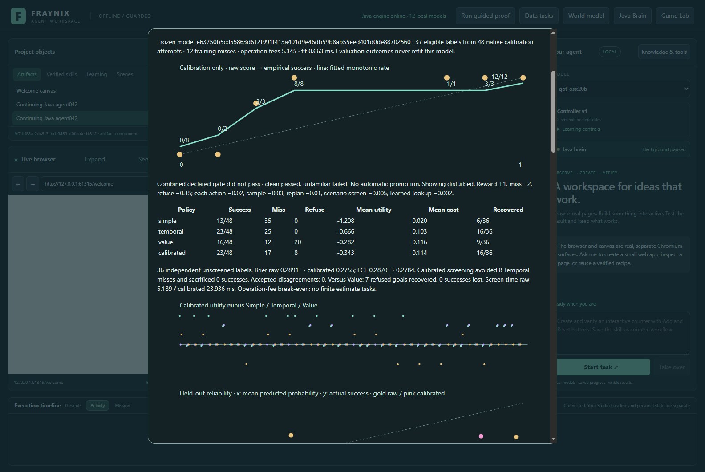
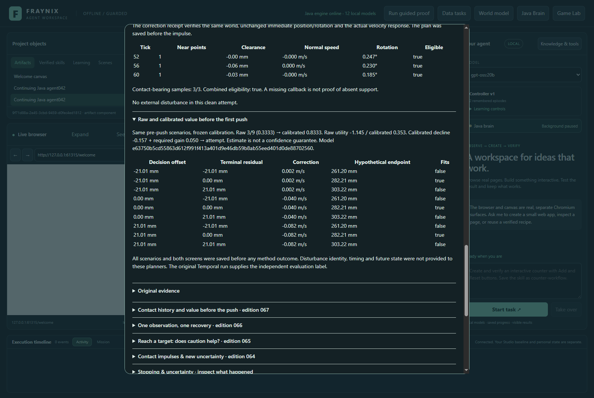
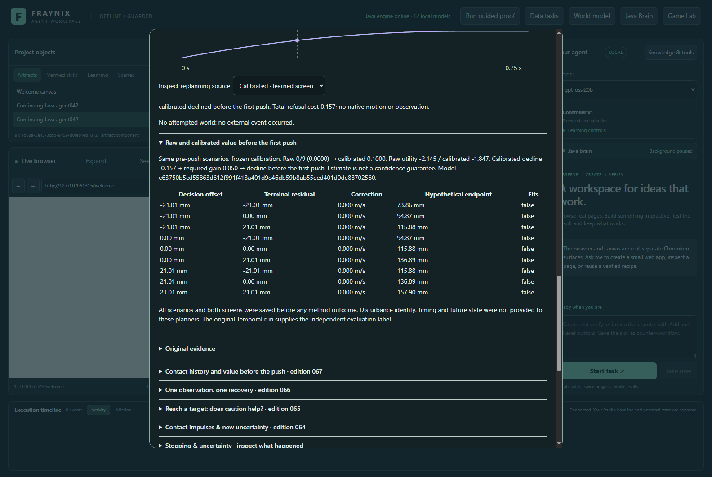
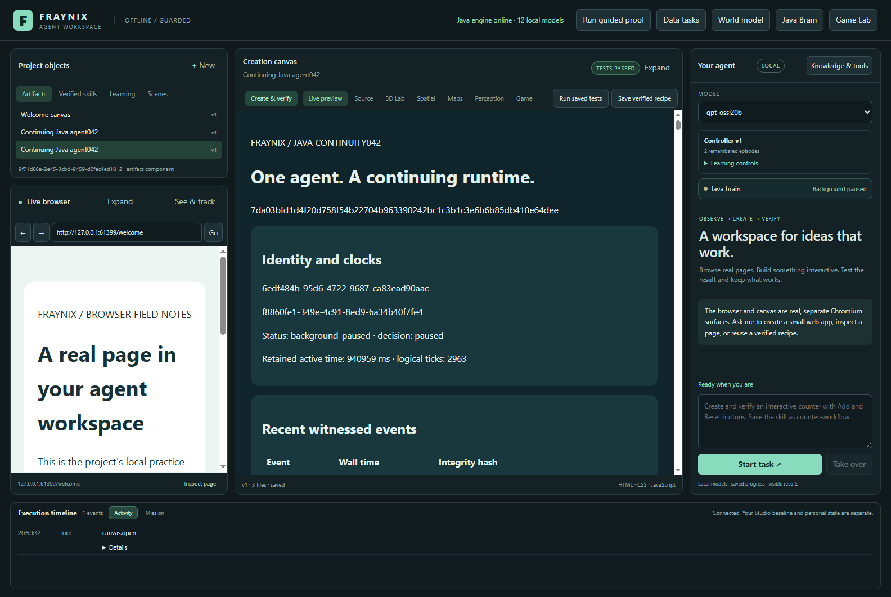
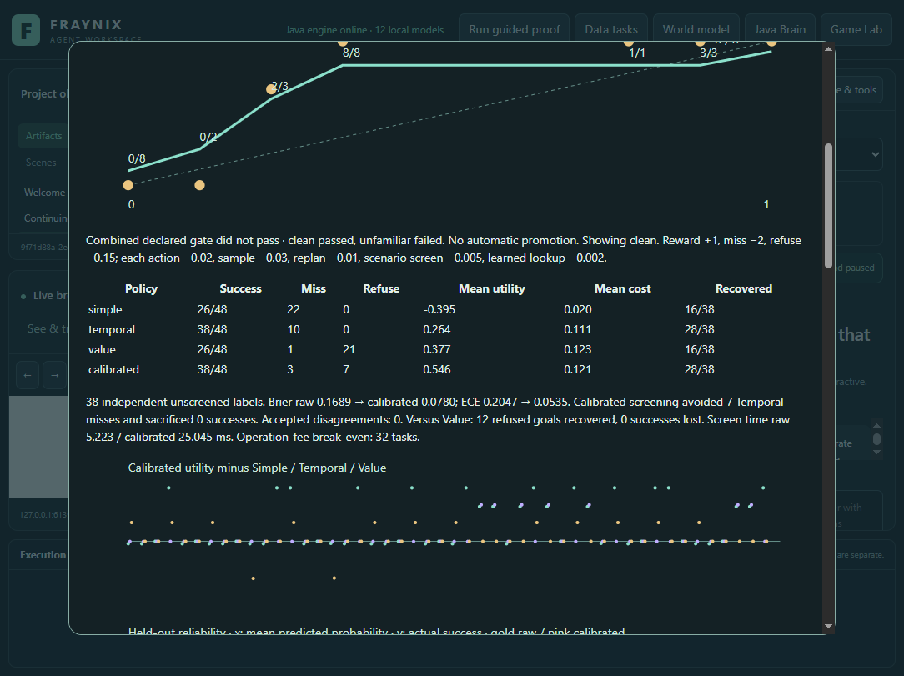
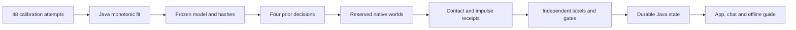

# Fraynix Agent Workspace · Edition 068

**Calibrate recovery value, then test it against unfamiliar disturbances.**

November 4, 2026 · Owned Java algorithms, real native impulses, frozen learning and complete failure evidence.

[Previous edition 067](README-067.md) · [Edition history](docs/readmes/INDEX.md) · [Offline interactive explorer](docs/readmes/068/index.html) · [Prospective contract](docs/EDITION_068_CONTRACT.md) · [Verification](docs/readmes/068/verification.json) · [Exact originals](docs/readmes/068/original-evidence.json)

## The result comes first

Edition 068 learns a useful recovery estimate on clean ramp tasks, but **does not qualify under unfamiliar disturbances**. Both facts matter. The implementation and its checks pass; the proposed controller's combined performance gate fails. No active controller is promoted, no old result is replaced, and no language-model weights change.

On 48 clean tasks, Calibrated completes **38**, with **3 misses and 7 refusals**. The earlier Value screen completes 26, with 1 miss and 21 refusals. Calibrated retains all 38 successes of unscreened Temporal while avoiding seven of its misses. Its mean utility improves over Value by **+0.168417** after charging screening, sensing, correction and lookup fees.

On 48 unfamiliar-disturbance tasks, Calibrated completes **23**, with **17 misses and 8 refusals**. Value completes 16, with 12 misses and 20 refusals. Additional completions do not compensate for extra failed attempts: Calibrated's mean utility is **0.060250 worse** than Value. Its 35.42% all-task miss rate exceeds the declared 25% limit.

These are actual app captures from isolated synthetic projects. The environment is the existing native rigid-body engine; the graphs display its measured motion. This release does not claim webcam calibration, physical manipulation, general intelligence or unlimited learning.

## What changed in the application

Edition 067 estimated recovery value from nine equally weighted analytical scenarios. That fraction described the sensitivity calculation, not an empirically calibrated chance of success. Edition 068 adds a small, owned Java learner that maps that fraction to actual observed recovery frequency.

Java runs calibration attempts, binds each usable label to its task and native record, fits a monotonic function, saves its hash and freezes it before any reserved evaluation outcome. A fourth policy uses that function in the pre-push decision. Three comparison policies retain their original choices. The UI shows the fitted curve, held-out reliability, full costs, chosen actions, contact history, external impulses and the failed qualification.

The language model requests and explains; Java owns decisions, state, validation and durable evidence; native physics determines the trajectory; the desktop displays it. The learner adds no external ML dependency. Existing Bullet/Minie, JSON, Chromium/Electron and Ollama remain existing components; calling the entire application dependency-free would be inaccurate.

## Prospective experiment

The [contract](docs/EDITION_068_CONTRACT.md) was committed as **19cd86e** before outcomes. Runtime implementation **fd1fd52** preceded the first new native invocation. The clarification charging calibration feature screens was included before that invocation. No case, threshold, fit rule, disturbance or success gate changed after seeing results.

| Partition | Tasks | Purpose |
| --- | ---: | --- |
| Calibration, seed 68001 | 48 | Unscreened attempts; fit eligible initial refusals |
| Clean evaluation, seed 68002 | 48 | New supported tasks without an outside impulse |
| Disturbed evaluation, seed 68003 | 48 | New supported tasks, twelve per event family |
| Unsupported, seed 68004 | 12 | Retain angle/friction domain fences |

Supported tasks span two regimes, angles from 12 to 32 degrees, friction ratios below or above balance, three target half-widths of 12/24/45 mm, and fresh target centres. Unsupported cases use 10°, 34° or the excluded exact balance ratio. All four policies refuse those twelve cases without native motion. Forty-eight unsupported decisions remain in the evidence.

The study completes **484 progress slots and 384 actual native executions**, including eight parity executions. Slots include refusals; they are not a claim of 484 simulations. Four adapter/original pairs have maximum position, velocity, rotation and angular-velocity differences of zero. Each policy attempt begins in a fresh world; an individual attempt remains in that same world through observation and correction.

## What Java learns

Forty-eight unscreened training attempts produce 36 successes and 12 misses. Thirty-seven were initially refused by the Pooled baseline and supply eligible recovery labels. The eleven direct admissions remain recorded but do not enter this fit.

For each occupied integer scenario score from 0 through 9, Java counts actual successes and failures. A declared Laplace prior produces (successes + 1) / (count + 2). Weighted pool-adjacent-violators merges adjacent rates that would decrease, retaining their combined counts. Prediction linearly interpolates between occupied knots and clamps outside their range.

The mathematical reference is [weighted isotonic regression](https://scikit-learn.org/stable/modules/isotonic.html); the application implements the procedure in Java and does not import scikit-learn. Smoothing, feature choice and acceptance gates are explicit experimental choices. This is finite empirical calibration, not a confidence bound.

Raw score 3/9 succeeded on eight of eight eligible calibration attempts, whereas score 7/9 had only one sample. Pooling and smoothing yield a common fitted rate of 0.833333 over the middle occupied knots. Score 0 maps to 0.1; score 9 maps to 0.928571. These estimates express limited evidence, including the prior, and are not guarantees about future disturbances.

Training required 73 actions, 111 observed samples, 37 replans and 37 feature screens. Its declared operation fees total **5.345**. Actual fitting took **0.6632 ms** in the app study. Original evidence retains timings for each execution and screen; UI and checkpoint overhead is not hidden inside a claim that the whole study takes only the fit time.

## Clean held-out performance

| Policy | Success / 48 | Miss | Refuse | Mean utility | Mean operation cost |
| --- | ---: | ---: | ---: | ---: | ---: |
| Simple | 26 | 22 | 0 | -0.395000 | 0.020000 |
| Temporal | 38 | 10 | 0 | +0.263750 | 0.111250 |
| Value | 26 | 1 | 21 | +0.377083 | 0.122917 |
| Calibrated | 38 | 3 | 7 | +0.545500 | 0.121167 |

Probability scoring uses the 38 initially Pooled-refused clean tasks and the independent unscreened Temporal outcome for every one, including tasks either screen declines. A screen cannot appear calibrated merely by hiding its refusals.

| Probability measure | Raw scenario fraction | Frozen calibrated estimate |
| --- | ---: | ---: |
| Clean Brier score | 0.168941 | 0.077991 |
| Clean five-bin ECE | 0.204678 | 0.053509 |
| Disturbed Brier score | 0.289095 | 0.275497 |
| Disturbed five-bin ECE | 0.287037 | 0.278373 |

Brier is mean squared difference between probability and outcome; lower is better. ECE compares mean forecast with observed success in five fixed equal-width bins. Empty bins stay empty. Exact counts, means and denominators are in the app, offline guide and [audited export](docs/readmes/068/calibration-data.json).

The clean gate requires at least 0.01 Brier improvement, utility no more than 0.01 below Value, at least 40% all-task success and at most 15% misses. It passes all four. Under the declared costs, operation-fee-only training break-even is **32 comparable clean tasks**. This excludes training miss penalties, fitting compute and physical risk; it is not a monetary return or deployment promise.

## Four unfamiliar disturbances

Calibration contains no external impulses. Reserved disturbed tasks add one event after a native step and before its recorded sample:

| Family | Tick / time | Actual native impulse |
| --- | --- | --- |
| Brake before observation | 40 / 0.166667 s | −0.10 N·s along ramp tangent |
| Lift before observation | 40 / 0.166667 s | +0.30 N·s along ramp normal |
| Push after observation | 84 / 0.350000 s | +0.10 N·s along ramp tangent |
| Spin after observation | 84 / 0.350000 s | +0.025 N·m·s about world Z |

The engine applies real linear or torque impulses. Each event stores state immediately before and after: position, orientation, velocity and angular velocity. Verification checks expected mass/inertia response, unchanged immediate pose, event tick, continuing world identity and matching sampled trajectory. It does not teleport the object or replace the result with an analytical path.

The controller receives measured past observations, never the event family or future schedule. External events are counted separately from agent actions. A later push or spin happens after the sole tick-60 correction opportunity, so this controller cannot react again. That limitation is part of the experiment.

| Policy | Success / 48 | Miss | Refuse | Mean utility | Mean operation cost |
| --- | ---: | ---: | ---: | ---: | ---: |
| Simple | 13 | 35 | 0 | -1.207500 | 0.020000 |
| Temporal | 23 | 25 | 0 | -0.665833 | 0.103333 |
| Value | 16 | 12 | 20 | -0.282500 | 0.115833 |
| Calibrated | 23 | 17 | 8 | -0.342750 | 0.113583 |

| Disturbance | Calibrated success / miss / refuse | Value success / miss / refuse | Calibrated minus Value utility |
| --- | ---: | ---: | ---: |
| brake-before | 8 / 2 / 2 | 5 / 1 / 6 | +0.086667 |
| lift-before | 2 / 7 / 3 | 2 / 5 / 5 | -0.329667 |
| push-after | 3 / 6 / 3 | 3 / 4 / 5 | -0.333500 |
| spin-after | 10 / 2 / 0 | 6 / 2 / 4 | +0.335500 |

Disturbed Brier improves slightly, but calibration remains poor: the highest calibrated bin forecasts roughly 0.8776 and succeeds only about 0.5714 of the time. Its ECE remains 0.2784. The clean-trained estimate is too confident in unfamiliar conditions.

The disturbed gate requires no Brier regression, utility no more than 0.01 below Value, at least 25% success and at most 25% misses. It fails utility and misses. There is no positive training-fee break-even against Value here. Both gates are required; the combined verdict is **not qualified**.

## Control, contact and cost

The cube has mass 1 kg, free rotation and unchanged ramp/gravity/friction settings. An attempt runs 180 ticks at 1/240 s, producing 46 samples. Success means displacement is inside the target band at 0.75 s. It does not require resting placement.

Temporal and Calibrated retain the edition-067 contact check at ticks 52, 56 and 60. Near callbacks, oriented clearance, rotation, normal speed and angular speed remain distinct measurements. At most one corrective tangent-velocity change occurs at tick 60, bounded to ±0.16 m/s and existing resulting-speed limits. Its plan is saved before applying the impulse.

Calibrated changes selection only. Direct Pooled admissions skip both value screens. Eligible recoveries pay screen and lookup costs whether accepted or declined. All accepted screened Calibrated attempts match Temporal endpoints and outcomes; there are zero disagreements. The gain comes from selecting attempts rather than secretly changing their controller.

Utility retains success +1, miss −2 and refusal −0.15. Each agent action costs 0.02, each used observation 0.03, each replan 0.01, scenario screen 0.005 and learned lookup 0.002. A calibrated pre-push refusal yields −0.157. Estimated attempt value is 3p − 2 − 0.147; it must exceed refusal by 0.05.

Every task stays in the denominator. A failed recovery cannot erase its first push, observation costs or missed target. Logical costs are assumptions; wall-clock timings and impulses are separate evidence.

## Review it in the app

1. Use **Launch-Agent-Workspace.bat** with existing JDK 21 and desktop prerequisites. Docker and WSL are unnecessary. Use a distinct experimental project; do not rebuild installed JARs while a Java owner uses that installation.
2. Open **Java Brain → Calibrate recovery · test unfamiliar disturbances · edition 068**.
3. Choose **Calibrate & test disturbances**. Progress distinguishes slots from actual executions and displays the phase.
4. Inspect the frozen model, label count, training misses and fees, then clean and disturbed reliability.
5. Switch among Clean, Unfamiliar and Unsupported. Choose task and policy; scrub 46 samples and inspect contact, correction and external-event receipts.
6. Expand the pre-push decision for raw fraction, calibrated probability, all nine scenarios, utility and model identity. A refusal has no invented trajectory.
7. Reopen the app: completed model, traces, receipts and costs restore exactly. Stop cancels a new study while retaining the completed one.
8. Ask chat to inspect recovery calibration and unfamiliar disturbances and create the verified report without rerunning experiments.

The actual **gpt-oss:20b** route was verified CPU-only with four threads. The model selects the registered read/report tools; Java constructs and checks the evidence report. This validates tool use and evidence delivery, not the quality of a free-form scientific explanation. Java's projection compresses repeated tables and turns large label/subgroup arrays into explicit source references for planning. Full facts and the checked report retain their values. The existing context-size guard remains active. This is checked reporting, not permission for arbitrary new actions.

The [offline explorer](docs/readmes/068/index.html) works without a server or CDN: phase/policy selection, recorded-frame scrubbing, displacement/speed/rotation charts, reliability counts, subgroups, source filtering and original screenshots. Open the repository as an Obsidian vault for the [linked note](docs/obsidian/76-calibrated-recovery.md) and [architecture canvas](docs/obsidian/calibrated-recovery.canvas).

## Implementation and reproducibility

| Source | Responsibility |
| --- | --- |
| [ValueCalibration068](workspace-engine/src/main/java/fraymus/workspace/ValueCalibration068.java) | Counts, smoothing, weighted pooling, interpolation, hashed model |
| [CalibratedPolicy068](workspace-engine/src/main/java/fraymus/workspace/CalibratedPolicy068.java) | Earlier decisions, learned screen, complete fees |
| [DisturbanceRamp068](workspace-engine/src/main/java/fraymus/workspace/DisturbanceRamp068.java) | Isolated native adapter and actual event application |
| [DisturbanceTrial068](workspace-engine/src/main/java/fraymus/workspace/DisturbanceTrial068.java) | Continuous attempt, receipts and verification |
| [CalibrationStudy068](workspace-engine/src/main/java/fraymus/workspace/CalibrationStudy068.java) | Frozen partitions, chronology, independent metrics, full audit |
| [CalibrationContext068](workspace-engine/src/main/java/fraymus/workspace/CalibrationContext068.java) | Bounded projection with original evidence references |
| [Integrated panel](workspace-desktop/renderer/calibration068.js) | Calibration, reliability, decisions and event inspection |

The [complete inventory](docs/readmes/068/file-inventory.json) and [file tree](docs/readmes/068/FILE_TREE.md) enumerate canonical source bytes. Failed preliminary compilation output, successful test reports, native jobs, app history and validation scripts are compressed without rewriting their contents. The manifest freezes this edition and preserves 001–067 unchanged.

Validation covers **81 distinct targeted Java checks in 16 classes**, 127 desktop tests, actual app interactions, cold restore, Stop, source isolation, installed distribution and the real local-model report. Native and app executions reproduce identical task outcomes and sampled trajectories. Four parity differences are zero. Corrupted event receipts, model identity and calibration/evaluation chronology are rejected. Published edition-067 evidence restores through the current Java owner unchanged.

The first actual chat completed a report whose original snapshot retained the model, but generic 50K source compaction removed the facts before the planner saw them. The source-preservation repair keeps full agent facts in the durable task, uses lossless shared-value tables for planning, and explicitly references unrelated operational history. A replay test reconstructs every aggregate and paired-comparison table exactly, rejects host replacement, preserves the 12,500-character guard and checks the original report. The first oversized-projection test and failed app assertion are retained. A fresh chat is tested against the same completed physics study; no outcomes are rerun or changed. That model task completed with the correct calibration facts. Its screenshot harness then found two reports with the same title; selecting the exact checked artifact fixed the harness without another model call. Both original failed invocations remain archived. The first offline phone-width check caught a long-identifier overflow; wrapping identifiers fixed it, and both 1440/390 browser checks then passed.

The first fast-test compilation found an effectively-final Java lambda issue in the new test; it was corrected before new native outcomes. Original failure output is archived. This is targeted validation, not a claim that every historical heavyweight experiment was freshly rerun.

## What this establishes and what comes next

The app can retain experience, learn a small decision model, evaluate it on new conditions, explain the result and decline to promote it. That is useful groundwork for a continuing world-and-agent system. Clean calibration can still fail after the environment changes; the evidence must remain visible.

The next edition should start with a fresh prospective contract. Classify retained misses by event timing, contact loss and angular response. Then add a bounded later observation or disturbance detector, compare its cost against the current single-observation controller, and include abstention when contact evidence is insufficient. Use newly seeded tasks and disturbance magnitudes; keep this evaluation frozen.

A candidate must improve all-task utility and reliability without concealing failed probes or sacrificed successes. Preserve native source checks, exact restart behavior and no automatic promotion. Separate fitting cost from runtime cost, and measure whether sensing pays for itself. More complex learning is justified only if evaluation reveals a gap the simpler model cannot address.

Physical camera/contact calibration remains a separate future evidence path. Known simulated mass, inertia and geometry do not transfer automatically to the cutting mat or a real object. Broader bodies, surfaces and observation noise require new tests. The app advances by making these boundaries measurable while keeping one integrated, owned Java system.

Additional actual screenshots: [brake](docs/readmes/068/calibration068-brake.png), [lift](docs/readmes/068/calibration068-lift.png), [later push](docs/readmes/068/calibration068-push.png), [spin](docs/readmes/068/calibration068-spin.png), [unsupported refusal](docs/readmes/068/calibration068-domain.png).
