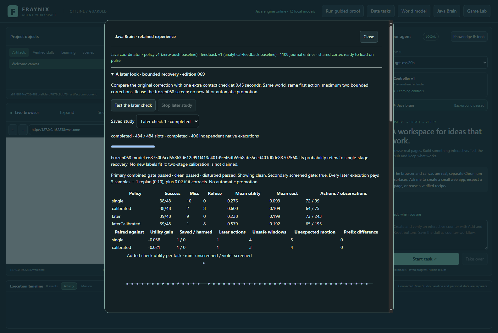
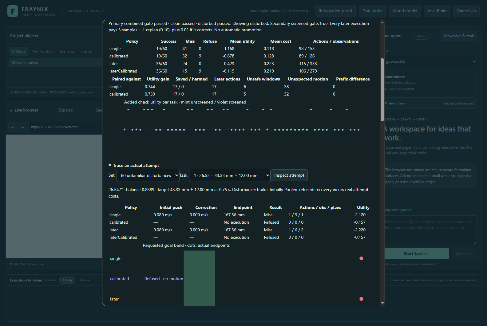
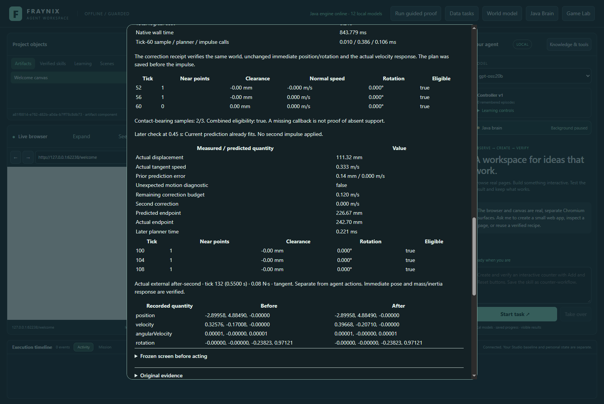
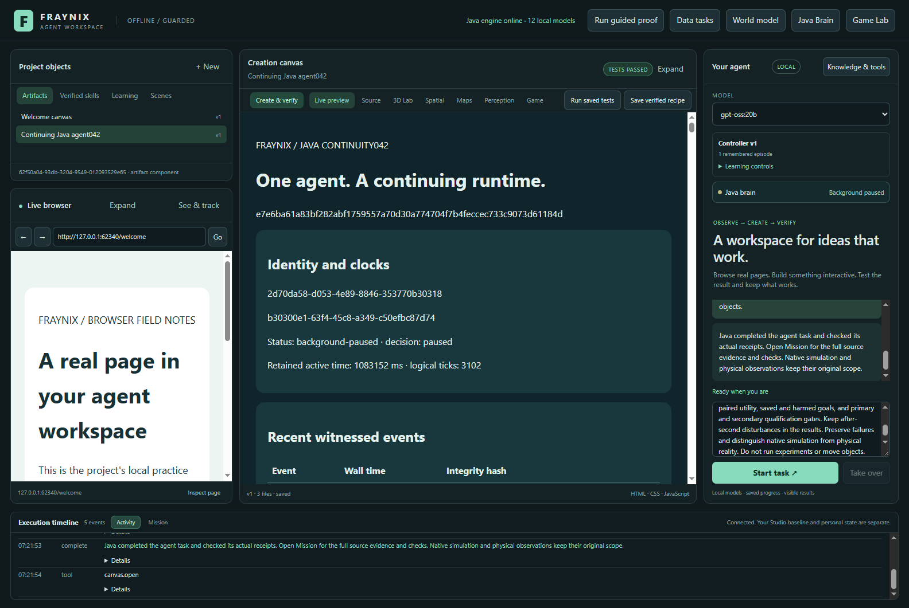
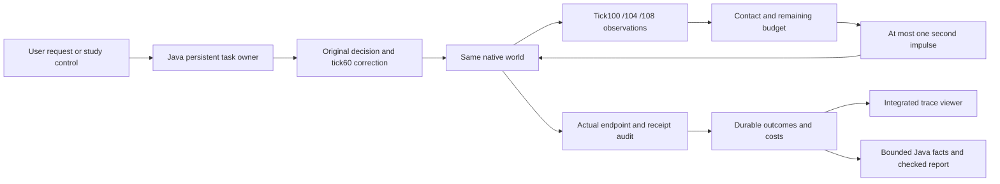

# Edition 069 — A later look, in the same world

[Previous: edition 068](README-068.md) · [Current entry point](README.md) · [All editions](docs/readmes/INDEX.md) · [Offline interactive guide](docs/readmes/069/index.html) · [Full source tree](docs/readmes/069/FILE_TREE.md)

**November 5, 2026.** This edition tests a concrete question: when an object changes course after the agent's first correction, can one additional observation recover the task without discarding the world, rewriting the result, or hiding the cost?

The answer comes from actual native rigid-body runs. The experiment retains the initial decisions and original correction, then adds a bounded contact check at 0.45 seconds. It compares the original and later-check versions on the same new tasks. The test includes disturbances that happen after the second check too. Those remain in the result.

The primary clean gate **PASS** and unfamiliar-disturbance gate **PASS**. Combined qualification is **True**. The active controller remains unchanged. Qualification is an experimental acceptance result, not permission for automatic promotion, a claim of physical calibration, or a language-model training result.

*Actual integrated app, November 5, 2026, isolated synthetic project. Screenshots in this edition show real execution evidence, not generated mockups.*

## Why this follows edition 068

Edition 068 fitted an owned Java monotonic estimate from native recovery attempts. It improved clean decisions, but its unfamiliar-disturbance gate failed. A single correction at tick60 could not respond to later external events. The new experiment changes that observation/action opportunity rather than quietly refitting the earlier held-out results.

The published068 model is reused exactly. It still describes the older single-stage recovery. Its probability must not be interpreted as calibrated for the new two-stage policy. No069 outcome becomes a fitting label, no model weight changes, and no source document installs new execution authority.

The distinction matters for the larger application. A continuing agent needs to observe what actually happened, compare it with its expectation, and decide whether another action is warranted. It also needs a reason to stop. This edition makes that process visible and auditable within a small, explicitly bounded physical task.

## What is implemented

Java owns the study, initial decisions, observation selection, inverse planner, correction budgets, validation, persistent jobs, costs and chat facts. The existing desktop presents these through one integrated Java Brain panel. The original game, browser, canvas, world and model interfaces remain available.

There are four policies:

| Policy | First decision | Later observation |
| --- | --- | --- |
| single | Original unscreened Temporal recovery | None |
| calibrated | The exact068 frozen pre-push screen, then original recovery | None |
| later | Same decision and first recovery as single | Three samples and at most one extra correction |
| laterCalibrated | Same screen, decision and first recovery as calibrated | Same extra observation and correction rules |

Every executed later-policy task gets the extra check, including goals originally admitted directly. Screened and unsupported refusals create no native world and pay no later observation fee. Paired versions must have identical first behavior and identical physical state traces through tick108, before any second impulse.

This is handwritten Java decision and verification logic using the project's existing native Bullet simulation. It adds no new learning framework or external control library. The complete application still uses its existing dependencies; “owned logic” does not mean a dependency-free application.

## The second observation

The original first stage remains at tick60, 0.25 seconds. Where recovery is needed, it uses the source-bound contact window at ticks52,56 and60. Its correction limit remains plus or minus0.16 m/s.

The later stage reads ticks100,104 and108. The final sample occurs at0.45 seconds, leaving0.30 seconds until the original0.75-second deadline. It requires at least one near-contact callback across the three samples, and every sample must satisfy the motion and geometry limits:

- Oriented cube-to-ramp clearance between−0.03 and+0.03 metres.
- Rotation at most10 degrees, normal speed magnitude at most0.1 m/s and angular speed at most2 rad/s.
- Nonnegative tangent speed.
- A source-matched, correctly timed observation prefix from this native world.

The geometric calculation uses known simulator geometry. It does not infer depth or contact from camera pixels. A missing callback on one sample is not by itself proof that the block lost support; the short window retains the available evidence while checking every sample's motion and clearance.

If the unchanged-motion prediction already lies inside the goal band, the planner applies no impulse. Otherwise it solves for the tangent speed needed to reach the target center in the remaining time, using the same acceleration and stopping equations as the earlier controller.

The second correction is capped at0.12 m/s. The cumulative absolute first-plus-second correction is capped at0.24 m/s. Resulting tangent speed must remain between0 and0.8 m/s. The proposed bounded correction must predict arrival inside the requested band, and the contact guard must pass. If either condition fails, the plan records its refusal and the original attempt still counts.

## Prediction error is evidence, not a success label

The later check also compares measured motion with a prediction anchored to the actual state immediately after the first correction. If there was no first correction, it uses the initial actual state. Displacement error above0.01 m or speed error above0.04 m/s raises an unexpected-motion diagnostic.

That diagnostic does not know the future disturbance schedule. It can also respond to ordinary model error. It is not a classifier proving which external event occurred, and it is not a second action gate. The contact guard and bounded arrival calculation decide whether to act. Success is checked independently against the actual final endpoint.

This separation avoids turning a plausible explanation into verification. The app exposes the prior prediction, actual state, error, proposed correction and eventual outcome together. You can inspect a warning that led to no action, an action that still missed, or a task that succeeded without another impulse.

## Measured results

All counts below include the complete reserved task set. A refusal has no invented endpoint. An executed miss remains a miss even if the controller later refuses to correct it. The utility is an explicit experimental score, not money, energy consumption or a physical safety estimate.

### Clean tasks — 48

| Policy | Successes | Misses | Refusals | Mean utility | Mean logical cost |
| --- | ---: | ---: | ---: | ---: | ---: |
| single | 38 | 10 | 0 | +0.276250 | 0.098750 |
| later | 39 | 9 | 0 | +0.238333 | 0.199167 |
| laterCalibrated | 39 | 1 | 8 | +0.578521 | 0.192312 |
| calibrated | 38 | 2 | 8 | +0.599771 | 0.108563 |

Later minus single mean utility: **-0.037917**. The later check saved **1** goals and harmed **0** previously successful goals. Primary clean gate: **PASS**.

### Unfamiliar disturbances — 60

| Policy | Successes | Misses | Refusals | Mean utility | Mean logical cost |
| --- | ---: | ---: | ---: | ---: | ---: |
| single | 19 | 41 | 0 | -1.167667 | 0.117667 |
| later | 36 | 24 | 0 | -0.423333 | 0.223333 |
| laterCalibrated | 36 | 15 | 9 | -0.118783 | 0.218783 |
| calibrated | 19 | 32 | 9 | -0.878117 | 0.128117 |

Later minus single mean utility: **+0.744333**. The later check saved **17** goals and harmed **0** previously successful goals. Primary unfamiliar gate: **PASS**.

Despite the improvement, the unscreened later policy still misses24/60 disturbed goals and has mean utility−0.423333. That is worse than the declared−0.15 utility of always refusing; passing the relative improvement gate is not a demonstration that every task should be attempted. The screened later policy has mean utility−0.118783 on this set. These are finite experimental results, not production guarantees.

The separately reported screened comparison has clean gate **PASS** and unfamiliar gate **PASS**. It is secondary evidence and cannot replace a failed primary comparison. The [verification file](docs/readmes/069/verification.json) and interactive guide retain exact metrics for every family, friction regime and goal width.

### Costs and the declared gates

Success earns+1, a miss−2 and a refusal−0.15, with operation fees counted explicitly. Each action costs0.02, each selected observation0.03, each replan0.01, a scenario screen0.005 and a learned lookup0.002. Every executed later policy therefore pays an extra0.10 before any additional impulse; an actual second correction adds another0.02.

The clean gate requires no lost success count and mean utility no worse than−0.12 relative to single. The disturbed gate requires at least+0.10 mean utility gain, at least+0.10 all-task success-rate gain, and a later-policy all-task miss rate no higher than0.45. These thresholds were committed before new outcomes.

Original068 training is historical reuse, not a new fitting run whose cost can be disguised as zero-cost learning. Current operation costs and measured native/planner timings are retained separately. Timing varies by machine and persistence work, so it should not be read as an end-to-end real-time performance guarantee.

## What the new disturbances test

The reserved set has five families, each with12 cases, two amplitudes and both friction regimes. The external impulse is executed by the native simulator and has its own before/after receipt. It is not counted as an agent action.

| Family | Tick | Change |
| --- | ---: | --- |
| Brake | 88 | Tangent impulse−0.08 or−0.14 N·s |
| Lift | 76 | Normal impulse+0.24 or+0.36 N·s |
| Push | 88 | Tangent impulse+0.08 or+0.14 N·s |
| Spin | 88 | World-z torque impulse+0.02 or+0.04 N·m·s |
| After-second push | 132 | Tangent impulse+0.08 or+0.14 N·s |

The unscreened paired successes were brake3→7, lift1→8, push1→7, spin9→9 and after-second5→5, each out of12. No previous success was lost in any family.

The after-second family explicitly tests the limit of a fixed observation schedule. The controller cannot respond after its final check. These12 cases are never removed from the primary disturbed denominator.

## Persistence and verification

Each attempt keeps one native world from the initial impulse through its endpoint. Before and after corrective receipts verify that immediate position, rotation and angular state were not rewritten. Linear velocity changes must agree with the requested tangent impulse. External torque receipts verify the known mass/inertia response.

Plans are saved before their actions. Auditing recomputes the permitted observation prefix, decisions, costs, endpoint, qualification and source identity. It rejects changed plans, altered event responses, invalid chronology, forged source identity and modified frozen model data. Cancellation preserves completed studies, and cold reopening retains the exact saved evidence.

Four original-runtime parity cases compare all46 samples of position, velocity, rotation and angular velocity within1e−6. Paired single/later and calibrated/laterCalibrated runs additionally check the shared prefix and first correction. Their maximum prefix differences are exposed in the results.

The completed study has484 progress slots and **406 actual native executions**. Slots include refusals and parity comparisons; they are not a claim that every slot executed a physical world. The [prospective contract](docs/EDITION_069_CONTRACT.md) describes the generation seeds, draw order, budgets and limits.

## Review it step by step

1. Open the app from this edition's installation. Keep your personal world separate from validation projects; do not rebuild an installation while its Java owner is running.
2. Open **Java Brain**, then **A later look · bounded recovery · edition069**.
3. Select a saved study, or choose **Test the later check** to run a new isolated comparison. Progress and Stop remain visible.
4. Switch between clean, disturbed and unsupported sets. Read success, miss, refusal, utility and cost together.
5. Select a task and choose a policy. Scrub the46 recorded frames to inspect actual displacement.
6. Read the original correction, then the later contact window, prediction error, remaining budget and action receipt.
7. Compare single against later on the same task. Use the paired outcome chart to distinguish a recovered goal from a changed trajectory that still misses.
8. Inspect a screened or unsupported refusal. It should have no native trajectory.
9. Reopen the app and select the saved study again. The original evidence remains available.
10. In chat, ask: “Inspect the later observation recovery study and create the verified report. Include costs, saved and harmed goals, both gates and the limits. Do not run experiments or move objects.”

The actual CPU-only, four-thread **gpt-oss:20b** path is tested. Java provides the checked facts; chat explains and reports them. The model does not receive authority to rewrite a native outcome. Aggregate planning tables retain all metrics and gates; larger unrelated history is explicitly referenced. Full original facts remain in the report.

## Architecture and source map

The source tree and canonical hashes are available in [FILE_TREE](docs/readmes/069/FILE_TREE.md) and [file inventory](docs/readmes/069/file-inventory.json). The offline guide provides a module map, source filter, all task traces, multiple plotted quantities, subgroup tables and dated screenshots. It has no CDN dependency. Open the repository as an Obsidian vault for the [edition note](docs/obsidian/77-later-recovery.md) and [JSON Canvas](docs/obsidian/later-recovery.canvas).

Core implementation paths are LaterContact069, LaterRamp069, LaterTrial069, LaterPolicy069, LaterStudy069 and LaterContext069 in the workspace engine. The existing dispatcher and persistent brain interfaces host the new job type. The renderer adds a focused panel rather than another application window.

## Validation scope and reproducibility

This release covers **83 distinct targeted Java checks across 17 classes**,127 desktop checks, the actual native study, actual app controls and trace inspection, cold restore, Stop, and actual local-model reporting. Native and actual-app outcome values and sample arrays match. The offline companion is tested at1440 and390 pixels, and the integrated app at1600 and1100 pixels.

These are targeted checks, not a claim that every historical heavyweight experiment was rerun. Original068 evidence also restores through the current Java owner. The [original evidence inventory](docs/readmes/069/original-evidence.json) lists exact compressed inputs, results, logs and test XML with compressed and uncompressed hashes.

Two preliminary unit-test issues were corrected before native outcomes: a malformed loop in the new test source, and an assertion expecting the planner to reject a nonfinite value that JSON already rejected. Both failures are retained. The first actual-app script also used an obsolete phase field in its post-study assertion. Its complete native study was preserved; the corrected script resumed UI and chat inspection from those exact results. Visual inspection then caught garbled UTF-8 labels in the new panel; correcting the text encoding also resolved the matching UI assertion timeout. Screenshots were recaptured from the same saved study. No case, controller budget, physical rule or qualification threshold was tuned after observing the new results.

## Boundaries and next steps

The task is a small known-geometry ramp with one cube, a fixed deadline and prescribed disturbances. It is not proof of general manipulation, camera-derived contact, real-world force calibration, unconstrained agency, consciousness or improved language-model weights. Reusing a learned rate is distinct from learning a better two-stage policy.

The next experiment should ask **when another observation is worth its cost**. Freeze a small set of adaptive schedules before running new cases, compare them with this fixed two-check controller, and include events outside every schedule's reach. Report observation use, delayed detection, refused corrections, recovered goals, harms and total utility.

A later stage can connect independent real sensors to the same observation/action/evidence structure, but only with separately measured scale, timing and uncertainty. The existing webcam/mat work remains its own qualified evidence. A simulator success must never overwrite a physical test's uncertainty.

The longer-term direction remains one Java-owned continuing system: world state, perception, tools, procedural skills, memory and verified outcomes connected in the same application. This edition contributes a small but concrete piece: the agent can look again, compare expectation with motion, spend a bounded correction, and retain what actually happened.
