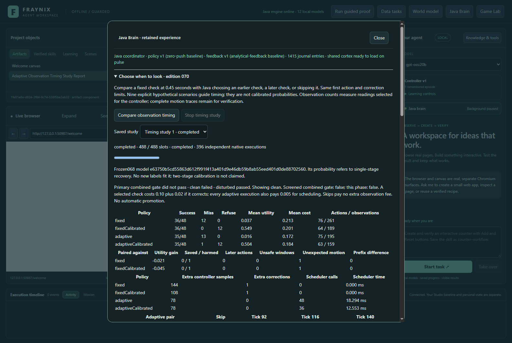
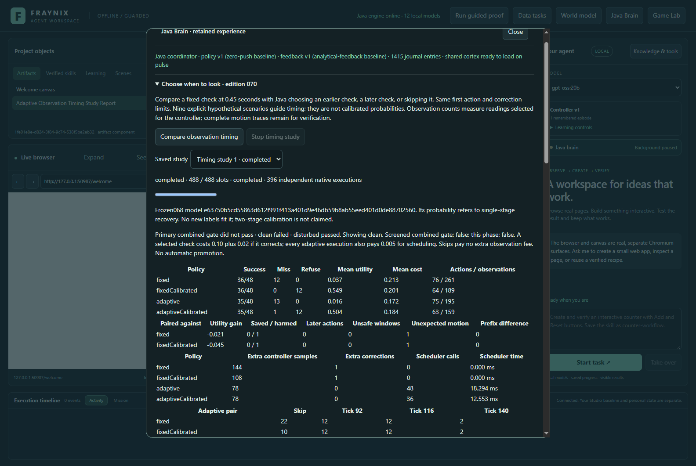
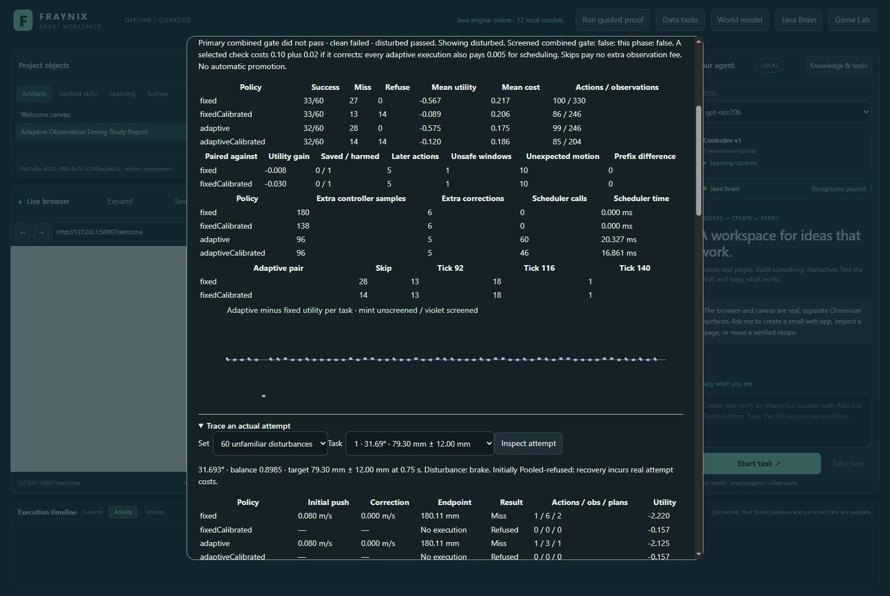
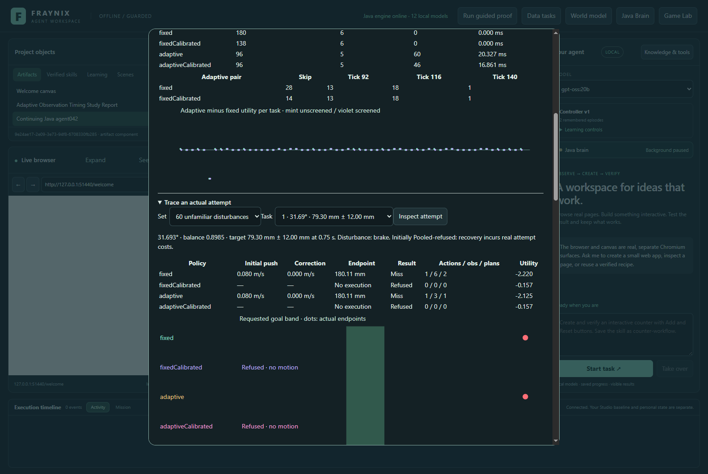
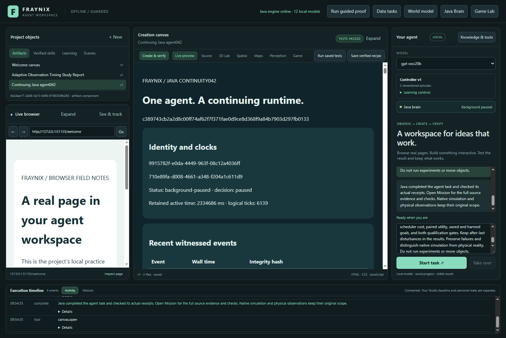

# Fraynix Agent Workspace · Edition 070

## Choose when another look is worth its cost

Edition 070 adds an owned Java observation scheduler to the continuous native recovery workflow. After the unchanged first action and first correction, it compares three possible observation times with skipping the extra observation. The decision is saved before any selected later sample is consumed. Actual contact, motion, remaining action budget and measured outcome still determine what it can do.

This is a functional addition to the same integrated app: a visible experiment, saved studies, native replay, explicit hypothetical forecasts, bounded correction, durable Java records and chat reporting. It is not a global replacement for every camera, browser or agent observer. Its current measured scope is the known-geometry ramp task described here.

[Previous edition 069](README-069.md) · [Interactive offline guide](docs/readmes/070/index.html) · [All editions](docs/readmes/INDEX.md) · [Prospective contract](docs/EDITION_070_CONTRACT.md) · [Verification and limitations](docs/readmes/070/verification.json) · [Exact originals](docs/readmes/070/original-evidence.json)



*Actual app, November 5, 2026; isolated synthetic validation project. Screenshots are captures, not mockups.*

## Measured result, including the cost

The reserved comparison completed **488 progress slots and 396 native executions**. There are 48 clean tasks, 60 disturbed tasks and 12 unsupported tasks, with four paired policies per task. Eight additional slots establish original-runtime and fixed-policy parity. Refusals count as evaluated tasks without fabricated motion; that is why progress slots and native executions differ.

The primary combined qualification is **False**. The separate screened combined qualification is **False**. Clean and disturbed gates remain separate, and both must pass along with meaningful schedule diversity and all source/count/parity audits. Secondary screened results cannot replace a failing primary result. Neither result changes the active controller automatically.

### Clean tasks · 48

| Policy | Success | Miss | Refused | Mean utility | Extra observations | Scheduler calls |
|---|---:|---:|---:|---:|---:|---:|
| adaptive | 35 | 13 | 0 | +0.015833 | 78 | 48 |
| adaptiveCalibrated | 35 | 1 | 12 | +0.503896 | 78 | 36 |
| fixed | 36 | 12 | 0 | +0.037083 | 144 | 0 |
| fixedCalibrated | 36 | 0 | 12 | +0.548896 | 108 | 0 |

- Against **fixed**: mean utility difference **-0.021250**; 0 goals saved, 1 previously successful goals harmed. Choices: skip 22, tick 92 12, tick 116 12, tick 140 2.
- Against **fixedCalibrated**: mean utility difference **-0.045000**; 0 goals saved, 1 previously successful goals harmed. Choices: skip 10, tick 92 12, tick 116 12, tick 140 2.

Clean primary gate: **False**; screened clean gate: **False**. The gate requires at least 25% fewer extra observations, at most one fewer success by count, and mean utility gain of at least 0.01. It is deliberately possible to save sensing effort and still fail this outcome gate.



### Unfamiliar disturbances · 60

| Policy | Success | Miss | Refused | Mean utility | Extra observations | Scheduler calls |
|---|---:|---:|---:|---:|---:|---:|
| adaptive | 32 | 28 | 0 | -0.574667 | 96 | 60 |
| adaptiveCalibrated | 32 | 14 | 14 | -0.119667 | 96 | 46 |
| fixed | 33 | 27 | 0 | -0.566667 | 180 | 0 |
| fixedCalibrated | 33 | 13 | 14 | -0.089500 | 138 | 0 |

- Against **fixed**: mean utility difference **-0.008000**; 0 goals saved, 1 previously successful goals harmed. Choices: skip 28, tick 92 13, tick 116 18, tick 140 1.
- Against **fixedCalibrated**: mean utility difference **-0.030167**; 0 goals saved, 1 previously successful goals harmed. Choices: skip 14, tick 92 13, tick 116 18, tick 140 1.

Disturbed primary gate: **True**; screened disturbed gate: **False**. The contract allows at most two fewer successes by count and mean utility difference no worse than −0.03. Every late disturbance remains in these totals, even when it arrives after all candidate observation times. No failure category is dropped to make the result look better.



The offline guide includes every task, all four policies, every subgroup, saved and harmed goals, observation counts, actual event receipts, predicted corrections and complete trajectories. The JSON verification retains exact values rather than rounded screenshot text. The native test and actual app agree on outcomes, native sample arrays and saved scheduling decisions; wall-clock timings vary and are compared separately. The app repeats the same fixed cases for reproducibility; it does not double the number of distinct held-out tasks.

### Where the saved sensing was not worth it

- **clean, task 45, none**: selected skip; fixed succeeded, adaptive missed its band by 1.435 mm. Fixed endpoint 0.098909m; adaptive endpoint 0.082678m. The complete schedule and native trace remain in the offline explorer.
- **disturbed, task 6, brake**: selected skip; fixed succeeded, adaptive missed its band by 10.443 mm. Fixed endpoint 0.202280m; adaptive endpoint 0.166280m. The complete schedule and native trace remain in the offline explorer.

These counterexamples matter: a cheaper observation schedule can leave a mistaken state prediction uncorrected. The next improvement should address that uncertainty and test whether an additional look is worthwhile near a goal boundary. Changing a scenario weight until these particular tasks pass would not establish generalization, so this edition retains the failed cases and original qualification thresholds.

**2 lost goals used a predicted first state**, rather than a paid measured first recovery window. In the retained examples, every hypothetical scenario predicted a goal hit without an extra check, so each candidate looked like an unnecessary cost. Actual native motion disagreed. That is a specific limitation in the scheduler's assumptions about unmeasured state and disturbances, not evidence that observations are intrinsically unhelpful.

Across the 108 supported primary comparisons, adaptive timing saves **4.500 declared operation-cost units**, after paying its scheduler fee. Its total utility difference is **-1.500**. A success changing into a miss costs three utility units under the frozen contract, so reduced sensing alone does not outweigh the lost completions. This explains the qualification result without treating assumed fees as money or measured energy.

## What the Java scheduler actually does

The original push is preserved. For tasks requiring first-stage recovery, the planner receives the same three selected samples at ticks 52, 56 and 60. If it applies a correction, the scheduler starts from that measured state plus the commanded velocity change. It does not obtain another free reading of the world. Directly admitted tasks instead use the initial action's analytical tick 60 prediction, because they did not pay for that first measured recovery window.

At tick 60, Java evaluates a window ending at tick 92, 116 or 140. Those correspond to approximately 0.3833, 0.4833 and 0.5833 simulated seconds. Each selected window contains exactly the last three four-tick samples. A fourth option is to skip the window entirely. Only one extra window may be selected; the episode still ends at tick 180, or 0.75 simulated seconds. These are world-clock times, not promises of wall-clock latency; durable evidence processing and verification take additional real time.

For each candidate time, the scheduler propagates nine explicit hypothetical futures through an owned one-dimensional model. It compares the terminal outcome without another look with the outcome of observing at that time and attempting a bounded correction. It accounts for the cost of the window, the possible corrective action and scheduling itself. The earliest candidate with the highest gain is chosen only if its gain clears0.02; otherwise the extra look is skipped.

These are prospective assumptions, not an oracle. The scheduler receives no actual disturbance family, magnitude or event time, and no future native trace. The hypothetical rows and selected time are saved before the chosen window. The native verifier recomputes the schedule using only the declared inputs and checks its chronology. The UI exposes every candidate value and all 27 hypothetical outcomes used in the comparison.

### Explicit assumptions instead of hidden certainty

The nine scenarios have fixed weights: a nominal future at0.50, negative and positive0.01metre position offsets at0.10each, and negative and positive0.08m/s tangent disturbances at hypothetical ticks 76, 108 and140 at0.05each. Their weights sum to one, but they are not learned event probabilities or a confidence guarantee. They were fixed in the contract before any new native outcome was produced.

The model integrates a known incline with Coulomb friction. Downhill motion uses acceleration9.81sin(angle)×(1−frictionRatio); uphill motion uses9.81sin(angle)×(1+frictionRatio). It integrates exactly to zero velocity, then holds static rest when the ratio is at least one or accelerates downhill otherwise. Hypothetical impulses are applied at their declared times exactly once, including a candidate observation boundary.

The model assumes nominal support while estimating candidate value. It does not predict lifting or rotation. Actual execution always applies the independent measured contact and motion guards. A plausible forecast can therefore lead to a selected observation that refuses to correct, or to a failed goal; its sensing cost remains counted. That mismatch is useful evidence about what the next state estimator needs to represent.

## Contact and action remain measured

At a selected observation time, Java requires at least one near-contact callback across the three samples, geometric clearance between−0.03 and+0.03 metres in every sample, rotation no greater than10 degrees, normal speed magnitude no greater than0.1m/s, angular speed no greater than2rad/s and nonnegative tangent motion. A missing contact callback alone is not treated as proof of lost support.

The first correction remains capped at0.16m/s. The second is capped at0.12m/s, and cumulative absolute correction is capped at0.24m/s. Resulting tangent velocity must stay between0 and 0.8m/s. The inverse calculation uses the actual remaining episode time, rather than reusing a fixed horizon at every candidate tick. A target behind the current state, an unreachable goal, or an unsafe observation does not earn an extra impulse.

The fixed baseline calls the exact published edition 069 later planner at tick 108. Four specific clean parity cases compare all 46 samples, both plans and immediate correction poses against that original implementation. Four other parity cases compare against the earlier original runtime. All fixed/adaptive pairs must share the entire sample prefix, including contacts, and the first plan through tick 60. Divergence afterward is the measured effect of scheduling and corrections, not a changed starting action.



Every actual correction and external disturbance has a same-world receipt with before/after position, rotation and velocity. An impulse cannot teleport the body. The simulation continues in one world without resetting it between observation and recovery. Persistent evidence includes source identity, definition, selected schedule, plans, sampled states, event receipts, outcomes and operation timings.

## Fresh cases and honest comparisons

The new cases use seeds 70001, 70002 and 70003. Angles span12–32 degrees for supported cases, with separate accelerating and slowing friction regimes. Goal half-widths cycle12, 24 and45 millimetres. Exact task tuples are disjoint from editions068 and069. Unsupported requests include out-of-domain angles and the friction boundary; all four policies retain their refusal behavior.

The 60 disturbed tasks have12 each of braking, lift, push, spin and after-last push. Two amplitudes and two timing labels are balanced within every family; each combination appears three times across regimes. Brake and push alter tangent velocity, lift adds a normal impulse, and spin applies world-Z torque. After-last pushes occur at tick 152, beyond every candidate check. Their timing labels share that same physical time; they are not represented as two different physical event times.

The four methods are **fixed**, **fixedCalibrated**, **adaptive** and **adaptiveCalibrated**. Screening uses the exact published 068 model, SHA-256 `e63750b5cd55863d612f991f413a401d9e46db59b8ab55eed401d0de88702560`. It is not refitted here. Its empirical probability concerns the earlier single-stage training task, so it is not claimed to calibrate either new two-stage outcome. Paired methods share the same screening decision before any first push.

Logical utility assigns+1 to reaching the goal,−2 to an attempted miss and−0.15 to refusal. Existing operation fees remain:0.02 per action,0.03 per selected observation,0.01 per replan,0.005 per screen and 0.002 per calibration lookup. An extra window therefore costs0.10 even if it refuses correction, plus0.02 if it corrects. Every executed adaptive attempt pays0.005 for scheduling, including skips. Refused tasks pay no invented observation or scheduler work.

These are declared comparison units, not dollars or physical energy. Measured scheduler time, native wall time and planner calls are retained separately. Saving logical sensing fees can still consume additional computation; the report shows both. The fixed policy order and finite task set limit generalization. A relative improvement is also distinct from positive absolute utility or superiority to refusing every risky request.

The experiment retains all 46 diagnostic motion samples for independent comparison and replay. Its observation counts refer to the selected readings passed to the controller, and the associated contact/replanning work. They do not claim fewer total native trace samples, reduced camera capture, or proportional CPU savings. An operational perception service would need its own measured acquisition costs and scheduling interface before this can support a camera-efficiency claim.

The complete native job took **15.70 minutes**, and the actual-app repeat took **16.14 minutes**, including durable evidence processing and verification. These full-job measurements are distinct from the sub-operation timings shown beside each plan. They exclude later UI inspection and model reporting; this experiment is not a claim of an end-to-end realtime validation pipeline.

## Review it in the integrated app

From this checkout, the [Windows launcher](scripts/Start-Agent-Workspace.ps1) builds the Java workspace and opens the desktop. This example selects a new private project; keep the printed path if you want to reopen that same study later. Node.js, Java 21 and the existing desktop/build dependencies are required. Use `-Offline` only after those dependencies are cached.

```powershell
$taskReview070 = Join-Path $env:LOCALAPPDATA ("Fraynix/review-070-" + (Get-Date -Format 'yyyyMMdd-HHmmss'))
$env:FRAYNIX_WORKSPACE_PROJECT = $taskReview070
$env:FRAYNIX_WORKSPACE_PLAN_CPU_ONLY = '1'
$env:JAVA_TOOL_OPTIONS = '-XX:ActiveProcessorCount=4'
Write-Host $taskReview070
./scripts/Start-Agent-Workspace.ps1 -Offline
```

1. Start the edition 070 checkout with the existing desktop launcher and a distinct private project. Use Java 21 and the checked-in build wrapper. Keep installed older review apps and their private worlds separate.
2. Open **Java Brain**, then **Choose when to look · edition 070**.
3. Click **Compare observation timing**. Progress covers488 slots; wait for the completed state or use **Stop timing study** to cancel. A cancelled run retains evidence already saved and does not replace a completed study.
4. Choose the clean, disturbed or unsupported set, select a task and inspect it. Compare success, miss, refusal, endpoint, sensing cost and utility for all four methods.
5. Choose an adaptive policy. Inspect the saved skip/time decision, all three candidate values and the 27 hypothetical futures. Compare that forecast with the actual contact window and endpoint below it.
6. Scrub the 46 recorded samples. Check the first correction, selected later correction, external event and before/after motion. Unsupported or screened refusals do not draw a fabricated trajectory.
7. Close and reopen the app against the same isolated project. The completed evidence and model identity survive restart. Nothing silently reruns or promotes a controller.

For chat, ask: “Inspect the adaptive observation timing study and create the verified report. Include sensing costs, schedule choices, saved and harmed goals, both qualification gates and late failures. Do not run experiments or move objects.” Java supplies a bounded, lossless aggregate projection for planning. The full original state remains available to the checked report. Large unrelated history is represented by explicit source references instead of silently replacing the current outcome evidence.



The actual app test uses local **gpt-oss:20b**, CPU-only with four threads. It verifies that the model reads the retained Java evidence and produces its checked report. This is a report capability, not new language-model training or proof that the model independently discovered the scheduling algorithm.

## Tests, documentation and ownership

Validation includes **93 distinct targeted Java checks across 20 classes**, 127 desktop unit checks, a full native comparison, an independent actual-app comparison, restart and Stop, old069 cold restoration, local-model reporting, and offline guide interactions at 1440 and 390 pixels. This is not a claim that every historical native experiment was freshly rerun. Original logs and exact archived bytes define the scope.

The first native invocation hit the inherited 15-minute test wait limit at 444 slots and 396 native executions. Closing the test cancelled the remaining work. Its exact checkpoint, journal and extracted original partial job are archived. The test wait was extended to one hour and the unchanged experiment rerun. Completed native sample arrays, scheduling decisions and non-timing outcomes from that partial attempt agree with the completed run. No runtime rule, case, fee, model, scenario weight or qualification gate was changed in response to an outcome.

The first local-model request exposed a routing gap: the new phrase “adaptive observation timing” went to general content creation instead of the checked Java study reader. The model proposed invented counts and invalid canvas checks. That task was cancelled and retained. Java now routes adaptive observation, observation timing, observation schedules and sensing-effort requests through `agent.read`, `agent.report` and completion. Two regression tests check those stages and preserve explicit website creation. A fresh chat reads the same completed study; no physics experiment, task or threshold was changed to repair chat.

Visual review also found the longest policy name overlapping the refusal label in the goal plot. The plot now reserves more space for names. A focused actual-app check measures all four label bounds and recaptures the affected views from the identical saved study, without repeating a native experiment or model request. Original captures remain archived with the corrected layout evidence.

Physics tests cover signed motion, stopping, sticking, downhill restart and event-boundary integration. Scheduler tests cover selected inputs, scenario weights, skip fees and candidate windows. Adversarial native checks alter a schedule, candidate value, source, timestamp, event response or frozen model and require rejection. Context tests reconstruct every aggregate table and retain original facts. A full native run checks source identity, chronology, counts, domain, parity and all outcome fees before it is called complete.

The scheduler, contact gate, policy comparison, trial lifecycle and projection are Java source owned by this project. The existing native rigid-body backend remains the physics executor; this edition does not claim to replace that library or to be dependency-free. The desktop hosts the view and local model interface. Source isolation and the complete canonical source inventory are checked before publication.

[Source tree](docs/readmes/070/FILE_TREE.md) · [Canonical source hashes](docs/readmes/070/file-inventory.json) · [System map](docs/readmes/070/system-map.json) · [Obsidian note](docs/obsidian/78-adaptive-observation.md) · [Canvas](docs/obsidian/adaptive-observation.canvas) · [Operations](docs/JAVA_CHAT_044.md)

## Where this takes the system

The useful next layer is attention with accountability: a goal runner can decide which observation is worth taking, preserve that decision, act on actual evidence, and compare the result against a simpler fixed schedule. This is a concrete part of the user's unified local agent vision. It supplies a reusable pattern for spending limited sensing and computation on task-relevant uncertainty while keeping the outcome visible.

The next prospective step should improve the state uncertainty used by scheduling, especially when a position prediction is wrong, support changes or rotation matters. Use the current failure categories to design a new hypothesis, freeze fresh cases before evaluation, compare against this unchanged scheduler and measure the complete cost. Only then consider promotion or broader tools. A future camera scheduler must separately measure capture latency, occlusion, calibration error and observation freshness; native contact truth does not establish those properties.

Preserve this edition's complete evidence, README and screenshots. Do not tune its scenario weights or gate thresholds after seeing these outcomes. The app's continuity comes from durable goals, source-bound observations and verified procedures; more saved activity alone is not evidence of improved intelligence. The next edition should demonstrate a measured gain on unfamiliar cases and retain it after restart.
