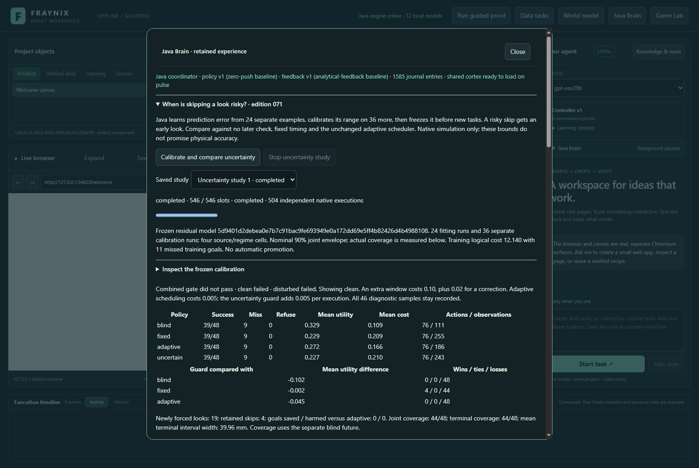
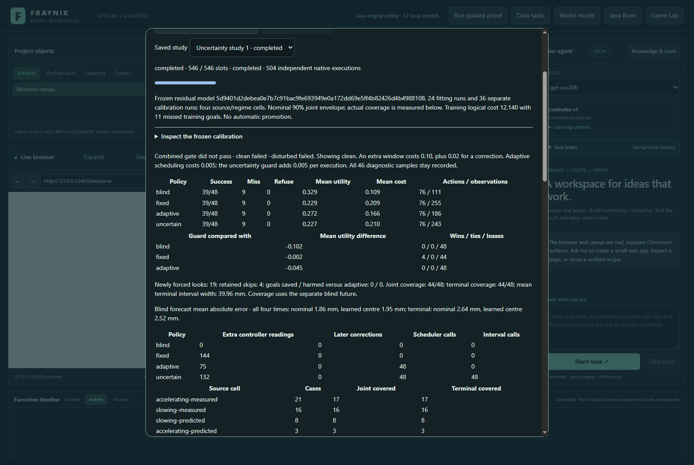
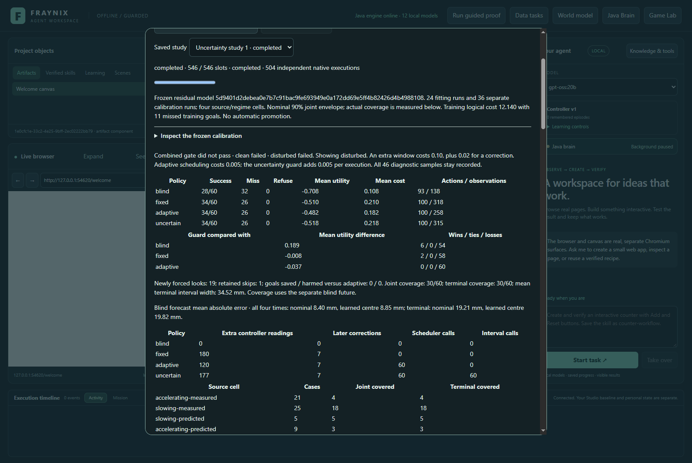
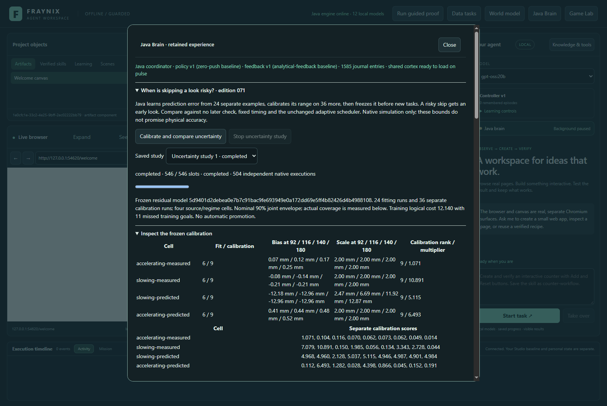
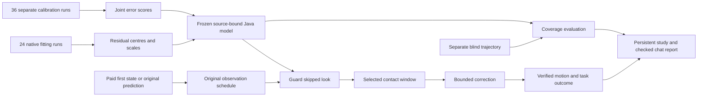
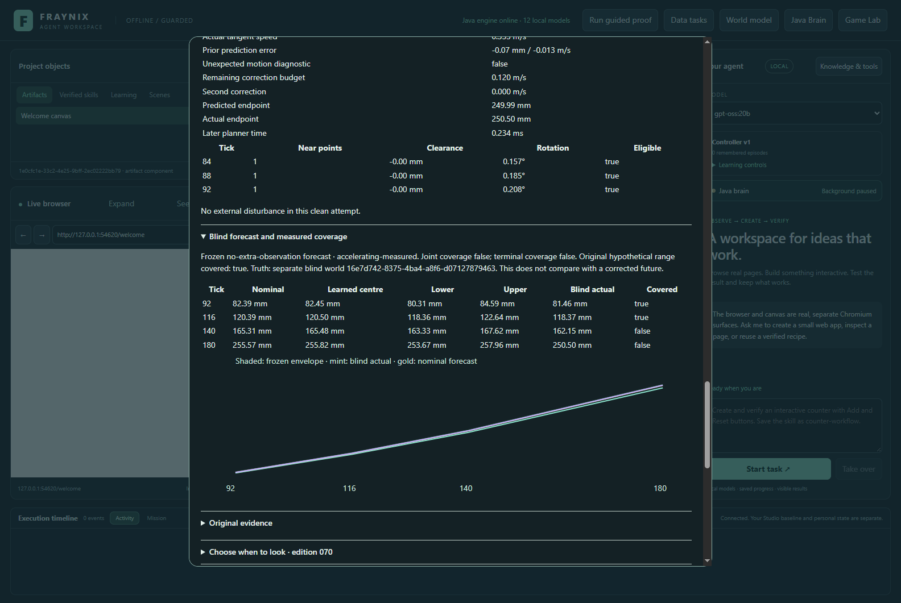
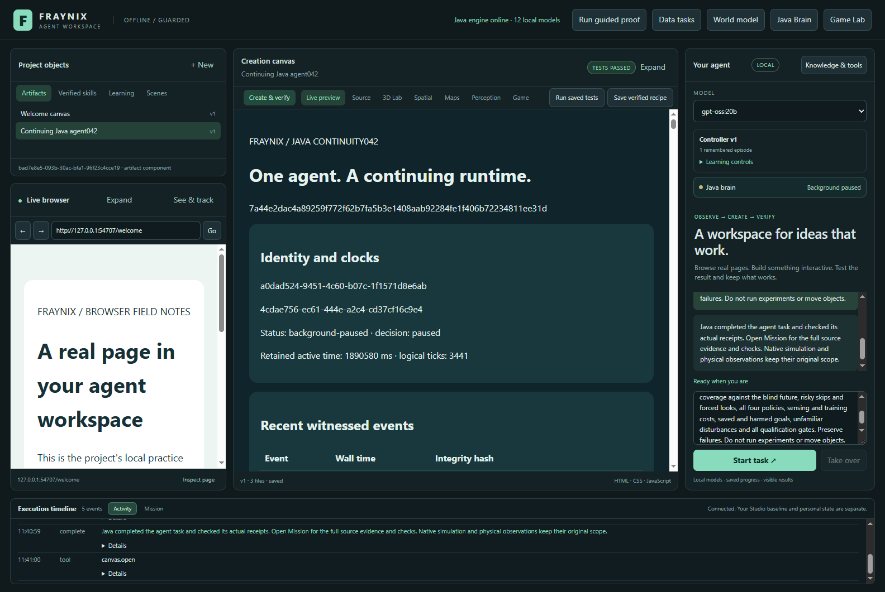

# Fraynix Agent Workspace · Edition 071

## Knowing when a skipped look is risky

The Java agent now learns how far its motion forecast can be wrong, calibrates that error on separate examples, and uses the frozen range to reconsider skipped observations. It requests an early look when a skipped forecast range leaves the goal band. The resulting motion, success, failure and sensing cost remain visible in the same integrated app.

The practical change is a better-defined decision: “The scheduler chose skip, but my calibrated range extends outside the target; take another look.” This is an implemented, persistent Java workflow with source-bound calibration, native physics, a visible study, replay and checked chat reporting. Its evidence concerns the known-geometry ramp environment. Webcam uncertainty and broad real-world understanding remain separate work.

[Previous edition 070](README-070.md) · [Interactive offline guide](docs/readmes/071/index.html) · [All editions](docs/readmes/INDEX.md) · [Contract fixed before outcomes](docs/EDITION_071_CONTRACT.md) · [Verification](docs/readmes/071/verification.json) · [Exact originals](docs/readmes/071/original-evidence.json)

*Actual application, November 5, 2026, in an isolated synthetic validation project. Every screenshot is an app capture.*

## Results and limits

The completed study has **546 progress slots and 504 native executions**. It includes 24 fitting runs, 36 separate calibration runs, six paired legacy/runtime comparisons, and four policies on 48 clean, 60 unfamiliar-disturbance and 12 unsupported tasks. Each legacy parity comparison executes twice; unsupported policies refuse without inventing motion.

**Combined qualification: False.** The numerical model and workflow work, but useful improvement is judged by the prospective outcome gates below. The active controller remains version 1; there is no automatic promotion or language-model weight update.

### Clean reserved tasks

| Policy | Success | Miss | Refused | Mean utility | Extra readings |
|---|---:|---:|---:|---:|---:|
| blind | 39 | 9 | 0 | +0.328750 | 0 |
| fixed | 39 | 9 | 0 | +0.228750 | 144 |
| adaptive | 39 | 9 | 0 | +0.271667 | 75 |
| uncertain | 39 | 9 | 0 | +0.227083 | 132 |

Uncertainty versus adaptive mean utility change: **-0.044583**. **0 goals saved, 0 harmed**, 19 forced early looks and 4 retained skips. Joint four-time coverage: **44/48 (91.7%)**; terminal coverage **44/48 (91.7%)**. Mean terminal interval width **39.96 mm**. The old hypothetical terminal range covered **97.9%**. Phase qualification: **False**.

### Unfamiliar disturbances

| Policy | Success | Miss | Refused | Mean utility | Extra readings |
|---|---:|---:|---:|---:|---:|
| blind | 28 | 32 | 0 | -0.707667 | 0 |
| fixed | 34 | 26 | 0 | -0.510000 | 180 |
| adaptive | 34 | 26 | 0 | -0.481667 | 120 |
| uncertain | 34 | 26 | 0 | -0.518333 | 177 |

Uncertainty versus adaptive mean utility change: **-0.036667**. **0 goals saved, 0 harmed**, 19 forced early looks and 1 retained skips. Joint four-time coverage: **30/60 (50.0%)**; terminal coverage **30/60 (50.0%)**. Mean terminal interval width **34.52 mm**. The old hypothetical terminal range covered **85.0%**. Phase qualification: **False**.

The disturbed set contains braking, lifting, pushing, spinning and pushes after the last possible check: twelve tasks per family, with both motion regimes and the frozen amplitude/timing combinations. The scheduler never sees the actual future event. A forecast trained on undisturbed motion can miss these changes; coverage on changed conditions is measured and retained rather than assumed from its nominal label.

All unsupported cases remain in the evaluation. Every policy reports twelve refusals and zero executions for that phase. Reported sensing savings refer to readings selected for control. The diagnostic recorder still retains all 46 samples for verification and replay; this edition does not demonstrate fewer camera captures or lower total sensor power.

### Every changed success

No goal changed success status between adaptive and uncertain in these reserved cases.

The forced looks are also audited by their subsequent action decision. In clean tasks, 19 forced looks produced 0 corrections: Target behind current state: 4; Current prediction already fits: 10; Remaining correction budget cannot reach goal: 4; Later contact or motion guard refused correction: 1. In disturbed tasks, 19 forced looks produced 0 corrections: Target behind current state: 4; Current prediction already fits: 7; Later contact or motion guard refused correction: 2; Remaining correction budget cannot reach goal: 6. These counts distinguish uncertainty from an opportunity to change the outcome. A useful future guard must consider remaining action authority and reachability as well as forecast width.

The independent native test and actual app reproduce the same numerical fit, physical sample arrays, plans, selected windows and non-timing outcomes. Separate runs have distinct record identities, timestamps and source-bound model hashes. Those identities are retained; reproducibility does not mean replacing one run with the other. App repetition validates integration and repeatability, not additional independent held-out goals.

## What the uncertainty model learns

The original analytical forecast uses signed friction and the saved tick-60 anchor. Directly admitted tasks have only the original predicted anchor; recovered tasks have paid measured first evidence and the commanded first correction. Neither receives a free later observation.

Java splits training into four cells: accelerating or slowing, each with predicted or measured-first state. Six fitting examples per cell determine the median residual at ticks 92, 116, 140 and 180. The scale is the median absolute deviation, with a declared 2 mm floor. Nine distinct calibration examples per cell then score the largest standardized error across those four times. Rank ceil((9+1)×0.90)=9 selects the largest calibration score. The frozen interval uses that multiplier, the fitted centre and scale.

| Forecast cell | Fit / calibration | Terminal bias | Terminal ± radius | Joint rank |
|---|---:|---:|---:|---:|
| accelerating-measured | 6 / 9 | +0.250 mm | 2.142 mm | 9/9 |
| slowing-measured | 6 / 9 | -0.205 mm | 21.782 mm | 9/9 |
| slowing-predicted | 6 / 9 | -12.958 mm | 65.830 mm | 9/9 |
| accelerating-predicted | 6 / 9 | +0.521 mm | 12.986 mm | 9/9 |

The **90% joint envelope is nominal**. Task stratification, a small calibration set, simulation-specific friction and changed disturbances mean this is not a promise of 90% coverage everywhere. Actual held-out four-time coverage, terminal coverage, widths and cell counts are exposed separately. Four checked times do not establish continuous-time containment.

[Nominal and learned-centre forecast errors by phase and cell](docs/readmes/071/forecast-errors.json) report mean and maximum absolute error at the terminal point and across all four times. Coverage, error and useful control remain separate quantities.

Terminal mean absolute error on clean cases changed from **2.638 mm** for the nominal forecast to **2.523 mm** for the learned centre. On disturbed cases it changed from **19.208 mm** to **19.820 mm**. A small clean-fit improvement does not establish robust behavior under changed dynamics.

The model retains all fitting and calibration residuals, record identities and hashes, per-time centres and scales, nine scores per cell, selected ranks and the final model hash. Full audit recomputes the model from its original training records. Reserved task outcomes cannot alter the frozen model. Training partitions and reserved cases are also checked for exact tuple disjointness from editions068–070.

Fitting and calibration have costs: **60 runs, 330 charged observations, 80 actions and 11 missed training goals**, with total logical cost **12.140000**. Those costs are reported separately from held-out utility. Label production charges four readings plus residual computation per run; fitting and calibration each carry a fixed charge. Training does not become free because the resulting model is reused.

## How it changes a decision

At tick 60, the existing scheduler evaluates skip or a three-sample window ending at tick 92, 116 or 140. Its nine hypothetical scenarios and weights are inherited unchanged. They are explicit assumptions, not calibrated event probabilities.

The uncertainty guard applies the learned terminal residual range to each no-extra-check hypothetical endpoint and forms their union. If the original scheduler already selected a window, that choice remains. If it selected skip and the whole union stays inside the target, the skip remains. If the union leaves the target, the guard selects the earliest candidate window, tick 92.

This conservative first version does not optimize the timing of the new check using interval width. It also cannot react to an event after its selected window. Both constraints are visible in the results and motivate the next experiment rather than being hidden behind a general intelligence claim.

At the chosen time, three measured samples still govern the original support, contact, velocity and rotation checks. The correction is limited to 0.12 m/s individually and 0.24 m/s cumulatively, with resulting tangent speed in [0, 0.8] m/s. Planning failure, unsafe evidence, denied action and missed target retain their costs. No extra impulse budget is introduced to make the new policy appear successful.

Coverage is checked against the paired **blind** future trajectory with no later check or correction. It is not calculated from the endpoint that the new controller already changed. An automated test rejects corrected motion as coverage truth.

## Four policies, complete costs

- **blind:** same initial behavior and first recovery, with no later check.
- **fixed:** exact published070 unscreened tick-108 check.
- **adaptive:** exact published070 scheduler, choosing skip or ticks92/116/140.
- **uncertain:** the same adaptive schedule plus the frozen residual guard.

All retain the same unscreened initial actions and first recovery. The older screened068 controller is neither refitted nor silently substituted. Six parity cases compare old070 and new071 execution for blind, fixed and adaptive, across predicted accelerating and measured slowing tasks. Maximum physical sample differences are all zero; saved plans and legacy schedules also agree.

The original action, observation, replanning and failure fees remain. Adaptive pays 0.005 per scheduling call; uncertain additionally pays 0.005 for its interval inference, including retained skips. Measured native and scheduler wall times are retained separately from logical utility. Full-study wall times were 1222.1s for the native validation and 1492.5s in the app; these include durable evidence processing, not just simulated time.

Clean qualification requires no lost successes against adaptive, utility gain at least 0.005, joint coverage at least 85%, and at least 10% fewer extra readings than fixed. Disturbed qualification permits at most one fewer success and utility change no worse than −0.03. Combined qualification additionally requires both forced looks and retained skips, at least one saved goal, and all identity, parity, domain and source audits. These criteria preceded outcomes.

## Review it in the app

1. Open **Java Brain**, then the edition071 uncertainty section. Run the study or choose its saved history.
2. Expand calibration to inspect each cell, residual scales, scores and model identity.
3. Select clean, disturbed or unsupported tasks. Compare all four policies and their charged readings.
4. Select a task and policy. Scrub all 46 frames, including real velocity, rotation, support contacts and external impulse receipts.
5. Inspect the original schedule, calibrated union, target band and reason for retaining or overriding a skip.
6. Inspect prediction coverage against the blind trajectory, including every uncovered sample.
7. Use Stop to cancel new work while retaining the completed study. Cold restart restores identical saved evidence.
8. Ask chat: “Inspect the uncertainty study and create the verified Java report. Include coverage, risky skips, forced looks, all costs and failures. Do not run experiments or move objects.”

Actual **gpt-oss:20b**, CPU-only with four threads, completed the report through Java's agent route. Its attached checked facts exactly equal the saved phase evaluations, training costs, model identity and qualification result. This validates the tested report route; it does not establish that every free-form model statement is correct.

The [offline guide](docs/readmes/071/index.html) carries the full source inventory, module map, calibration, every task, all four policies, subgroups, frame controls, coverage bands and dated screenshots. It needs no server or CDN. The repository can also be opened as an Obsidian vault using the [note](docs/obsidian/79-observation-uncertainty.md) and [canvas](docs/obsidian/observation-uncertainty.canvas).

## Verification and the retained failure

102 distinct targeted Java checks across 23 classes passed, along with 127 desktop checks. The JDK-only factory runtime and transaction harnesses also passed, covering checkpoint round-trip, corruption recovery and atomic edits. Verification includes actual native execution, separate fitting/calibration, all source bindings, frozen-before-evaluation chronology, bounds and event tampering, corrected-truth rejection, exact edition 070 restore compatibility, lossless chat projection, Stop and cold restart. This is a targeted regression record, not a new full-history heavyweight rerun.

The first native attempt failed when Windows denied atomic replacement of the world checkpoint. Its original project, log and failed test output are archived. A sharing-denying monitoring reader is a possible cause, not established. The persistence repair retries the same forced bytes for a bounded time while keeping the writer lock. It never deletes the old checkpoint or substitutes a non-atomic copy; persistent failure retains the old and pending generations. Three tests use real Windows locked handles to verify successful retry, persistent-lock preservation and interruption.

The read-only monitoring helper now permits shared deletion. The unchanged physics study was rerun from the start; 60 completed training records and 157 completed evaluation records in the failed attempt match the rerun's physical evidence and numerical fit. Policy rules, task seeds, costs and pass criteria were not changed after outcomes.

The initial app inspection also exposed duplicate trace reads and a frame-control timeout, plus a calibration table that needed wrapping. The interface now coalesces identical in-flight reads, clears stale trace content, and identifies the verified job, dataset and task before enabling replay. The test waits for that identity and avoids redundant selection requests. Calibration values wrap inside the panel. Original failed output and captures are retained; the completed physics study was reused unchanged for this presentation repair.

[All verification details](docs/readmes/071/verification.json) · [Original archive hashes](docs/readmes/071/original-evidence.json) · [Complete source tree](docs/readmes/071/FILE_TREE.md) · [Source hashes](docs/readmes/071/file-inventory.json)

## Architecture, ownership and next experiment

The owned algorithms remain in Java: uncertainty fitting, calibrated ranges, scheduling, domain checks, physics actions, evidence validation, durable jobs and reporting context. The existing Electron view displays those facts and hosts the report. No new prediction framework or external neural dependency was introduced. Existing native physics and JSON dependencies remain; “owned Java logic” does not mean that this entire application has no dependencies.

This is a practical step toward an agent that recognizes when its internal forecast is insufficient. The useful test is whether that recognition produces better verified outcomes at an acceptable cost. A colourful brain display, a wide interval or a changed weight would not answer that question.

**Proposed edition 072:** use the preserved error categories to design conditional uncertainty and uncertainty-aware timing together. Start with features available before the decision: measured versus predicted state, slowing near rest, target width, contact history, forecast horizon and whether the remaining correction budget can still change the outcome. Fit on new examples, calibrate on a separate partition, freeze, then evaluate on fresh clean and disturbed goals. Compare the current guard with a simple conservative early check and a conditional timing policy. Count missed goals, unsafe corrections, extra readings, inference and training cost. Evaluate coverage separately from usefulness, and preserve late events and unsupported refusals.

Only after a policy earns that measured improvement should it be considered for a separately authorized controller promotion or transfer to physical webcam observations. Physical transfer needs its own timestamp, measurement, camera-scale and contact uncertainty; simulated residuals cannot substitute for those measurements. The same unified app, durable Java brain and existing worlds remain the foundation.
