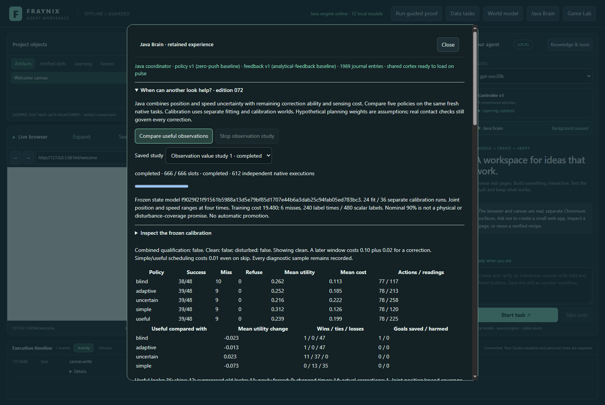
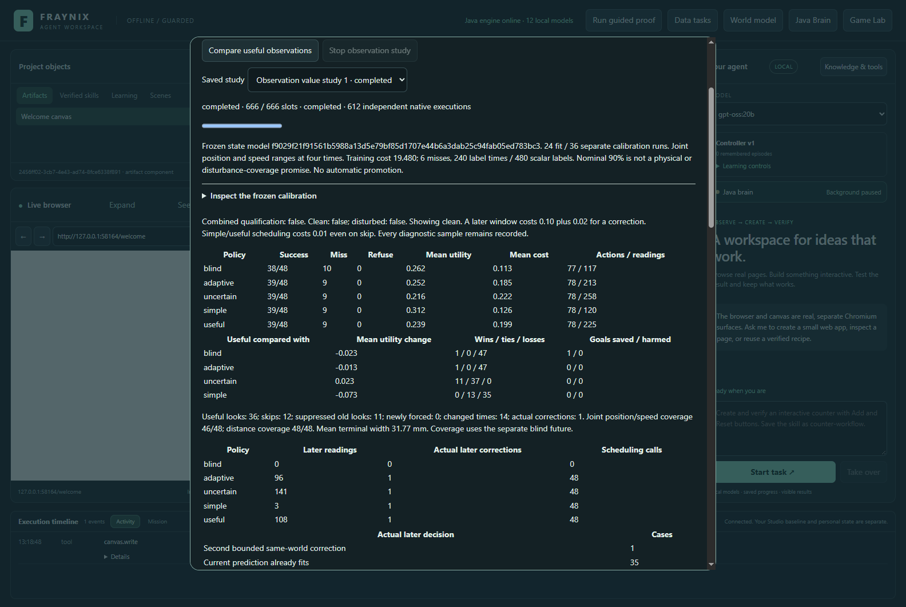
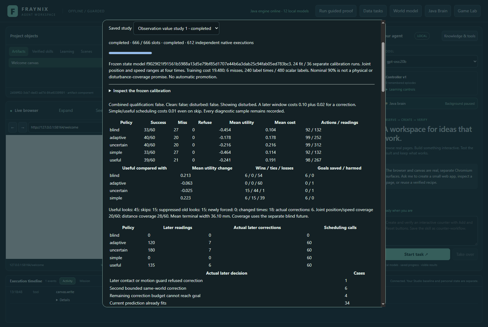
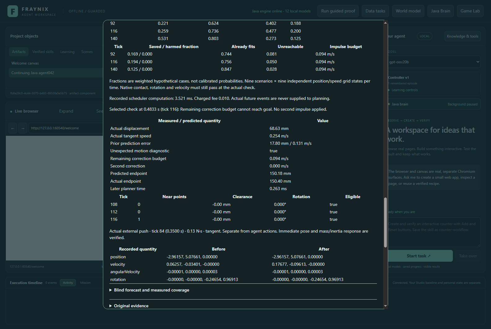
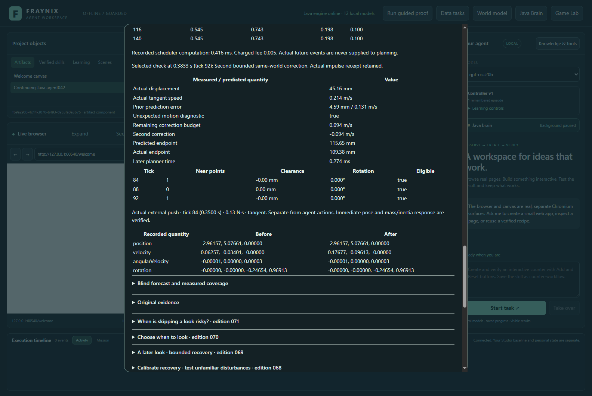
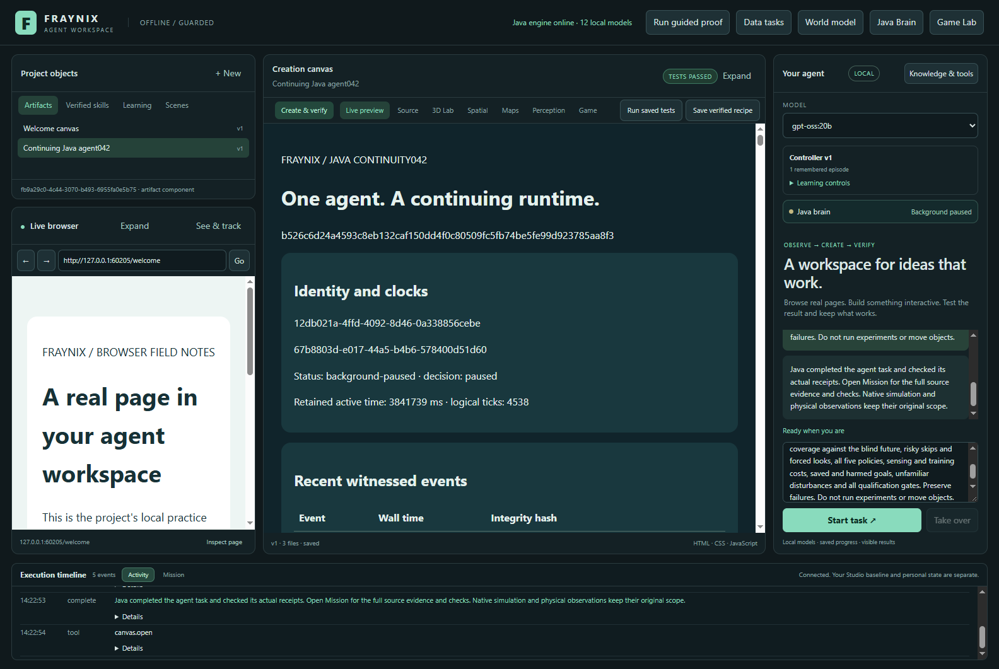

# Fraynix Agent Workspace · Edition 072

## When can another look still help?

**Java now compares prediction uncertainty with the correction it can still make.** It chooses an observation window only when its declared hypothetical cases predict enough useful correction to pay for another look. An uncertain state is a reason to consider sensing; it is not proof that sensing will help.

[Previous edition 071](README-071.md) · [Offline interactive guide](docs/readmes/072/index.html) · [Complete history](docs/readmes/INDEX.md) · [Operating guide](docs/JAVA_CHAT_044.md) · [Chandra assessment](docs/CHANDRA_072_ASSESSMENT.md)

This remains the same Java Agent Workspace, with its persistent brain, browser and canvas surfaces, physical world, procedures and verifiers. The change lives inside its existing Java Brain and chat path. No separate Chandra service, model framework or new runtime dependency was installed.

**Measured qualification: False.** Clean gate: False; unfamiliar-disturbance gate: False. A passing implementation test means the declared experiment works and its evidence survives verification. It does not mean the proposed policy beat its comparisons. The original controller remains active; no automatic promotion occurred.

Actual application capture, November 5, 2026, isolated synthetic validation world. All images in this edition are real captures rather than generated mockups.

## Why this edition exists

Edition 071 learned an uncertainty envelope from actual native motion and used it to challenge skipped observations. On its reserved tasks that guard forced 38 additional looks, made no extra corrections and did not save a goal. Those results remain frozen. They suggested a missing question: after learning more, does the controller still have the time, authority and physical opportunity to change the outcome?

The new work was specified in [a prospective contract](docs/EDITION_072_CONTRACT.md), committed at 2e4a2e7. Training cost units were clarified at f7c4220 before outcomes. The initial implementation 4e36547 also preceded the first new native outcomes. New task streams separate fitting, calibration and evaluation from earlier editions. No result was used to retune a threshold, remove a difficult case or weaken a success check.

## The implemented decision

```mermaid
flowchart LR
    A[Original action and first recovery] --> B[Permitted state at tick 60]
    B --> C[Frozen position and speed ranges]
    C --> D[Forecast possible futures]
    D --> E[Check remaining bounded correction]
    E --> F[Compare benefit with sensing cost]
    F --> G[Skip or select 92 / 116 / 140]
    G --> H[Actual contact and motion check]
    H --> I[Bounded correction or refusal]
    I --> J[Verified outcome and persistent evidence]
```

The first action and first recovery remain identical across policies. Directly admitted tasks do not receive a free measured state at tick 60. Every later policy shares one three-sample window, at most one extra correction, a 0.12 m/s individual and 0.24 m/s cumulative correction budget, and the existing tangent-speed, contact and rotation guards. The episode lasts180 ticks at 240 Hz, or 0.75 seconds.

The new state model fits position and tangent-speed prediction errors at four times: 92, 116, 140 and 180. It uses 24 fitting trajectories and 36 different calibration trajectories, divided into four cells by accelerating/slowing regime and predicted/measured first anchor. Each cell has six fitting and nine calibration examples. Median errors, median absolute deviation scales and the separate maximum standardized calibration score form an eight-component joint range. The distance and speed scale floors are 2 mm and 0.01 m/s. The original 071 distance-only model is also fitted from the same 60 trajectories for its unchanged comparison policy.

Both models freeze before evaluation. Original labels, native record IDs, source hashes, calibration scores, model hashes and chronology remain inspectable. Nominal 90% describes the calibration construction; it is not a guarantee for unfamiliar disturbances or physical camera measurements. Coverage is checked against the paired blind trajectory, not a corrected endpoint that the model did not predict.

The useful policy propagates the nine original 070 hypothetical scenarios to each candidate time. It combines them with a 3×3 grid around the fitted position/speed center. The per-axis weights are 0.25/0.50/0.25: 81 hypothetical states per time, 243 total. These weights are explicit assumptions. They are not learned probabilities; the rectangular grid also discards position/speed correlation.

For each hypothetical state, Java predicts a no-check endpoint, calls the unchanged bounded inverse controller, and predicts the corrected endpoint including any hypothetical later event. It records weighted saved, harmed, already-safe, unreachable and correcting fractions, available impulse budget and endpoint ranges. The earliest highest-value candidate must predict at least 0.02 gain after sensing and correction fees. Otherwise it skips. Planning assumes nominal contact; actual contact, rotation and velocity must still pass before any real corrective impulse.

## Five policies, one fair comparison

| Policy | What it does |
|---|---|
| blind | Keeps the initial action/recovery and makes no later check. |
| adaptive | Uses the exact 070 hypothetical timing rule. |
| uncertain | Uses the exact 071 distance-envelope guard on skipped looks. |
| simple | Checks 92 only if terminal uncertainty leaves the goal and nominal bounded correction can reach it. |
| useful | Compares uncertainty, remaining correction and costs across 92/116/140. |

The simpler rule matters. Additional numerical work is worthwhile only when measured task outcomes or sensing savings justify it. All methods retain the same first behavior, authority and native success tests. Six exact 071 parity pairs check the old methods through the new adapter; all 46 diagnostic samples, plans and schedules must match. Prefixes through 60 must agree across paired policies.

The complete study has 666 progress slots and 612 native executions: 60 training trajectories, six parity comparisons using 12 executions, and 540 supported held-out executions. The 120 held-out tasks comprise 48 clean, 60 disturbed and 12 unsupported tasks, evaluated by five policies. Unsupported cases are refusals, not fabricated trajectories.

## Actual clean results

| Policy | Success / miss / refusal | Later readings | Later corrections | Mean utility | Mean logical cost |
|---|---:|---:|---:|---:|---:|
| blind | 38 / 10 / 0 | 0 | 0 | +0.261667 | 0.113333 |
| adaptive | 39 / 9 / 0 | 96 | 1 | +0.252083 | 0.185417 |
| uncertain | 39 / 9 / 0 | 141 | 1 | +0.215833 | 0.221667 |
| simple | 39 / 9 / 0 | 3 | 1 | +0.311667 | 0.125833 |
| useful | 39 / 9 / 0 | 108 | 1 | +0.238750 | 0.198750 |

| Useful compared with | Mean utility difference | Goals saved | Goals harmed |
|---|---:|---:|---:|
| blind | -0.022917 | 1 | 0 |
| adaptive | -0.013333 | 0 | 0 |
| uncertain | +0.022917 | 0 | 0 |
| simple | -0.072917 | 0 | 0 |

Useful selected 36 looks and 12 skips. It suppressed 11 old looks, changed 14 selected times and made 1 actual later corrections. Joint position/speed coverage was 46/48; four-time distance coverage was 48/48.

On these clean tasks, the simple rule matched the new policy's completion with far fewer readings. Of the useful policy's selected looks, 35 found that the current prediction already fit the goal. The uncertainty range can cover the trajectory while its hypothetical value calculation still spends too much effort on problems that do not occur. This is a measured limit of the current scheduling assumptions, not evidence to remove from the comparison.

## Unfamiliar disturbances

Five families test braking, lift, extra push, spin and a push after every possible later observation. Fresh task parameters, two event amplitudes and timing labels remain included. Actual future events are never passed into the scheduler. The after-last family deliberately exposes the limit of a single extra observation.

| Policy | Success / miss / refusal | Later readings | Later corrections | Mean utility | Mean logical cost |
|---|---:|---:|---:|---:|---:|
| blind | 33 / 27 / 0 | 0 | 0 | -0.454000 | 0.104000 |
| adaptive | 40 / 20 / 0 | 120 | 7 | -0.178000 | 0.178000 |
| uncertain | 40 / 20 / 0 | 180 | 7 | -0.216333 | 0.216333 |
| simple | 33 / 27 / 0 | 0 | 0 | -0.464000 | 0.114000 |
| useful | 39 / 21 / 0 | 135 | 6 | -0.241000 | 0.191000 |

| Useful compared with | Mean utility difference | Goals saved | Goals harmed |
|---|---:|---:|---:|
| blind | +0.213000 | 6 | 0 |
| adaptive | -0.063000 | 0 | 1 |
| uncertain | -0.024667 | 0 | 1 |
| simple | +0.223000 | 6 | 0 |

Useful selected 45 looks and 15 skips, suppressed 15 old looks and made 6 actual later corrections. Joint state coverage was 20/60; four-time distance coverage was 28/60. The [complete verification record](docs/readmes/072/verification.json) retains subgroup results, failure reasons, timing costs and every qualification gate. The [offline guide](docs/readmes/072/index.html) can switch tasks, policies and physical quantities without network access.

One disturbed case exposes the timing failure directly: case 7 receives an external push at tick 84. The original adaptive policy observes at 92 and successfully corrects. The useful policy waits until 116, when its remaining impulse budget cannot reach the target. This failure and its successful paired alternative are retained; they can inform a future training hypothesis, but cannot become fresh test evidence for that revised hypothesis.

## Costs and limits are part of the result

A later window costs 0.10 for three readings and replanning, plus 0.02 when a correction occurs. Adaptive scheduling pays 0.005; uncertain, simple and useful pay 0.01 per attempted world, even if they skip. Measured computation times are retained separately from those logical accounting fees. Utility rewards a successful goal with +1 and charges −2 for a miss, with the existing operation/refusal costs preserved.

Training logical cost is 19.480000, including 6 misses. There are 240 sampled label times and 480 scalar labels. Charging eight scalar values per run is an accounting assumption, not a claim that eight separate physical camera frames were captured. Training cost is reported separately from held-out utility rather than silently amortized away.

All 46 diagnostic samples remain saved in every attempted trajectory. “Fewer observations” here means fewer readings selected for control. It does not establish lower total simulator logging, camera bandwidth or hardware power. Likewise, a forecast fraction is not an empirically calibrated chance of success. A rejected native correction, an unhelpful look and a late disturbance remain real failures or costs even if the forecast was optimistic.

## Review it in the app

1. Build this edition in its separate checkout using Java 21 and the documented [desktop startup](docs/JAVA_CHAT_044.md). Preserve existing private projects and any older running installation.
2. Open **Java Brain → When can another look help? · edition072**.
3. Choose **Compare useful observations**. The progress bar reports the complete 666-slot experiment. Stop cancels new work while retaining completed studies.
4. Open the frozen calibration and inspect position/speed biases, scores and model identity.
5. Switch between clean, disturbed and unsupported cases. Compare all five policies, chosen times, corrections, goals and costs.
6. Select **Uncertainty + correction value** or **Simple reachability** to inspect the actual decision. Scrub the saved native trace and compare it with blind-future coverage.
7. Ask chat: “Inspect the useful observation study and create the verified Java report. Include state uncertainty, remaining correction ability, all five policies, costs and failures. Do not run experiments or move objects.”

The actual gpt-oss:20b check used CPU-only planning with four threads. Its completed report was compared with the exact Java model identity, three evaluation summaries, training costs and qualification result. Chat does not certify success by inventing a narrative. Java retains the original facts; concise planning tables preserve every aggregate metric with explicit references to detailed subgroup evidence.

## What Chandra contributes

The user suggested revisiting [chandra-fraymus](https://github.com/eyeoverthink/chandra-fraymus). This edition pins its source to e984a33685c0ed9e0c4f4c79e4cd1f094b4118de and reviews fleet collaboration, execution budgets, contextual inheritance, prediction-error processing, arena judging and recursive-improvement mechanisms. The [detailed assessment](docs/CHANDRA_072_ASSESSMENT.md) links the exact source and distinguishes reading from executed checks.

Its strongest transferable idea is organizational: specialists can share task context, inherit relevant experience, exchange proposed solutions and let a coordinator combine their work. Roles need not all be language models. The new Java forecast, bounded-control and value stages already demonstrate useful specialization with deterministic calculations. They are not a newly installed multi-LLM system.

Four existing inheritance tests passed with disposable databases and mocked model replies. Six controlled source probes reproduced important gaps: timeout or all-failed collaborations can end as done; a no-executor error can be sealed as executed; a single long line can grow beyond the output bound; prediction error can earn action-effectiveness credit with no action; and unchanged genomes can receive higher RSI fitness from a random offset. These are specific tested mechanisms, not a dismissal or complete audit of Chandra's 1,450 tracked files. The setup failure and successful retry are both retained.

The Java version should preserve the ambition while strengthening these boundaries. A hash proves byte identity, not execution. A judge's preference is not external success. A lower error after doing nothing is not a causal control improvement. A memory entry should distinguish a proposal, a tested procedure and a promoted policy. These distinctions make recursive improvement testable.

## Game Lab, experimental memories and an internal investigator

The user's follow-up points to a stronger integration: use the Game Lab as a runtime for testing ideas, then retain the experiments as memories. The app already has a hidden game runtime with bounded stepping, structured spatial observations and renderer frames. Its separate native 3D counterfactual runner already branches from frozen world state. These are useful foundations; the game observation snapshot is not yet a complete general restore checkpoint, and the two adapters do not have identical capabilities.

The [rehearsal and memory assessment](docs/REHEARSAL_MEMORY_072.md) connects this to pinned [fraynix-akashic](https://github.com/eyeoverthink/fraynix-akashic/tree/2e5a0f94b8d812d6ef9c976366220be8ba75aeaa) and [fraymus-re-agent](https://github.com/eyeoverthink/fraymus-re-agent/tree/4c04eee36be9a0c188a76bc5db8db16fb0142233). Akashic offers lineage, fossil retention, binary state, consolidation and HDC ideas. Its original 19-check RAM-mode Java suite passed, including deterministic updates and runtime rule replacement. Six focused counterexamples also reproduced restore/store/seal/consolidation boundaries that need repair before adopting its continuity claims. These properties were not covered by the original passing checks. The RE scripts provide address-linked analysis and receipt concepts; four controlled probes reproduce address/body misalignment, false completion and trusting a caller's verification flag. Existing Mac binary-analysis results are source artifacts, not fresh Windows execution claims.

The next delivery should retrieve one relevant experiment, fork its complete starting state, change one component or action, execute a bounded trial, compare prediction with measured results, and save a new parent-linked episode. Store structured events and state alongside keyframes or video. A video helps visual recall; it cannot restore velocity, contacts, controller memory or solver state by itself. Reuse is valid only when the code, conditions, units and relevant assumptions still match.

An internal investigator can connect an unexplained failure to our Java methods or bytecode and propose a testable explanation. Start with an owned class-file inspection tool and known fixtures; broad native decompilation is a much larger capability and the existing RE project uses upstream engines. Neither multiple agreeing models nor a content seal should approve a live code change. Verified outcomes, fresh evaluation and actual rollback remain required.

This is a concrete extension of the user's entity-component thinking idea: objects, hypotheses, experiments, observations and procedures become distinct typed records connected by tested relationships. Bounded background rehearsal is a useful functional analogy for a subconscious process; it is not a claim of subjective awareness. The new memory design remains planned and does not alter edition072's frozen experiment.

## Validation and preserved evidence

- 112 distinct targeted Java checks across 25 classes passed, with original per-invocation XML and source provenance. This is not a new full-history heavyweight rerun.
- 127 desktop checks passed. The actual app completed the full experiment, showed real traces at 1600 and 1100 pixels, restored identical evidence after cold restart, and retained completed work when a new run was stopped.
- Native and actual-app numerical calibration, physical samples, plans, schedules and non-timing outcomes agree. Independent world IDs and source/model identities are retained rather than substituted.
- Rehashed altered source/model/plan/event/timing evidence, future leakage, changed correction budgets and corrected trajectories masquerading as blind coverage are rejected. Published 071 evidence reopens unchanged.
- The original factory runtime and transaction harnesses passed. No claim is made about new physical camera accuracy, semantic recognition, subjective awareness or general intelligence.
- The first native test completed and saved all 612 executions, then exceeded its 768 MB heap while retaining several tampered full-study copies. The original failure is archived. Harness-only 769b366 releases those copies before the next trace read; validation resumes the same completed experiment without repeating or changing its physics. A subsequent context-budget rejection is also retained; 6891627/c223cf4 compress repeated coverage/goal headings into shared table schemas and test exact reconstruction of every value.
- The offline guide is tested at 1440 and 390 pixels, including navigation, filters, source links, physical quantities, model ranges, all event families and screenshots.

[Verification](docs/readmes/072/verification.json) · [Exact original archives](docs/readmes/072/original-evidence.json) · [Audited motion and decisions](docs/readmes/072/useful-data.json) · [Forecast errors](docs/readmes/072/forecast-errors.json) · [Canonical source inventory](docs/readmes/072/file-inventory.json) · [Complete file tree](docs/readmes/072/FILE_TREE.md)

## Current architecture and next phases

Java owns durable goals, model routing, state, authority, procedures, prediction and outcome checks. The desktop presents those results and hosts browser/canvas interactions. The native physics backend remains the existing dependency; this edition's uncertainty, timing, accounting and verification logic is owned Java. “Ground up” does not mean that the existing graphics, physics or language-model dependencies disappeared.

| Next phase | Concrete addition | Acceptance evidence |
|---|---|---|
| 073 proposal | Reusable experimental memory using typed observer/planner/verifier requests in the existing Java goal runner | Shared source identity; bounded parent/child budgets; timeouts, stale state, contradiction, Stop and restart cannot become false success. |
| Procedure inheritance | Retrieve relevant verified successes and failures for both planning and review | Better held-out completion or cost after restart, with every retrieval/model cost counted. |
| Specialist comparison | Compare one planner with planner-plus-critic under the same budget | Independent native/artifact/browser outcomes, including regressions and null results. |
| Wider attention | Apply uncertainty and useful-response tests to browser/file/scene observations | Typed units and freshness, matched no-action comparisons, and no credited action that did not occur. |
| Measured evolution | Generate bounded policy candidates and evaluate before promotion | Separate training/selection/test cases, exact source/model versions, real rollback and retained incumbent. |

These are ordered proposals, not installed capabilities or performance promises. Current results should guide a fresh prospective contract; they must not be used to rewrite this edition's gates. Broader state estimation should retain contact uncertainty and position/speed correlation before claiming that a more elaborate planner understands unfamiliar physics.

The practical vision is one persistent system that can explain what it saw, what it expected, what it could still change, why it spent another observation, and what the outcome proved. Chandra contributes coordination ideas. The Java world's verified actions, durable records and measured failures give those ideas something concrete to learn from.

[Obsidian note](docs/obsidian/80-useful-observation.md) · [Canvas map](docs/obsidian/useful-observation.canvas) · [Machine-readable system map](docs/readmes/072/system-map.json)
