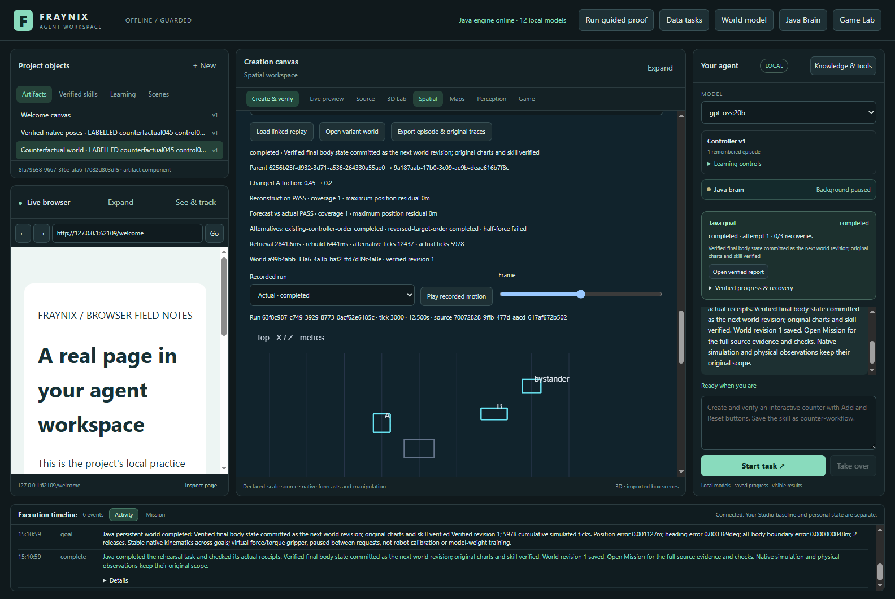
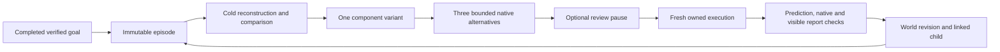
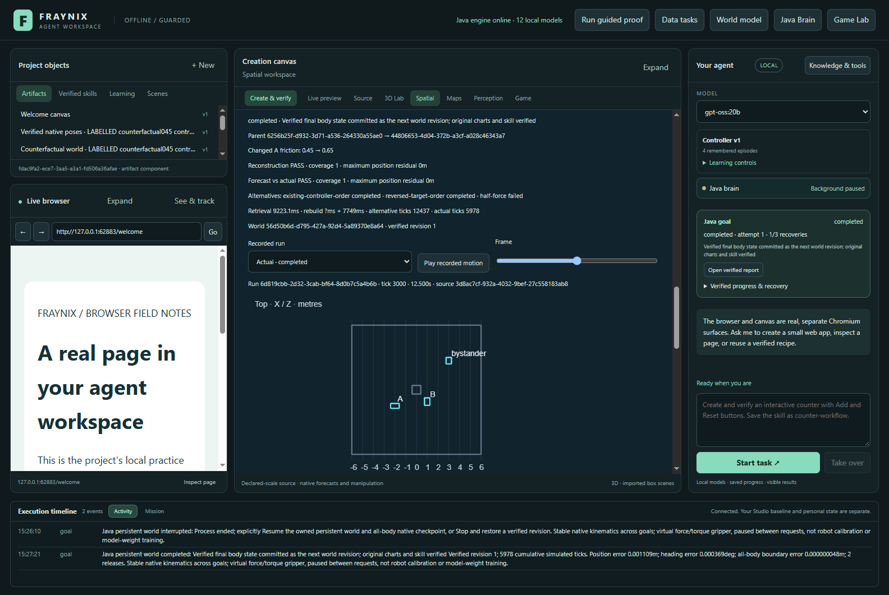

# Fraynix Agent Workspace · Edition 073

**Executable experiment memory: retrieve, reconstruct, vary, compare and verify.** November 5, 2026.

[Previous edition072](README-072.md) · [Offline interactive guide](docs/readmes/073/index.html) · [Complete source tree](docs/readmes/073/FILE_TREE.md) · [Verification](docs/readmes/073/verification.json) · [Exact original evidence](docs/readmes/073/original-evidence.json) · [Edition history](docs/readmes/INDEX.md)

## From a remembered experiment to a fresh result

The user's idea was to treat the runtime as a place where the agent can try an idea, observe the outcome and retain an executable memory. Edition 073 implements the first complete version of that loop in the existing Java goal runner. A memory contains the original source state, physical properties, controller plan, every retained native motion sample, original report identity and committed world outcome. It can be reconstructed and tested again. Its description alone does not establish success.

The app remains one integrated workspace. Java owns episode identity, retrieval, state reconstruction, task progress and verification. The desktop presents the world, chat, replay and original charts. Existing native physics and the virtual force/torque gripper remain the execution layer. No external memory framework, model download, remote service or separate editor was added. The existing Bullet/Minie, Chromium/Electron and JSON dependencies remain; this is owned Java orchestration over the current engine, not a claim that all of those dependencies were rewritten.

*Actual app capture from the isolated labelled validation project. The UI connects the remembered original, reconstruction, changed component, alternatives, child episode and world revision.*

## What is implemented

1. **Remember a verified experiment.** Select a completed persistent-world arrangement. Java rechecks its original native trace, report and world commit. A stored `passed` label or imported JSON cannot create that authority. Repeating the operation returns the same episode instead of duplicating it.
2. **Retrieve a compatible starting point.** An explicit episode ID is supported. Without one, Java filters incompatible memories and ranks the remaining episodes by the requested source role, property and normalized distance from the new value, with stable ID ties. It records the ranking, exclusions and retrieval time. This is a transparent local rule, not semantic neural retrieval.
3. **Reconstruct before changing anything.** The original source and original controller plan run in a separate native world. Sample coverage, position and orientation residuals are checked against the saved trace. A failed reconstruction stops the workflow before changed alternatives or live action.
4. **Substitute one component.** Friction or a dynamic body's mass changes by stable source role. Geometry, declared units, gravity, other components and target poses remain the same. The entire changed plan is validated before creating its import and separate persistent world.
5. **Run bounded alternatives.** The existing policy tries controller order, reversed target order and half force. It retains failures and applies the original admissibility and ranking rules. A visual replay does not substitute for native simulation.
6. **Execute and compare.** The chosen plan runs again under ownership of the variant world's current revision. Java compares prediction with actual motion and checks the original body, force, torque, release and protected-body gates.
7. **Verify the visible report and retain the result.** The existing canvas must pass its 13 original assertions. Only then can the world advance and a linked child episode be retained. Export contains parent, reconstruction, all original alternative attempts and actual execution.

## Try it step by step

Open **Spatial → One evolving world → Experiment memory**. Start with an ordinary labelled world arrangement and finish its actual verification. Select that completed goal and press **Remember verified experiment**. A descriptive chat answer on its own is not an eligible experiment.

Choose the remembered experiment, its actual object role, a component and the new value. Press **Rehearse through chat**. The button sends the same typed request available through chat. For the labelled test source, an example is: `Rehearse experiment, change A friction to 0.2 and execute.` An explicit UUID after `experiment` selects that memory; otherwise Java ranks eligible memories. Use `massKg` for payload mass. Missing or ambiguous component requests are refused with an actionable explanation.

Select **Review alternatives before moving** to pause after prediction. In chat, `review before executing` requests the same pause. A request without explicit execution also defaults to review. Resume rechecks the chosen plan against the current world head. Changing that head while review is paused invalidates the old decision.

The variant is a separate saved world. The original user world remains intact. The normal integrated world view observes the accepted task without changing another tool's action binding. **Open variant world** returns to its actual retained state. Use the existing Java goal Stop and Resume controls; a stopped or refused task does not earn a successful child memory.

Select a retained rehearsal and press **Load linked replay**. Choose the parent, reconstruction, an alternative, or actual execution. Scrub the frame slider or play the recorded samples. The top/front projections use the original positions and quaternions, labelled in metres and native ticks. A dashed forecast accompanies the actual run at matching ticks. The original full trace remains available through JSON export. Replay cannot write poses or issue forces.

*Final app capture: recorded native geometry and motion after interruption, restart and explicit recovery. The projection fits oriented geometry and uses equal metre scale.*

## Measured results and costs

The frozen acceptance values were friction 0.2 and 1.2, mass 0.7 kg and 1.5 kg, a 20 kg unsupported request and malformed/static-body changes. The full app ran each accepted variant through actual chat, native execution and canvas verification. All four accepted variants completed and retained linked children. Every original source reconstruction matched its retained samples; these are deterministic simulator results, not a measurement of physical-camera accuracy.

| Component | Original → changed | Rebuild max position residual · m | Forecast/actual max position residual · m | Completed alternatives | Committed revision |
| --- | --- | --- | --- | --- | --- |
| friction | 0.45 → 0.2 | 0 | 0 | 2/3 | 1 |
| friction | 0.45 → 1.2 | 0 | 0 | 2/3 | 1 |
| massKg | 1 → 0.7 | 0 | 0 | 2/3 | 1 |
| massKg | 1 → 1.5 | 0 | 0 | 2/3 | 1 |

Each full case contains one reconstruction, three alternative executions and one fresh actual execution. Failed low-force alternatives remain in the comparison and exported evidence. The original source world was compared before and after the variants and restart and remained unchanged. The checks also covered cold app/Java restart, idempotent retention, review before movement, changed-head refusal, Stop without promotion, a real exported JSON file and wide/narrow layouts.

A fifth follow-up selected a compatible memory automatically from five retained episodes, then interrupted an actually running reconstruction by closing the app and Java. After restart, explicit Resume created a fresh reconstruction while preserving the interrupted attempt. The friction 0.65 variant completed all checks and retained its child. A separate Stop during an actually running reconstruction left revision zero and no child. The final app had no recorded page errors.

The portable [trace inspector](scripts/Inspect-Rehearsal073.cjs) independently recomputed motion, component differences, force/torque effort, protected-body drift, ranking and lineage from all five exported cases. Six controlled altered exports were rejected. This is independent arithmetic over saved native outputs, not a second physics solver. Actual chat used the deterministic Java procedure with zero new LLM planning calls; the selected model in a screenshot is not evidence of new model inference.

Costs are visible: retrieval wall time, reconstruction attempts and duration, alternative native ticks and measured wall time, and actual execution ticks. A reconstruction intentionally costs computation. These tests establish correctness and reproducibility of memory reuse; they do **not** establish that retrieval is faster or more useful than planning without memory. That claim requires a separate matched-budget comparison. Wall time is observed elapsed time, not isolated CPU time; interrupted attempts can have incomplete timing information.

The validation record covers 78 distinct targeted Java checks across 11 classes, 127 desktop checks, five additional runtime/transaction/continuity/skill/kernel harnesses, real app cases and the final follow-up. Exact invocation scope and original output are in [verification.json](docs/readmes/073/verification.json); this is not a new full-history rerun of every expensive study. The local symlink check was unavailable; its traversal and absolute-path checks ran.

## Restore contract, bounds and honest limits

The supported restore point is **initial at rest**: original geometry and stable roles, elapsed tick 0, zero linear/angular velocity, no held object, original controller initialization and the existing fixed timestep. It does not claim to restore arbitrary moving contact manifolds, solver caches, runtime script stacks, external devices or random simulation state. Resumed original native traces are outside this first episode contract. Restore eligibility is checked before committing a new remembered variant; a successful native endpoint alone cannot erase that limitation.

Reconstruction requires at least 95% matched sample coverage, at most 0.00001 m maximum position difference and 0.001 degree maximum orientation difference, plus the original native gates. Changed-plan prediction versus actual execution keeps the existing stricter evidence path and its original 0.01 m/0.5 degree comparison thresholds. Neither set is a real-world accuracy claim.

One uninterrupted goal allows one reconstruction, up to three original alternatives and one fresh actual run, with a ten-minute goal budget and 90-second reconstruction/alternative budgets. At most two explicit reconstruction retries are allowed; prior attempts remain. Existing runner/history limits remain: 32 memories, bounded imports/native histories and the original counterfactual study capacity. This is a bounded workbench, not an unbounded background search process.

The input accepts friction 0–2 and a positive mass up to 20 kg, but the unchanged lifted-route planner supports upright 0.2–4 kg boxes. The 20 kg acceptance test therefore verifies an early refusal before world creation; it is not presented as a simulated payload failure. A static floor cannot be converted into a dynamic payload by this operation. Moving geometry, material deformation, arbitrary-component mutation and general robot manipulation remain separate future capabilities.

Native version identity is preserved. The new memory checks the current controller identity against the retained episode. Corrupt or incompatible records stay on disk and are reported as ineligible; rehashing a changed file does not bypass checks against the original owned goal and native trace. This is corruption detection and evidence binding within the local application, not protection against a machine administrator rewriting every authority store.

## Development evidence and corrections

The acceptance contract was committed as `4a1168d` before implementation and new outcomes. The first targeted run found a test reader using a generic 4 MB budget for a larger native episode; the test was corrected to use the declared 32 MB episode envelope budget. The first real app run completed native reconstruction, alternatives, fresh execution, report checks and child retention, then exposed a viewer assumption that compressed original traces were already decoded. The viewer now checks their original byte length and SHA256 before decoding. A source-encoding startup rejection and its correction are also retained.

The integrated view was changed to observe a new world without trying to rebind an action tool while the agent owns a task. Projection bounds now use oriented box corners and equal metre scale. These corrections changed display/validation handling; the native controller, alternative policy, experiment values and acceptance thresholds were not retuned after seeing results. Earlier failed attempts remain under the exact-original archive, separate from final passing evidence. The final documentation check also caught two nonstandard embedded-data labels in the new offline guide. The guide now uses the established system-map and inventory format; its original check failure is archived.

## Architecture, source and next steps

The implementation is concentrated in [Rehearsal073](workspace-engine/src/main/java/fraymus/workspace/Rehearsal073.java), [GoalRunner](workspace-engine/src/main/java/fraymus/workspace/GoalRunner.java), [Java domain planning](workspace-engine/src/main/java/fraymus/workspace/Domain044.java), the registered tool catalogs and the [integrated replay panel](workspace-desktop/renderer/rehearsal073.js). Existing [Counterfactual045](workspace-engine/src/main/java/fraymus/workspace/Counterfactual045.java), [WorldLedger](workspace-engine/src/main/java/fraymus/workspace/WorldLedger.java) and native physics verification remain authoritative. The [complete source inventory](docs/readmes/073/file-inventory.json) includes the inherited game, assets, modules and current implementation.

This turns the Game Lab analogy into a concrete form of experimental memory: propose, reconstruct, change, observe, verify and retain. The new episode is an entity with components and provenance that another task can reuse. A video alone would lose much of that information; state/action traces plus a visual witness preserve both inspectability and a starting point for another experiment. This does not demonstrate consciousness or automatically improve language-model weights.

The next useful gates are:

- Compare retrieval with no retrieval under the same total native tick/time budget on new scenes. Count failed reconstructions and lookup costs, not just successful outcomes.
- Add complete restore contracts for moving scenes only after measuring controller, contact-cache and randomness compatibility. Reject unsupported state explicitly.
- Build typed skill-graph nodes around these episodes, with prerequisites, source-qualified success conditions and recovery branches.
- Use verified counterexamples to propose changed procedures, then evaluate on held-out goals before promotion and keep rollback.
- Investigate unexpected outcomes using owned source/bytecode inspection. The earlier reverse-engineering assessment remains a proposal; no binary execution or RE stack is installed by this edition.

The original roadmap remains linked through [the rehearsal-memory assessment](docs/REHEARSAL_MEMORY_072.md) and the [edition073 contract](docs/EDITION_073_CONTRACT.md). Existing camera/world calibration qualifications and edition072's failed useful-observation promotion remain unchanged.
