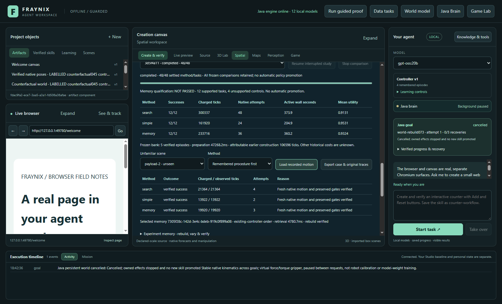
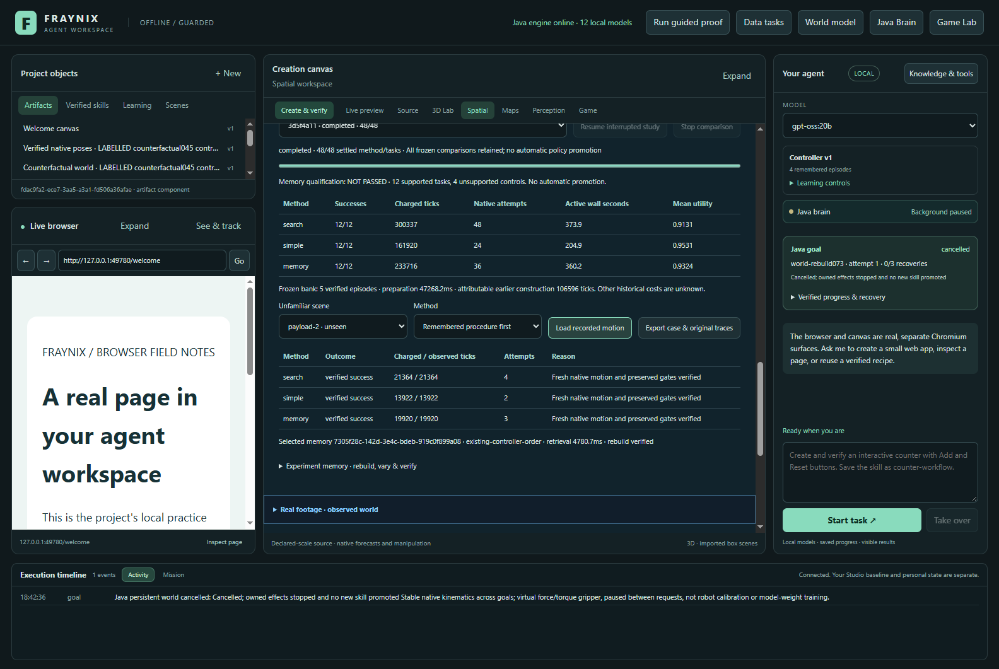
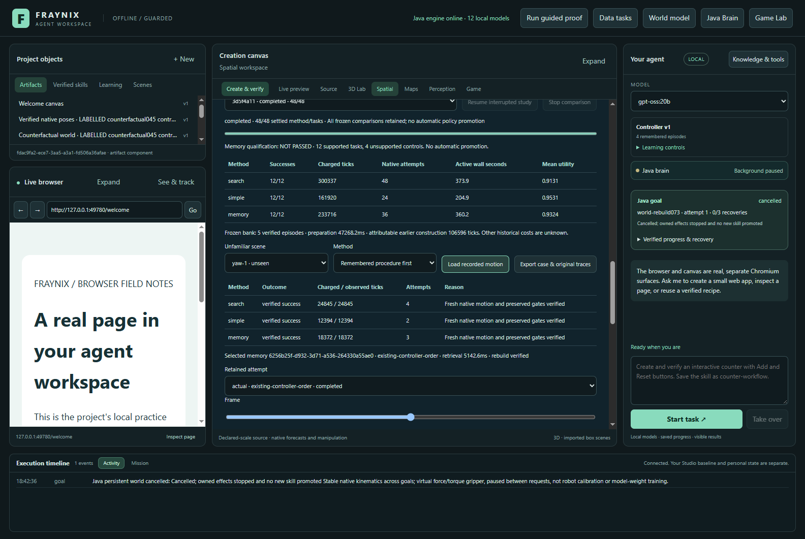
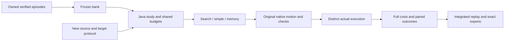

# Fraynix Agent Workspace · Edition 074

**Measuring whether executable memories earn their cost on unfamiliar scenes.** November 5, 2026.

[Previous edition 073](README-073.md) · [Offline interactive guide](docs/readmes/074/index.html) · [Complete source tree](docs/readmes/074/FILE_TREE.md) · [Verification](docs/readmes/074/verification.json) · [Exact original evidence](docs/readmes/074/original-evidence.json) · [Edition history](docs/readmes/INDEX.md)

## What this edition answers

Edition 073 made experiment memories executable: retrieve a verified source, reconstruct it, change a component, compare alternatives and retain a verified result. The next question is practical: **does remembering an experiment help on a new task once retrieval, reconstruction and failures are counted?** Edition 074 adds a real comparison in the existing Java workspace and answers that narrower question with retained native motion, rather than a demonstration selected after success.

The qualification **did not pass**. The table below includes all 12 prospectively specified supported tasks. Four unsupported controls are shown separately and never counted as successes. No controller or skill was automatically promoted, and the active saved worlds stayed unchanged.

*Actual app, isolated labelled synthetic project, November 5, 2026. These are new configurations within the existing native box/controller family, not new camera measurements or a demonstration of general intelligence.*

## Results, including the simpler control

| Method | Verified success | Charged native ticks | Native attempts | Active wall seconds | Mean primary utility |
| --- | --- | --- | --- | --- | --- |
| search | 12/12 | 300,337 | 48 | 373.93 | 0.913097 |
| simple | 12/12 | 161,920 | 24 | 204.93 | 0.953148 |
| memory | 12/12 | 233,716 | 36 | 360.23 | 0.932374 |

| Paired comparison | Goals saved | Goals harmed | Mean extra ticks per task | Mean utility difference |
| --- | --- | --- | --- | --- |
| Memory versus search | 0 | 0 | -5551.75 | 0.019277 |
| Memory versus simple | 0 | 0 | 5983.00 | -0.020774 |

In this study, the remembered family was the existing controller order on ten tasks and reversed order on two material tasks. The memory method used exactly the same combined new-task forecast/actual ticks as the simple method. Its 71,796 extra ticks were the twelve original-memory reconstructions. The bank influenced two choices but produced no additional successes or net task-work reduction here. Against exhaustive search, the apparent saving comes from stopping after the first verified forecast, which the simpler control already does.

A success needs an eligible forecast and a distinct fresh execution that passes the original native gates and prediction-versus-actual comparison. Fewer forecasts alone cannot earn success. The declared utility is `success - 0.2 × chargedTicks / 57600`; the weight is an accounting choice, not a learned probability or universal value function.

Bank preparation took 47.27 seconds; the final original-evidence audit took 164.04 seconds. These shared overheads are separate from the per-method active-wall table. Retained bank creation accounts for at least 106,596 earlier native ticks. Including that lower bound, memory uses at least 28359.33 ticks per new task. Missing historical collection failures and historical wall time are **unknown**, not zero. The interactive guide can add this attributable earlier work to the chart.

All three methods reached the success ceiling on this supported set, so it cannot show a success-rate improvement. The measured cost difference remains informative; it does not show that memory would be useless on harder or different tasks.

Each task is one deterministic execution per method with counterbalanced method order. Native ticks are a simulation-work proxy, not a claim of proportional CPU savings. Wall time includes lookup, reconstruction, planning, native execution, persistence and per-task checking; it is machine elapsed time, not a clean CPU microbenchmark. No confidence interval or population-wide performance claim is inferred from these 12 designed cases. All methods use the same simulator; independent trace arithmetic is not a second physics solver.

## The three methods

1. **Search** uses the existing controller-order, reversed-target-order and half-force alternatives. It evaluates admissible distinct candidates and retains original native-tick, effort and ordinal ranking.
2. **Simple** tries the same candidates in the existing order and stops at the first verified forecast. It still runs and verifies a distinct fresh actual execution.
3. **Memory** selects the nearest compatible episode from a frozen bank, reconstructs its original at-rest run, and tries its remembered successful candidate family first on the new scene. It uses bounded fallback if needed and the same fresh-actual checks. A remembered success never certifies a changed task.

The bank contains the original verified source and four original edition 073 acceptance children. It is frozen before the new study. New test results are not added to retrieval, and no evaluation case becomes training data during comparison. Retrieval uses an explicit normalized distance over role-matched mass, friction, dimensions and target travel length, with penalties for unmatched context roles and stable ID ties. It is local Java arithmetic, not semantic neural recall.

All arms share a 57,600-native-tick and 600-second active-wall budget. Each native attempt retains its original 14,400-tick and 90-second bounds. Admission reserves a full worst-case attempt plus a full fresh-actual allowance. Reconstruction and unsuccessful alternatives consume the same total budget; unknown interrupted native tails are conservatively charged their full maximum. Observed ticks remain separately visible. Recovery is explicit and limited to two resumes.

## New scenes and preserved outcomes

The source-controlled protocol declares 12 supported changes: two footprints, two rotations, two route changes, two obstacle contexts, two payloads and two material settings. Four invalid or unsupported cases test excess mass, oversize geometry, missing floor and invalid height. The original physics solver, controller classes and verifier identity are unchanged.

| Case | Search outcome / ticks | Simple outcome / ticks | Memory outcome / ticks |
| --- | --- | --- | --- |
| footprint-1 | success / 23458 | success / 11708 | success / 17686 |
| footprint-2 | success / 25537 | success / 12540 | success / 18518 |
| yaw-1 | success / 24845 | success / 12394 | success / 18372 |
| yaw-2 | success / 27235 | success / 13398 | success / 19396 |
| route-1 | success / 26869 | success / 13416 | success / 19394 |
| route-2 | success / 28553 | success / 14040 | success / 20018 |
| obstacle-1 | success / 29912 | success / 14946 | success / 20924 |
| obstacle-2 | success / 30974 | success / 15458 | success / 21436 |
| payload-1 | success / 20602 | success / 13414 | success / 19412 |
| payload-2 | success / 21364 | success / 13922 | success / 19920 |
| material-1 | success / 19048 | success / 12378 | success / 18356 |
| material-2 | success / 21940 | success / 14306 | success / 20284 |
| excess-mass | refused / 0 | refused / 0 | refused / 0 |
| oversize | refused / 0 | refused / 0 | refused / 0 |
| no-floor | refused / 0 | refused / 0 | refused / 0 |
| bad-height | refused / 0 | refused / 0 | refused / 0 |

The full [frozen protocol](workspace-engine/src/main/resources/memory074-protocol.json) contains exact component values, source poses, target poses and force/torque ceilings. The [prospective contract](docs/EDITION_074_CONTRACT.md) was committed as `49c82da`; the schema-only original-quaternion correction `e652acc` also preceded implementation and outcomes. Runtime implementation `d38238a` preceded the full study. Cases, thresholds, ranking and controller behavior were not retuned after seeing results.

*Actual per-case evidence. A refused or failed attempt remains visible and charged; no missing result becomes success.*

## Try the comparison and inspect the evidence

Open **Spatial → One evolving world → Does memory help? · new-scene comparison**. Select eligible verified memories from the existing experiment-memory workflow. Press **Freeze bank & run comparison**. The Java runner validates the original owned evidence before beginning. A foreign ID or a user-supplied success label cannot create an eligible memory.

The current progress, method summary and per-case table update in the same application. Choose a case and method to inspect its selected memory, candidate order, reconstruction status, all attempts and observed versus charged work. Use **Load recorded motion** to replay an original native attempt. Change the run selector and frame slider to inspect failures as well as successes. The oriented boxes use original quaternions and metre coordinates; the replay is read-only.

**Export case & original traces** writes the selected case, frozen study/source identities, method outcomes and original native traces through the existing file export system. Each retained compressed trace carries original byte length and SHA-256. The portable [inspector](scripts/Inspect-Memory074.cjs) recomputes source/target authority, retrieval ranking, motion verification, candidate choice, fresh-actual comparison and all cost totals. Eight deliberately altered exports are rejected, including hidden reconstruction costs, changed payload/target, false success and substituting a forecast for actual execution.

**Stop** retains unfinished work without qualifying it. Closing the app and Java preserves the study; after reopening, **Resume** explicitly continues from checked state. A separate post-study lifecycle test interrupted an actually running native attempt, restarted Java, retained and charged that attempt, resumed, then stopped without producing a completed qualification. The primary comparison was already complete before that probe and its outcomes were not mixed into the primary score.

The original edition 073 synthetic project was copied into a distinct project and checked byte-for-byte before launch and after validation. Existing user worlds, normal review installations and model services were preserved. Starting this comparison does not modify the active world's revision, save new memories or launch an unbounded background search.

## Architecture and validation

[MemoryPolicy074](workspace-engine/src/main/java/fraymus/workspace/MemoryPolicy074.java) defines the comparison and preserves the original candidate plans. [MemoryStudy074](workspace-engine/src/main/java/fraymus/workspace/MemoryStudy074.java) owns persistence, bounded native attempts, recovery and audit. [GoalRunner](workspace-engine/src/main/java/fraymus/workspace/GoalRunner.java) validates owned episode bundles. [The panel](workspace-desktop/renderer/memory074.js) displays evidence and dispatches typed Java operations. This edition adds no model, external agent framework or library. Existing Bullet/Minie, Electron/Chromium and JSON dependencies remain; it does not claim all inherited dependencies were rewritten.

Validation covers 84 distinct targeted Java tests across 12 classes, the desktop suite, the complete actual-app 48-cell study, original-evidence audit, exported-trace inspection and eight altered-evidence probes. It includes actual file export, cold restart, interruption/resume, Stop, unchanged worlds and 1600/1100 app layouts. The offline companion is checked at 1440/390 widths with real interactions and image loading. These are scoped regressions, not a fresh rerun of every expensive historical study. Original XML, outputs, traces, screenshots and development failures are archived with hashes.

The first focused test expected the missing-floor rejection one call too late. The test now checks the whole admission path; its original failure is retained. No scene or admissibility gate was changed. A first regression launcher incorrectly split a test-name argument; Gradle stopped before executing tests. Its command/output are retained and the corrected launcher runs the same intended classes. Visual inspection also found that the app correctly blocked an inline style under its existing content-security policy. The layout was moved into the existing stylesheet and the final app check asserts that its computed styles actually apply. The earlier image remains archived. The first narrow offline check also found an intrinsic-width replay selector exceeding its container; the grid sizing was corrected and the failed check and image retained. Presentation-only follow-up keeps the saved comparison label current, separates table cells and clears a replay when its selected case or method changes. A separate actual-app check confirms that the finished evaluation and active worlds remain unchanged. Evidence-inspector or lifecycle-harness corrections, if needed, are retained separately from the frozen runtime and primary results.

No new LLM inference was required or tested in this edition. A model selected in a screenshot is not an inference result. Existing Java chat and skills remain; this comparison uses the integrated typed study controls. It neither updates LLM weights nor establishes consciousness, unrestricted autonomy or real-world accuracy.

## What the result suggests next

The experiment distinguishes remembering from improving. A costly reconstruction can be correct and still be a poor choice for a task that the simple method already solves. The next edition should use these measured costs and failures to write a new prospective contract, rather than adjusting this test until memory wins.

- Test a source-bound reconstruction certificate cache, invalidated by native identity, original bytes and restore-contract changes. Count verification/cache costs and retain a cold-start control.
- Build a bank whose procedures exhibit measured task-specific differences, rather than assuming an alternate order is useful. Keep training and evaluation separate, freeze the retrieval policy, then evaluate new configurations without selecting results to favor memory.
- Add harder, prospectively chosen tasks where control order matters. Investigate failures using retained contact, velocity, rotation and force traces; implement a bounded repair only after specifying its acceptance cases and rollback.
- Keep exhaustive search and first-success control, charge all failures, separate earlier training/collection work and require useful held-out outcomes before promotion.
- Broaden moving-state restore and typed skill-graph reuse only with complete state contracts and dedicated compatibility tests.

The vision remains a local agent whose environment, actions, memories and evaluations are part of one system. This edition adds the measurement needed to decide which forms of memory actually deserve to guide it.
