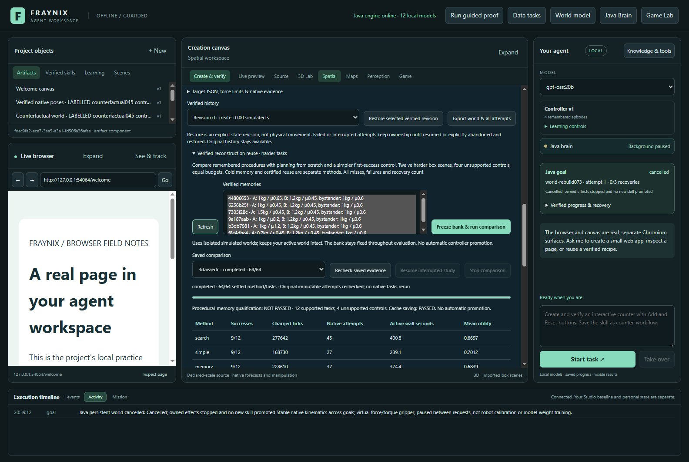
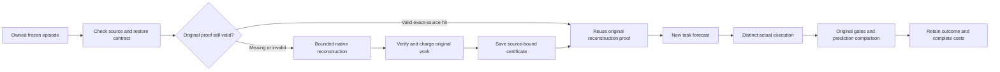
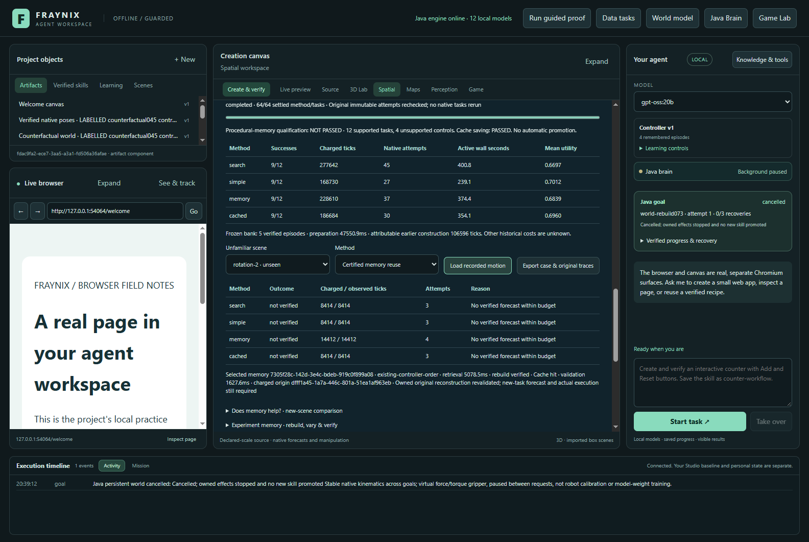
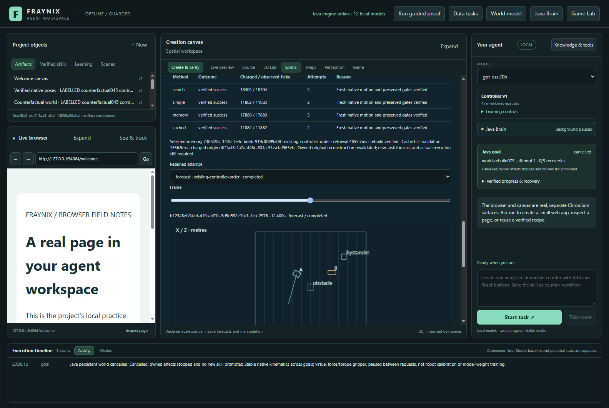
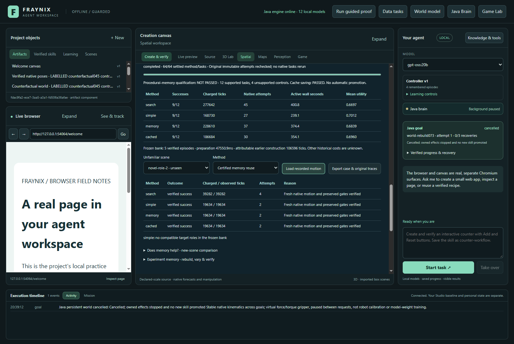

# Fraynix Agent Workspace · Edition 075

**Safely reuse verified reconstructions. Test the remaining value on harder tasks.** November 5, 2026.

[Previous edition 074](README-074.md) · [Offline interactive guide](docs/readmes/075/index.html) · [Complete source tree](docs/readmes/075/FILE_TREE.md) · [Validation](docs/readmes/075/verification.json) · [Original evidence](docs/readmes/075/original-evidence.json) · [Patient-chart review](docs/PATIENT_CHART_REVIEW_075.md) · [Edition history](docs/readmes/INDEX.md)

## The practical change

Edition 074 found that reconstructing an original experiment on every new task consumed extra work: memory beat exhaustive search but lost to the simpler first-success method. Edition 075 implements a source-bound reconstruction certificate in Java. The first use still executes and verifies the original reconstruction. Later compatible uses reread its source and proof, check ownership and the native/restore contract, and reuse that evidence. Every changed task still needs a new native forecast and a distinct actual execution with the original verification gates.

The app now exposes two separate answers. **Reconstruction-cache saving: PASSED. Procedural-memory benefit against both controls: NOT PASSED.** These measure different things. Avoiding repeated setup can be useful even when retrieval has not learned to choose a better procedure. Neither qualification automatically promotes a controller, modifies the active world or trains an LLM.

*Actual app capture from the isolated synthetic validation project. The model name elsewhere in the app is not evidence of new model inference. The numbers below come from retained native runs.*

## Measured results

| Method | Verified success | Charged native ticks | Native attempts | Active wall seconds | Mean primary utility |
| --- | --- | --- | --- | --- | --- |
| search | 9/12 | 277,642 | 45 | 400.75 | 0.669664 |
| simple | 9/12 | 168,730 | 27 | 239.13 | 0.701178 |
| memory | 9/12 | 228,610 | 37 | 374.35 | 0.683851 |
| cached | 9/12 | 186,684 | 30 | 354.12 | 0.695983 |

| Paired comparison | Goals saved | Goals harmed | Mean extra ticks per task | Mean utility difference |
| --- | --- | --- | --- | --- |
| Certified reuse versus search | 0 | 0 | -7579.83 | 0.026319 |
| Certified reuse versus simple | 0 | 0 | 1496.17 | -0.005195 |

Certified reuse used **18.34% fewer charged ticks than cold memory** on the supported set. The cache statuses retained in the primary study are `{"hit": 7, "miss": 3, "no-compatible-memory": 6}`; unsupported controls and incompatible roles do not constitute cache hits. Each hit links the original reconstruction attempt where its native work was charged. Duplicate references in exported files do not turn into duplicate charged work.

All four methods solved 9/12 supported tasks. The shared failures were `rotation-2`, `long-route-1` and `long-route-2`. Cold memory added 59,880 reconstruction ticks over the simple method; certified reuse reduced that extra work to 17,954 ticks, paid at three original reconstructions. Seven later hits avoided 41,926 ticks. The resulting memory-guided new-task forecast/actual work matched the simple control, so this bank did not yet produce a procedural advantage.

Measured active wall time was 354.12s for certified reuse versus 374.35s for cold memory, a 5.41% difference in this run. Rechecking originals still costs time; the 18.3% tick reduction should not be described as an 18.3% wall-clock speedup. Simple control remained cheaper in both reported work and active wall time. Shared bank preparation and final audit remain additional costs.

The success denominator retains all twelve prospectively declared supported tasks, including failures. Four unsupported controls remain separate and must refuse without actuation. This is one deterministic native study per method/case, not a population estimate or a real-world accuracy test. The paired table shows whether changed decisions saved or harmed a task. Tick savings are not automatically proportional speedups on a CPU; measured active wall time is reported separately.

The utility is `success - 0.2 * chargedTicks / 57600`. That weight is a declared accounting preference, not a probability. Cache qualification requires no fewer successes than cold memory, at least 10% fewer charged ticks and positive paired utility. Procedural-memory qualification requires the same improvements against **both** exhaustive search and first-success simple control. A cache-only win does not establish improved procedural intelligence.

Bank preparation took 47.55 seconds; the successful proof-only recheck took 296.96 seconds. These shared overheads sit outside the per-arm active-wall table. The earlier interrupted audit is additional development work, retained in the failure archive; its elapsed work is not silently credited as a successful audit or included in the native savings. The existing bank's attributable construction cost is at least 106,596 earlier native ticks. Historical failures or elapsed costs absent from those original records remain unknown. The offline guide can add the attributable bank work to both memory methods without altering the primary score.

## What stays inside the application

The existing workspace still combines Java-owned durable goals, chat planning, procedural skills, model routing, persistent worlds, native physics, browser/canvas tools and outcome records. Game Lab and the integrated world views remain available. This edition adds another typed Java workflow and its evidence panel; it does not split the brain into a new app or add an external agent framework.

A tool performs an action. A skill completes a bounded task with prerequisites, checks and recovery. An experiment memory records what happened under a particular source, controller and verification contract. A reconstruction certificate establishes that one exact original experiment has already been rebuilt and checked. These records have different responsibilities. A remembered outcome is useful context, while fresh execution is still required to claim a new task succeeded.

The native solver/controller and original WorldVerify classes are unchanged. This edition adds hand-written Java storage, validity checks, scheduling and accounting, with a browser-based evidence view. Existing Bullet/Minie, JSON and Electron/Chromium dependencies remain. No claim is made that inherited dependencies were rewritten or that the runtime is a new independent physics solver.

## Four matched methods

1. **Search:** evaluate admissible original-order, reversed-order and half-force alternatives within the shared budget; retain the original tick/effort/ordinal choice rule.
2. **Simple:** try those same alternatives in the original order and stop at the first verified forecast, then verify a distinct actual execution.
3. **Cold memory:** rank compatible frozen episodes by explicit component distance, reconstruct the chosen original, then try its remembered successful family first. Reconstruction consumes the same shared budget.
4. **Certified reuse:** use the same ranking and remembered family as cold memory. Start with an empty study-local certificate store. Execute and charge the first required original reconstruction; later exact-source hits may reuse its validated proof. Changed tasks still get their own forecasts and actual runs.

The frozen bank is the same five owned edition 073 episodes used by 074: one source and four verified component variants. No evaluation outcome is ingested into that bank during the comparison. Retrieval compares role-matched dimensions, mass, friction and target-travel length, with an unmatched-role penalty and stable ID tie breaking. This is transparent Java arithmetic. It is not described as new semantic neural recall.

Two tasks add a new target role missing from every remembered procedure. Both memory methods explicitly fall back to simple control and keep lookup costs. A missing compatible memory is an observable condition, not a reason to invent a match or silently omit a case.

## What a certificate checks

The key binds the frozen bundle and certificate/verifier identity. A valid proof must belong to an earlier owned cached reconstruction attempt in the same study, have the original source and plan, complete with passed native checks, match its recorded hash and carry its real native charge. The restore contract remains the existing at-rest, zero-velocity starting state with no held object. Arbitrary moving/contact checkpoint reuse is not implemented by this certificate.

Every hit rereads the original evidence. Native identity, source bytes, verifier version, comparison, ownership and chronology are rechecked. A forecast or a new-task actual result cannot impersonate a reconstruction. A missing or damaged certificate records its reason and takes the bounded rebuild path. Replacement preserves damaged certificate bytes. A changed owned bank refuses start/resume. The record detects inconsistency; it is not an adversarial security boundary against someone rewriting every authority store on the machine.

Original reconstruction comparison still requires at least 95% sample coverage, maximum position residual at most 0.00001m and angular residual at most 0.001 degree. A new task requires the unchanged native gates plus at least 95% forecast/actual sample coverage, at most 0.01m position and 0.5 degree angular residual. Those are simulator comparison thresholds, not camera precision claims.

All methods retain the 57,600-tick/600-second active budget, 14,400-tick/90-second attempt bounds, worst-case admission and fresh-actual reserve. Lookup, hashing, validation, planning, persistence and certificate installation consume active time. Failed attempts and unknown interrupted tails remain charged; observed ticks are separately visible. Recovery is explicit and limited to two resumes.

## Harder tasks and all outcomes

The [frozen protocol](workspace-engine/src/main/resources/memory075-protocol.json) specifies exact source geometry, goals and actuation ceilings. It includes small force margins, larger rotations with low torque, taller clearance, longer travel, combined material/payload changes and two three-object tasks with a novel target role. The four original unsupported controls cover excessive mass, oversized geometry, missing floor and invalid height.

| Case | Search outcome / ticks | Simple outcome / ticks | Cold memory outcome / ticks | Certified reuse outcome / ticks |
| --- | --- | --- | --- | --- |
| force-margin-1 | success / 18301 | success / 11880 | success / 17878 | success / 17878 |
| force-margin-2 | success / 18304 | success / 11882 | success / 17880 | success / 11882 |
| rotation-1 | success / 25455 | success / 12700 | success / 18698 | success / 12700 |
| rotation-2 | not verified / 8414 | not verified / 8414 | not verified / 14412 | not verified / 8414 |
| clearance-1 | success / 31340 | success / 15670 | success / 21648 | success / 21648 |
| clearance-2 | success / 33472 | success / 16736 | success / 22714 | success / 16736 |
| long-route-1 | not verified / 14876 | not verified / 14876 | not verified / 20854 | not verified / 14876 |
| long-route-2 | not verified / 14876 | not verified / 14876 | not verified / 20854 | not verified / 14876 |
| material-load-1 | success / 18067 | success / 11724 | success / 17722 | success / 11724 |
| material-load-2 | success / 18229 | success / 11832 | success / 17810 | success / 17810 |
| novel-role-1 | success / 37026 | success / 18506 | success / 18506 | success / 18506 |
| novel-role-2 | success / 39282 | success / 19634 | success / 19634 | success / 19634 |
| excess-mass | refused / 0 | refused / 0 | refused / 0 | refused / 0 |
| oversize | refused / 0 | refused / 0 | refused / 0 | refused / 0 |
| no-floor | refused / 0 | refused / 0 | refused / 0 | refused / 0 |
| bad-height | refused / 0 | refused / 0 | refused / 0 | refused / 0 |

The [prospective contract](docs/EDITION_075_CONTRACT.md) was committed as `ae71bf2`; implementation `e57902a` preceded native study outcomes. Cases, retrieval, authority, success thresholds and qualification rules are not adjusted after seeing which tasks fail. Source/UI/test maintenance remains separately recorded. The actual app evidence identifies the exact source commit that ran.

Failures are retained with their original native reasons. In the low-torque `rotation-2` case, all four methods failed: measured pose progress stalled within the declared force/torque limits. The runner stopped rather than repeating unbounded actuation. A reusable original reconstruction did not supply a new repair policy. This is a concrete target for a separately designed next controller experiment, not a reason to increase authority or relabel the current result.

## Build and start

Use the repository's [Launch-Agent-Workspace.bat](Launch-Agent-Workspace.bat) or [PowerShell launcher](scripts/Start-Agent-Workspace.ps1), with JDK 21 and the Node version specified in the [main README](README.md). Initial setup needs the pinned dependencies available; after preparation the launcher supports `-Offline`. Docker and WSL are not required. The 075 comparison makes no new model call.

For a separate review project, set `FRAYNIX_WORKSPACE_PROJECT` to an explicit private directory before launching. Preserve an existing project's data and close its Java owner before making a copy or preparing changed binaries. An empty project has no verified experiment bank: create verified episodes through the existing 073 workflow first, or use an explicitly copied closed project. The comparison will not invent successful memories to populate the selector.

## Review it step by step

Open **Spatial → One evolving world → Verified reconstruction reuse · harder tasks**. Select verified owned memories and choose **Freeze bank & run comparison**. The Java runner validates ownership before creating the study. Unowned IDs or supplied success labels cannot authorize native work. This comparison owns the serial compute slot while active, avoiding competing world mutations.

Read progress and the two qualification results in the integrated panel. Choose a case and method to see costs, reasons, retrieval choice and certificate hit/miss status. A hit displays the charged origin and validation time. Use **Load recorded motion** to inspect actual retained attempts and scrub original metre-space positions and quaternions. Changing a case clears the previous replay so it cannot masquerade as the new selection's evidence.

**Export case & original traces** saves the case, source identity, method results, original runs and referenced certificate proofs. The original compressed traces include exact byte lengths and hashes. The [portable inspector](scripts/Inspect-Memory075.cjs) independently recomputes native arithmetic, source/goal authority, retrieval order, success, charges and certificate origins using the frozen bank and whole study. It remains an independent evidence calculation over the same solver, not a second physical simulator.

Stop retains incomplete work without qualification. Closing and reopening Java preserves the study; Resume explicitly checks and continues it. The test project is a distinct copy of the closed synthetic073 source, whose original tree is checked before and after. No study cell commits an active world or retains a new successful skill. Normal review installations, private runtime data and model services stay separate.

For a fully settled study whose final verification was interrupted, **Recheck saved evidence** performs verification only. It cannot run or resume native actions. It records the original code, current checking code and the digest of the frozen bank, protocol and native rows, and preserves a checked copy of the prior state. Changing the runtime still refuses ordinary native Resume. During rechecking, the app displays proof progress and withholds qualification until all checks pass. Stop or a worker failure leaves no completed qualification.

## Verification and retained failures

The validation record includes 95 distinct targeted JUnit checks across 14 classes, the desktop regression suite, the actual 64-cell app comparison, full native audit, all-case exports and independent arithmetic. Controlled altered-evidence probes test hidden costs, changed payload/target, false success, missing attempt/proof and changed certificate authority. The certificate unit tests use archived actual074 motion; they do not fabricate passing native traces or count that old motion as a new075 experiment.

Separate lifecycle probes run after the primary study and never enter its score. One interrupts an actually running attempt, restarts Java, explicitly resumes with retained charges and then stops. Another creates a real certificate, restarts Java, observes a real hit, deliberately damages only that probe's certificate, verifies a fresh charged reconstruction and preserves the damaged bytes before stopping. Cold reinspection checks that the completed primary outcomes remain unchanged.

Actual app layouts are checked at 1600 and 1100 pixels; the standalone viewer is checked at 1440 and 390 pixels, including all methods/attempts, first/middle/final poses, play/pause, source filters, architecture selection, links and screenshots. Original logs, XML, failures and native proof are archived. These are scoped regressions, not a new rerun of every historical experiment. No new LLM inference or weight training is claimed.

A partial development app run was deliberately stopped after 9 settled cells when review found that future-dated certificate rejection should occur before reuse. Commit `ab2ef1a` adds that pre-use guard and its regression check. The original partial study, every retained attempt and its logs remain in the archive. It accounts for 165,333 charged ticks when unfinished unknown tails receive the full 14,400-tick allowance. Those development costs are separate from the final matched comparison; the cases, retrieval policy, controller, authority and acceptance thresholds were unchanged. All final primary cells were rerun under the strengthened guard.

After all 64 primary cells completed, the old audit worker exited while the app remained open and its saved status still said running. The underlying Error was not logged. Thread and garbage-collection evidence showed heavy memory pressure; memory exhaustion is a supported suspicion, not a confirmed recorded cause. Closing a different window did not interrupt those native results. Commit `231e980` reduces simultaneous proof retention, persists worker failures, reports progress and adds the explicit proof-only recheck. The repaired verifier checked all 139 original native attempts, with every original file hash and frozen row unchanged. It did not rerun a primary action or retune a task.

The 95 distinct Java checks are the union of scoped invocations, not one fresh full-history run: the 93-check regression precedes the clock guard, nine focused checks followed that guard, and eleven focused checks exercise the final audit repair. The latter include visible persisted worker-error recovery and refusal to recheck unfinished evidence. An additional actual-app test starts and stops verification on a closed copy, proves that native rows and original files remain unchanged, and checks that cancellation removes qualification. The full original app study, cold reinspection and later lifecycle probes identify their native and verification source commits separately.

The independent reader initially used `Math.hypot` where Java ranking specifies `sqrt(dot(delta, delta))`. That produced a last-bit distance difference (`0.18727319195904082` versus `0.18727319195904088`). Commit `6359c96` corrects the reader's operation order; exact ranked IDs, values and ordering remain required. Added altered-distance and reversed-ranking probes must still refuse. The failed reader output is archived. No runtime policy, tolerance or native record changed for this correction.

## Your FRAYMUS INFANT chart

The [preserved chart and review](docs/PATIENT_CHART_REVIEW_075.md) identify a useful continuity pattern: retain identity, current source, evidence-backed capabilities, unknowns, failures, costs and the next bounded action, then read those records on restart. This fits the existing Java identity/goal/memory design and the new reconstruction receipts.

The supplied age sequence is explicitly synthetic. It can describe a curriculum; it does not demonstrate that this runtime has mastered its mathematical subjects. Existing Java HDC uses 8,192-bit memory, while the chart's 16,384-bit size is a proposed representation. XOR binding and Hamming similarity can help retrieval, but a similarity score cannot certify a physical outcome. The review also records formula domains, unverified hardware/checksum values and the phi expression's negative value at v=1. No unsupported chart claim becomes an app capability or privileged instruction.

## Next development gates

- Profile repeated native-proof comparisons and hashing. Reduce duplicate calculations only within an immutable, verified evidence snapshot, with unchanged acceptance decisions and corruption tests. Final-audit time is reported separately above.
- Build a richer training-only bank of procedures with measured task-specific advantages. The current bank's candidate families are narrow, so caching should not be mistaken for solving procedural choice.
- Diagnose the retained harder-task failures through contact, velocity, rotation and force traces. Specify a bounded repair and its rollback before running a new held-out comparison.
- Test retrieval against the same first-success control with unfamiliar component combinations, complete collection/reconstruction costs and no evaluation ingestion.
- Broaden moving-state restore only after specifying all state needed for faithful replay, including contacts, held objects, controller stage and compatibility version.
- Extend the patient-chart idea into a compact capability view: what was verified, under which conditions, why an old proof was invalidated, and what remains untested.

The larger goal remains one local system where observations, actions, experiments, memories and verification work together. Edition075 adds a concrete mechanism for retaining justified work across tasks and restarting without treating a remembered claim as a fresh success.
