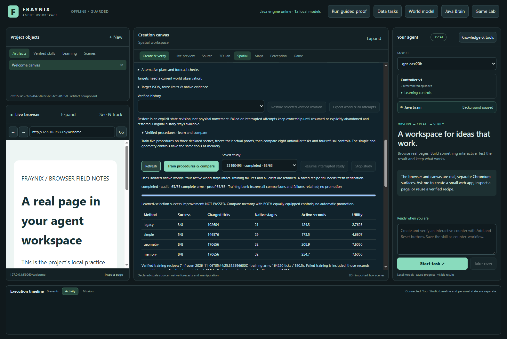
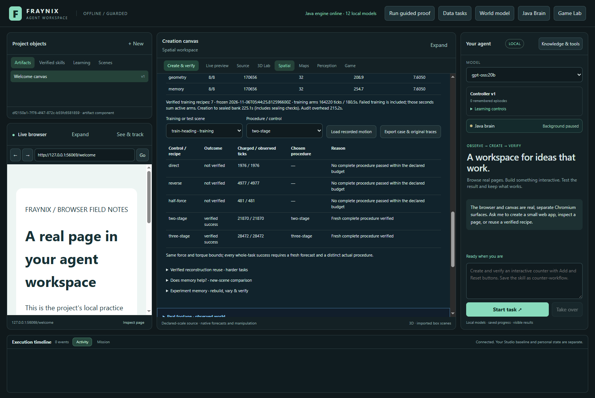
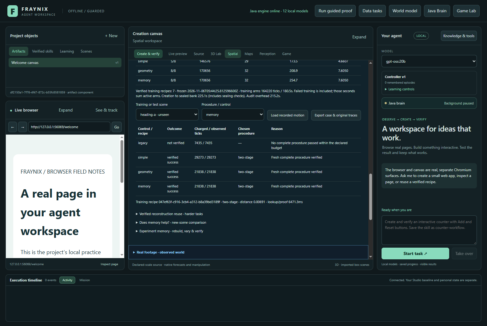
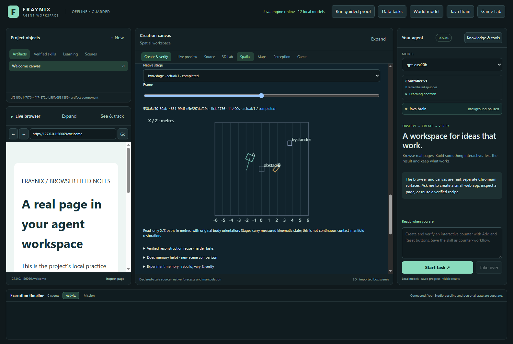

# Fraynix Agent Workspace · Edition 076

**Varied verified procedures, measured against equally equipped simple controls.** November 5, 2026.

[Previous edition 075](README-075.md) · [Offline interactive guide](docs/readmes/076/index.html) · [Complete source tree](docs/readmes/076/FILE_TREE.md) · [Validation](docs/readmes/076/verification.json) · [Original evidence](docs/readmes/076/original-evidence.json) · [Frozen contract](docs/EDITION_076_CONTRACT.md) · [Edition history](docs/readmes/INDEX.md)

## What changed

Edition 075 demonstrated that an exact reconstruction certificate could avoid repeated setup work. It did not establish better procedural decisions: the remembered alternatives largely selected the same control that a simpler method would choose. Edition 076 adds a genuinely executable repertoire of five typed Java procedures and tests whether their verified training outcomes improve success on unfamiliar arrangements.

The new procedures include two-stage and three-stage tasks. A stage is a complete native arrangement, ending only after the original pose, speed, force and protected-body checks. The next stage starts from the measured positions, rotations, linear velocities, angular velocities and elapsed ticks. It does not pretend the objects stopped perfectly or write them directly to the next target. A whole-task forecast must be followed by a distinct actual execution from the original starting frame before the procedure can enter the training bank.

The app now contains **7 verified training receipts** from this study, covering **direct, reverse, three-stage, two-stage**. These are saved, versioned procedures with original native evidence. They are separate from the existing general skill registry and are not automatically promoted into arbitrary active-world execution. The integrated comparison is functional: it trains, freezes, retrieves, executes, verifies, survives restart, displays motion and exports originals.

*Actual dated capture of the isolated validation app. The model selector elsewhere in the interface is not evidence of new LLM inference. All reported motions below come from retained native physics runs.*

## The measured answer

**Learned-selection success improvement: NOT PASSED.** The primary qualification requires more successes than both equally equipped controls, no harmed cases against either and positive paired utility. A better repertoire than the older control is useful, but does not by itself demonstrate that memory selects better than simple geometry.

| Method | Verified successes | Charged ticks | Native stages | Active wall seconds | Primary utility |
| --- | --- | --- | --- | --- | --- |
| legacy | 3/8 | 102,604 | 21 | 124.28 | 2.762491 |
| simple | 5/8 | 146,576 | 29 | 173.51 | 4.660704 |
| geometry | 8/8 | 170,656 | 32 | 208.94 | 7.604963 |
| memory | 8/8 | 170,656 | 32 | 254.73 | 7.604963 |

Memory and the geometry control both solved 8/8 tasks. Simple control solved 5/8; legacy solved 3/8. Memory and geometry used exactly the same charged native work. Memory took 21.91% longer in measured active wall time; retrieval therefore adds proof/lookup overhead without a measured selection advantage on this set.

| Paired comparison | Tasks saved | Tasks harmed | Extra native ticks | Utility difference |
| --- | --- | --- | --- | --- |
| Memory versus legacy | 5 | 0 | 68,052 | 4.842472 |
| Memory versus simple | 3 | 0 | 24,080 | 2.944259 |
| Memory versus geometry | 0 | 0 | 0 | 0.000000 |

Training consumed **164,220 native ticks** and **180.51 summed per-arm active seconds**, including failures. Elapsed time from study creation to the sealed bank was **225.13 seconds** by the recorded timestamps; that additionally includes bank-proof auditing, storage and scheduling outside individual arms. The final original-proof audit took **215.22 seconds**. Memory's new-task work plus the complete training bill is **334,876 ticks**, or **41859.50 per unfamiliar supported task** for this single batch. The offline chart can include that training bill. The simple and geometry methods use the same hand-written procedures without performing retrieval or training-proof validation.

Work means charged simulated ticks, not GPU operations, wall-clock speed or electricity. Active wall time includes scheduling, lookup, planning, native execution, verification and storage within each arm. Bank-freeze work outside the individual training arms, final audit and separate development/recovery tests are additional overheads; the creation-to-freeze elapsed time is reported above. Recorded elapsed timestamps are not CPU time. This is one deterministic run per method and case, not a population confidence estimate. No outcome or threshold was tuned after the primary results.

## Four controls with a fair comparison

The **legacy** control tries direct, reversed order and half force, stopping at the first whole-task success. This preserves the prior three-alternative baseline. The **simple** control has all five procedures and tries them in a fixed order. The **geometry** control also has all five, choosing three stages first for travel greater than eight metres, otherwise two stages for a shortest yaw change greater than 130 degrees, otherwise direct. Those rules were committed before any new native outcome.

The **memory** control ranks only verified training receipts by declared components: matching target roles, size, mass, friction, requested travel and yaw, plus force and torque ceilings. Equal distances prefer lower measured training work, then stable receipt identity. It revalidates the selected original proof before trying the same recipe on the new task. If the target roles are incompatible, it explicitly falls back to fixed-order simple control and retains the lookup cost. It never matches on a hidden test-case label or learns from evaluation outcomes.

Giving memory more tools than the baseline would confound the comparison. Here simple, geometry and memory have the same repertoire, budgets, force limits and checks. Improvements over legacy measure repertoire value; improvements over simple and geometry measure the extra value of learned selection. Both answers are reported even when the stronger qualification fails.

The declared utility is `success - 0.2 × chargedTicks / 86400`, summed over eight supported cases. It is an accounting preference, not a probability. A cheaper tie alone cannot pass the learned-success gate. The four unsupported controls must all refuse with zero actuation; their exclusions from the eight-case denominator are explicit and their full records remain available.

## What training actually retained

| Training scene | Direct | Reverse | Half force | Two-stage | Three-stage |
| --- | --- | --- | --- | --- | --- |
| train-short | verified / 11308 | verified / 11308 | not verified / 481 | verified / 17498 | verified / 23438 |
| train-heading | not verified / 1976 | not verified / 4977 | not verified / 481 | verified / 21870 | verified / 28472 |
| train-distance | not verified / 3924 | not verified / 6863 | not verified / 3924 | not verified / 0 | verified / 27700 |

Each table cell shows outcome and charged ticks. Every recipe was attempted on each of the three declared sources. Failed forecasts, refused plans and consumed work remain recorded. Only a complete forecast and separate successful actual procedure create a receipt. The bank was frozen at `2026-11-06T05:44:25.812596600Z` before any evaluation attempt.

The large-heading training scene illustrates why composition matters. The original direct alternatives stalled under the same declared torque ceiling, while staged procedures completed the arrangement. Their intermediate goals reduced the required change per native stage without increasing force or erasing measured motion. The long-travel scene also exposes a constraint: an equal-fraction intermediate target can collide with existing geometry. The conservative planner must refuse such a stage; interpolation is not a universal route planner.

A receipt records the training source, family/version, costs, owned study and arm, native/verifier identity, exact proof hash and all stage lineage. Hashes detect changed bytes; they are not cryptographic signatures proving an adversarially controlled machine trustworthy. Source ownership and actual native verification remain necessary. Imported text cannot install a handler or mark a procedure successful.

## Every unfamiliar case stays in the result

| Case | Legacy | Simple | Geometry | Memory |
| --- | --- | --- | --- | --- |
| heading-a | not verified / 7435 | success / 29273 | success / 21838 | success / 21838 |
| heading-b | not verified / 7435 | success / 29569 | success / 22134 | success / 22134 |
| distance-a | not verified / 14765 | not verified / 14765 | success / 27902 | success / 27902 |
| distance-b | not verified / 14603 | not verified / 14603 | success / 27850 | success / 27850 |
| combined | not verified / 15932 | not verified / 15932 | success / 28498 | success / 28498 |
| short-a | success / 11416 | success / 11416 | success / 11416 | success / 11416 |
| short-b | success / 11676 | success / 11676 | success / 11676 | success / 11676 |
| novel-role | success / 19342 | success / 19342 | success / 19342 | success / 19342 |
| excess-mass | refused / 0 | refused / 0 | refused / 0 | refused / 0 |
| oversize | refused / 0 | refused / 0 | refused / 0 | refused / 0 |
| no-floor | refused / 0 | refused / 0 | refused / 0 | refused / 0 |
| bad-height | refused / 0 | refused / 0 | refused / 0 | refused / 0 |

The cases vary heading, distance, combined demands, payload, friction and target-role compatibility. They remain in the same declared upright-box task family. The four unsupported controls cover excessive mass, oversized geometry, missing floor and invalid target height. A refusal is a useful boundary check, not a secretly completed task.

## How measured stages connect

```mermaid
flowchart LR
    A[Declared training source] --> B[Typed Java procedure]
    B --> C[Native forecast stages]
    C --> D[Distinct actual stages]
    D --> E[Original checks and full-task verification]
    E --> F[Frozen owned receipt]
    F --> G[Component-based retrieval]
    G --> H[Unfamiliar task with fresh execution]
    H --> I[Compare against matched simple controls]
    I --> J[Retain outcomes, costs and replay]
```

Intermediate targets are derived from the original source and requested endpoint, not repeatedly interpolated from a drifting current estimate. Translation uses equal fractions. Rotation uses the shortest yaw path, including the wrap across ±180 degrees. The final stage retains the exact requested targets. Two-stage and three-stage procedures remain separate typed recipes, not arbitrary executable text emitted by an LLM.

After each successful stage, `WorldFrames.after` preserves all dynamic bodies, their stable IDs, original geometry and accumulated time. The next fresh native world initializes from that exact measured frame. This is a **kinematic cold handoff**: solver contact manifolds and hidden integrator state are not restored continuously. The native initialization checks bound any numeric conversion error in positions, orientations and velocities. The UI and documentation name this limitation directly.

Each native stage still uses the original `WorldPlan`, `WorldPhysics` and `WorldVerify`. Completed stages cannot silently bypass their original release, target, inactive-body, force, torque or speed gates. Whole-task final targets require position error at most 0.1 m, orientation error at most 5 degrees, speed at most 0.2 m/s and angular speed at most 0.2 rad/s. Non-target bodies are additionally checked against the original whole-task positions and rotations at **every integrated tick**, not merely the displayed samples or a new anchor at each stage.

Forecast and actual programs start independently from the same initial frame. Each actual stage must match its forecast's exact source and plan, with at least 95% sample coverage and at most 0.01 m positional and 0.5-degree orientation residual. A stored forecast cannot be relabelled as the actual run. An observed success cannot be credited before its complete verification chain is present.

## Bounds, recovery and costs

Each arm has an 86,400-tick and 900-active-second ceiling. Every native stage retains its original 14,400-tick and 90-wall-second bounds. Before a candidate begins, the runner reserves the worst-case work for all of its forecast and actual stages. It checks the remaining reserve again before each stage. This makes ordering consequential: after spending work on failed candidates, a six-run three-stage forecast/actual program may no longer fit. The refusal and unused capacity remain visible rather than borrowing beyond the common budget. In particular, the two unfamiliar long-distance cases succeeded with memory and geometry-first ordering, while fixed-order control spent work on earlier failed alternatives and could no longer reserve the full three-stage worst case. That is a benefit of ordering under this prospective reservation rule, not evidence that the fixed-order method consumed all86,400 ticks or that memory has discovered a new physics law.

A failed stage stops that program. A later candidate begins again at the original source, retaining the earlier failure and cost. Stop cannot qualify unfinished work. An interrupted native tail is conservatively charged the full 14,400 ticks when its completion is unknown. Explicit Resume retains settled stages and histories and is limited to two resumptions. Recovery is tested separately from the primary comparison so its probe does not inflate or improve the reported score.

All study worlds are isolated. No procedure is automatically applied to an active user world, promoted to a global controller or ingested as evaluation training. Existing persistent-world commits still require their own authority and fresh checks. The study demonstrates verified reusable procedure selection within a bounded task family; broader chat-directed execution remains a subsequent integration gate.

## Review the app, step by step

1. Start the Java-backed workspace using the existing launch instructions in the [entry README](README.md). Keep an existing private project's ownership separate from a new test project.
2. Open **Spatial**, expand the persistent-world section, then **Verified procedures · learn and compare**.
3. Use **Train procedures & compare** to run a new isolated study. Progress counts fifteen training arms plus forty-eight evaluation arms. The app refuses other compute mutations while this serial study owns execution.
4. Watch the training phase, bank freeze, unfamiliar-case comparison and original-proof audit. A running or interrupted job has no improvement claim. **Stop study** preserves its work; **Resume interrupted study** resumes only compatible code and protocol.
5. Choose a training or test scene and a procedure/control. Inspect successes, failures, charged and observed ticks, chosen procedure and retrieval evidence.
6. Use **Load recorded motion**, select a native stage and move the frame slider. Changing case or method clears the previous replay identity. Replay is a read-only view.
7. Use **Export case & original traces** after the study settles. Exported packets contain original native traces and checksums, source/plan declarations, attempt metadata, bank and procedure outcomes. They do not grant execution authority.
8. Restart the app and select the saved study. Verified recipes, results and proof identities remain available; cold verification is part of this release's recorded tests.

The companion [offline guide](docs/readmes/076/index.html) provides training and test selectors, all methods, stage replay, cost charts, a training-cost toggle, module links, screenshots and searchable source inventory. Its displayed motion is sampled to at most 240 retained frames per stage for a smaller offline page. Exact unabridged traces and all integrated ticks remain in the original exports. The viewer does not synthesize missing motion or operate the application.

## Validation and retained development failures

The primary comparison retained **151 native stage attempts**, including failures. The release records **106 distinct targeted Java checks across 16 classes**, **127 desktop checks**, the actual 63-arm app comparison, full original-proof audit after cold restart, export/replay checks, separate interruption/resume/Stop, and damaged-bank refusal. Independent inspection recomputes native displacement, force/torque authority, stage handoffs, final outcomes, retrieval order and charged costs. **20 altered-evidence probes** verify that false sources, missing originals, substituted stages, erased carried motion, changed authority, costs, ranking or success labels are rejected. Validation scope and exact invocation records are in [verification.json](docs/readmes/076/verification.json).

The first compile failed on a Java parameter-type error, then passed after correction. The first app study stopped after 3 settled training arms because the inherited edition073 reconstruction comparison deliberately accepts only initial-at-rest scenes. A later actual stage correctly retained velocity, so that older contract refused it. The repair added a separate edition076 comparison with exact source/plan equality and original native verification; the edition073 restriction remains unchanged. A real four-run test verifies two forecast stages and two independently executed actual stages, including nonzero velocity carried into stage two. A separate boundary test catches a bystander moving out of bounds and back between displayed frames.

That partial study retains 9 native attempts and 40,595 charged ticks, with unknown tails charged conservatively where needed. It is development evidence, not part of the primary score. The complete primary study restarted from a new empty project after correction `6530e9b`; the frozen cases, thresholds, controls and budget were unchanged. The completed primary study also exposed two test-harness assumptions: it read the first export manifest before asynchronous creation, then compared a restart-updated timestamp as immutable data. The harness now waits for actual file creation and compares every retained outcome field while excluding only the ordinary last-opened timestamp. Its original failures are archived; primary motion was not rerun. No performance tuning followed the primary outcomes. Tests ran serially with Java21, four CPUs and a 768MB heap; installed jars were not replaced while their app was alive.

## Current architecture and practical value

The application remains one local workspace with Java-owned goals, chat planning, skill scheduling, persistent worlds, experiment histories, model routing and verification. The desktop hosts the browser, creation canvas, integrated views and input. The existing Game Lab remains a runtime and visualization surface. These responsibilities let an agent observe state, propose action, execute bounded alternatives, inspect actual motion and retain a procedure whose success is traceable to evidence.

This edition adds handwritten Java composition, receipts, selection, budgets and verification around the existing solver. Existing Bullet/Minie, JSON and Electron/Chromium dependencies remain; they have not been rewritten or hidden behind a pure-Java claim. The new logic has no added external framework. Nor does a versioned bank constitute LLM weight training, semantic understanding of an arbitrary photograph or unrestricted self-improvement.

The useful advance is inspectable task knowledge: a procedure can encode a multi-step way of working, preserve the actual state between steps and be reused only when its original proof is valid. The app's live processes and evidence provide content for evaluation. More elaborate intelligence should earn its place by improving a complete task against a simpler alternative.

## Next steps and acceptance gates

- **Separate repertoire value from selection value.** Keep the current result intact. Freeze a new task set before changing retrieval or geometry rules; require more useful successes, no hidden harmed cases and all training/validation work included.
- **Use failure traces for better intermediate goals.** Equal-fraction staging can place a target on an obstacle. A subsequent typed procedure could choose a verified clear waypoint using the owned geometry logic, with conservative clearance checks and no extra force allowance.
- **Make memory selective and cheaper.** Profile repeated proof reads and component ranking. Any cache must bind source, code, restore contract and original evidence, and still require fresh execution on a changed task.
- **Connect the proven repertoire to durable goals.** Let chat request a supported procedure through Java's existing typed routing, with explicit scope, task-specific checks, interruption recovery and active-world commit verification. Do not expose a comparison success as permission to execute arbitrary code.
- **Expand only after the boundary is measured.** Continuous contact-state restoration, interacting or non-upright bodies, richer geometry and physical-camera grounding need their own tests. Synthetic native success does not establish real-world calibration.

These are planned gates, not claims that the features already exist. The complete current sources, original records and next-step reasoning are linked below.

## Sources and continuity

[Typed procedures](workspace-engine/src/main/java/fraymus/workspace/Procedure076.java) · [Java study runner](workspace-engine/src/main/java/fraymus/workspace/ProcedureStudy076.java) · [Frozen protocol](workspace-engine/src/main/resources/procedures076-protocol.json) · [Integrated panel](workspace-desktop/renderer/procedures076.js) · [Independent inspector](scripts/Inspect-Procedures076.cjs) · [Actual integration test](workspace-desktop/test/procedures076-integration.cjs) · [Obsidian operation note](docs/obsidian/84-verified-procedures.md) · [System canvas](docs/obsidian/verified-procedures.canvas) · [Project memory](docs/PROJECT_MEMORY.md) · [Development log](docs/DEVELOPMENT_LOG.md).

Earlier numbered editions and their frozen assets remain unchanged. This edition's publication target is the existing private Fraynix-Agent-Workspace repository; the historical Chandra application remains separate.
