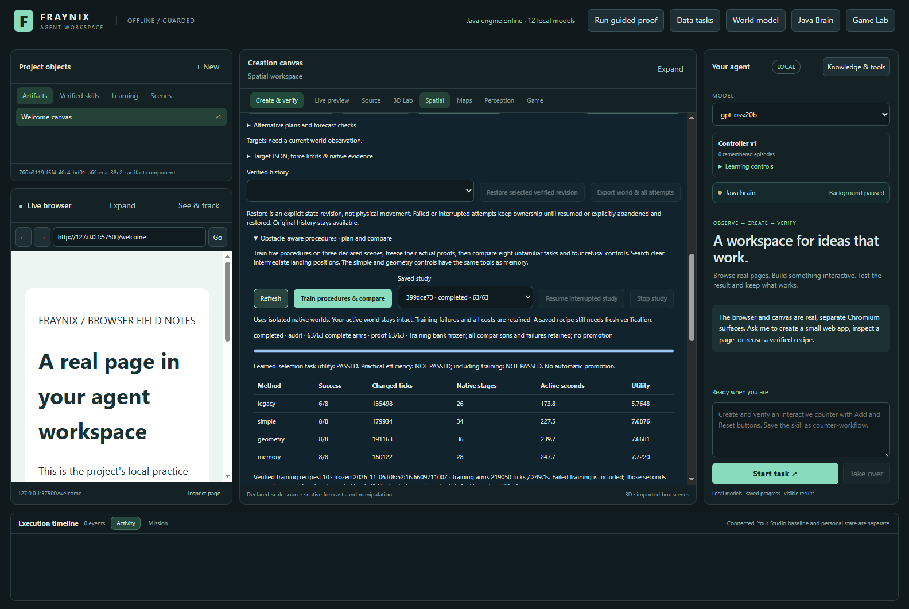
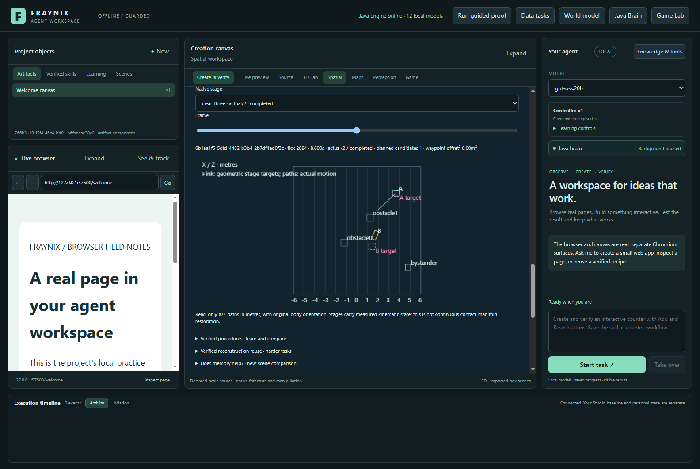
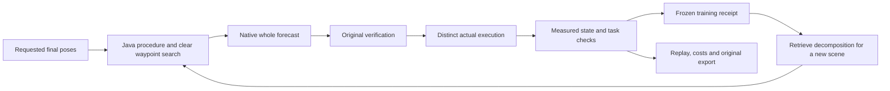
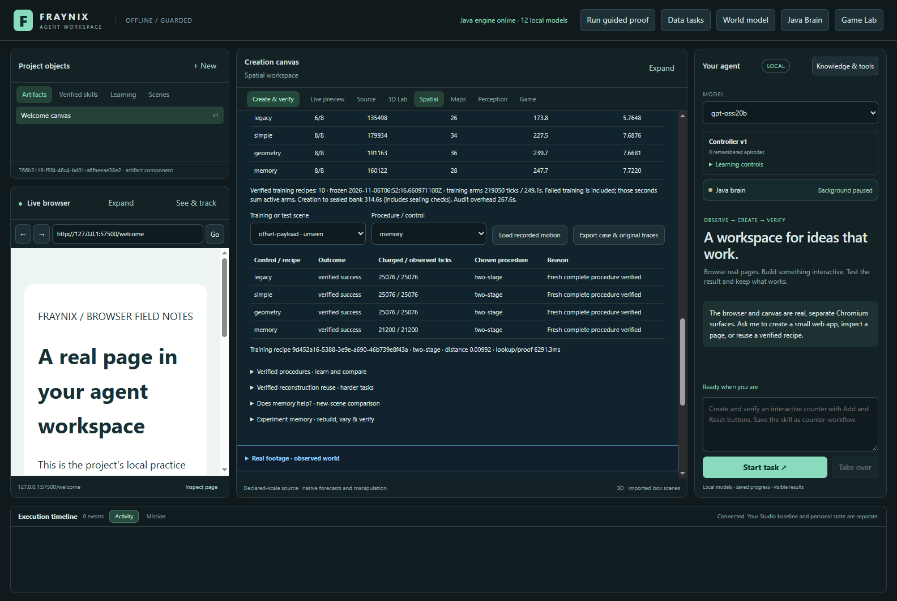
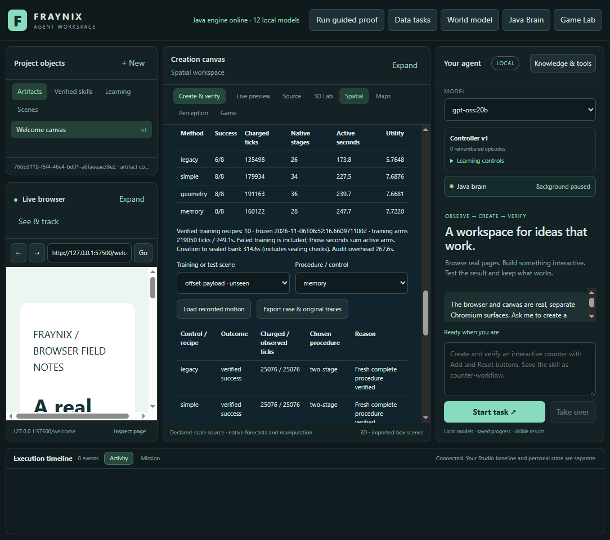

# Fraynix Agent Workspace · Edition 077

**Obstacle-aware intermediate targets, measured motion and a fair test of remembered procedures.** November 5, 2026.

[Previous edition 076](README-076.md) · [Offline interactive guide](docs/readmes/077/index.html) · [Complete source tree](docs/readmes/077/FILE_TREE.md) · [Validation](docs/readmes/077/verification.json) · [Exact original evidence](docs/readmes/077/original-evidence.json) · [Prospective contract](docs/EDITION_077_CONTRACT.md) · [Edition history](docs/readmes/INDEX.md)

## What this edition adds

Edition 076 showed that staged procedures can solve tasks that the older direct control misses. It also exposed two limits: equal fractions can place intermediate targets in occupied space, and memory did not beat the geometry baseline. Edition 077 addresses the first limit with a real Java clearance search and tests the second again on a separately declared task set.

The app now has five executable recipes: **direct, two-stage, three-stage, clearance-aware two-stage and clearance-aware three-stage**. The clearance-aware recipes look for unoccupied landing positions around the equal-fraction intermediate goals. They preserve final requested positions, shortest-path yaw fractions, original body identities and force/torque ceilings. A proposal cannot move an object or declare itself successful.

The retained training bank contains **10 verified receipts**, spanning **clear-three, clear-two, direct, three-stage, two-stage**. These receipts are owned by this isolated procedure study. They are not automatically installed into the general skill registry or exposed as unrestricted chat actions. The visible app runs training, freezes the bank, compares controls, restores saved progress, replays actual motion and exports original evidence. Those functions are implemented and exercised below.

*Actual capture of the edition 077 validation app. Its model selector is not evidence of a new language-model inference test. The trajectories in this study come from actual native physics execution.*

## Measured results

**Task-level memory utility: PASSED. Practical wall-time efficiency: NOT PASSED. First-batch efficiency including training: NOT PASSED.** These gates answer different questions. None automatically promotes a controller.

| Method | Verified successes | Charged ticks | Native stages | Active wall seconds | Utility |
| --- | --- | --- | --- | --- | --- |
| legacy | 6/8 | 135,498 | 26 | 173.85 | 5.764760 |
| simple | 8/8 | 179,934 | 34 | 227.49 | 7.687615 |
| geometry | 8/8 | 191,163 | 36 | 239.70 | 7.668120 |
| memory | 8/8 | 160,122 | 28 | 247.66 | 7.722010 |

Memory solved 8/8, simple 8/8, geometry 8/8 and legacy 6/8. Memory used 160,122 native ticks and 247.66 active seconds; geometry used 191,163 ticks and 239.70 seconds. These are the measured methods in this declared task family, not a claim of superiority to all simple controllers.

| Paired comparison | Tasks saved | Tasks harmed | Extra native ticks | Utility difference |
| --- | --- | --- | --- | --- |
| Memory versus legacy | 2 | 0 | 24,624 | 1.957250 |
| Memory versus simple | 0 | 0 | -19,812 | 0.034396 |
| Memory versus geometry | 0 | 0 | -31,041 | 0.053891 |

Training cost **219,050 ticks** and **249.06 summed active seconds**, including failed and refused recipes. The recorded elapsed time from study creation to bank sealing was **314.58 seconds**, which includes checks outside individual training arms. Final original-proof auditing took another **267.59 seconds**. Memory's evaluation work plus the whole training bill is **379,172 ticks** for this single batch of eight unfamiliar tasks. The offline chart can add that training bill to memory's displayed work.

Work is charged simulated ticks, not GPU operations or electrical consumption. Per-arm active wall time includes planning, retrieval, proof revalidation, native execution, verification and storage. Sealing and final audit remain additional reported overheads. These are one deterministic run per method and configuration; they do not establish population confidence or hardware-independent speed. Failed attempts remain in every total.

## How the waypoint search works

For each intermediate stage, Java first computes the original equal-fraction target for every selected body. It then considers that point and eight directions at each of two radii, one and two metres. Candidate positions must remain within the supported floor and pass the existing clearance rules. Combinations are explored by total squared displacement from the ideal, with a stable tie order and a maximum of 512 full-plan checks. The first complete plan accepted by the unchanged native planner is used. Exhausted search refuses; it does not relax a threshold or increase force.

The search considers the actual current arrangement, including static obstacles, dynamic targets and protected nearby bodies. Its conservative tests may refuse arrangements that a more sophisticated planner could solve. A finite search is deliberately not described as a complete path planner or proof of global optimality. The final stage uses the user's original targets without an offset.

Each search records its source-frame hash, candidate count, ideal targets, chosen targets, displacement and exact native plan. The integrated replay overlays stage targets in pink on measured motion. A stage target is a hypothesis; a plotted native trajectory is recorded execution. Keeping those distinct makes the system's reasoning inspectable without presenting a prediction as an observation.

This is **obstacle-aware landing within a lifted virtual-gripper task**. The underlying controller raises objects, translates and rotates them, lowers them and releases them. It can pass above low obstacles. This edition does not implement a ground vehicle navigating a maze, a physical robot gripper or arbitrary contact-rich manipulation. The terminology and evidence retain that scope.

## Why measured state matters

A completed stage produces the next exact kinematic frame: all body positions, rotations, linear velocities, angular velocities and elapsed ticks. It does not silently zero small residual motion or replace a measured position with the planned target. Original authored geometry and object identities stay attached to the frame.

The next native stage starts a cold contact solver. Persistent contact manifolds and warm-start impulses are not restored. This limitation is explicit; preserving kinematic state alone is not continuous restoration of every internal physics variable.

A complete forecast must be followed by a distinct actual whole procedure starting from the same original frame. Every stage must pass the original native lifecycle, wrench, endpoint, release and protected-body checks. Forecast and actual must cover at least 95% of corresponding samples, with position residual at most 0.01 m and rotation residual at most 0.5 degrees. Final task gates remain 0.1 m position, 5 degrees heading, 0.2 m/s linear speed and 0.2 rad/s angular speed. Protected-body drift is checked against the original whole-task state throughout integrated motion, rather than resetting the allowance at each stage.

## What the controls know

**Legacy** tries direct, equal two-stage and equal three-stage procedures in that order. It measures the value of adding the new clearance-aware repertoire. Here legacy denotes the existing equal-stage recipes; edition 076 used a different older baseline, so cross-edition counts are not a controlled improvement comparison. **Simple** gets all five recipes in fixed order and stops at the first verified task success.

**Geometry** also gets all five recipes. It previews their complete hypothetical intermediate arrangements and prefers the fewest-stage clear preview with no per-stage translation over 4 m or yaw change over 90 degrees. Equal-stage choices prefer lower waypoint deviation, then the fixed family order. If none qualifies, it uses fixed order. These rules were frozen before native outcomes. They are a declared conservative heuristic, not an optimized universal controller.

**Memory** ranks only verified training receipts using object-role compatibility, mass, friction, size, travel, yaw and force/torque limits, plus the fraction of occupied equal-fraction landing positions. Ties prefer lower measured training work, then a stable receipt identity. It rechecks the selected original proof before reuse. The remembered item is a decomposition recipe; Java searches fresh waypoints for the new geometry. It does not copy a training trajectory into a changed scene.

All controls share authority, native physics, verification and arm budgets: 115,200 ticks and 1,200 active seconds. Each native stage keeps its original 14,400-tick/90-second bound. The runner reserves the worst-case remaining forecast and actual work before admitting a candidate and again at each stage. Failed work cannot be borrowed back, and an unknown interrupted native tail costs a full stage. This admission policy may refuse a later candidate before all ticks are spent; the exact remaining reserve is in the evidence.

Memory must harm no task against either equally equipped control and improve paired utility against both. Against each, it must either complete more tasks or use at least 10% fewer native ticks at equal success. Utility is `success − 0.2 × chargedTicks / 115200`, an accounting preference rather than a learned probability. The practical gate additionally demands lower active wall time; the first-batch gate also includes all training ticks and creation-to-sealing elapsed time. A win over legacy alone establishes repertoire value, not memory's extra value. Edition 076 used a success-only memory qualification; this edition prospectively adds the equal-success work-saving criterion. A passed utility gate therefore does not mean that memory increased success over the equally equipped controls.

## Training and all unfamiliar cases

| Training source | Direct | Two-stage | Three-stage | Clear two-stage | Clear three-stage |
| --- | --- | --- | --- | --- | --- |
| train-open | verified / 11308 | verified / 17498 | verified / 23438 | verified / 17498 | verified / 23438 |
| train-occupied | not verified / 3876 | verified / 21072 | not verified / 0 | verified / 21072 | verified / 26626 |
| train-turn | not verified / 1976 | not verified / 0 | not verified / 0 | verified / 22142 | verified / 29106 |

Cells show verification outcome and charged ticks. Every recipe is attempted on every declared training source; only a complete forecast and separate actual success create a receipt. The bank is sealed before evaluation starts. Failed training is retained. Evaluation never feeds back into this bank or selects new thresholds.

| Unfamiliar or unsupported case | Legacy | Simple | Geometry | Memory |
| --- | --- | --- | --- | --- |
| offset-payload | success / 25076 | success / 25076 | success / 25076 | success / 21200 |
| rotated-blockers | success / 25417 | success / 25417 | success / 25417 | success / 21454 |
| heavy-turn | not verified / 1979 | success / 24747 | success / 22768 | success / 22768 |
| shifted-turn | not verified / 1974 | success / 23642 | success / 21668 | success / 21668 |
| combined-load | success / 25772 | success / 25772 | success / 25772 | success / 21628 |
| open-control | success / 11454 | success / 11454 | success / 17630 | success / 11454 |
| protected-neighbor | success / 24948 | success / 24948 | success / 24948 | success / 21072 |
| novel-role | success / 18878 | success / 18878 | success / 27884 | success / 18878 |
| excess-mass | refused / 0 | refused / 0 | refused / 0 | refused / 0 |
| oversize | refused / 0 | refused / 0 | refused / 0 | refused / 0 |
| no-floor | refused / 0 | refused / 0 | refused / 0 | refused / 0 |
| bad-height | refused / 0 | refused / 0 | refused / 0 | refused / 0 |

The cases change payload, friction, torque, blocker position and rotation, protected-neighbor placement or target roles. The unsupported controls test excessive mass, oversized geometry, missing floor and invalid goal height. They must refuse without actuation and are reported separately from the eight supported-task denominator. A new target role cannot manufacture a matching training receipt; it falls back explicitly to simple control.

## Review the app step by step

1. Launch the workspace with [Launch-Agent-Workspace.bat](Launch-Agent-Workspace.bat). Keep private projects separate from validation fixtures; an experiment does not require replacing a saved personal world.
2. Open **Spatial**, expand **One evolving world**, then **Obstacle-aware procedures · plan and compare**.
3. Select a saved study or use **Train procedures & compare**. The progress bar counts 15 training arms and 48 evaluation arms. This serial study owns compute while it runs.
4. Inspect the results table and the separate utility, practical-efficiency and training-inclusive verdicts. Open both successful and failed cases.
5. Select a training recipe or evaluation control, then **Load recorded motion**. Choose a native stage and move the frame slider. Pink markers are planned stage targets; body paths are actual recorded motion. Switching case clears the old replay so another scene's trace cannot appear to be current.
6. Use **Export case & original traces** to save the exact native records, source, bank identity, attempt costs and procedure lineage. The offline guide offers the same case comparisons and sampled replay without needing the app or a network.
7. **Stop study** ends execution without qualifying unfinished work. After an interruption, **Resume interrupted study** retains settled work, charges uncertain tails and permits at most two explicit resumes. Reopening an app alone is not permission to rerun a task.

The app stores this study under a separate `procedures-077` area. Existing worlds and earlier studies are preserved. The new comparison does not commit an action into the user's active world, train model weights or install arbitrary executable code.

## Validation and retained evidence

The completed integrated study is `399dce73-a0da-49c2-887b-dad84e8f8de3`: 63 arms and **172 original native stage attempts**. It exercised visible training, frozen receipts, all declared outcomes, exports, real stage replay, wide and narrow layouts, cold restart, full original-proof audit and separate interruption/resume/Stop behavior. A damaged-bank test uses an isolated copy and leaves the primary evidence intact.

**119 distinct targeted Java checks across 18 classes and 127 desktop checks passed.** The focused native test executed a complete clearance-aware three-stage forecast and a separate three-stage actual procedure. The independent reader checks original compressed bytes, integrated pose and wrench arithmetic, candidate membership, preserved authority, exact measured handoffs, memory ranking, task outcomes and costs. **23 altered-evidence probes were rejected.** Java additionally reconstructs the complete geometric search and baseline decision; the independent reader is not a second physics solver or an independent proof of search optimality.

The first preflight rejected duplicate obstacle IDs introduced by the fixture generator. That schema defect was corrected before native outcomes. A test expecting a boolean instead of the documented out-of-range exception was also corrected. Original failed logs/XML remain alongside passing evidence. Text encoding damage during local editing was repaired before the implementation commit. These development corrections did not tune a primary physics result or change a success threshold.

The protocol was frozen in 73ebe37, its pre-native schema correction in 4e9c72e, and the runtime implementation in 4bc8fd4. No new native solver, controller, force budget or verification threshold was substituted. The published evidence includes complete original records; the offline viewer uses at most 240 display samples per stage and labels that reduction. Hashes detect changed bytes but are not adversarial cryptographic attestations of a trusted physical machine.

## What this means for the larger system

The useful architectural step is the connection between a proposed procedure, observed physical execution, durable evidence and later selection. The workspace can inspect why a remembered action was chosen, what it cost and whether it still works under changed conditions. Its content is produced by its own experiments and retained results, while the user can inspect the same state.

That supports the longer-term vision of a Java-owned agent with continuity, a shared world, reusable skills and explicit verification. It does not establish consciousness, general self-improvement or an autonomous physical-world model. Here “learning” means collecting verified task receipts and using them to rank a fixed executable repertoire; no LLM weights are updated. A memory remains useful only where a complete comparison shows benefit after its overhead is counted.

## Next steps and acceptance gates

- **Make retrieval selective.** Use the observed savings and failures to decide when a remembered recipe merits lookup. Compare against the current geometry controller on another frozen task set and include the decision cost.
- **Reduce repeated proof work.** A cache must bind source, code, recipe and original evidence, reject altered input and retain fresh forecast/actual checks for every changed task. Faster lookup must not weaken verification.
- **Connect validated procedures to durable goals.** Route supported chat requests through Java's existing typed goal and transaction interfaces, with source revision checks, recovery and an explicit verified active-world commit. The present isolated study is not that integration.
- **Broaden physics only with new evidence.** Non-upright bodies, tighter passages, continuous contact restoration and manipulation near other moving bodies need separate contracts and tests. Clearance in a lifted task does not prove ground navigation.
- **Reconnect to real observations carefully.** Camera scale, occlusion, uncertainty and correspondence between observed objects and simulated bodies must remain measured. Synthetic scene success cannot replace a new physical calibration trial.

These are planned next gates. All previous numbered READMEs and their snapshots remain historical records.

[Waypoint search](workspace-engine/src/main/java/fraymus/workspace/Waypoints077.java) · [Procedures](workspace-engine/src/main/java/fraymus/workspace/Procedure077.java) · [Java runner](workspace-engine/src/main/java/fraymus/workspace/ProcedureStudy077.java) · [Protocol](workspace-engine/src/main/resources/procedures077-protocol.json) · [App panel](workspace-desktop/renderer/procedures077.js) · [Independent inspector](scripts/Inspect-Procedures077.cjs) · [Actual integration test](workspace-desktop/test/procedures077-integration.cjs) · [Operation note](docs/obsidian/85-obstacle-waypoints.md) · [System canvas](docs/obsidian/obstacle-waypoints.canvas) · [Project memory](docs/PROJECT_MEMORY.md) · [Development log](docs/DEVELOPMENT_LOG.md).
