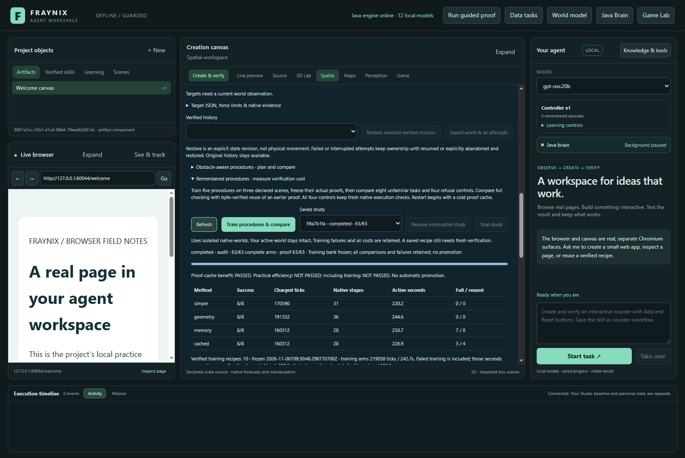
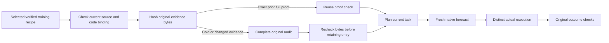
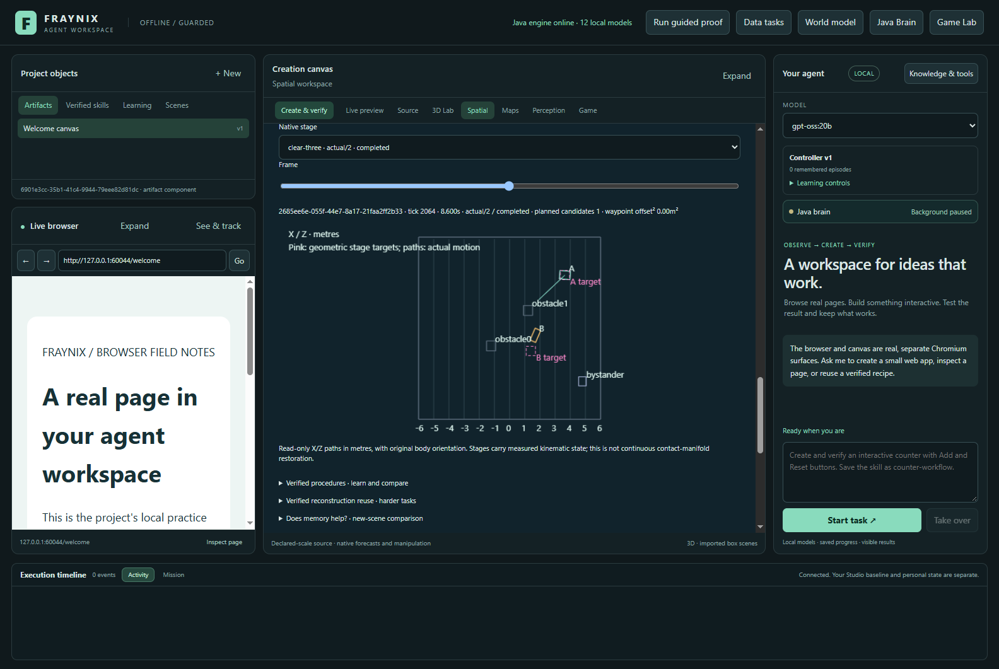
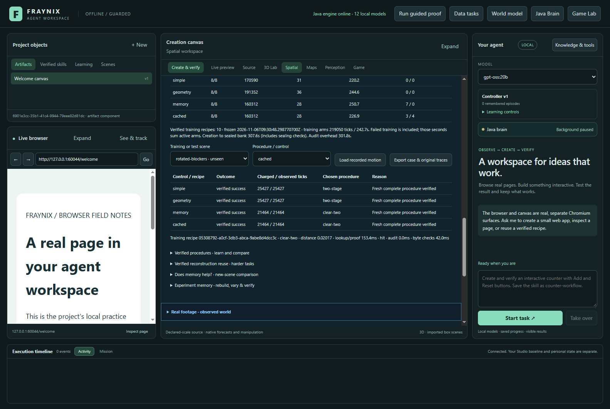

# Fraynix Agent Workspace · Edition 078

**Remember useful work, recheck changed evidence, and measure the complete cost.** November 6, 2026.

[Previous edition 077](README-077.md) · [Offline interactive guide](docs/readmes/078/index.html) · [Complete source tree](docs/readmes/078/FILE_TREE.md) · [Validation](docs/readmes/078/verification.json) · [Original evidence](docs/readmes/078/original-evidence.json) · [Prospective contract](docs/EDITION_078_CONTRACT.md) · [Edition history](docs/readmes/INDEX.md)

## The problem this edition addresses

Edition 077 showed that remembered procedures could reduce simulated work while still taking longer overall. The memory control repeatedly parsed and verified the same original training traces before choosing a recipe. That work was included in the reported time, so a lower tick count could not be presented as a faster agent.

Edition 078 adds a small Java proof cache and measures its value. A successful prior check can be reused only while its source, implementation, selected receipt, training outcome and original evidence bytes remain the same. A new task still gets fresh planning, a complete forecast, a distinct actual execution and the original outcome checks. The improvement targets repeated proof processing; it does not change the physical controller or invent a new successful trajectory.

The cache is part of the existing Java-owned procedure runner and integrated Spatial view. No new framework, model download, remote provider or background application is introduced. Existing Bullet/native physics, Electron/Chromium and JSON dependencies remain. Java owns the additional logic; this is not a claim that those existing dependencies were rewritten.

*Actual capture from an isolated, labelled edition 078 validation project. The model selector elsewhere in the window is not evidence of new language-model inference. These outcomes come from native simulation.*

## Measured results

**Proof-cache benefit: PASSED. Practical elapsed-time benefit against both simpler controls: NOT PASSED. First-batch efficiency including training: NOT PASSED.** No result automatically promotes a controller.

| Method | Verified successes | Charged ticks | Native stages | Active wall seconds | Full checks / reused checks |
| --- | --- | --- | --- | --- | --- |
| simple | 8/8 | 170,590 | 31 | 220.16 | 0 / 0 |
| geometry | 8/8 | 191,352 | 36 | 244.62 | 0 / 0 |
| memory | 8/8 | 160,312 | 28 | 250.66 | 7 / 0 |
| cached | 8/8 | 160,312 | 28 | 226.93 | 3 / 4 |

Cached memory solved 8/8 and uncached memory 8/8. Cached selection used 3 full checks and 4 reused checks, compared with 7 full checks for uncached memory. Lookup time was 17.16s versus 42.26s; active time was 226.93s versus 250.66s. These are matched source/recipe comparisons; broader practical and training-inclusive gates remain separate. In this batch, simple had the lowest active time. Cached memory reduced lookup time by 59.4% and complete active time by 9.5% versus uncached memory.

| Cached versus | Tasks saved | Tasks harmed | Difference in ticks | Difference in active seconds |
| --- | --- | --- | --- | --- |
| Cached versus memory | 0 | 0 | 0 | -23.73 |
| Cached versus simple | 0 | 0 | -10,278 | 6.77 |
| Cached versus geometry | 0 | 0 | -31,040 | -17.69 |

Training retained **10 verified receipts** across **clear-three, clear-two, direct, three-stage, two-stage**. All training, including failures, cost **219,050 ticks** and **242.72 summed active seconds**. Creation through sealing the bank took **307.62 seconds**; final full auditing took an additional **301.84 seconds**. Cached evaluation plus the whole training bill costs **379,362 ticks** for this first batch. The offline chart can include that training cost.

Active time includes planning, ranking, proof checks, byte hashing, native execution, verification and storage. The cache's first full checks are charged to cached memory. Its store begins empty after training; training-time checking does not quietly prime it for free. Bank sealing and final auditing are reported separately from per-task time.

This is one counterbalanced comparison per supported configuration. Timing depends on the machine and its current workload. It does not establish population confidence or a hardware-independent speed guarantee. Every failed attempt remains in the accounting. Faster proof processing also does not establish improved semantic reasoning or broader task success.

## What each control does

**Simple** tries all five edition 077 recipes in fixed order. **Geometry** has the same repertoire and uses the unchanged bounded geometric preview to select a preferred recipe. **Memory** ranks verified training receipts using the unchanged component similarity rule and fully checks the chosen original training arm on every use.

**Cached** uses precisely the same ranking and executable recipes as Memory. It can reuse a previous full check only under the byte and source conditions below. Its candidate order, selected family, native attempt sequence, charged ticks and numeric motion must match uncached memory in the paired test. Native run identities remain distinct: comparison methods cannot share a successful execution or relabel a forecast as actual motion.

The five recipes are direct, equal two-stage, equal three-stage, clearance-aware two-stage and clearance-aware three-stage. They retain the same force and torque limits, final goals, bounded waypoint search and whole-task protection of nearby objects. Geometry changes are replanned for the current scene; a remembered trajectory is not copied into it.

## How a proof becomes reusable

A cache key includes the owning study, code and native identities, frozen bank identity, selected receipt, source specification and complete original training-arm metadata. The cache holds at most **16 compact entries**. It does not retain decoded native trajectories or accumulate an unbounded set of full run objects in memory.

On the first cached use, Java streams the selected proof files and records their lengths and SHA-256 hashes. It then performs the original complete proof audit. It reads the file bytes again afterward. Only a passing audit with unchanged before/after snapshots can install an entry.

On a later use, Java streams and hashes the files again. An exact match permits reuse of the earlier check. File modification times do not establish identity: a same-length alteration with a restored timestamp still fails the byte comparison. Missing files, redirected paths, changed bindings and changed evidence cannot produce a hit. A failed full check never installs an entry.

The uncached control retains its original full-check path. It does not acquire extra byte-snapshot work just to make the cached method look better, and it cannot prime or evict the cached method's entries. Both methods pay their own real work.

Every result records whether it used a full check or a hit, the binding, evidence files and byte hashes, the original full-check receipt where applicable, and time spent auditing and hashing. These are internally owned execution records. Hashes detect changed content; they are not an external attestation of a trusted machine or physical truth.

## Restart and interrupted work

The cache deliberately starts cold in a new Java process. A saved disk file containing a success label or checksum cannot grant a warm proof hit. The verified training bank and original evidence persist; their first reuse after restart needs full checking again. This trades some cold-start work for a clear trust boundary.

The durable study still saves progress and retains settled native work. Unknown interrupted tails keep their conservative full-stage cost. Explicit Resume uses the remaining bounded workflow; it does not turn an interrupted task into a new unlimited budget. Stop prevents unfinished work from qualifying. An interface restart is not permission to repeat a physical effect.

A final audit always reads and reconstructs the original evidence, independently of the cache. It checks training, selection, every native stage, exact measured handoffs, cache provenance and paired numeric outcomes. A fast online lookup therefore does not eliminate the later complete experiment audit; that additional cost stays visible.

## What the physics claim covers

These remain synthetic lifted-gripper box arrangements. A virtual force/torque controller lifts, translates, rotates, lowers and releases the selected bodies. Clearance-aware intermediate landing positions can avoid occupied targets, while the controller may pass above low obstacles. This does not establish ground navigation, arbitrary robot manipulation, material strength or physical-camera accuracy.

Stages carry actual native positions, rotations, linear velocities, angular velocities and elapsed ticks. They do not replace measured endpoints with planned ones. The next stage starts a cold contact solver: persistent contact manifolds and warm-start impulses are not restored. That limit remains explicit.

Original acceptance still requires fresh forecast/actual correspondence, original lifecycle and wrench verification, final pose and speed checks, and protection of nearby bodies throughout the whole task. The cache cannot relax those thresholds, increase authority or change how an outcome is judged.

Pink markers show proposed intermediate targets. The body paths come from retained native execution. Replay is read-only and cannot actuate a world.

## Training and unfamiliar scenes

| Training source | Direct | Two-stage | Three-stage | Clear two-stage | Clear three-stage |
| --- | --- | --- | --- | --- | --- |
| train-open | verified / 11308 | verified / 17498 | verified / 23438 | verified / 17498 | verified / 23438 |
| train-occupied | not verified / 3876 | verified / 21072 | not verified / 0 | verified / 21072 | verified / 26626 |
| train-turn | not verified / 1976 | not verified / 0 | not verified / 0 | verified / 22142 | verified / 29106 |

Only a complete verified forecast and separate actual success create a receipt. The bank is frozen before evaluation; test outcomes cannot update it or select new rules.

| New supported or unsupported case | Simple | Geometry | Memory | Cached |
| --- | --- | --- | --- | --- |
| offset-payload | success / 25086 | success / 25086 | success / 21210 | success / 21210 |
| rotated-blockers | success / 25427 | success / 25427 | success / 21464 | success / 21464 |
| heavy-turn | success / 25068 | success / 23092 | success / 23092 | success / 23092 |
| shifted-turn | success / 13958 | success / 21518 | success / 21518 | success / 21518 |
| combined-load | success / 25801 | success / 25801 | success / 21654 | success / 21654 |
| open-control | success / 11434 | success / 17608 | success / 11434 | success / 11434 |
| protected-neighbor | success / 24958 | success / 24958 | success / 21082 | success / 21082 |
| novel-role | success / 18858 | success / 27862 | success / 18858 | success / 18858 |
| excess-mass | refused / 0 | refused / 0 | refused / 0 | refused / 0 |
| oversize | refused / 0 | refused / 0 | refused / 0 | refused / 0 |
| no-floor | refused / 0 | refused / 0 | refused / 0 | refused / 0 |
| bad-height | refused / 0 | refused / 0 | refused / 0 | refused / 0 |

The eight supported configurations change masses, friction, obstacle positions and endpoints from edition 077. The four unsupported controls retain invalid mass, geometry, floor or goal-height conditions and must refuse without actuation. These are separate from the eight-task success denominator. Unmatched object roles fall back explicitly to simple control.

Each method has the same 115,200-tick and 1,200-active-second arm limits. Native stages retain their 14,400-tick and 90-second limits. Complete remaining forecast/actual work must fit before admission. A refused later recipe can therefore leave some nominal ticks unused; it does not have permission to overrun the reserved remainder.

## What qualifies as improvement

Correctness comes first: cached and uncached memory must agree on procedures, success, native work and numeric motion in all supported paired cases. All methods must preserve zero-actuation refusal for unsupported controls.

The declared cache-benefit gate additionally requires a real hit, fewer full selected-proof checks, at least **10% less lookup time** and at least **5% less total active time** than uncached memory. The practical gate also requires no harmed tasks against Simple and Geometry, at least equal success, and lower active elapsed time than both. The first-batch gate additionally counts the entire training and sealing bill.

Those gates were fixed before the new native outcomes. They distinguish a useful implementation optimization from a faster complete agent. A lower proof-check time cannot conceal slower execution, and a small test-set success does not establish general intelligence.

## Review the app

1. Launch the workspace with [Launch-Agent-Workspace.bat](Launch-Agent-Workspace.bat), using a separate project for experiments.
2. Open **Spatial → One evolving world → Remembered procedures · measure verification cost**.
3. Choose **Train procedures & compare**, or reopen a saved study. The progress display covers 15 training arms and 48 evaluation arms.
4. Compare success, charged work, native stages, active seconds, and full/reused proof counts. Read all three verdicts.
5. Select a scene and **Cached**. Its detail shows the selected receipt and actual lookup, audit and byte-check times. A role fallback has no invented cache hit.
6. Use **Load recorded motion** to inspect the actual stage, frame, body orientation and proposed targets. Changing scenes clears a previously loaded trace.
7. **Export case & original traces** retains original native bytes and source-linked results. Use the offline guide for comparisons, training-cost toggles, sampled replay, source navigation and evidence links.
8. Use **Stop study** or explicit **Resume interrupted study** as appropriate. The original active world remains separate from these experiments.

## Verification and evidence

Primary study `39a7b1fa-1e6d-4839-a615-17c9cd3275a2` completed 63 arms with **171 original native attempts**. **133 distinct targeted Java checks across 20 classes and 127 desktop checks passed.** These are scoped invocations, not a fresh rerun of every historical heavy experiment.

The focused real-native test executes an actual arrangement and uses its saved motion proof to test a warm hit, cold-process full checking and rejection of altered evidence. Separate software tests cover same-size/timestamp-restored mutations, changes during auditing, unsuccessful audits, ownership and redirected paths, cache eviction and caller mutation of returned records.

Actual app validation covers the full comparison, exports, replay, cold restart, complete original audit, interruption/resume/Stop, damaged bank refusal and preservation of a nonempty authored world. The independent reader checks original compressed bytes, integrated pose/wrench arithmetic, stage handoffs, source-bound cache evidence and exact paired native observations. **29 deliberately altered-evidence probes were rejected.** Java also reconstructs the complete waypoint search and geometric baseline; the reader is not a second physics solver.

Wide and narrow app layouts and the offline guide were inspected. The guide retains at most 240 display samples per stage; full traces remain in the original archives. Source integrity, UI correctness, simulated-task success and physical-world accuracy are distinct claims.

The prospective contract is d68de31; initial implementation is 84e47ac. Earlier native physics, controllers, verification and edition 077 algorithms remain unchanged. No primary outcome or threshold was tuned after inspection. The complete original evidence, source inventory, notes and development log accompany this release.

## Direction from here

The larger objective remains a continuing Java-owned agent that can observe, act, retain useful experience and verify improvement. This edition addresses one cost in that loop. Its cache remembers that an exact proof was checked; it does not learn a new control law, train language-model weights or automatically publish a new skill into general chat.

Next, use the measured costs to decide when retrieval is worth attempting. Compare that decision against simple control on another frozen set of tasks. Then connect suitable procedures to the existing durable chat/goal interfaces, including current-world revision checks, recovery and a verified commit. New geometry, moving contacts and real camera correspondence need their own evidence before expanding capability claims.

Keep the application integrated: the existing chat, world, canvas and timeline should expose one meaningful task. Existing verified world skills remain available; the new comparison is isolated until its additional integration passes end-to-end checks.

[Java cache](workspace-engine/src/main/java/fraymus/workspace/ProofMemo078.java) · [Runner](workspace-engine/src/main/java/fraymus/workspace/ProcedureStudy078.java) · [Claims and procedures](workspace-engine/src/main/java/fraymus/workspace/Procedure078.java) · [Unchanged waypoint search](workspace-engine/src/main/java/fraymus/workspace/Waypoints077.java) · [Independent inspection](scripts/Inspect-Procedures078.cjs) · [App test](workspace-desktop/test/procedures078-integration.cjs) · [Operation note](docs/obsidian/86-proof-reuse.md) · [System canvas](docs/obsidian/proof-reuse.canvas) · [Project memory](docs/PROJECT_MEMORY.md) · [Development log](docs/DEVELOPMENT_LOG.md).
