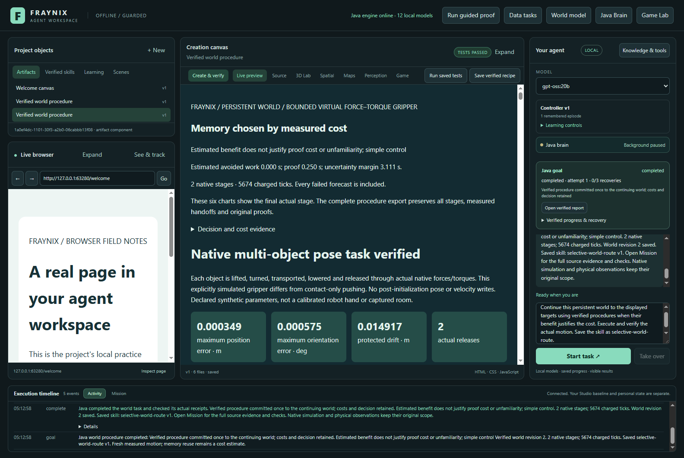
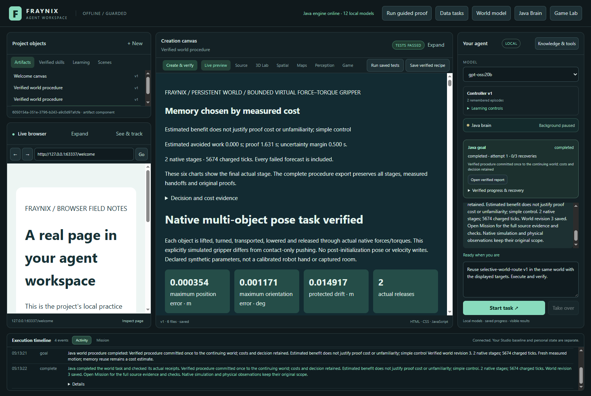
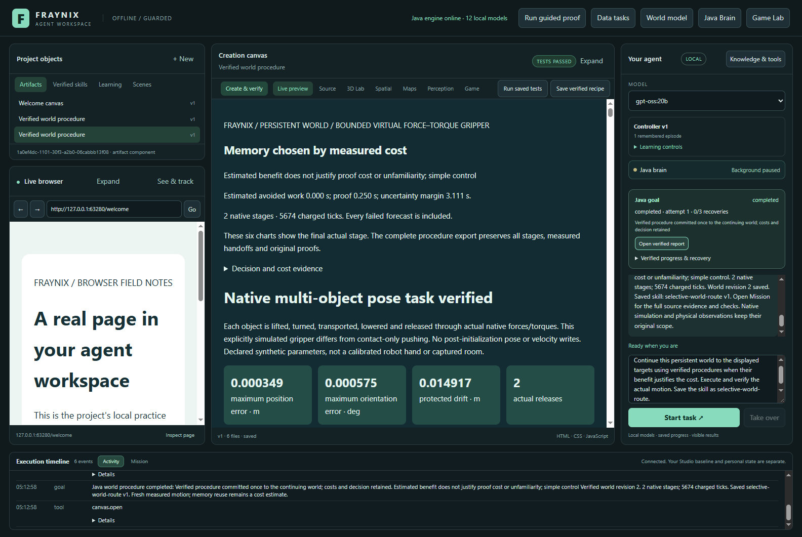

# Fraynix Agent Workspace · Edition 079

## Memory must earn its cost

[Previous edition 078](README-078.md) · [Offline results and motion replay](docs/readmes/079/index.html) · [Edition history](docs/readmes/INDEX.md) · tag `readme-079`

Edition 079 connects selective experiment memory to the existing Java goal runner, chat, saved skills and persistent world. A request can choose a procedure, predict its motion, execute distinct real simulation stages, verify the actual report, commit the measured result and retain a reusable named skill. Subsequent requests start from the current world rather than copying an old trajectory.

The implementation works and the measured efficiency claim is evaluated separately. **Selective-memory qualification: NOT PASSED. Training-inclusive efficiency: NOT PASSED.** These are the frozen criteria from the [prospective contract](docs/EDITION_079_CONTRACT.md), fixed before new outcomes. No policy or cases were tuned after this batch. Performance measurements retain their original implementation identity `e810564`. The later compatibility admission correction changes the ledger identity, and restart reconciliation updates the procedure identity, without changing native calculations or selection rules; the final runtime is separately checked with fresh native evidence and a complete chat/restart/skill demonstration.

## What changed

* Java now owns one durable multi-stage world procedure through the existing goal system. Chat chooses and explains; native controllers handle physical timing; original verifiers determine whether motion passed.
* Three choices share the same five recipes: simple order, always prefer compatible memory, or use memory only when its conservative estimated saving is positive. Simple control performs no memory lookup.
* Memory is an owned receipt backed by original native traces and a verified world commit. It grants no additional authority. A successful procedure can be saved as a named, versioned skill and reused against fresh observed targets.
* Forecasts are isolated. Actual stages start from measured positions, rotations, linear/angular velocities and elapsed ticks. One successful complete procedure commits one final revision.
* The integrated persistent-world panel exposes the decision, memory list, actual progress, complete evidence export and existing report. No second application or new inference service is required.

## Try the complete workflow

1. Start the existing desktop app with Java 21 and the repository’s normal desktop launcher. Use a labelled imported scene or an explicitly selected persistent world. Existing private projects are not silently migrated.
2. Open **Spatial → Persistent world**, select the world and target objects, and enter destination positions/rotations and the existing force/torque limits.
3. Enable selective verified procedures or request them in chat: “Continue this persistent world to the displayed targets using verified procedures when their benefit justifies the cost. Execute and verify the actual motion. Save the skill as selective-world-route.”
4. Watch the decision and native motion. The generated report includes the cost decision and actual final-stage charts; the complete export contains every forecast and actual stage, including failed forecasts.
5. After completion, change the displayed targets and say: “Reuse selective-world-route v1 in the same world with the displayed targets. Execute and verify.” The actual tested route reads the named saved skill and current world binding after restart.
6. **Stop** cannot create success. Interrupted actual motion retains ownership of its uncommitted world. Explicit Resume continues a compatible original checkpoint with bounded retries; explicit abandonment/restoration is a recorded operation.

Chat integration was exercised through the real desktop input and deterministic Java tool dispatcher. This is not evidence of improved language-model weights or an evaluation of arbitrary free-form LLM planning. Existing configured model paths remain available.

## How the decision works

The closest compatible owned experience is compared using the existing normalized component distance. Its measured failed/nonselected recipe work estimates the work a remembered successful recipe could avoid. Adaptive selection subtracts a proof-cost estimate and an uncertainty margin: `500 ms + 2 × distance × source active time`. It requires distance at most 0.10, a nondirect preferred family and positive remaining estimated saving.

Warm proof cost is at least 250 ms; cold proof cost is at least 1,000 ms or the prior full audit. A warm check still hashes exact evidence bytes. Restart clears trust. Changed sources, code or proof bytes require checking or refusal; filenames and previous success labels are not evidence. The memory bank is bounded to 16 receipts. Initial learning, verification and proof retention are charged.

The five families are direct, two-stage, three-stage, clearance-aware two-stage and clearance-aware three-stage. All share original force/torque bounds, a 115,200-tick / 1,200-active-second task budget, and 14,400-tick / 90-second stage limits. At most two explicit native resumptions are admitted. An interrupted unknown tail costs a full stage allowance.

## Actual matched results

Three real simple-control learning goals created 3 verified receipts, costing 60,374 ticks and 154.15 seconds including report/commit/proof retention. The bank was frozen before eight unfamiliar supported tasks. Each task used all three methods in counterbalanced order, from the same explicitly restored experimental starting state. Four unsupported controls were separate. Production procedures never reset a world implicitly.

| Method | Verified tasks | Physics ticks | Native stages | Complete task seconds | Selected memory |
|---|---:|---:|---:|---:|---:|
| simple | 8/8 | 180,276 | 34 | 445.03 | 0/8 |
| memory | 8/8 | 160,462 | 28 | 421.65 | 7/8 |
| adaptive | 8/8 | 172,437 | 32 | 438.14 | 2/8 |

Adaptive selected memory on 2/8 tasks; always-memory selected it on 7/8. Adaptive harmed 0 tasks versus simple and 0 versus memory. Memory had the lowest complete summed task time in this batch. The complete selective-benefit gate did not pass; the training-inclusive gate did not pass. Timing is one serial run on this machine, not a universal speed claim.

Complete task time includes selection, native predictions and actual stages, checking, actual Chromium report assertions and world commit. Native tick counts and wall time answer different questions. Training cost is separately shown in the offline viewer and can be added to the adaptive total. No automatic policy promotion follows this comparison.

| Unfamiliar task | Simple | Always memory | Adaptive |
|---|---|---|---|
| 079-offset-payload | completed / 25080 ticks | completed / 21204 ticks | completed / 21204 ticks |
| 079-rotated-blockers | completed / 25423 ticks | completed / 21460 ticks | completed / 21460 ticks |
| 079-heavy-turn | completed / 25147 ticks | completed / 23170 ticks | completed / 25147 ticks |
| 079-shifted-turn | completed / 23566 ticks | completed / 21592 ticks | completed / 23566 ticks |
| 079-combined-load | completed / 25800 ticks | completed / 21652 ticks | completed / 25800 ticks |
| 079-open-control | completed / 11442 ticks | completed / 11442 ticks | completed / 11442 ticks |
| 079-protected-neighbor | completed / 24952 ticks | completed / 21076 ticks | completed / 24952 ticks |
| 079-novel-role | completed / 18866 ticks | completed / 18866 ticks | completed / 18866 ticks |

## Continuity and verification

145 distinct targeted Java checks in 22 classes and 129 desktop checks passed. The retained first failures are documented: an original reader bound, a generic report-storage bound, a named-skill parser gap and a layout harness targeting a hidden tab. Their corrections preserve the original failed invocation records. The regression also found that the legacy world identity needed admission before its explicit handoff. Three older certificate tests used archived motion tied to the earlier engine; they now execute that archived source afresh under the current engine when identities differ. All original archived records remain unchanged, and a separate check confirms that old proofs cannot authorize current reuse. No tests are skipped or old proof identities rewritten. An actual shutdown test also exposed stale stage metadata; restart now reconciles the owned native checkpoint, retains its trace and charges the unknown tail before explicit Resume. Missing or inconsistent saved native state blocks recovery instead of silently restarting the motion.

The actual application exercised the full primary workflow, saved skill, cold restart, same-world successor targets, report/export and wide/narrow layouts. Separate lifecycle tests interrupted an actual moving stage, resumed the same native IDs, charged the unknown tail, checked stale bindings, and used visible Stop without committing or retaining success. The independent inspector recomputes original native arithmetic, exact handoffs, selected-memory provenance, whole-task and protected-body checks, and cost arithmetic. 20 controlled alterations were refused. It is an independent reader, not an independent physics solver.

World visibility observes moving actual procedure bodies, not the old committed head Actual moving-stage closure preserves the old verified head and pending owner Explicit same-stage resume retains IDs, charges the unknown tail, passes original checks and commits once Stale pre-execution binding is refused Visible Stop during actual motion neither commits nor retains success; ownership remains explicit Explicit abandonment/restoration records a new revision and releases ownership.

## Architecture and compatibility

`Procedure079` owns current-frame specifications, selection and whole-task checks. `Waypoints079` proposes bounded intermediate targets from the measured frame. `WorldProcedure079` owns durable execution and evidence. `GoalRunner` coordinates host report verification and saved skills. `WorldLedger` atomically commits the measured final frame. `WorldExport079` retains all stages in mixed-world history. `ProofMemo078` keeps source-bound, boot-local verification receipts.

Native solver, controller, original verifier and `WorldFrames` computations remain unchanged. `WorldLedger` participates in native source identity, so its new commit operation deliberately changes that identity. A closed verified world from the exact known 078 identity can use the explicit compatibility handoff without changing its frame. Pending and unknown legacy worlds refuse upgrade; they must finish under their original engine. No claim is made that arbitrary old running checkpoints resume under new code.

Exact kinematic handoff preserves pose, velocity and clock, while each stage starts a cold contact solver. These are labelled synthetic lifted-box manipulation tasks, not arbitrary ground navigation, new webcam calibration or a physical robot experiment. The report’s six native charts describe its final actual stage; use the complete export/offline replay for the whole sequence.

## Files, evidence and reproduction

* [Full source inventory and hashes](docs/readmes/079/file-inventory.json) · [Source tree](docs/readmes/079/FILE_TREE.md)
* [Original evidence archives and raw-byte hashes](docs/readmes/079/original-evidence.json) · [Validation record](docs/readmes/079/verification.json)
* [Protocol](workspace-engine/src/main/resources/procedures079-protocol.json) · [Independent inspector](scripts/Inspect-Procedures079.cjs)
* [Actual app test](workspace-desktop/test/procedures079-integration.cjs) · [Lifecycle test](workspace-desktop/test/procedures079-lifecycle.cjs)
* [System notes](docs/obsidian/87-selective-world-goals.md) · [System canvas](docs/obsidian/selective-world-goals.canvas)

Tests ran serially under Java 21 with four active processors and a 768 MB heap. Heavy native and model work did not overlap. Original normal045/qa046 applications, private projects and model services were preserved. Published editions 001–078 are frozen. Source, screenshots, exact originals and notes are published together; the separate publication receipt records fetched GitHub verification after upload.

## Next steps

1. Compare estimated savings with actual complete savings across repeat runs and changing conditions. Calibrate uncertainty and machine-load sensitivity before treating one timing win as a general advantage.
2. Reduce repeated evidence work only where exact source ownership and independent verification remain intact; measure amortization over longer task sequences.
3. Expand recovery and procedure diversity with new, prospectively fixed obstacle/body tasks against the same simple baseline.
4. Connect perception updates and real observations to this same durable goal/world contract, retaining scale uncertainty and provenance.

The direction is one local system that observes, predicts, acts, checks and remembers useful procedures. Progress is measured by reliable completed tasks and retained verified state, rather than by naming modules “intelligent” or displaying activity alone.
