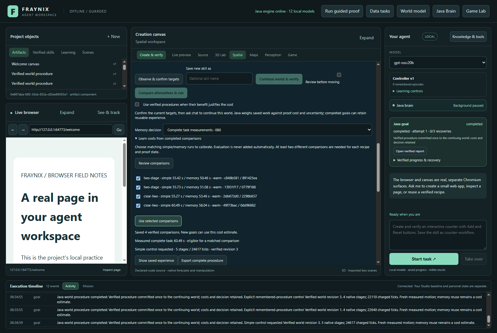
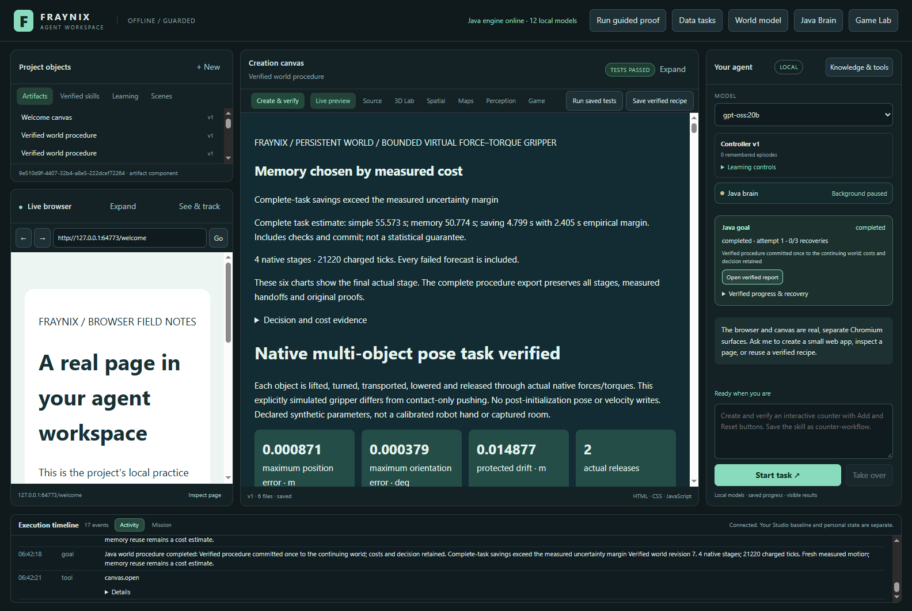
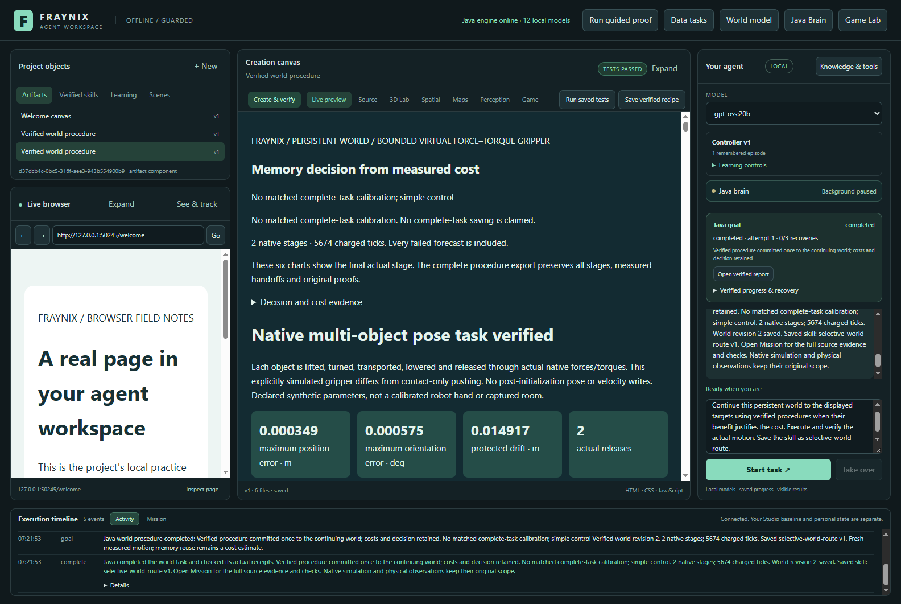
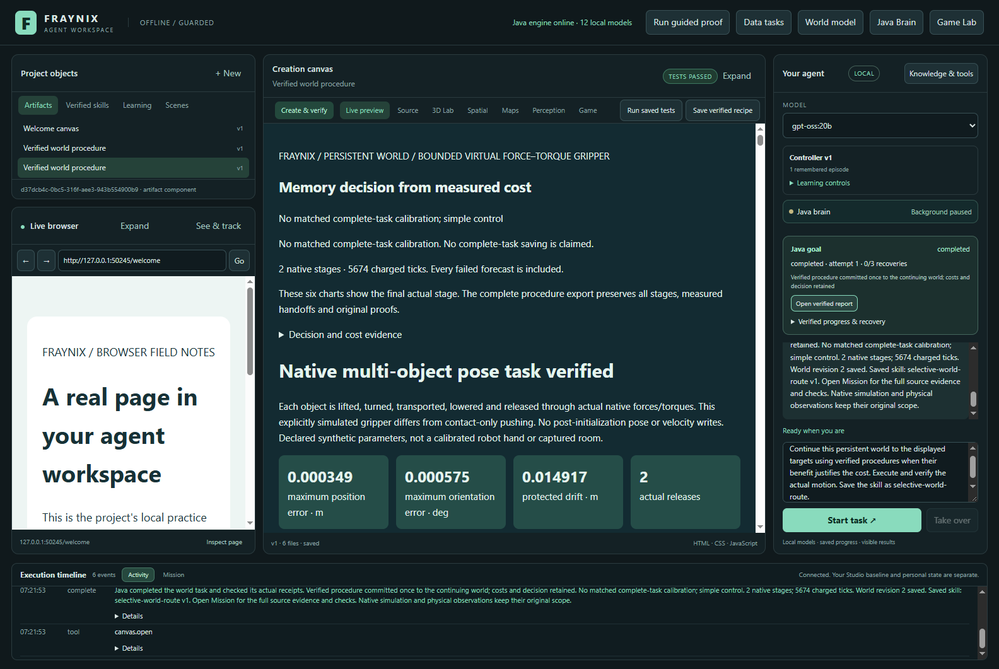
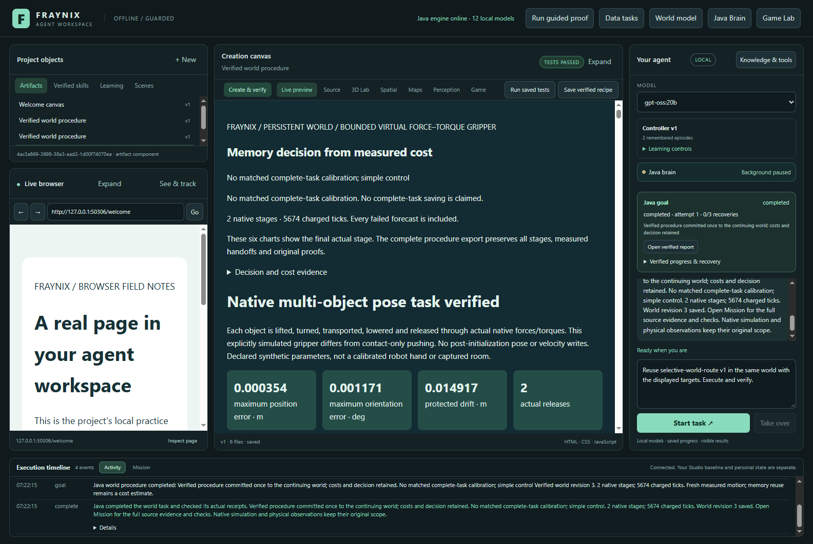

# Fraynix Agent Workspace · edition 080

**Complete-task cost estimates, learned from verified work.** Java now measures a procedure from admission through execution, verification, world commit and optional memory/skill saving. Explicitly matched simple-control and memory-control tasks calibrate the next decision. A faster simulation alone no longer counts as a cheaper completed task.

[Previous: edition 079](README-079.md) · [All editions](docs/readmes/INDEX.md) · [Interactive offline guide and recorded motion](docs/readmes/080/index.html) · [Complete source tree](docs/readmes/080/FILE_TREE.md) · [Verification record](docs/readmes/080/verification.json)

## What the measurements established

Estimation-improvement gate: **PASSED**. Complete-task efficiency gate: **NOT PASSED**. First-batch efficiency including learning and calibration: **NOT PASSED**.

Supported estimates on 5/8 tasks. Mean absolute saving error 0.607s versus 1.723s for the earlier point estimate on the same cases. Calibrated control selected memory on 2/8 tasks. These are frozen held-out outcomes; the policy was not retuned after observing them.

| Control | Verified tasks | Complete task seconds | Caller seconds | Native ticks | Stages | Memory selections |
| --- | ---: | ---: | ---: | ---: | ---: | ---: |
| simple | 8/8 | 468.91 | 470.39 | 181,018 | 34 | 0/8 |
| memory | 8/8 | 446.91 | 448.52 | 161,200 | 28 | 7/8 |
| adaptive | 8/8 | 460.59 | 462.15 | 173,179 | 32 | 2/8 |
| calibrated | 8/8 | 477.58 | 479.56 | 173,179 | 32 | 2/8 |

These are eight new, labelled simulated box tasks, measured once per control on this machine in counterbalanced order. They vary established synthetic task families; they are not a new-domain or real-robot benchmark. Complete time is the Java interval described below. Caller time also includes transport, response and polling. Both selective modes made the same memory-use choices and consumed the same native ticks in this batch. The new mode improved the saving estimates but added elapsed time; it did not demonstrate a better control policy. Neither is a general hardware benchmark. All controls use the same physics, recipe repertoire, force/torque limits, original checks and task bounds.

Three real learning goals cost **157.86 seconds** and **60,374 ticks**. Four calibration pairs plus the explicit fitting operation cost **496.06 seconds**; their eight executions cost **185,489 ticks**. These costs are disclosed even when the later estimate is useful. The explicit fitting figure includes comparison review and successful fitting; invalid-input validation probes are separate tests. The verified bank and fitted model stayed unchanged throughout evaluation; none of the evaluation outcomes were added to training.

| New task | Calibrated saving estimate, seconds | Observed simple minus memory, seconds | Inside empirical margin | Memory chosen |
| --- | ---: | ---: | --- | --- |
| 080-offset-payload | 4.799 | 4.499 | True | True |
| 080-rotated-blockers | 4.799 | 5.770 | True | True |
| 080-heavy-turn | 2.128 | 1.537 | True | False |
| 080-shifted-turn | 2.128 | 1.949 | True | False |
| 080-combined-load | Unavailable | 3.921 | Not evaluated | False |
| 080-open-control | Unavailable | -0.795 | Not evaluated | False |
| 080-protected-neighbor | 4.799 | 3.804 | True | False |
| 080-novel-role | Unavailable | 1.313 | Not evaluated | False |

Positive saving means memory was faster than simple control. Unsupported estimates are absent, not zero-error predictions. The margin is an empirical guard built from observed variation and task distance; it is **not a statistical confidence interval**. Per-case cost, selection regret and complete originals are available in the verification record and offline guide.

## What changed in the app

The existing persistent-world panel has a memory-decision selector and a **Learn costs from completed comparisons** section. You can review completed matched controls, explicitly select pairs and fit a cost model. The existing chat/world-goal path can request calibrated decisions, complete real native stages, verify the report, commit one final world revision and retain a named skill. The report shows the cost estimate; the world panel shows measured complete task time after completion.

These are captures of the running Electron/Java application in isolated synthetic projects, not mockups. Calibration and estimate images come from the frozen comparison; chat, restart and layout captures come from the fresh final-source smoke check. The offline guide includes the captured sizes and recorded native motion; its replay does not rerun physics or invent frames.

## Try the workflow

1. Use a separate practice project under this edition. Preserve any existing private project and its running Java owner; do not replace live JARs or share a database between versions.
2. Open the existing Spatial/persistent-world view. Import or create a supported scene, observe its current state, set valid targets and confirm the current world binding.
3. Enable verified procedures and select **Complete task measurements · 080**. Without sufficient matched measurements, the app explains the fallback and runs simple control with the original verification checks.
4. To calibrate, explicitly run a simple control and an always-memory control from identical physical starting states and targets, with the same saving workload and runtime profile. Restoring a starting state is an explicit world revision, not an invisible rewind. Repeat on at least two distinct compatible tasks.
5. Open the comparison section, review the eligible pairs, select the pairs you intend to use, then fit. The server reads its own completed records; supplying a duration or a claimed success does not train it.
6. Ask chat to continue the bound world to the displayed targets using verified procedures when their benefit justifies the cost. Add a skill name if desired. Inspect the checked report and actual committed world state.
7. Restart the practice app and reuse the named skill against a fresh current-world binding. Skills, world history and calibration persist; proof trust does not. A warm-cache calibration cannot silently stand in for cold verification cost.

Calibration is tied to the saving workload. This study's comparison pairs do not save additional memories or skills. Chat tasks that do save them correctly fall back until matching calibration exists. Edition 080's procedure identity also differs from 079: old proof records are not relabelled as newly verified evidence. Native physics and world-ledger computations are unchanged.

## Timing and decision contract

`TaskCost080` is owned Java logic. Its clock begins at goal admission and includes lookup, forecasts, distinct actual execution, original audits, host report verification, atomic world commit and requested retention. The final timing-record write and caller transport/polling are outside that interval; caller elapsed time is measured separately. Scene import/restoration and chat planning before Java goal admission are setup costs outside this measured procedure; exports and validation-only rejection probes are also reported separately rather than included in a successful goal duration. An interrupted or resumed task can still recover under the existing rules, but its unavailable continuous interval is ineligible for fitting.

Pairs must be distinct owned completed simple/always-memory goals with identical physical task, starting kinematics, code identity, runtime profile and retention/skill workload. Their native evidence, report checks and world commits must verify. The persisted model records exact source references and byte hashes, rechecked when used. Duplicate IDs, mismatched pairs, changed evidence and supplied timings are refused.

For the selected verified memory, use up to four nearest calibration pairs, requiring at least two distinct task specifications, matching recipe, receipt, workload and warm/cold proof regime, and component distance at most 0.10. Estimate each control's complete duration by the paired means. Saving is simple minus memory. The margin is the larger of 500 ms or maximum observed saving deviation, plus twice the maximum neighbor distance times the maximum paired task duration. Select memory only when saving minus margin is positive. Direct recipes, missing coverage or changed workload/profile use simple control.

The native controller still determines motion. The verifier still decides whether a task succeeded. A cheaper predicted procedure gains no extra authority, and neither cost measurements nor remembered success can bypass a fresh current-world binding.

## Validation and preserved failures

- **152 distinct Java checks across 23 classes**, plus **130 desktop checks**, all passing in the source-qualified invocations recorded with their original XML/logs. No skipped checks are counted as passes.
- Actual app: three learning goals, eight paired calibration executions, eight new tasks across four controls, four unsupported controls, explicit UI fitting, chat, report viewing, complete file export, saved skill, cold restart and wide/narrow layouts.
- Independent inspection reconstructs original native arithmetic, measured outcomes, world commit chains, proof origins, complete costs, paired provenance and estimate arithmetic. **26 altered-evidence probes** test refusals. This is an independent evidence reader, not an independent physics solver.
- Eight actual Java API probes refused changed timings, ineligible samples, original bytes, arithmetic, duplicate provenance and foreign code even when their envelopes were re-sealed Every altered file restored byte-for-byte; calibration reloaded unchanged and world ledger unchanged after each refusal.
- World visibility observes moving actual procedure bodies, not the old committed head Actual moving-stage closure preserves the old verified head and pending owner Resumed verified task has no continuous timing, is explicitly ineligible and cannot calibrate cost Explicit same-stage resume retains IDs, charges the unknown tail, passes original checks and commits once Actual app labels interrupted timing unavailable rather than zero-cost Stale pre-execution binding is refused Cancelled motion has no completed timing sample Visible Stop during actual motion neither commits nor retains success; ownership remains explicit Explicit abandonment/restoration records a new revision and releases ownership.

The first actual smoke run found a real saved-skill defect: internal cost-workload metadata was copied into a public skill input and rejected during cold reuse. That attempt and its repair-loop/model-request logs are preserved. The fix removes internal metadata from saved inputs and preserves the selected memory mode. The harness also now identifies the new task by ID rather than assuming restored task-list order. A fresh corrected smoke and the primary workflow passed. No earlier failed run was overwritten or represented as a successful one. After the comparison, two display labels were clarified: interrupted timing now says unavailable, and the report heading covers both memory and simple decisions. The sole later Java edit changes that heading; fresh native checks and a fresh final-source chat/restart workflow pass. The frozen comparison retains source `fd2dfa4` and its original procedure identity; its calibration is not relabelled for newer code. The exact wording-only diff is archived.

The successful acceptance path exercises deterministic Java planning and real execution; it does not establish new LLM reasoning quality or model-weight training. The failed first smoke did enter the local-model repair path. The measured tasks are synthetic lifted-box manipulation; they do not establish webcam accuracy, general robotics or real-world physical calibration. Exact kinematic reconstruction does not restore a continuous native contact manifold.

## Source and evidence

| Responsibility | Implementation |
| --- | --- |
| Complete timing, paired estimate and conservative selection | [TaskCost080.java](workspace-engine/src/main/java/fraymus/workspace/TaskCost080.java) |
| Original staged procedure, cost records, calibration provenance and reports | [WorldProcedure079.java](workspace-engine/src/main/java/fraymus/workspace/WorldProcedure079.java) |
| Durable goals, lifecycle clocks, report/commit/retention and saved skills | [GoalRunner.java](workspace-engine/src/main/java/fraymus/workspace/GoalRunner.java) |
| Existing integrated world UI | [persistent-world-panel.js](workspace-desktop/renderer/persistent-world-panel.js) |
| Independent original-evidence and cost inspection | [Inspect-Procedures080.cjs](scripts/Inspect-Procedures080.cjs) |
| Frozen prospective protocol | [Contract](docs/EDITION_080_CONTRACT.md) · [Exact cases](workspace-engine/src/main/resources/procedures080-protocol.json) |

[Exact source inventory](docs/readmes/080/file-inventory.json) · [Original archive manifest](docs/readmes/080/original-evidence.json) · [Results and validation](docs/readmes/080/verification.json) · [Obsidian note](docs/obsidian/88-complete-task-costs.md) · [System canvas](docs/obsidian/complete-task-costs.canvas)

Every archived original has compressed and decompressed byte counts and SHA-256 hashes. Historical README editions 001–079 remain frozen. Publication is recorded separately in `docs/PUBLICATION_080.json` after actual push and fresh fetch verification; local preparation is not a publication claim.

## Next steps

1. Profile and reduce the added estimation/provenance-check overhead while retaining every source and outcome check. Repeat matched complete-task measurements to separate stable savings from host timing noise; keep new evaluation tasks out of calibration.
2. Add measured cold-proof and memory/skill-saving workloads so routine chat can use supported estimates rather than fallback.
3. Measure amortization across longer sequences of durable goals, including the cost of gathering and fitting calibration data.
4. Broaden verified procedure families and uncertain observations without weakening current-world authority, original physics checks or recovery.

The direction remains one integrated local agent: Java owns durable goals, observations, actions, experience and verification. This edition makes its decision about using experience accountable to the cost of finishing the whole task.
