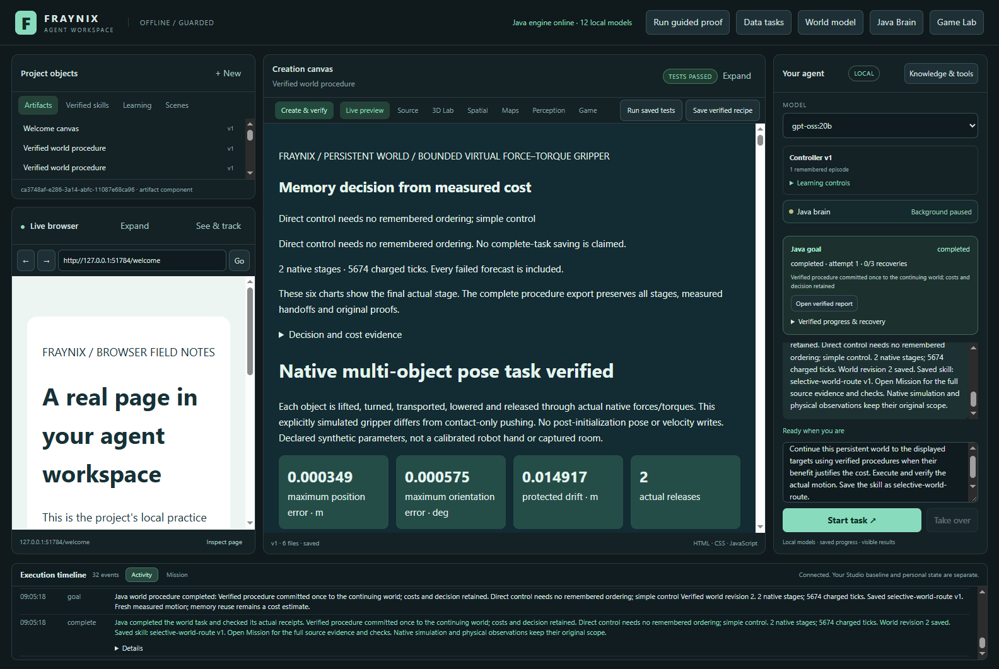
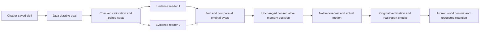
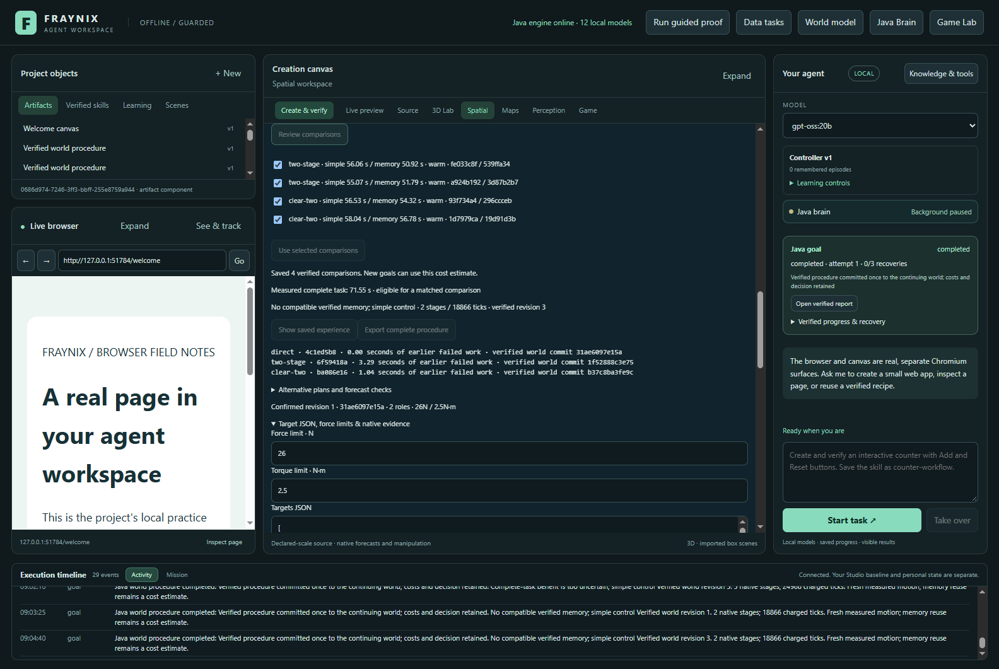
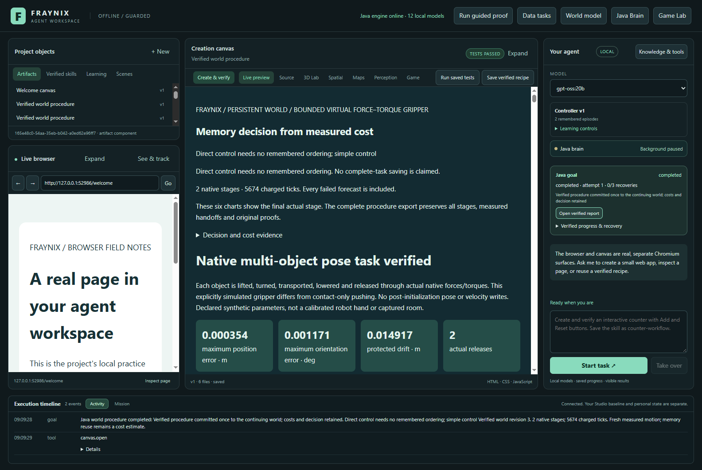

# Fraynix Agent Workspace · edition 081

**Faster estimation, with the original evidence checks.**

[Previous: edition 080](README-080.md) · [All editions](docs/readmes/INDEX.md) · [Offline charts and motion replay](docs/readmes/081/index.html) · [Complete source tree](docs/readmes/081/FILE_TREE.md) · [Verification record](docs/readmes/081/verification.json)

The previous edition learned to estimate the complete cost of using a remembered procedure. Its estimates improved on the tested cases, but checking the estimates added enough work that the full workflow did not become faster. This edition addresses that measured bottleneck. It changes how Java reads the calibration evidence while keeping the existing decision rule, physics, native outcome checks, report verification and world commits.

## What the measurements say

Calibration-reading overhead fell by the comparison's measured 44.2%. Complete Java task time changed from 465.13s to 459.66s (1.18% reduction). Complete-task improvement: **observed in this batch**. Both methods completed 8/8 tasks.

| Evidence reader | Completed | Java task seconds | Caller seconds | Estimation seconds | Evidence loads | Native ticks |
|---|---:|---:|---:|---:|---:|---:|
| reference | 8/8 | 465.13 | 466.40 | 15.104 | 40 | 173,179 |
| parallel | 8/8 | 459.66 | 461.00 | 8.426 | 40 | 173,179 |

Both readers made identical decisions, executed identical native work, and reached identical measured final states in the eight matched comparisons. Each successful calibration load checked the same original file bytes. The frozen procedure bank and calibration model were not changed by the evaluation.

The separate reader comparison uses six counterbalanced repetitions after a retained warm-up for each reader. Its measured reduction is **44.6%**. It is a diagnosis of the reading path; the complete-task measurements above are the evidence for the user-facing effect. The two new mass/friction variations and six established regression tasks are all declared in the [prospective input protocol](workspace-engine/src/main/resources/procedures081-protocol.json). This is one machine and one batch of eight pairs, not a universal speed guarantee.

*Actual isolated app capture, November 6, 2026. The chat requests a current-world task, Java executes it, the real report is checked, and a named procedure is retained.*

## Why checking the estimate was expensive

A read-only profile of the previous edition's original calibration found approximately 150 MB of evidence per load. Hashing that evidence took 334–400 ms per read, while parsing and arithmetic were much smaller. Calibration is checked again at the existing decision and verification boundaries, so repeated reads accumulate over a full task.

Those historical records were used to locate the bottleneck only. They were not relabelled as proof under the new implementation. This study generated its own three learning tasks and four matched calibration pairs, with the current code identity. Learning cost **161.19 seconds**; calibration and fitting cost **493.62 seconds**, reported separately from evaluation. The first two-reader load is not silently excluded from the complete-task boundary.

## The change in Java

[CalibrationScan081](workspace-engine/src/main/java/fraymus/workspace/CalibrationScan081.java) owns two bounded reading threads. The coordinator gives each reader an ordered group of original files. Both use the existing [ProofMemo078 snapshot routine](workspace-engine/src/main/java/fraymus/workspace/ProofMemo078.java), which checks ownership, rejects redirected path components, enforces the original read limits and computes SHA-256 from the actual bytes.

Only one calibration batch runs at a time. The coordinator waits for every reader, even if one fails or the caller is interrupted. It then compares each ordered result with the frozen evidence manifest. A missing, altered or redirected file refuses the calibration. There is no timestamp shortcut, persistent trust cache or skipped original file. The reduction is in elapsed time: the same bytes are hashed, with one additional reading thread available, rather than a claim of less total computation.

[WorldProcedure079](workspace-engine/src/main/java/fraymus/workspace/WorldProcedure079.java) still rebuilds the cost-pair arithmetic and checks implementation identity. It retains all existing calibration checks at their original authority boundaries. The numeric estimate in [TaskCost080](workspace-engine/src/main/java/fraymus/workspace/TaskCost080.java) is unchanged. A faster estimate does not grant permission to move an object or claim that an action succeeded.

The serial reference is available only in an idle, explicitly isolated test runtime. Normal launches use the two-reader path. Model tool input cannot switch the implementation or remove verification. Read-only diagnostics report load counts, elapsed loader/hash time, failures, and bytes verified by successful loads. These counters are operational measurements, not a replacement for outcome evidence.

## What the app can do now

The app remains one integrated workspace. Chat can request a bounded goal in the current persistent physics world. Java chooses whether a verified remembered procedure is worth checking, plans intermediate targets, forecasts the outcome, executes separate actual stages, compares motion, checks the report, and commits one verified final revision. A user can retain the resulting named skill and use it after restart.

The existing physics editor, browser/canvas surfaces, durable goals, procedure history, explicit calibration controls, original exports and replay remain available. This edition improves the internal cost of that workflow. It does not replace the design with a new application, add another window, introduce an external AI framework, or claim new model-weight training.

*The existing controls fit explicitly selected, completed simple-versus-memory pairs. Estimates remain specific to the procedure, source, runtime, warm/cold proof state and requested saving workload.*

## Review it step by step

1. Build the isolated checkout with Java 21 using the existing [run instructions](README.md). Preserve an active older installation and its private project; do not replace live JARs or silently share its data directory.
2. Open the persistent-world controls and use a labelled scene with supported bodies, bounds and targets. Review the force and torque limits before running.
3. Run a simple-control task and retain its verified experience. Learning requires successful original checks and a committed world outcome.
4. Complete matched simple and always-memory tasks with the same physical input and workload. In the complete-cost panel, review and select the pairs, then fit the model explicitly.
5. Select calibrated memory and request a new task through chat. The report shows the estimate, decision, actual stages, original checks and measured complete time.
6. Save a named skill, close the isolated app, and reopen its project. The world and skill persist; warm proof trust does not. Unsupported cold or different-workload estimates fall back rather than borrowing incompatible timings.
7. Export the procedure to inspect its original records, or open the [offline companion](docs/readmes/081/index.html) to compare this edition's actual timings and replay its recorded motion without running the app.

## Validation and evidence

159 Java tests across 24 classes passed, along with 130 desktop checks. Focused reader tests cover identical ordered bytes, returned-data mutation, same-size/restored-timestamp changes, missing files in different groups, outside paths, duplicates, empty/oversized groups, redirected parents, interruption and closing.

The real app study checks learning, explicit fitting, frozen sources, both reading paths, original native outcomes, chat, a named skill, cold restart, file export and two window widths. Separate lifecycle tests interrupt moving actual stages, resume with the original IDs and evidence, exclude the interrupted timing from calibration, and verify that Stop cannot commit a success. Sixteen actual Java API corruption probes exercise both readers, restoring original bytes after every refusal. Independent inspection also checks the original byte hashes, native arithmetic, forecast/actual comparison, pair provenance and world-commit chain.

An earlier development attempt was stopped after visual review caught a build made before a source text-encoding cleanup. Its partial measurements, original project records, log and exact installed engine JAR are retained and excluded from this comparison. A full rebuild and entirely fresh study followed; input and installed-JAR hashes are checked before launch and at completion. No cases or policy thresholds were changed.

The Java complete-task clock runs from goal admission through execution, original audits, real host-report checks, world commit and requested saving. Writing the final timing record, caller polling and transport sit outside that clock. Caller time is recorded separately. Reader diagnostics captured before export cover the task's calibration reads; the subsequent independent export and evidence inspection are not hidden inside the task measurement.

[Verification and measurements](docs/readmes/081/verification.json) · [Exact compressed originals](docs/readmes/081/original-evidence.json) · [Canonical source hashes](docs/readmes/081/file-inventory.json) · [Prospective contract](docs/EDITION_081_CONTRACT.md) · [Independent inspector](scripts/Inspect-Procedures081.cjs)

*The real application reopens the same isolated project and uses the saved procedure against its continuing world. It executes and checks fresh stages; the old success is not substituted for the new outcome.*

## Limits and next steps

Two readers can help when hashing is a bottleneck and CPU/storage resources permit it. They can compete for resources on a slower or heavily loaded machine. The current tests establish the measured result here, with four available Java processors and a 768 MB heap limit. They do not establish improved physical-camera accuracy, wider semantic understanding or general intelligence.

The empirical cost margin remains an empirical guard, not a statistical confidence guarantee. The world model still has its existing supported physics, geometric and recovery bounds. Kinematic reconstruction does not restore native contact manifolds. Learning and calibration have real costs; neither is free because a later estimate is faster.

Next, repeat complete-task measurements under a declared resource budget, include cold starts and skill-retention workloads, and test whether the saved work pays back over longer sequences. If a one-reader deployment is needed, choose it from measured available resources while retaining the same byte checks. Broader procedures should enter through the existing verified goal contract, with unfamiliar scenes reserved for evaluation.

The direction remains a local Java system that owns goals, state, evidence, actions and durable experience. This edition makes that system more practical by reducing a measured internal expense without changing what counts as a verified result.

[Obsidian operation note](docs/obsidian/89-calibration-evidence.md) · [System map](docs/obsidian/calibration-evidence.canvas) · [Project memory](docs/PROJECT_MEMORY.md) · [Development log](docs/DEVELOPMENT_LOG.md)
