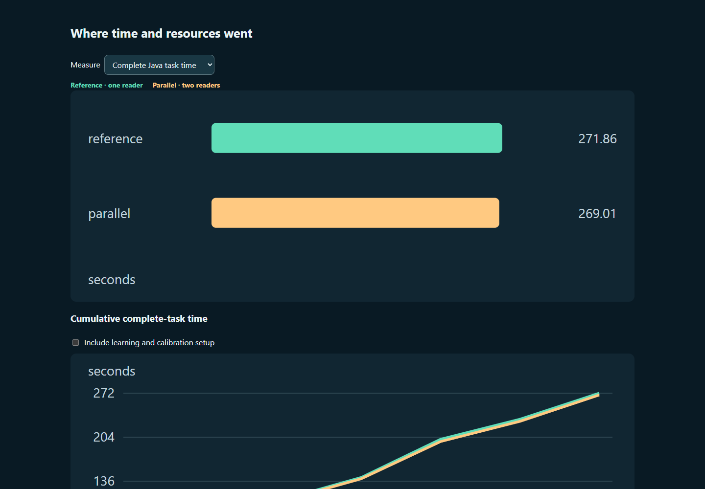
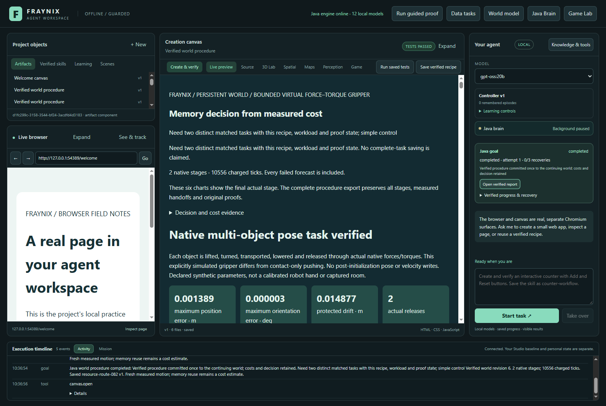
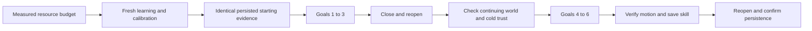
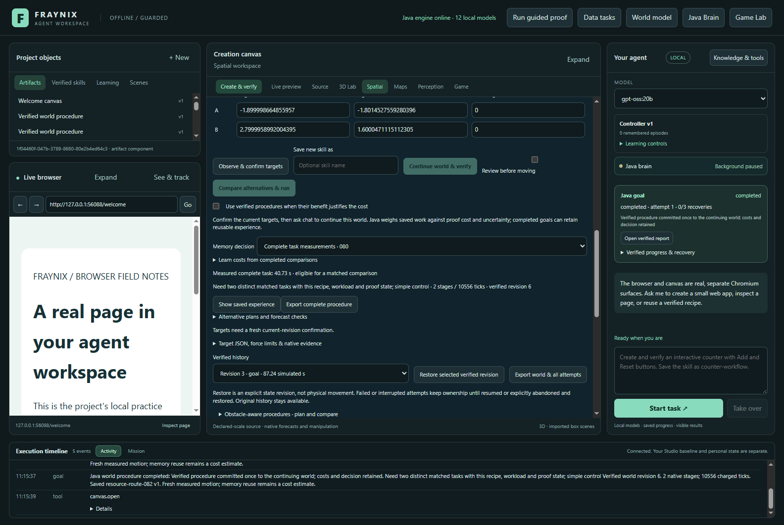
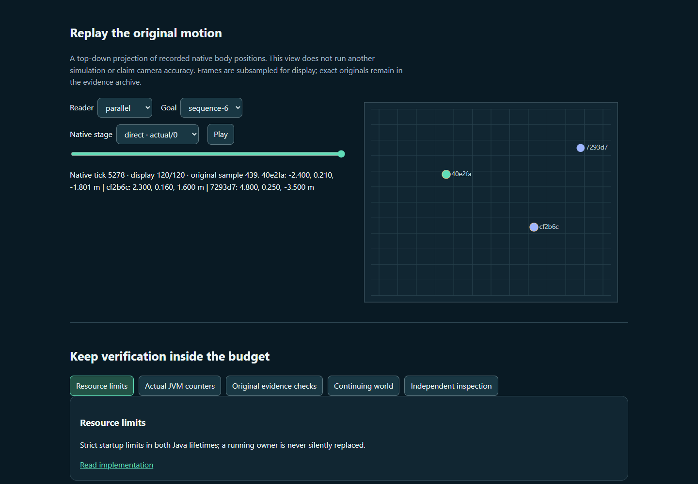
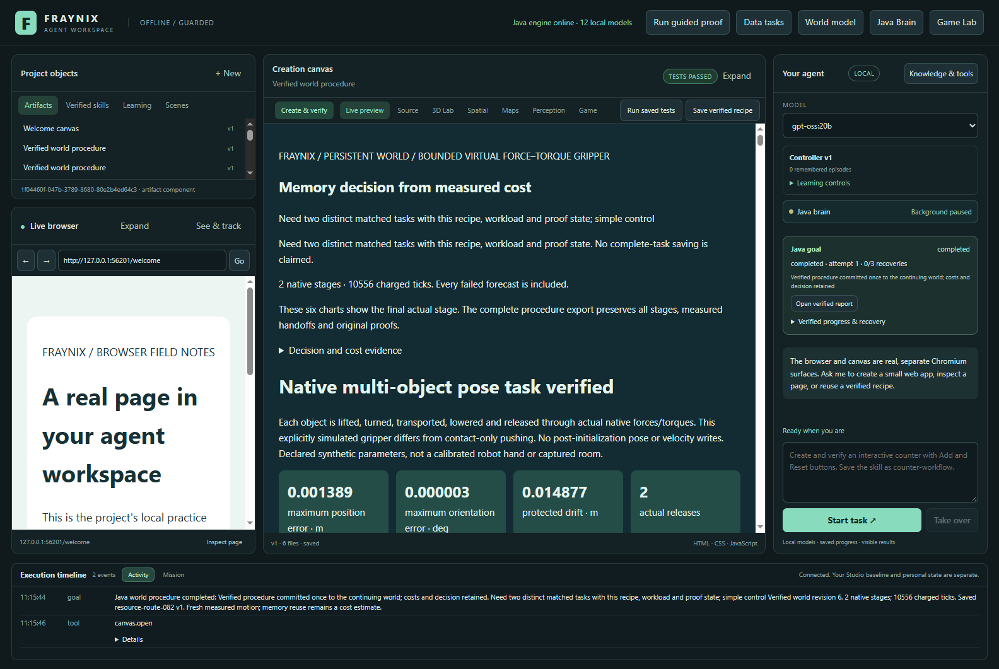

# Fraynix Agent Workspace · edition 082

**Measured work under smaller Java budgets, with the same verification.**

[Previous: edition 081](README-081.md) · [All editions](docs/readmes/INDEX.md) · [Interactive results and recorded motion](docs/readmes/082/index.html) · [Complete source inventory](docs/readmes/082/FILE_TREE.md) · [Verification record](docs/readmes/082/verification.json)

Edition 081 made calibration evidence checking faster on its tested machine. Edition 082 asks a different question: what happens when the Java owner has fewer processors and a smaller heap, while the agent keeps working in one persistent world? It measures actual tasks, a restart in the middle of the sequence, and saving a reusable procedure at the end. Every original verification requirement remains in place.

## Results

The study completed **36/36 planned evaluation goals** across the six continuing-world sequences. The following changes compare two evidence readers with one reader inside each resource budget.

- **four-768**: complete Java time was 0.70% lower; evidence checking was 37.48% lower.
- **two-512**: complete Java time was 1.37% lower; evidence checking was 8.07% lower.
- **one-384**: complete Java time was 1.05% lower; evidence checking was 3.04% lower.

Matching reader arms retained identical decisions, native work and final states in the independently checked completed pairs. Setup and restart costs remain separate below. These measurements do not establish an automatic best budget.

**Calibration coverage:** 0/36 evaluation goals had matching complete-cost estimates; 0/36 selected remembered execution. The measured outcomes therefore describe the existing verified fallback path when those estimates are unavailable. They do not establish a memory-selection benefit.

| Budget | Reader | Completed | Java seconds | Check seconds | CPU seconds | Sampled private MiB |
|---|---|---:|---:|---:|---:|---:|
| four-768 | reference | 6/6 | 218.29 | 5.988 | 336.75 | 1017.3 |
| four-768 | parallel | 6/6 | 216.77 | 3.744 | 329.44 | 987.8 |
| two-512 | parallel | 6/6 | 316.12 | 5.812 | 460.95 | 718.3 |
| two-512 | reference | 6/6 | 320.52 | 6.322 | 461.80 | 707.7 |
| one-384 | reference | 6/6 | 271.86 | 6.703 | 246.84 | 532.6 |
| one-384 | parallel | 6/6 | 269.01 | 6.499 | 243.36 | 526.8 |




*Actual offline results view for the one-processor/384 MiB profile, built from the retained measurements. The companion lets you switch budgets and inspect individual goals.*

These are three paired comparisons on one Windows machine, with one six-goal sequence per reader and budget. They are useful measurements of this configuration, not a statistical guarantee for every machine or task. Each smaller budget receives a fresh calibration from its own measured work. Across budgets, cost estimates may therefore differ legitimately. Within a budget, both reader arms begin with byte-checked copies of the same synthetic project.

The smallest profile used less sampled Java private memory and finished faster than the middle profile in this batch, while the four-processor profile was fastest overall. CPU and heap limits changed together; JVM collector choices and machine conditions can also affect the result. This does not isolate the benefit of any one setting. Independent cross-budget comparisons found matching status, charged native ticks and physical starting/final states after substituting stable object roles for scene-instance IDs.

The runs use Java's existing verified procedure path. They do not benchmark Ollama inference, model loading, or natural-language planning before goal admission. A smaller Java heap setting does not cap a separate model server's memory.

The experiment uses the same D: checkout and storage for all three budgets. Earlier edition 081 runs used C:, so their absolute times are not presented as a matched baseline. Windows file caching remains available. “Cold” here means a restarted Java process with cleared in-memory proof trust; it does not mean that the operating system's disk cache was forcibly cleared.



*Actual application capture, November 6, 2026. The report displays recorded motion and the original verification result. Resource limits are independently recorded in the study evidence.*

## What is limited, and what is measured

The three declared Java budgets are four logical processors with a 768 MiB heap, two with 512 MiB, and one with 384 MiB. The experiment sets the Java processor count and pins the isolated Java process to that many allowed Windows logical processors before measured work. Actual affinity is recorded throughout the run. This is a count of logical processors, not a claim about dedicated physical cores or exclusive CPU ownership.

A Java heap limit is not a cap on the whole application's RAM. Native physics allocations, thread stacks, the JVM's non-heap memory, Electron, and other applications are separate. The record therefore contains JVM heap usage, the configured heap bound, process CPU time, garbage-collection counters, Windows private-memory samples, working-set samples and the process's peak working set. Sampled maxima are labelled as sampled; they are not substituted for exact instantaneous peaks. Java may choose different garbage collectors under different budgets, and the actual collector names are retained.

[Resources082](workspace-engine/src/main/java/fraymus/workspace/Resources082.java) reads the JVM's own counters. [Measure-Resources082](scripts/Measure-Resources082.ps1) checks that the process belongs to the explicit study checkout before changing its affinity or sampling it. The measurements observe the running system. They cannot authorize an action, change a controller threshold, or declare a task successful.

## One world across six goals

Each measured sequence begins from the same declared scene: two manipulated bodies, a protected neighboring body, two fixed obstacles and a floor. The first goal is a regression of the learned occupied-target layout. Later goals move and rotate the bodies between prospectively declared destinations. The complete trajectory was frozen before fresh outcomes were collected.

Every next goal uses the preceding committed world revision and hash. There is no reset between the six goals. Native forecasts are separate from actual stages, and the original checks inspect the resulting positions, rotations, contacts, bounds and protected bodies. A real host report must pass its assertions before the final world revision is committed.

After goal three, the application closes and reopens the same private project. The study records startup time, confirms a new Java boot, checks the exact previous world revision and hash, and verifies that warm proof trust has not survived the restart. The sixth goal requests experience retention and a named skill. A final reopen checks that the world and saved skill still exist. Reopening the saved skill is a persistence check; it is not represented as an additional executed task.





*The actual application under the one-processor study profile. The comparison concerns this declared simulation and workload, not new physical-camera accuracy.*



*Offline replay of retained native body positions. The controls select the budget, reader, goal, stage and recorded frame; they do not invent new motion or rerun the physics.*

## The same evidence requirements

The existing [CalibrationScan081](workspace-engine/src/main/java/fraymus/workspace/CalibrationScan081.java) still uses the original [ProofMemo078](workspace-engine/src/main/java/fraymus/workspace/ProofMemo078.java) byte and path checks. Both reader modes reread the original evidence. The parallel mode joins all readers before comparing their results or returning a refusal. There is no timestamp shortcut, persistent trust cache, skipped file, or weaker low-resource verification mode.

[TaskCost080](workspace-engine/src/main/java/fraymus/workspace/TaskCost080.java), [WorldProcedure079](workspace-engine/src/main/java/fraymus/workspace/WorldProcedure079.java), [GoalRunner](workspace-engine/src/main/java/fraymus/workspace/GoalRunner.java), the physics/controller/verifier classes, and [WorldLedger](workspace-engine/src/main/java/fraymus/workspace/WorldLedger.java) remain unchanged. Every prior compiled engine class except the HTTP server was compared directly with edition 081; the server adds only the read-only resource route. The new resource class supplies observations, not outcome authority.

Cost calibration remains specific to its source, implementation, runtime profile, workload and warm/cold proof state. Saving a skill has a different workload from merely running a task. A previously measured warm, no-retention task cannot automatically predict that extra cost. If suitable evidence is absent, the existing simpler-control fallback remains the valid result.

## Time boundaries and setup costs

Complete Java task time includes admission, native execution, the original audits, real report checking, world commit and requested experience/skill retention. The final timing-record write and caller transport sit outside that clock. Caller time is also recorded. Reader checks have their own counters, so their wall-time savings are not confused with whole-task savings.

Sequence-envelope time includes application startup, goal requests, measurements, exports, review captures and the midpoint restart. The records separately expose exports, restart time and the final persistence check. Java process CPU is measured between surrounding JVM samples; it is distinct from elapsed task time. No CPU or memory benefit is inferred solely from a shorter wall-clock duration.

The same measurement schedule is used for both readers: periodic JVM snapshots and separate Windows process samples. Sampling has a cost and remains part of this instrumented comparison. These figures are not presented as measurements of an unmonitored production session.

The JVM processor and heap arguments apply at launch. The study applies and confirms Windows affinity after the owner reports ready, before learning, calibration and goals. Application startup measurements include that initial period before OS affinity is applied; Electron is not affinity-limited by this study.

Each profile pays for one learning goal and two matched simple/memory calibration pairs. Those costs remain separate from the six-goal evaluation. The offline chart can add setup costs to cumulative task time. This does not establish a break-even point for arbitrary future tasks, or prove that calibration pays for itself. It shows what was actually spent in this bounded study.

## Using the launch settings

The default Java launch keeps its existing heap and processor behavior. To request a smaller budget before starting a new Java owner, set `FRAYNIX_WORKSPACE_JAVA_HEAP_MIB` to an integer from 256 to 768, and optionally `FRAYNIX_WORKSPACE_JAVA_PROCESSORS` from 1 to 4. The [shared launch module](workspace-desktop/java-budget082.cjs) validates these values and supplies literal JVM arguments in both application lifetimes.

For example, in PowerShell before using the normal launcher:

```powershell
$env:FRAYNIX_WORKSPACE_JAVA_HEAP_MIB = '512'
$env:FRAYNIX_WORKSPACE_JAVA_PROCESSORS = '2'
```

These startup settings do not silently resize or replace a running Java owner. If an existing owner has different effective limits, the app explains that it must be stopped before a new budget can take effect. Its work is preserved. Java's processor setting is not itself OS affinity; the study's separate Windows tool enforced affinity for its comparisons. The settings should not be presented as a whole-application RAM cap or an automatic hardware optimizer.

To review the evidence without running the physics workload, open the [offline companion](docs/readmes/082/index.html). Select a resource budget, compare time and memory, toggle setup cost, inspect the six goals, and play the original recorded body positions. To reproduce the study, use the frozen [protocol](workspace-desktop/test/fixtures/procedures082-protocol.json), the [integration harness](workspace-desktop/test/procedures082-integration.cjs), the existing Java 21 build instructions and a new private project. Preserve active installations and do not overwrite live JARs.

## Validation, qualifications and next steps

**160 Java tests across 25 classes and 133 desktop checks passed**, with no failed or skipped checks. A real persistent Java owner refused a different requested budget and then reconnected under matching limits with the same PID and boot identity. All study launches checked the effective heap bound and CPU count; sampled OS affinity remained within the declared logical processors. Sixteen actual Java API evidence-corruption probes exercised both readers under the tightest study launch settings and restored exact original bytes.

The independent [inspector](scripts/Inspect-Procedures082.cjs) reuses the original byte, native-arithmetic, cost-provenance and commit-chain checks, then verifies the sequence bindings and recorded resource limits. Corruption probes change original evidence in an isolated completed test project, require refusal in both readers, and restore the exact original bytes. Matching results are not accepted merely because two summaries say “passed.”



*Actual reopened project and verified final report. Original motion evidence and skill identity remain available after the process ends.*

This edition does not introduce a new neural policy, claim model-weight training, or improve camera calibration. Kinematic world reconstruction retains its existing limits; it does not restore continuous native contact manifolds. Resource contention, processor topology, storage and JVM ergonomics can affect timing. The results describe one declared machine batch. Historical failures and original evidence remain linked, rather than being overwritten by a later favorable run.

This batch recorded 0 goals with supported complete-cost estimates and 0 goals that selected remembered execution. Those counts matter when interpreting the timing comparison: faster evidence loading alone is not evidence that remembered procedures helped the sequence. Next, collect explicitly matched cold-start and retention workloads, then compare longer sequences against simple control with repeated, counterbalanced runs. Keep any new policy behind the same original outcome checks. Automatic reader selection should wait for those resource/benefit measurements.

The direction remains an integrated local Java agent: it owns goals, tools, world state, evidence and useful retained procedures. Resource measurements make that architecture easier to operate honestly. A smaller budget is useful only when the application still completes the intended work and retains its checks.

[Verification](docs/readmes/082/verification.json) · [Exact originals](docs/readmes/082/original-evidence.json) · [Prospective contract](docs/EDITION_082_CONTRACT.md) · [Source hashes](docs/readmes/082/file-inventory.json) · [Obsidian note](docs/obsidian/90-resource-sequences.md) · [System map](docs/obsidian/resource-sequences.canvas) · [Project memory](docs/PROJECT_MEMORY.md) · [Development log](docs/DEVELOPMENT_LOG.md)
