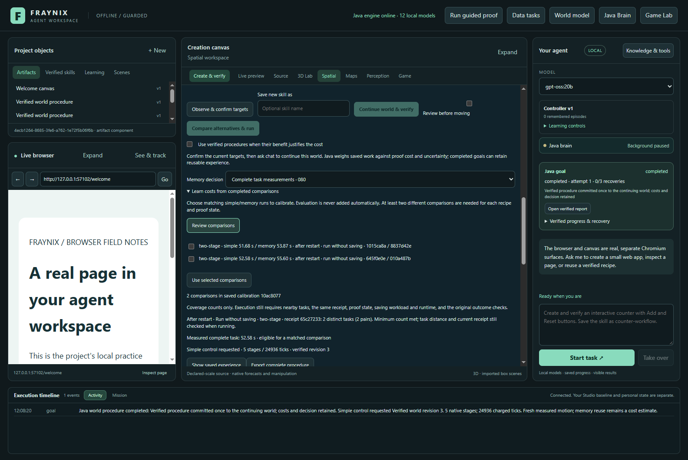
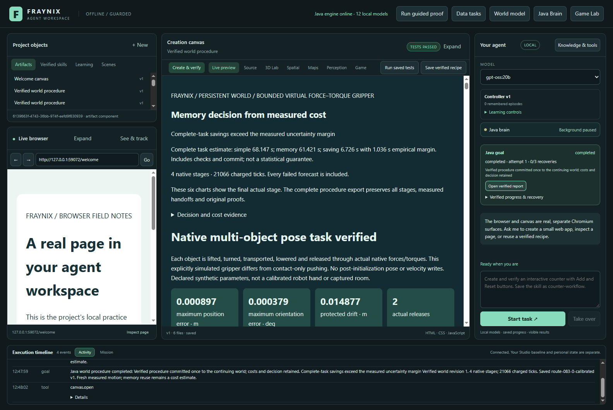
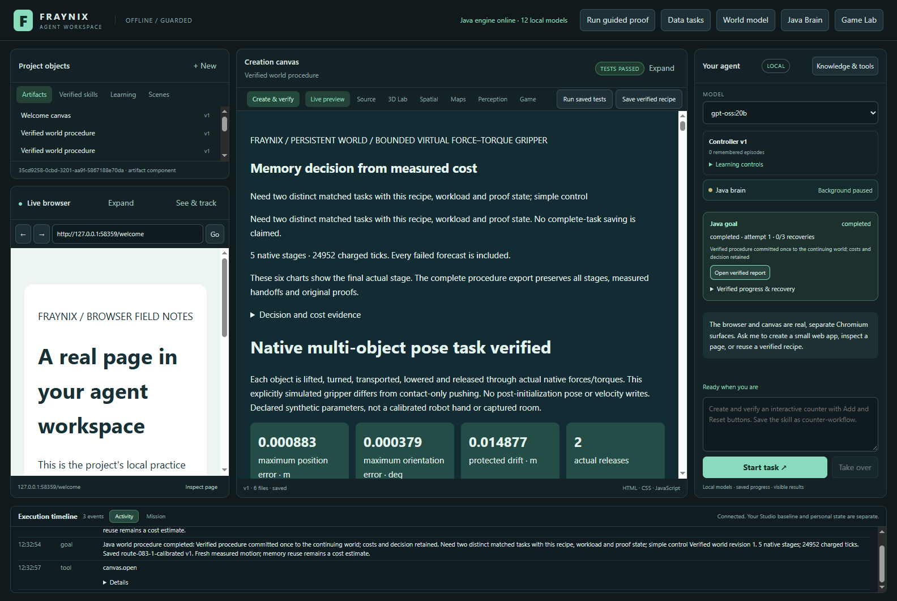
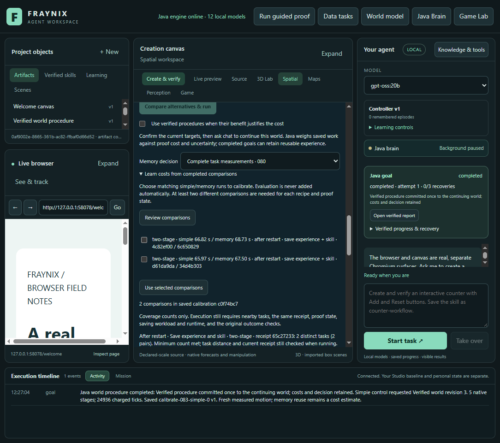
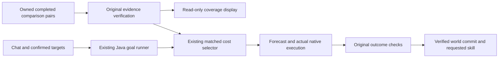

# Edition 083 — calibration after restart and when saving skills

The workspace now shows which completed comparisons cover a restarted Java owner, an already checked procedure, and the work of saving experience plus a named skill. Actual native tasks measured those conditions separately. The existing cost selector, original evidence checks, physics, controllers and world-commit rules remain unchanged.

[Previous: edition 082](README-082.md) · [Edition history](docs/readmes/INDEX.md) · [Interactive offline results](docs/readmes/083/index.html) · [Validation and measurements](docs/readmes/083/verification.json) · [Source inventory](docs/readmes/083/FILE_TREE.md)

## What changed

The preceding resource study exposed a coverage gap: its restarted and saving workloads did not match the available complete-cost calibration. The application correctly fell back, but the user could not readily see which conditions needed more examples.

Edition 083 adds a Java coverage description to the existing verified comparison response. The real app labels each comparison by proof state and saving work, groups the saved calibration by procedure/receipt and workload, and reports distinct task counts and runtime-profile matching. Two different nearby tasks are still required at execution. Repeating the same task does not manufacture coverage. A coverage count never authorizes an action.

The application still runs a complete loop: observe the current world, bind targets to its revision, choose a procedure, forecast, execute bounded native motion, check actual results, commit the verified world, and retain requested experience/skills. Chat uses the same Java-owned goal path. This edition tests that path's cost conditions; it does not add a new language model or change its weights.



## Measured results

**18/18 evaluation goals completed. 4/6 calibrated decisions had matching estimates**. In the two saving conditions, the second new case selected newly retained experience with no matching cost calibration; those decisions correctly fell back. The original goal of six supported estimates was not achieved. The calibrated selector chose memory in **1/6** cases. Each requested saved skill and verified world state survived a reopen.

| Condition | Simple Java time | Explicit memory time | Calibrated time | Calibrated vs simple |
| --- | ---: | ---: | ---: | ---: |
| cold-run | 107.43 s | 111.68 s | 106.30 s | 1.05% faster |
| cold-save | 130.99 s | 137.22 s | 134.69 s | 2.82% slower |
| warm-save | 134.86 s | 133.11 s | 133.25 s | 1.19% faster |

Times are totals for two new tasks per control and condition; smaller is better. Every control retains the same outcome checks.

An available estimate and a useful memory decision are different results. The explicit-memory control measures what reuse actually costs; the calibrated control also pays to load and check the calibration. A positive estimate is not substituted for a successful native result. The unchanged selector requires a positive lower empirical saving bound before choosing memory.

| Condition / case | Estimated memory saving | Observed memory saving | Saving error | Inside empirical interval |
| --- | ---: | ---: | ---: | --- |
| cold-run / 083-unseen-1 | -2.61 s | -2.83 s | 0.23 s | yes |
| cold-run / 083-unseen-2 | -2.61 s | -1.42 s | -1.19 s | no |
| cold-save / 083-unseen-1 | -1.72 s | -3.95 s | 2.22 s | no |
| cold-save / 083-unseen-2 | Unavailable: changed receipt | -2.28 s | — | Not applicable |
| warm-save / 083-unseen-1 | 6.73 s | 4.37 s | 2.36 s | no |
| warm-save / 083-unseen-2 | Unavailable: changed receipt | -2.62 s | — | Not applicable |

Saving means simple time minus explicit-memory time: a negative value means reuse was slower. The observed difference fell inside the empirical interval in **1/4 supported cases**. These few points are not a statistical coverage guarantee. An unsupported estimate is not counted as an interval hit or a successful prediction.



## How the comparison was performed

The [prospective contract](docs/EDITION_083_CONTRACT.md) and [case definitions](workspace-desktop/test/fixtures/procedures083-protocol.json) were frozen before measurements. A [documented collection amendment](docs/EDITION_083_COLLECTION_AMENDMENT.md) follows the first failed saving-study attempt: it changes collection order and explicitly tests changed-receipt fallback instead of forcing unsupported coverage. The scenes, task parameters, controllers and cost thresholds are unchanged. All groups ran on the same D: installation with four logical Java processors, actual Windows affinity and a 768 MiB Java heap. The heap limit is not a limit on total Java, native, Electron or operating-system memory.

| Condition | Proof state | Requested saving |
| --- | --- | --- |
| `cold-run` | New Java owner before each new task | No new experience or named skill |
| `cold-save` | New Java owner before each new task | Verified experience and named skill |
| `warm-save` | Real seed-procedure warm-up in the same Java owner; a different newly selected receipt remains cold | Verified experience and named skill |

“Cold” describes process-local proof state. It does not mean that the operating system's disk cache was cleared. These are new uninterrupted tasks following restart; interrupted and resumed complete-task clocks remain ineligible for calibration.

1. Learn one real occupied-layout procedure using the existing simple controller; retain its original native evidence.
2. Copy its closed project into each condition, checking the copied bytes.
3. Collect two distinct memory/simple pairs and fit only those explicit, owned comparisons through the original checks.
4. Close the calibrated project. Make a separate byte-checked copy for every evaluation case and control, preventing later saving from teaching the next control its answer.
5. Run two unseen perturbations of mass, friction and target location per condition. Rotate the order of simple, explicit memory and calibrated controls. Keep the original parameters and thresholds.
6. Verify the actual report, native motion and world commit, export the originals, then reopen the project and check the exact world hash and saved skill identity.

The calibration memory runs intentionally precede the saving simple runs. The original cold-run group uses memory case0 then case1; the amended saving groups use case1 then case0 so their two calibration runs still select the seed. Real retained memories are never erased. Preflight with the unchanged installed Java distance function found that the second evaluation case selects a newly retained receipt in the saving groups. Those cases must remain unsupported by the seed's calibration and use the calibrated fallback. This deliberate order and bank growth are recorded limitations. Evaluation controls share an identical starting bank; evaluation outcomes never enter the frozen calibration. This is a focused two-case comparison per condition on one machine, not a randomized population study or evidence about arbitrary long sequences.



## Costs that remain visible

Complete Java task time includes admission, native work, evidence checking, actual report checks, world commit and requested retention. Its final timing-file write and transport are outside that clock; caller elapsed time is recorded separately. Calibration loading has its own measured cost. Source inspection checks the exact matching workloads and task definitions.

Initial shared learning took **58.65 s** of complete Java task time. Additional work follows. These totals cover the entire study for each condition, not one ordinary request.

| Condition | Calibration and fitting | Real warm-ups | Recorded launches | Reopen checks |
| --- | ---: | ---: | ---: | ---: |
| cold-run | 241.19 s | 0.00 s | 39.31 s | 18.24 s |
| cold-save | 296.47 s | 0.00 s | 39.41 s | 18.45 s |
| warm-save | 285.55 s | 562.11 s | 42.90 s | 20.13 s |


The offline page provides condition and metric selectors, predicted-versus-observed savings, empirical intervals, and recorded native motion with original sample indices. The replay is a point projection of actual positions, subsampled only for display. Every original native sample remains in the evidence archives. The plotted bodies are labelled simulated bodies; they are not new physical-camera observations.



## Use the feature

1. Open the persistent world view and select a world. Set targets and use **Observe & confirm targets** before asking chat to continue it.
2. Enable **Use verified procedures when their benefit justifies the cost**. **Complete task measurements · 080** uses the existing calibrated selector. **Simple control** and **Prefer verified memory** are explicit comparison modes and retain the same native checks.
3. Expand **Learn costs from completed comparisons** and choose **Review comparisons**. Read the new proof-state and saving-work labels. Select matching completed pairs, then choose **Use selected comparisons**. Evaluation outcomes are not silently added.
4. Supply **Save new skill as** when you want a named procedure retained. Check the completed goal and saved experience after execution. Restart coverage and saving coverage are distinct; do not assume one implies the other.
5. Use **Export complete procedure** to retain the full evidence. The coverage display describes the saved examples; the next execution still checks its own task, runtime profile, procedure, receipt, proof state and workload.

Run the existing desktop through the repository's [launch instructions](README-081.md). Keep a separate project directory for a study; do not silently point a second running owner at private review data. This release preserves the existing application layout and all earlier numbered releases.

### Reproduce the measured workflow

Use the existing Java 21 build and desktop dependencies, build `:workspace-engine:installDist`, then stamp the installed artifacts with `node scripts/Study-Build083.cjs --stamp` from the repository root. The harness selects four Java processors and a 768 MiB heap and checks actual Windows affinity. Run the following stages **one at a time**, from `workspace-desktop`, stopping and preserving the output if any stage fails:

```powershell
node test/procedures083-integration.cjs seed
node test/procedures083-integration.cjs cold-run
$env:FRAYNIX083_OUTPUT = (Join-Path (Resolve-Path ..) 'build/ui083-cold-save-v2')
node test/procedures083-integration.cjs cold-save
Remove-Item Env:FRAYNIX083_OUTPUT
node test/procedures083-integration.cjs warm-save
node test/procedures083-faults.cjs
```

Each measurement directory must be fresh. The original failed attempt is preserved in this release's evidence; it need not be recreated to run the amended collection. From the repository root, independently inspect each successful folder with `node scripts/Inspect-Calibrations083.cjs <folder>`. The harness, fixed case JSON, preflight source and original build/validation helpers are retained alongside the results. Do not compare absolute timings from different machines as though they were matched controls.

## Implementation and evidence boundaries



- [CalibrationCoverage083.java](workspace-engine/src/main/java/fraymus/workspace/CalibrationCoverage083.java) describes an already verified model. Runtime matching is separate from the count of distinct tasks. It does not return action authority.
- [WorkspaceServer.java](workspace-engine/src/main/java/fraymus/workspace/WorkspaceServer.java) appends that description after the existing checked pairs load.
- [persistent-world-panel.js](workspace-desktop/renderer/persistent-world-panel.js) displays the conditions and refreshes them after fitting.
- [TaskCost080.java](workspace-engine/src/main/java/fraymus/workspace/TaskCost080.java), [GoalRunner.java](workspace-engine/src/main/java/fraymus/workspace/GoalRunner.java), the native controllers, proof readers and world ledger retain their existing behavior.
- [Independent inspection](scripts/Inspect-Calibrations083.cjs) rechecks original evidence, commits, complete costs, warm-up ownership, cold process boundaries, frozen starting banks and retained results.

**164 Java tests across 26 classes and 133 desktop checks passed**, with no failures or skipped checks. Four focused coverage tests exercise separation, duplicate task counts, foreign runtime profiles and lack of action authority. Sixteen actual Java API corruption probes across both readers refused altered originals through the same comparison/coverage route, then restored exact bytes. Independent native, commit and cost inspection passed for the seed, calibration, warm-up and evaluation tasks.

Of the 1,154 previously inventoried canonical files, 1,152 remain unchanged; the two changed files are the server response and app display. There are 321 byte-identical prior compiled engine classes; WorkspaceServer is the only changed prior class. The new coverage class is descriptive. Original native, proof, cost, goal and ledger identities are preserved. Actual app captures include 1,600- and 1,100-pixel layouts; the offline page is exercised at 1,440 and 390 pixels, including charts, selectors, original-coordinate replay, source links and image decoding.

[All exact originals](docs/readmes/083/original-evidence.json) include task records, native traces, comparison inputs, OS/JVM observations, logs, screenshots, regression results and failed attempts. Identical complete raw payloads share one SHA-256-named gzip file for publication; each logical path retains its original size and digest. This is lossless archive storage. Runtime verification still reads and checks the original files in full.

The build receipt binds installed JARs and runtime inputs before and after the studies. The first receipt attempt exceeded Node's metadata-output buffer before any experiment; the bounded capture was enlarged without dropping any source paths. The first saving-study attempt completed two native goals but stopped when the selected receipt changed. Its exact checkpoint, exported procedures, failure screenshot and wrapper error remain retained; it is not counted as a successful study. The retry's wrapper overwrote the first mode console log, a recorded logging limitation; the complete checkpoint assertion and task evidence remain original. The preflight also exposed changed-receipt selection on the second evaluation case before new motion. No successful coverage or native result is invented to replace these failures.


## What this establishes—and what comes next

This is useful groundwork for an agent that budgets its own work: it can retain a procedure, identify the conditions under which its costs were measured, and decline unsupported estimates. It still needs measured benefit before making more automatic choices. Calibration is experience-based cost estimation, not proof of consciousness, general intelligence or neural-weight learning.

The calibrated total was lower than simple control in **2/3 conditions** in this batch; that descriptive difference does not establish a causal speed gain. The first priority is calibration under a growing memory bank: collect new matched pairs for the genuinely selected new receipt, while preserving the older model and its provenance. Do not relabel an old receipt's costs as evidence for a new one. Then repeat runs that separate prediction error, checking overhead and the value of the chosen procedure. A bounded admission decision could stay with simple control when consulting memory is unlikely to repay its cost, but must be tested prospectively and preserve full original checks whenever memory is consulted.

Only 1/4 supported savings fell inside their empirical interval in this batch. Collect repeated timings before recalibrating those margins; do not widen them after seeing these outcomes and present that as a new validation. Then extend matched calibration to longer continuing-world sequences and explicit interruption/recovery work, where completed stages and restart costs change the economics. Keep interrupted clocks out of uninterrupted-task training; record recovery as its own workload. Expand to more distinct procedures and scenes before automatic policy promotion. The destination is a durable Java agent that chooses how much reasoning and remembering a task deserves, supported by measured outcomes.

[System note](docs/obsidian/91-restart-saving-calibration.md) · [System map](docs/obsidian/restart-saving-calibration.canvas) · [Current project memory](docs/PROJECT_MEMORY.md) · [Development log](docs/DEVELOPMENT_LOG.md)

Publication target: **eyeoverthink/Fraynix-Agent-Workspace**, `main`, `edition083`, immutable annotated `readme-083`. The current root README links the fetched publication receipt after upload; this numbered edition stays frozen.
