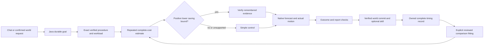
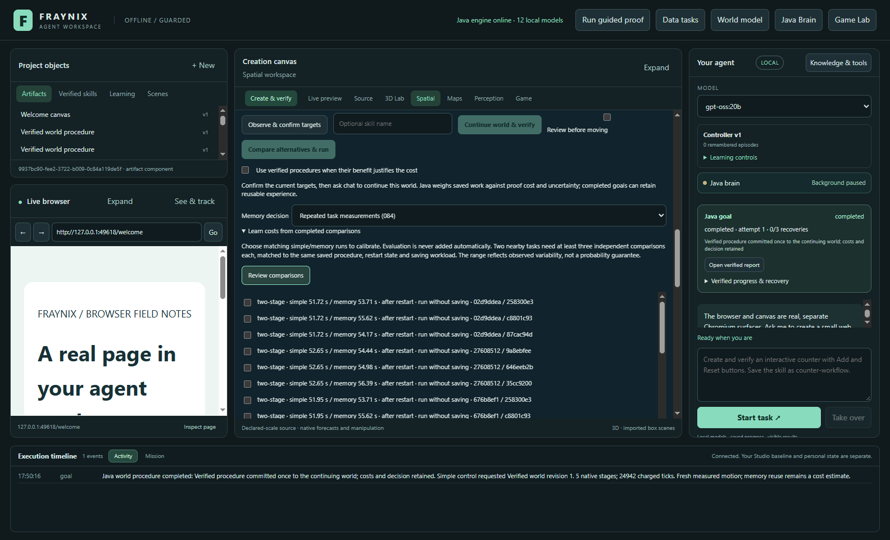
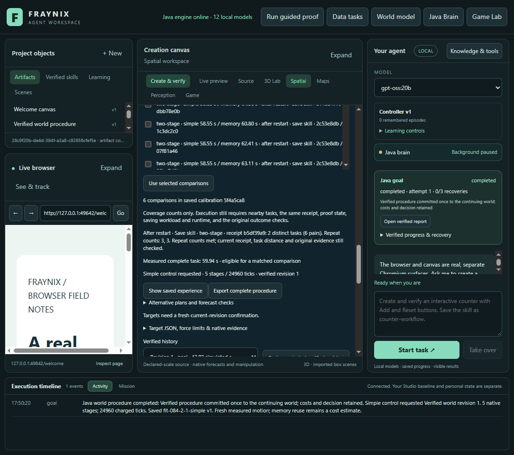
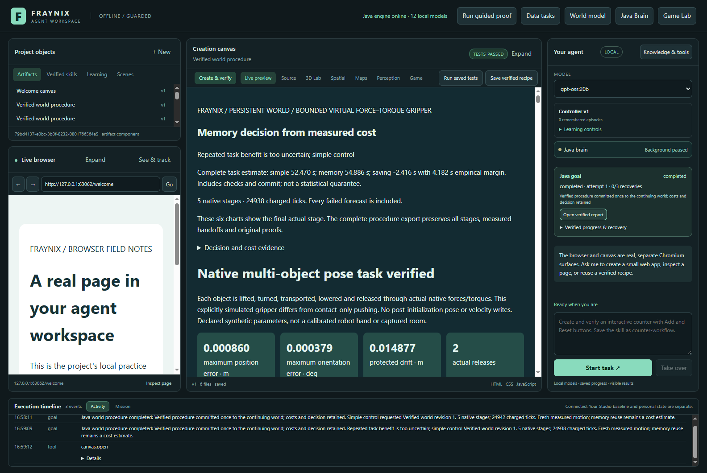
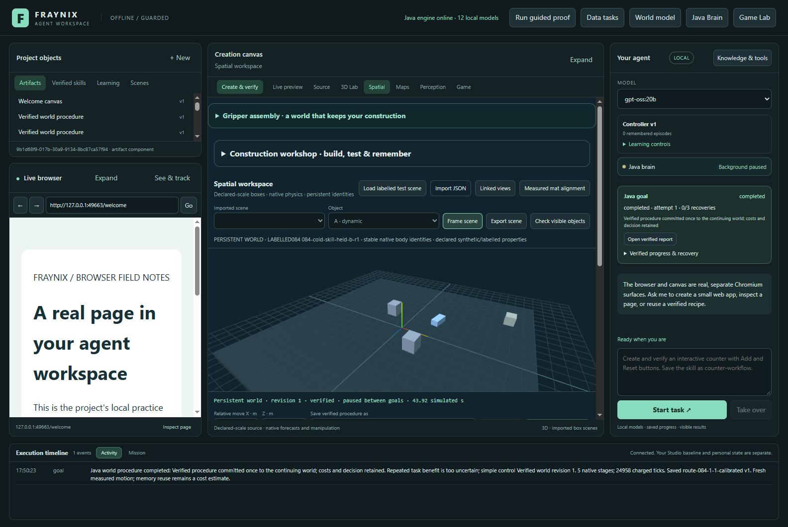

# Edition 084 — repeated timings and honest uncertainty

[Previous: edition 083](README-083.md) · [All editions](docs/readmes/INDEX.md) · [Interactive evidence](docs/readmes/084/index.html) · [Source tree](docs/readmes/084/FILE_TREE.md)

Edition 084 strengthens one part of the local Java agent: deciding when a verified
procedure is worth reusing. It measures complete work repeatedly, including the
checking and saving that make a successful action trustworthy. This is an
implementation and an experiment, with the measured limits shown alongside the
results. It does not substitute an animation or a predicted success for execution.

## What changed

The previous estimator used up to four individual comparisons. That could let
repetitions of one nearby task crowd out the second distinct task. It also had
little evidence about how much another execution might vary. Edition 083 exposed
that weakness: only one of four supported saving estimates covered the observed
saving, and saving new experience sometimes changed the selected receipt entirely.

The new handwritten Java estimator groups comparisons by exact task before
choosing neighbouring tasks. Each supported estimate requires at least two
nearby tasks and three independent simple/memory comparisons per task. Repeating
one goal ID never counts as new evidence. Tasks contribute equally to the point
estimate, so heavily repeated examples cannot dominate simply through volume.

Its uncertainty includes three visible contributions: variation across repeat
executions of the same task, differences between the task means, and the distance
from the requested scene. The range concerns savings in a fresh simple/memory comparison, rather than
shrinking just because the average has more samples. The formula was fixed in
[the contract](docs/EDITION_084_CONTRACT.md) before these measurements.

This range is empirical. Three repeats do not establish a probability such as
95% coverage, and no such promise is made. The decision remains conservative:
reuse memory only when the lower estimated saving is above zero. Otherwise use
simple control. The resulting action still needs every original motion and
commit check.

## What the actual tests found

**24/24 held-out evaluation goals completed; 8/8 calibrated decisions had matching repeated estimates.** Memory was selected in 0/8 decisions. Every requested skill and exact committed world state survived reopen. These are fresh current-code simulation results, not historical timings relabelled as new evidence.

| Condition | Simple total | Explicit memory total | Calibrated total | Calibrated vs simple |
| --- | ---: | ---: | ---: | ---: |
| cold-run | 212.35 s | 225.15 s | 223.78 s | +5.38% |
| cold-skill | 240.28 s | 250.60 s | 250.33 s | +4.19% |


The table totals four evaluation executions per control and workload: two unseen
scenes, each repeated twice. All use the same native controller, outcome limits,
and verification. Comparing total time matters because a promising estimate can
still cost too much to load and check.

| Condition / case | Actual saving | New predicted saving | New interval width | New hit | Old hit |
| --- | ---: | ---: | ---: | --- | --- |
| cold-run / 084-cold-run-held-a-r0 | -2.60 s | -2.42 s | 8.36 s | yes | yes |
| cold-run / 084-cold-run-held-b-r0 | -4.19 s | -2.42 s | 8.36 s | yes | no |
| cold-run / 084-cold-run-held-a-r1 | -3.24 s | -2.42 s | 8.36 s | yes | yes |
| cold-run / 084-cold-run-held-b-r1 | -2.76 s | -2.42 s | 8.36 s | yes | yes |
| cold-skill / 084-cold-skill-held-a-r0 | -4.09 s | -2.03 s | 11.57 s | yes | no |
| cold-skill / 084-cold-skill-held-b-r0 | -2.34 s | -2.03 s | 11.57 s | yes | yes |
| cold-skill / 084-cold-skill-held-a-r1 | -2.12 s | -2.03 s | 11.57 s | yes | yes |
| cold-skill / 084-cold-skill-held-b-r1 | -1.78 s | -2.03 s | 11.57 s | yes | yes |

New intervals covered **8/8** measured savings; the old arithmetic covered **6/8** on the same data. Mean interval width: new 9.96 s, old 2.48 s. Mean absolute saving error: new 0.73 s, old 0.84 s. These eight comparisons are descriptive, not a calibrated confidence guarantee. Independent repeats mean distinct goal executions; hardware noise is not assumed statistically independent.

The old 080 calculation is also evaluated on these same new fitted pairs. That
is an arithmetic baseline, not a separate old executable running with a different
engine identity. Its old four-neighbour rule and uncertainty formula are retained
unchanged. We compare both against untouched measured simple-minus-memory costs.
We report width as well as coverage: a wider interval can cover more outcomes
while making fewer useful decisions. A negative measured saving means explicit
memory was slower than simple control.

| Condition | Fresh learning | Calibration and fit | Owner launches | Reopen checks | Full study elapsed |
| --- | ---: | ---: | ---: | ---: | ---: |
| cold-run | 59.13 s | 727.32 s | 103.31 s | 46.59 s | 1766.65 s |
| cold-skill | 58.73 s | 813.97 s | 97.49 s | 41.29 s | 1928.60 s |

The refused naming attempt adds 58.64 s of separately retained learning time. It contributes no fitted pair or held-out result.


The component timing columns do not include every interface review, export or
project-copy operation. Full study elapsed time includes those operations and
restarts; it is retained alongside the task measurements.

## A complete task, not just a fast inner loop

Java records time through execution, native verification, report checking, the
persistent-world commit and requested skill saving. The final timing-file write
and caller transport sit outside that internal duration; caller duration is
retained too. Startup, learning, fitting and reopen work are separate measured
costs, not hidden in a free setup phase. Each calibration pair has distinct
owned simple and memory goals with matching scene, implementation, runtime,
workload and proof state.

Both conditions start a new Java owner for every measured goal. That tests an
after-restart workload; it does not flush the operating-system disk cache, and
it is not an interrupted task resumed halfway through. Interrupted clocks remain
ineligible for this calibration. Recovery requires its own measurements.

One fresh procedure is measured without saving a skill. The other saves a real
reusable skill and proves that it and the exact committed world state survive
reopen. During timing, both explicitly disable retaining additional procedure
experience. Their original memory banks remain byte-identical. This isolates
repeat timing from a changing nearest receipt without deleting or overwriting
anything the agent learned.

The two conditions use different freshly learned procedures. Their time
difference is not a causal estimate of skill-saving overhead. Skill records and
goal history grow during calibration; held-out executions each start from the
same closed prepared snapshot.

That distinction is a deliberate boundary. These results do **not** calibrate a
workload that retains both new experience and a skill. The app continues to refuse
a mismatched workload. The unresolved growing-bank problem from edition 083 stays
visible; an old receipt's timings are never renamed as calibration for a new one.

## Where the work lives



- [TaskCost084](workspace-engine/src/main/java/fraymus/workspace/TaskCost084.java)
  owns the new repeat-aware arithmetic and conservative decision.
- [WorldProcedure079](workspace-engine/src/main/java/fraymus/workspace/WorldProcedure079.java)
  connects it to the existing durable execution and checked calibration storage.
- [CalibrationCoverage083](workspace-engine/src/main/java/fraymus/workspace/CalibrationCoverage083.java)
  now reports repeated-task coverage after the original evidence is read.
- [The app panel](workspace-desktop/renderer/persistent-world-panel.js) shows
  repeat counts, workload and restart state beside the calibration controls.
- [Independent inspection](scripts/Inspect-Calibrations084.cjs) reconstructs
  costs and decisions alongside the existing native-motion and commit checks.

There is no new service, library, external inference dependency or background
training process. The estimator is Java; the desktop presents its results.
Existing browser, canvas, creation, Game Lab, persistent worlds, physics,
perception and typed-skill capabilities remain in the same application. This
edition changes cost estimation, not the physical solver or language-model weights.

## Using it in the app

1. Open the existing persistent-world view and select the intended world.
2. Set and confirm the current target poses. A stale world revision must be
   confirmed again; a cost estimate cannot authorize movement from an old state.
3. Enable verified procedures and choose **Repeated task measurements (084)**.
4. Expand **Learn costs from completed comparisons**, then **Review comparisons**.
   The app lists actual simple/memory durations, saving workload and proof state.
5. Select independent matching pairs. At least two nearby tasks need three pairs
   each for the same receipt and workload. Saving an incomplete model does not
   make it supported; the coverage text explains what is missing.
6. Run the confirmed request. Java chooses memory only when the empirical lower
   saving bound is positive, and verifies the action before committing it.
7. Read the complete-task report, world revision and saved skill. Reopen the
   project to inspect durable results. Review evidence before fitting again;
   evaluation data is never silently added to calibration.

Fresh current-code procedures are required. Procedure identity includes the
estimator, so earlier motion receipts are preserved as historical evidence and
are not relabelled for this edition. Back up and close a private project before
any explicit migration. The tests use isolated projects and never share the
normal review application's live database or replace its running JARs.

## Actual screenshots









These are dated captures of the running application, using clearly labelled
synthetic scenes. They are not interface mockups or camera measurements. The
[offline companion](docs/readmes/084/index.html) includes cost controls, per-case
predictions, original-coordinate motion replays, implementation links and these
captures. The replay display subsamples frames; the full original traces remain
in the evidence archive.

## Validation and reproducibility

**173 Java tests across 27 classes and 133 desktop checks passed.** The fifty planned native goals include two learning goals, twenty-four calibration goals and twenty-four held-out evaluations. Independent native-motion, original-byte, cost-arithmetic and commit inspection passed. Sixteen actual API corruption probes across both evidence readers were refused and restored byte-for-byte. Actual app views were checked at 1600 and 1100 pixels; the offline guide is checked at 1440 and 390 pixels before publication.

After measurements, the cost-mode label was corrected from its old edition number
to **Repeated task measurements (084)**. An exact source comparison confirms
this display text is the sole post-study runtime-input change; every compiled
input and installed JAR remains identical to the measured build. The 133 desktop
checks passed again, and the final screenshots show reopened calibration and
the actual committed world renderer. Original measured UI bytes remain archived.

The first skill-saving attempt was refused before calibration because the test
harness generated skill names beginning with a number. The learning goal and
failure output are retained; a fresh attempt changes only those labels. See the
[collection note](docs/EDITION_084_COLLECTION_NOTE.md). The accepted matrix still
contains fifty goals; the failed attempt adds one separately recorded learning
goal. No scene, controller, estimator or threshold was retuned.

The [frozen protocol](workspace-desktop/test/fixtures/procedures084-protocol.json)
fixes scene inputs and method order before collection. Each condition learns one
fresh receipt, collects six matched pairs, and fits before any evaluation goal.
Each held-out execution starts from a byte-checked copy of the closed prepared
project. The selected receipt and model remain fixed; successful evaluation skills
are real but cannot leak back into subsequent comparisons.

Four logical Java processors and a 768 MiB Java heap are declared and checked
against the running process. Windows affinity is pinned and recorded. Heap is
not total process memory: native allocations, Electron and the operating system
are distinct. All study storage is on D:. Native runs are serialized to avoid
competing validation jobs contaminating the measurements. Ordinary machine and
OS variation can still occur, which is why repeated timings matter.

The new regression tests cover minimum repetitions, distinct tasks, duplicate
provenance, unequal repeat counts, variance that must not shrink away, old-model
version refusal, runtime/workload/receipt mismatches and read-only coverage.
Actual corruption probes alter isolated original evidence, require the Java API
to refuse it, restore the exact bytes, then verify that model and world state
remain unchanged. Re-sealing an envelope is not permission to change an original.

To reproduce, use a separate checkout and private project, build the Java runtime,
then use the checked build receipt and serial harness:

```powershell
node scripts/Study-Build084.cjs --stamp
node workspace-desktop/test/procedures084-integration.cjs cold-run
$env:FRAYNIX084_OUTPUT='build/ui084-cold-skill-v2'
node workspace-desktop/test/procedures084-integration.cjs cold-skill
node scripts/Inspect-Calibrations084.cjs build/ui084-cold-run build/ui084-cold-skill-v2
```

Output folders must be fresh. Do not run this against a live review project or
while other heavy native/model validations are running. The complete build,
regression, failure and original-evidence records are linked from
[verification](docs/readmes/084/verification.json) and the
[original inventory](docs/readmes/084/original-evidence.json). Identical raw
payloads share compressed publication storage while retaining every logical path,
byte count and hash. Runtime verification still reads the required originals.

## Direction and next gates

The repeated estimator covered 8/8 held-out savings versus 6/8 for the previous arithmetic. Treat that together with the interval widths and complete-cost totals above; this small study does not establish a general speed gain. The next gate is calibrating a growing bank without changing the identity of the measured procedure, then measuring interrupted/resumed workloads separately. Reuse setup only when a bounded admission check predicts enough remaining task benefit to repay calibration and original-evidence reading. Test that decision on untouched longer sequences and report failures as well as successes. Preserve the current proof and world-commit boundaries.

The destination remains an integrated local agent: language expresses the goal;
Java keeps identity, progress and policy; the world supplies measurable state;
controllers perform timed actions; independent checks establish what happened;
and reusable skills retain successful ways to complete tasks. A useful memory
must repay its retrieval and checking costs on unfamiliar work. This edition
makes that question more measurable rather than assuming that more reasoning
or more stored experience is always better.

[Previous measurements](README-083.md) · [Architecture](docs/ARCHITECTURE.md) ·
[Project memory](docs/PROJECT_MEMORY.md) · [Development log](docs/DEVELOPMENT_LOG.md) ·
[Obsidian map](docs/obsidian/repeated-cost-calibration.canvas)
