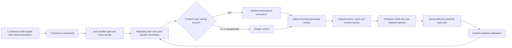
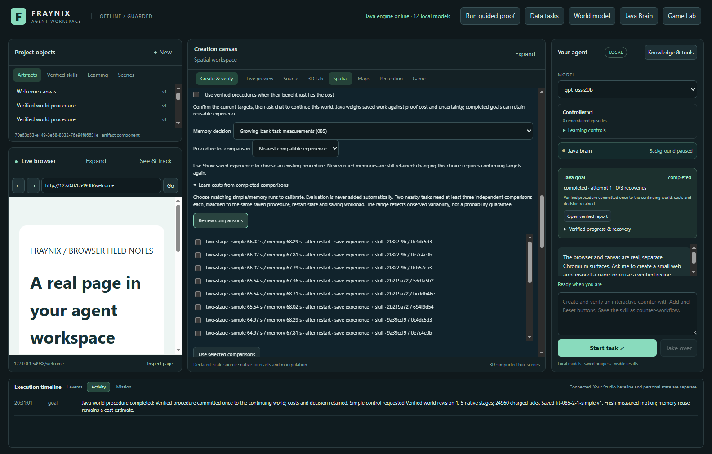
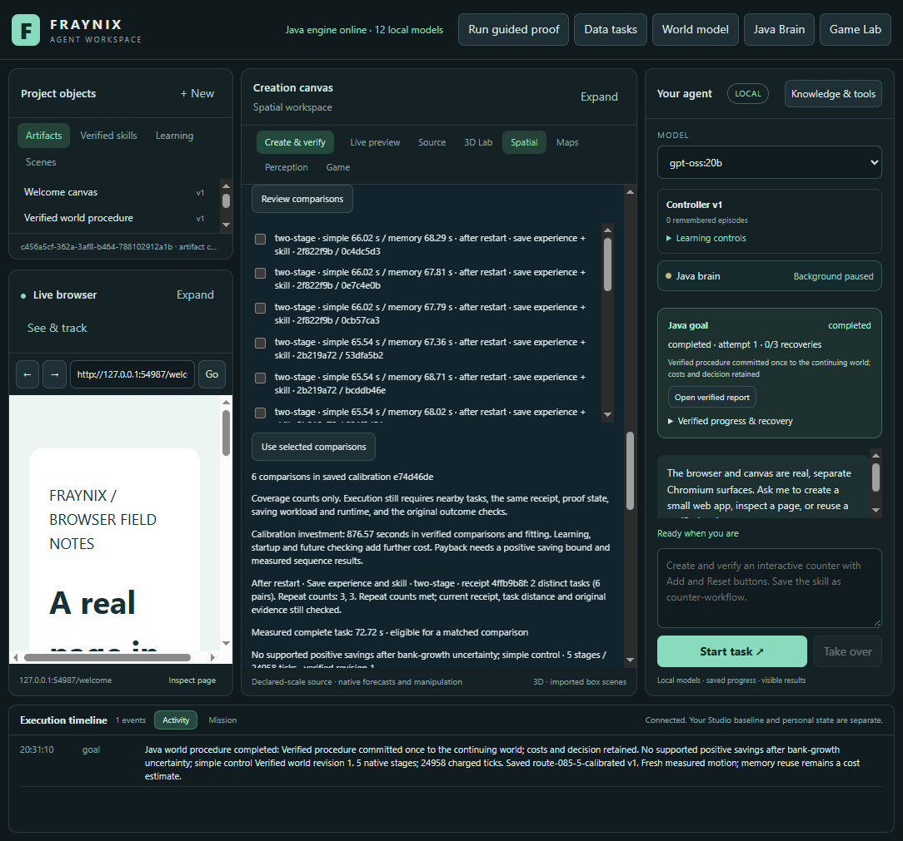
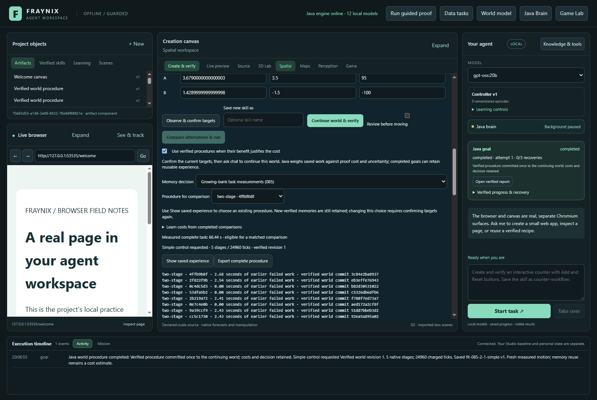
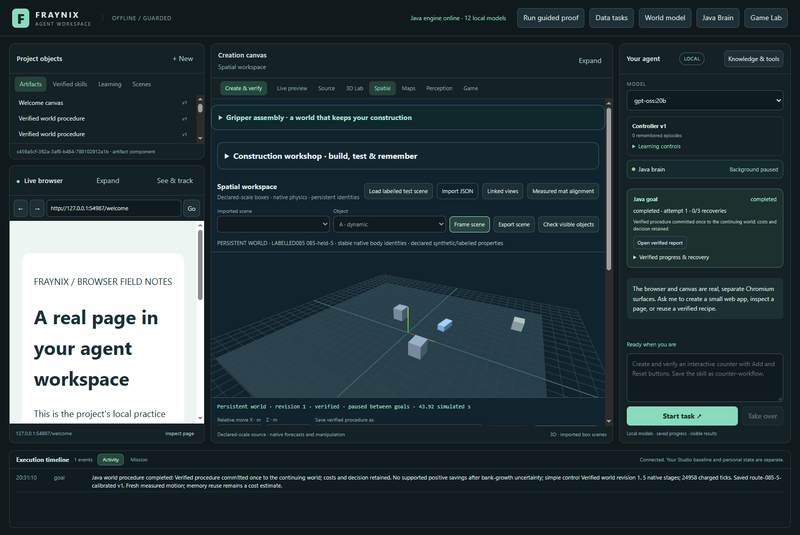
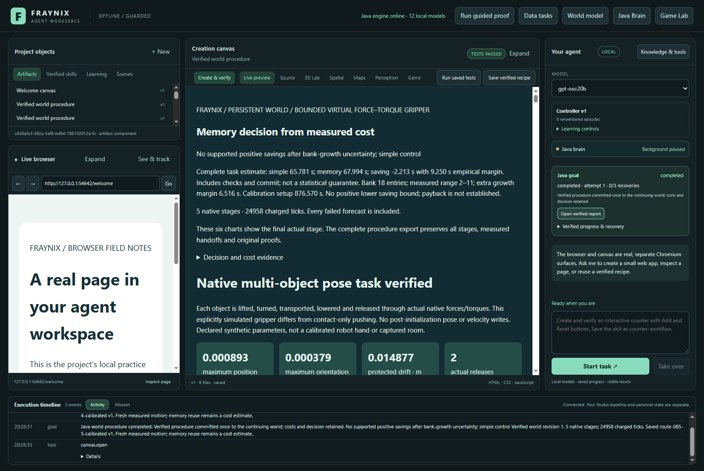

# Edition 085 — growing memory, measured cost

[Previous: edition 084](README-084.md) · [All editions](docs/readmes/INDEX.md) · [Interactive evidence](docs/readmes/085/index.html) · [Source tree](docs/readmes/085/FILE_TREE.md)

The local agent now keeps a chosen, verified procedure stable while it retains
new successful experiences. Its complete-task estimates account for observed
variation in the size of the memory bank, and its reports show the cost of
collecting calibration before discussing possible repayment. This edition asks
an operational question: after paying for learning, comparison runs and checking,
did calibrated selection save work over a complete sequence?

## What was missing

Edition 084 measured repeated tasks with experience retention disabled. It could
save reusable skills, but adding new procedural memories could change the nearest
receipt and invalidate the old receipt's calibration. A faster or newer-looking
memory cannot simply inherit another procedure's timings or proof.

Edition 085 adds an explicit optional procedure choice. Select a real retained
receipt in the world controls and confirm the current targets. Java then uses
that exact compatible receipt for a memory control or calibrated decision. New
successful goals still produce their own receipts. The selection survives chat
transport, saved-skill defaults and a restart; it never changes the identity of
new memories or grants authority to move the active world.

Malformed, absent, foreign-code, ambiguous or too-distant selections are refused.
Simple control does not select a memory. Without an explicit selection, the
existing nearest-compatible rule remains. A request to change a confirmed
receipt through ordinary chat arguments is refused; the user can choose another
receipt and confirm it in the world controls.

The retention bank is bounded at 32 entries, increased from 16. The world registry now also holds up to 32 worlds; its 16 MB file bound, 64 revisions per world and existing 64-goal history bound remain. This permits the declared growing-bank study without
silently discarding its later experiences. Capacity is still finite and reported;
this is not unbounded background learning.

## A capacity failure caught during development

The first attempt completed thirteen preparation goals and nine evaluation goals,
then refused world seventeen: the memory bank had been expanded, but the world
registry still had its earlier sixteen-world bound. The refusal preserved the
existing ledger. The complete failed attempt, logs and original build receipt
remain archived; none of its timings are fitted into the corrected study.

Correction `28f919b1` aligned the world capacity at 32, tested exact preservation
through reopening and refusal of world 33, and added an explicit upgrade for known
closed 079–084 worlds. Use **Upgrade compatible saved world** for this explicit handoff. It preserves the frame and records a revision;
an unfinished owner still refuses upgrade. Earlier native proofs remain historical.
The ledger change alters engine identity, so all 31 measurements below start again
with fresh code and empty projects. The cases, uncertainty formula and order stay
unchanged. Failed development work is reported separately from successful-study
payback; it was not free progress.

## What the actual study found

**18/18 evaluation goals completed. All three banks grew from 13 to 19 verified memories; all 30 requested skills were present after reopening.** The exact selected receipt remained unchanged. Calibrated selection chose memory in 0/6 decisions. These are fresh current-code results from actual native simulation.

| Control | Complete Java tasks | Caller time | Calibration checking | Bank growth |
| --- | ---: | ---: | ---: | --- |
| simple | 401.24 s | 401.92 s | 0.00 s | 13 → 19 |
| memory | 419.05 s | 419.70 s | 0.00 s | 13 → 19 |
| calibrated | 430.29 s | 431.25 s | 14.48 s | 13 → 19 |

Explicit memory used 24 native stages versus 30 for simple control, and 126,480 versus 149,736 charged ticks (15.53% fewer). Its complete task time was 4.44% higher. Calibrated selection was 7.24% higher than simple control. Lower native work did not yield lower complete cost in this batch.

Each method ran the same six predeclared, previously unmeasured parameter
variations of earlier scene layouts, with changed masses and friction. Every
evaluation goal retained a verified memory and saved a real reusable skill. Each
method's separate project grew from 13 to 19 bank entries, with no rollback or
memory removal between its tasks. Methods used the same native controller,
forces, outcome limits and original verification. Their stored experiences can
differ because their procedure order differs; that is part of the measured
workflow, not a reason to substitute one method's results for another's.

Measured calibration tasks cost **802.65 s**, with **82.70 s** of fitting caller time (73.92 s recorded inside Java). Calibrated evaluation cost **29.04 s more** than simple control before setup. Including calibration, its additional cost was **914.39 s**. **Calibration did not repay its setup within the declared six-task horizon.**

Learning cost 58.51 s. Charging that as well gives net saving -972.90 s. All recorded owner launches total 132.72 s; reopen checks total 64.35 s. Reopen checks include another launch, so these totals must not be blindly added. The full study elapsed 2588.57 s, including exports, copies and UI review. Preparation was shared for matched evaluation; the setup accounting is not an extra measured run from an empty project.

The earlier capacity-failed development attempt completed 22 goals costing 1480.01 s in measured task time, plus its other development overhead. Those costs are disclosed separately and none of those outcomes enter the corrected fit or evaluation.

Including measured owner launches as well as learning and calibration, the accounting totals are simple: 416.91 s, memory: 495.62 s, calibrated: 1423.98 s. Net calibrated saving is -1007.07 s. This view charges actual seed and calibration launches to their respective setup, and each policy's six task launches. Validation-only reopens, export and copy time remain separate. These are explicit accounting views of the same measured runs.

Calibration tasks themselves might be useful work in a real project. Here we
charge their entire measured cost as setup, because they were collected to fit
the estimator. We also report learning, startup and reopening separately rather
than treating them as free. The six-task horizon was fixed before collection;
we did not extend it until a positive result appeared.

| Case | Bank entries | Actual saving | Predicted saving | New range width | Growth margin | In new range | In 084 range |
| --- | ---: | ---: | ---: | ---: | ---: | --- | --- |
| 085-held-0 | 13 | -2.47 s | -2.21 s | 8.58 s | 1.86 s | yes | yes |
| 085-held-1 | 14 | -2.68 s | -2.21 s | 10.62 s | 2.79 s | yes | yes |
| 085-held-2 | 15 | -3.09 s | -2.21 s | 12.47 s | 3.72 s | yes | yes |
| 085-held-3 | 16 | -3.35 s | -2.21 s | 14.56 s | 4.65 s | yes | yes |
| 085-held-4 | 17 | -4.01 s | -2.21 s | 16.41 s | 5.58 s | yes | yes |
| 085-held-5 | 18 | -2.19 s | -2.21 s | 18.50 s | 6.52 s | yes | yes |

New ranges covered **6/6** observed savings, versus **6/6** for 084 on the same pairs. Mean width: 13.52 s versus 5.14 s. Mean absolute point error: 0.76 s. The growth addition changes range width, not the point estimate.

The comparison with 084 uses its unchanged arithmetic on the same new fitted
pairs. It is an arithmetic baseline, not a different executable rerunning the
experiment. We report interval width and prediction error alongside range hits.
A wider interval can cover more outcomes without producing a useful decision.
These are empirical ranges on one machine, not 95% confidence intervals.

## How Java handles growth

A fitted comparison now records the number of entries in the memory control's
original bank snapshot. Java checks that count against the original measured
job and its selected receipt. It retains the exact task, implementation, runtime,
workload and warm-proof boundaries from 084. Two nearby distinct tasks still need
three separately executed simple/memory comparisons each, with no duplicate goal
IDs and equal weighting of task means.

The original uncertainty has within-task variation, between-task variation and
scene-distance terms. When a requested bank is larger than every matching
calibration neighbor, 085 adds another nonnegative term:

```text
extra entries = max(0, current bank entries - largest matched measured bank)
sensitivity = max(25 ms, |memory time A - memory time B| / |bank size A - bank size B|)
growth margin = extra entries × sensitivity
```

The sensitivity considers matched comparisons with different bank sizes. Task
variation, hardware noise and entry count are mixed in those observations, so
this is a conservative descriptive penalty—not an identified causal law of
memory growth. It widens the range; it never invents an improvement in the point
estimate. Counts outside the bounded bank, mismatched workloads and unsupported
receipts do not produce an available estimate.

The application records the measured fitting duration and sums the verified
simple/memory calibration tasks. A conditional break-even count is displayed
only when the lower estimated saving is positive:

```text
conditional tasks to repay setup = ceiling(calibration setup / lower saving bound)
```

That forecast excludes learning, launch overhead and the future cost of checking
the model. It is explicitly conditional. Actual repayment requires a measured
sequence including those costs, as shown above. A negative or zero lower saving
bound produces “payback is not established,” rather than a fabricated number.

## One system, with distinct responsibilities



The browser, creation canvas, Game Lab, Java brain, persistent worlds, perception
and typed procedures remain parts of the existing application. This addition
uses handwritten Java selection and arithmetic. It adds no inference provider,
new external library or synthetic success response. The language model can express
a request; Java owns the binding, execution and verification. Keeping useful
procedures across sessions is distinct from training language-model weights.

- [TaskCost085](workspace-engine/src/main/java/fraymus/workspace/TaskCost085.java)
  validates the selected receipt, checks growth evidence and calculates conditional
  setup repayment. The original [084 arithmetic](workspace-engine/src/main/java/fraymus/workspace/TaskCost084.java) is unchanged.
- [WorldProcedure079](workspace-engine/src/main/java/fraymus/workspace/WorldProcedure079.java)
  binds the selection to existing native execution, checks fitted bank counts and
  exposes the cost explanation in actual reports.
- [WorldLedger](workspace-engine/src/main/java/fraymus/workspace/WorldLedger.java)
  preserves the revision chain, bounded storage and explicit compatibility handoff.
- [GoalRunner](workspace-engine/src/main/java/fraymus/workspace/GoalRunner.java)
  validates the optional choice before creating a goal and retains it in saved skills.
- [The world controls](workspace-desktop/renderer/persistent-world-panel.js) and
  [chat transport](workspace-desktop/goals.cjs) preserve the confirmed selection.
- [Independent inspection](scripts/Inspect-Growth085.cjs) reconstructs the original
  motion, selection, bank history and cost accounting without rerunning a substitute simulation.

## Using the new controls

1. Open the persistent-world view and select the actual world to work on.
2. Enable verified procedures and choose **Growing-bank task measurements (085)**
   or **Prefer verified memory** for an explicit comparison control.
3. Click **Show saved experience**. Under **Procedure for comparison**, choose the
   existing receipt to measure or reuse. Leaving it unselected keeps nearest matching.
4. Set the target poses and force/torque limits, then confirm them. Changing the
   selected receipt invalidates that confirmation. A stale world revision also
   requires a new confirmation.
5. Ask chat to continue the confirmed world, or start the confirmed task directly.
   Normal successful requests retain experience; request a skill name when saving
   a reusable procedure. Saved defaults keep the exact selected receipt.
6. For fitting, open **Learn costs from completed comparisons**, review the actual
   simple/memory pairs, and select independent matching comparisons. An incomplete
   calibration can be saved but does not become supported merely by being saved.
7. Read the repeat counts, saving workload, calibration investment and the actual
   task report. Review the measured world revision and retained skill after reopening.

An explicit choice stabilizes this comparison; it does not automatically calibrate
every new receipt. Nearest matching can still select an unsupported new memory,
which must fall back rather than inherit somebody else's timings.

Calibration is an explicit review action. New evaluation outcomes are not silently
fitted. Earlier code's receipts remain historical; a changed implementation needs
fresh compatible procedures and timings. Keep private review projects closed and
backed up before an explicit upgrade. This study used separate projects and never
shared the normal review app's live data or replaced its running Java installation.

## Actual screenshots











These captures come from the running app using clearly labelled synthetic scenes.
They are not mockups, camera measurements or reconstructed screenshots. The
[offline companion](docs/readmes/085/index.html) provides cost controls, cumulative
setup accounting, per-case uncertainty, original-coordinate motion replay,
source links and the captured views. Display replays subsample frames; complete
original traces remain in the evidence archive.

## Validation and reproducibility

**187 Java tests across 28 classes and 135 desktop checks passed.** The actual 31-goal study, independent native/proof/commit/cost reconstruction, 20 corruption-refusal probes across both readers, 30 reopened skill records, and real app wide/narrow views all passed. The offline guide is exercised at 1440 and 390 pixels before publication. 320 prior compiled engine classes are byte-identical; the changed prior classes are GoalRunner, WorldProcedure079, CalibrationCoverage083 and WorldLedger, plus new TaskCost085. The original native solver/controllers, proof reader and 080/084 arithmetic are unchanged.

The [prospective contract](docs/EDITION_085_CONTRACT.md) and
[committed fixture](workspace-desktop/test/fixtures/procedures085-protocol.json)
precede new timings. One fresh learning goal is followed by two calibration tasks,
three matched simple/memory pairs each. Those twelve goals retain experience and
save skills. The fitted preparation project is closed and copied byte-for-byte
into three independent evaluation projects. Each copy keeps its evolving bank
across six goals; no active world is restored to an earlier revision.

Calibration pairs use adjacent growing banks, with counterbalanced method order;
they match physical task, code, workload and runtime, not identical bank contents.
This is another reason the observed sensitivity is descriptive rather than causal.

All measured goals start a new Java owner with four logical processors and a
768 MiB heap; actual Windows affinity and process resources are recorded. This is
an after-restart condition, not an OS cache flush or an interrupted task resumed
halfway through. Heap is distinct from total process memory. Native work runs
serially, and all study data is on D:. Ordinary machine variation remains.

The first calibrated evaluation traverses the real confirmed UI selection and
chat tool bridge. This verifies tool transport into Java; it is not a new claim
about the quality of an LLM-generated plan. The saved procedure registry is checked
after reopening, including source goal, code identity, targets, selected receipt,
prerequisites, actions and recovery steps.

New tests exercise selection drift when a nearer memory arrives, malformed and
missing choices, unchanged 084 arithmetic within the measured range, wider growth
uncertainty, original bank-count provenance, setup arithmetic, nonpositive payback,
workload/version/bank boundaries and confirmed chat selection. Actual corruption
probes alter isolated timing, bank-count, setup and native evidence, require refusal,
then restore the exact original bytes and verify that the bank and world remain unchanged.

To reproduce, build this checkout's Java distribution and use fresh isolated
output paths. The build receipt must match before and after the experiment:

```powershell
node scripts/Study-Build085.cjs --stamp
node workspace-desktop/test/procedures085-integration.cjs
node scripts/Inspect-Growth085.cjs build/ui085-study
```

Do not run against a live review project or overlap another heavy validation job.
See [verification](docs/readmes/085/verification.json), the
[exact-original inventory](docs/readmes/085/original-evidence.json) and
[full source tree](docs/readmes/085/FILE_TREE.md). Shared compressed payloads preserve
all logical original paths and byte hashes; they do not bypass runtime evidence checks.

## Next gates

Next, test a bounded admission decision before paying for calibration: compare a short task horizon with the measured setup cost and expected saving. Keep unsupported cases on simple control and preserve all verification. Evaluate longer sequences and more than one useful procedure before any automatic promotion; calibrating one chosen receipt does not calibrate every newly retained memory. Interrupted/resumed workloads still require separate clocks and recovery measurements. Treat this edition's measured net cost and uncertainty as evidence for the next decision, including an unfavorable result.

The goal remains a local agent that can retain useful experiences, choose a known
procedure, act in a measurable world and verify what changed. More memory alone
does not establish useful improvement. The practical measure is whether retained
knowledge improves outcomes or repays the work required to retrieve, check and
calibrate it on unfamiliar tasks.

[Previous measurements](README-084.md) · [Architecture](docs/ARCHITECTURE.md) ·
[Project memory](docs/PROJECT_MEMORY.md) · [Development log](docs/DEVELOPMENT_LOG.md) ·
[Obsidian map](docs/obsidian/growing-memory-payback.canvas)
