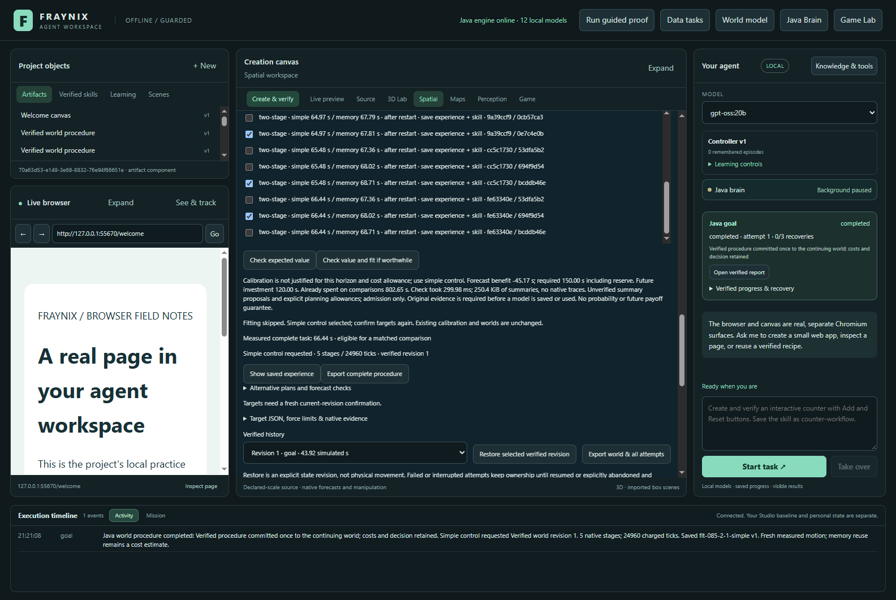
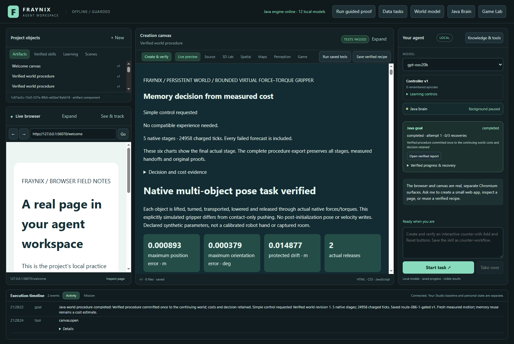
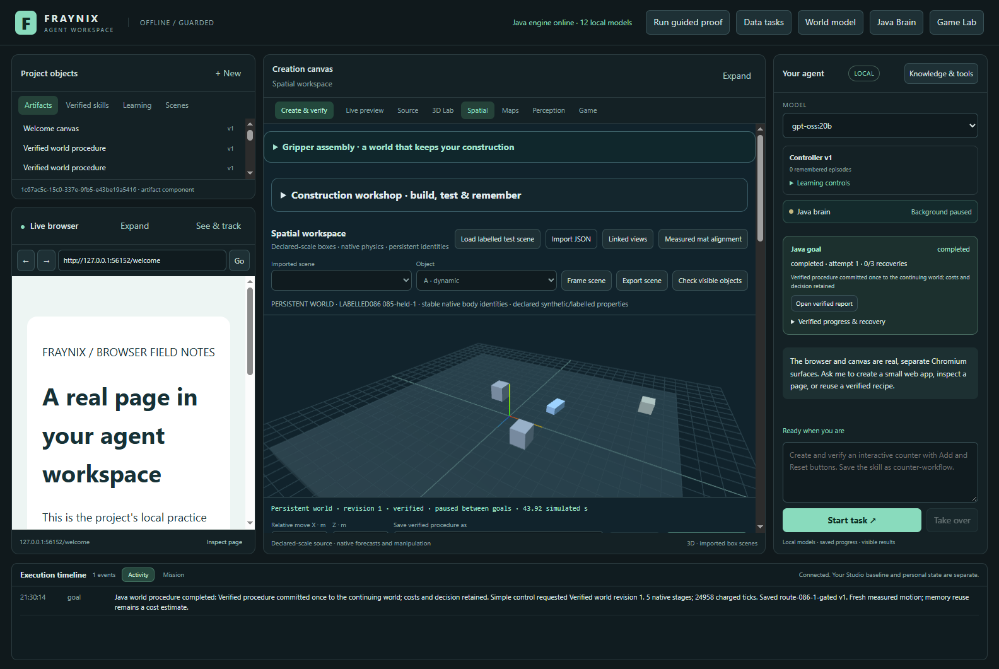
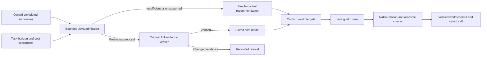

# Edition 086 — decide whether calibration deserves the work

[Previous: growing memory and payback](README-085.md) · [All editions](docs/readmes/INDEX.md) · [Offline evidence explorer](docs/readmes/086/index.html) · [Prospective contract](docs/EDITION_086_CONTRACT.md)

Edition 085 showed why the agent needs a spending decision: its calibration and checking work cost more time than they saved. Edition 086 adds that decision **before a new fit**, in Java, while preserving the existing verification of models, motion, reports, committed world state and saved procedures.

**Four of four new native goals completed, and all four saved skills survived restart.** The gate declined the real negative-saving cohort. Three preflights took 510.93, 368.78, 308.83 ms; each read 256,435 bytes of summaries and zero native trace bytes. The measured new fitting cost avoided, including the guarded click, was 85.11 s. Net caller saving across fitting plus the two-task sequence was 94.13 s. These are measured single-machine results, not a general speed guarantee.

## What the application does now

Fraynix Agent Workspace combines a Java runtime with an integrated desktop workspace. Chat can request bounded work against a confirmed persistent world. The runtime keeps goals, observations, verified outcomes, recoverable progress and reusable procedures. The desktop presents the world, browser, canvas, charts and controls. Existing native physics supplies the executed dynamics; Java owns the procedure logic and its checks. This release adds owned Java code without adding a library or replacing the physics engine.

A tool performs an action. A skill completes a task through actions, checks and recovery. A calibration helps choose a procedure only if its workload, implementation, receipt, runtime and supporting evidence match. A spending gate answers an earlier question: is learning another cost model justified for the work we expect to do?

These layers now meet in the persistent-world controls. The gate can recommend ordinary simple control when fitting would be wasteful. That choice still runs the full physical task, verifies its outcomes, commits its world revision and can save a real skill. Refusing calibration is not refusing the user's world goal.

## Actual application views

Actual isolated application capture, dated with the study record. The gate reports future investment, the benefit required including reserve, past comparison cost and its measured reading overhead. This is a labelled simulation study, not a webcam or physical gripper measurement.

Actual completed report reopened from the isolated study project. Its native outcomes, report acknowledgement, world commit and saved procedure are checked rather than inferred from the display.

The world view shows the committed state of the second gated task after restart. It is evidence of the application displaying its state; it is not a separate physical sensor.

## How to use the gate

1. Open the persistent-world view and expand **Learn costs from completed comparisons**.
2. Select **Review comparison proposals**. This reads bounded owned summaries; it does not load the existing calibration or scan large native traces.
3. Choose independent simple/memory comparisons. A supported cohort needs two distinct nearby tasks, at least three pairs for each task, and the same procedure, runtime, implementation, proof state and saving workload. Reusing a goal in multiple selected pairs is rejected.
4. Set the number of comparable future tasks and cost allowances. The defaults are six tasks, 120 seconds for fitting and three seconds of checking per future task. Additional comparison runs can be budgeted before collecting them. They are not launched automatically.
5. **Check expected value** previews the decision. **Check value and fit if worthwhile** recomputes it at execution time. Stale text on screen cannot authorize fitting.
6. If the fit is declined, simple control is selected and any old target confirmation is invalidated. Confirm the targets again before asking chat to continue the world. Existing calibrations and world data remain intact.
7. If the proposal clears the gate, the original full verifier and fitter run. Any changed original evidence still causes refusal. Actual fitting duration and any allowance overrun are recorded in the durable decision history.

Allowances are planning inputs, not enforced deadlines or automatic cancellation times. A generous horizon is an assumption that similar tasks will actually arrive; it does not prove benefit. The application does not manufacture calibration samples or automatically add evaluation goals to a training cohort.

## Java decision and evidence boundary

For each task group, the gate calculates mean simple time minus mean memory time. It takes the smallest group saving, subtracts the largest combined simple/memory timing range with a 500 ms floor, then subtracts the declared future checking allowance. This is a conservative empirical heuristic, **not a calibrated probability interval**.

Future investment equals the fitting allowance plus the number of additional comparison runs multiplied by the largest observed task duration. Admission requires positive net per-task saving and projected horizon benefit strictly greater than 125% of the future investment. Equality declines. Completed comparison cost is shown separately because it has already been spent.

The summaries are integrity-checked proposals, not proof of physical outcomes and not a security signature. A locally rewritten summary can make a proposal look attractive. It cannot skip the authoritative checks against the owned completed goal, original native results, report and commit. The positive corruption test deliberately exercises this distinction.

The new HTTP entry point routes normal fitting through this gate. The unconditional route exists only when the isolated test environment is explicitly enabled, to measure the control. The desktop does not expose that test route. Existing task-time calibration reads and their original checks remain unchanged; this release does not claim to remove their overhead.

Decision history retains the latest 64 receipts. A positive attempt is persisted as verifying before entering the full fitter; an interrupted record is not reported as completed. Negative and verification-refused results survive restart. Journal retention is distinct from original goal and physics evidence retention.

## Prospective experiment and complete costs

| Method | Complete Java tasks | Task calls | Fit or gate call | Setup + task calls | Native ticks |
| --- | ---: | ---: | ---: | ---: | ---: |
| gated | 133.00 s | 133.17 s | 0.37 s | 133.54 s | 49,912 |
| baseline | 141.90 s | 142.18 s | 85.48 s | 227.66 s | 49,912 |

The original comparison cohort cost 802.65 s before this release. It remains recorded as historical investment. Under the six-task default, proposed future benefit was -45.17 s against 150.00 s required including reserve. The gate did not fit.

Charging all three extra diagnostic previews adds 1.28 s and leaves a net caller saving of 92.84 s. Human selection, UI review, screenshots and validation-only work are not part of these clock boundaries. Baseline model checks still read 3,145,024,470 original evidence bytes across the two goals; the gate does not alter that checker.

Both methods began as exact copies of the completed edition085 preparation project. Before reuse, all existing compiled procedure, controller, cost-estimator, proof-reader, GoalRunner and ledger classes had to match edition085 byte for byte. Only the HTTP entry point changed, plus new admission classes. The old comparison runs are explicitly reused original evidence, not relabelled new trials.

The experiment compared one actual unconditional verified fit against the gate's decline, then ran two tasks per method in alternating order. The scenes are repeated edition085 evaluation definitions; they are not advertised as unseen scenes. Each task starts a fresh Java owner with four logical CPUs, a 768 MiB heap and measured Windows affinity. Each method grows its memory bank from 13 to 15 by retaining both successful outcomes, and saves two skills. All four skills and world heads are reopened and checked.

Previews are measured separately from the guarded UI click. Setup-and-task totals use actual caller times for that click or unconditional fit plus the two task calls. Native tick counts and complete Java durations are reported separately. Launches, copying, export, verification-only reopens and this development session are not disguised as task time. Historical comparison collection is sunk; its cost is not claimed as avoided by this release.

This is a small descriptive comparison on one computer, with no deliberate operating-system cache flush. Runtime loads and scheduling can affect timings. A negative cohort is a useful test of declining wasted work; it does not establish profitable calibration on other tasks, nor does it measure the recall of good cohorts that the gate might wrongly decline.

## Verification and preserved boundaries

**199 unique Java regression tests across 29 classes and 135 desktop checks passed.** The 12 new admission tests were repeated after the final bounded-reader refinement. All 324 prior engine classes other than the HTTP entry point remain byte-identical to085. Actual API, UI, native-trace, report, commit, saved-skill, restart and positive-path refusal checks passed. The offline guide is exercised at 1440 and 390 pixels and its replay coordinates are compared to the original extracted samples.

The full test set covers positive and negative arithmetic, strict reserve boundaries, future collection costs, timing variability, repeated provenance, mixed cohorts, unsupported counts, invalid allowances, original-verifier invocation and durable receipts. Positive arithmetic examples are labelled synthetic unit cases. No naturally profitable cohort was invented to make the gate look successful.

The live API fault test reseals altered comparison summaries so they appear profitable, confirms admission, then requires the original fitter to reject their mismatch with the owned completed goals. It restores every byte and checks that no calibration or world revision was created. Independent readers reconstruct original native traces, decisions, complete-task costs and world commit chains for the four real goals.

[Verification summary](docs/readmes/086/verification.json) · [Exact original archive index](docs/readmes/086/original-evidence.json) · [Canonical source inventory](docs/readmes/086/file-inventory.json) · [File tree](docs/readmes/086/FILE_TREE.txt) · [System map](docs/readmes/086/system-map.json)

## What changed and where

- `CalibrationAdmission086.java`: bounded summary review, spending forecast, original fitter handoff and durable decisions.
- `WorkspaceServer.java`: guarded normal fitting, preview/review/history routes and isolated unconditional comparison route.
- Desktop persistent-world controls: explicit allowances, readable forecast, cheap review and confirmation invalidation after simple-control fallback.
- Actual-app study and independent reader: exact original reuse, four fresh native goals, saved-skill restarts, overhead accounting and positive-path refusal.

The existing native implementation and procedure verification classes are unchanged. The running private review project, personal models, camera history and older frozen README editions are preserved. This is an improvement in the agent's execution policy, not new language-model weights, consciousness or unbounded autonomy.

## Next phase

Use the recorded actual fit and checking costs to improve the allowances without introducing another expensive estimator. Test repeated admission decisions under changing machine load, growing banks and genuinely profitable procedures. Measure both wasted fits avoided and useful fits incorrectly declined. Add explicit expiry and workload drift checks before considering autonomous comparison collection.

Only promote a policy after a held-out complete sequence repays all incremental collection, fitting, checking and recovery costs while preserving successful outcomes. Longer interrupted tasks and multi-procedure selection remain separate validation workloads. The direction is a local agent that chooses useful work, remembers verified results and knows when another layer of learning is not worth its cost.
