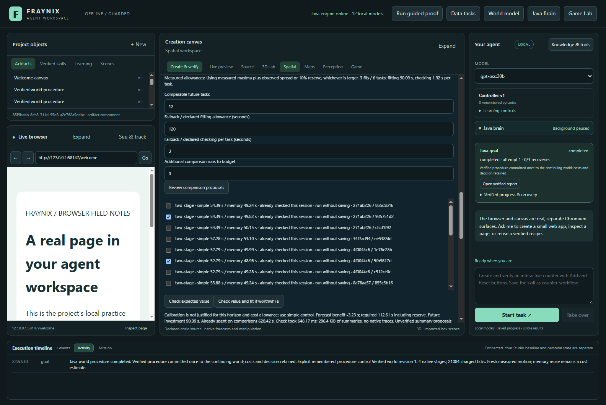
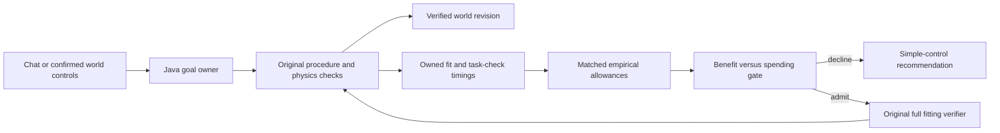
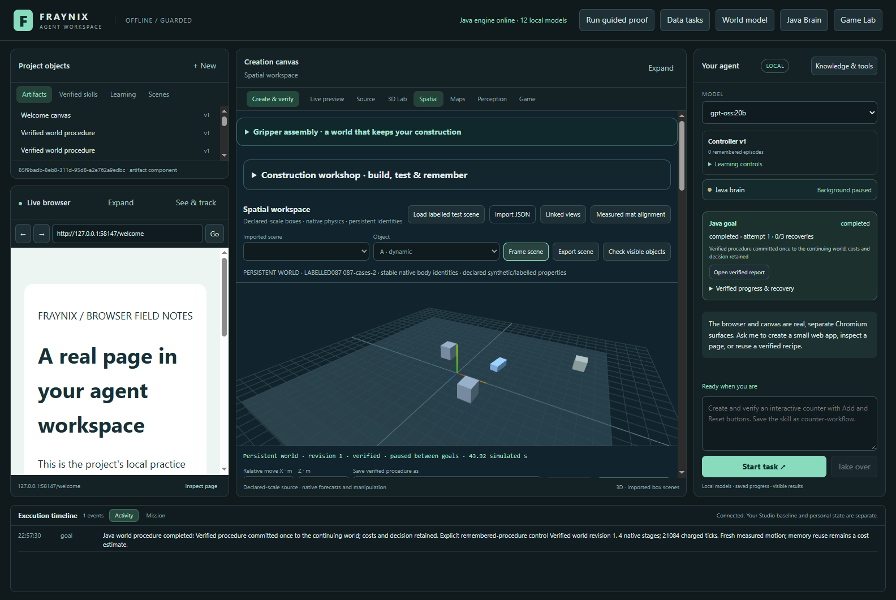

# Fraynix Agent Workspace · Edition 087

[Previous: 086](README-086.md) · [Edition history](docs/readmes/INDEX.md) · [Offline results and replay](docs/readmes/087/index.html) · [Architecture](docs/ARCHITECTURE.md)

## Learn the cost before deciding to spend

Edition 087 teaches the Java owner about the cost of its own calibration work. Earlier editions measured complete world tasks and checked whether another fitting job appeared worthwhile. This edition replaces suitable declared allowances with allowances learned from successful fits and completed calibrated tasks. It retains the original action and outcome verification.

**9/9 held-out native goals completed across simple, fixed-memory and calibrated control.** Three actual fits and three completed pilot tasks produced a fitting allowance of 90.09s and a checking allowance of 1.92s per comparable task. First-batch calibration repayment against both controls: **no**. These are descriptive results from one machine and one warm, fixed-bank workload.

This is a local, measured improvement to an agent application. It is not a claim of general intelligence, consciousness, physical accuracy, model-weight training or universal performance. The demonstration uses labelled simulated scenes and real native execution. All limits and costs below belong to that scope.

*Actual edition 087 application, captured 2026-11-07 (UTC). The smaller layout is also available: [1100-pixel capture](docs/readmes/087/review-allowances-1100.png). These are application screenshots, not design mockups. The final review includes six checking observations; the held-out forecast used the original three pilots, as frozen before evaluation.*

## What the application is

The workspace combines a continuing Java agent, local model routing, browser and canvas surfaces, stored artifacts, tools, reusable procedures, scene editing and native physics. A request can lead to a bounded experiment, a visible report, a verified world revision and a saved procedure. Chat is one entry point into these operations; the Java runtime keeps the actual goal, ownership and evidence. Existing local Ollama choices remain optional reasoning providers rather than the owner of durable execution.

The Game Lab and 3D world provide environments in which the agent can compare a prediction with an actual run. Objects have stable identities and component properties. Worlds retain revisions and construction state. A remembered procedure can suggest a useful ordering or route; its old outcome does not substitute for fresh motion. The browser and canvas remain hosted by the desktop shell. Earlier camera, mat calibration, observation and uncertainty experiments retain their original qualifications; this edition does not upgrade their physical accuracy claims.

The direction remains one integrated application with owned algorithms and inspectable continuity. Java owns scheduling and state; controllers handle physical timing; checks establish whether the requested result occurred. Existing Electron, Chromium, native physics and JSON dependencies remain acknowledged. No new library or model dependency is introduced here, and the system is not described as dependency-free.

## What changed in 087

A new Java service observes two costs already paid by actual operations:

1. **Fitting:** elapsed monotonic time around the complete original fitting call, including original goal/report checks. It is broader than the fitter's existing inner timing.
2. **Checking during a task:** the calibration reader's accumulated elapsed time, calls and original bytes between an owned goal start and its first observed verified completion. Every reader invocation in that interval is included. Additional manual calibration reads during the interval would add conservatively to this amount.

Callers cannot supply those durations. The journal identifies the boot, model, completed goal where applicable, runtime profile, source hashes and workload. Repeated reads do not create additional samples. Starts that did not pass through the measuring wrapper, interrupted tasks, failed checks and resets do not become cheap fictional examples. A completed-goal observation is collected at the first completed read; an unobserved completion is not retroactively given an invented interval after restart.

Measurements are spending evidence, not motion authority. Their small metadata and referenced envelopes are checked during proposal review. A positive decision still invokes the original fitter, which checks its original reports, goals and native evidence. During execution the model is still verified against original bytes, and the report, current world revision, commit and optional skill checks remain mandatory.

## How an allowance is learned

The bounded journal retains at most 64 observations. At most the newest 12 usable observations of each kind, no more than 14 days old, contribute. The target must match the implementation, runtime profile, comparison-pair count, procedure family, warm/cold proof state and saving workload. Original evidence volume must lie between 0.8 and 1.25 times the observed cohort volume.

For each compatible observation, cost is multiplied by `max(1, target bytes / observed bytes)`. A smaller dataset never produces an optimistic downward scaling. Each allowance is the largest scaled observation plus the larger of its observed range and ten percent of that maximum. Minimum allowances are one second for fitting and ten milliseconds for checking. Three successful fitting observations and three completed calibrated-task observations are required. Bounds remain enforced; unavailable, stale, incompatible or changed sources lead to declared allowances and an explanation.

Persisting a measurement does not make a restarted proof cache warm. Matching refers to the selected comparison workload; a future goal must still satisfy the original execution-time compatibility checks. The preview does not waive those checks.

These reserves are descriptive. Three observations do not establish a statistical confidence level. The runtime profile does not fully characterize disk contention, thermal state or other applications. New slower observations can raise the allowance, but unseen disturbances can still exceed it. The UI labels these as planning allowances, not deadlines or guaranteed upper bounds.

Learning is restricted to the normal two-reader evidence mode. The experimental single-reader mode uses declared allowances and does not teach fitting or checking observations. This final compatibility exclusion was tested after the timed study, whose runs all used the normal mode; no timing formula, threshold, fixture or native result was changed. [Refinement record](docs/EDITION_087_REFINEMENT.md).

The 086 gate remains unchanged: nearby repeated simple/memory comparisons give a conservative saving after observed variability; estimated checking cost is subtracted per future task; forecast benefit must exceed fitting plus any declared future collection cost by 25 percent. Historical collection is already spent for this decision, but is still charged in the first-batch payoff report.

## Use it

1. Open the integrated 3D world and the persistent-world procedure controls. Finish any active goal before fitting.
2. Run genuinely matching simple-control and memory-control tasks. Select at least three independent pairs for each of two nearby tasks, using the same procedure and workload.
3. Open **Learn costs from completed comparisons**, then **Review comparison proposals**. Choose the independent pairs; do not select cross-pair duplicates of the same original goal.
4. Keep **Use measured costs when supported** selected. Enter the number of comparable future tasks and any additional comparison runs still needed. The declared fields remain the fallback when measurements are insufficient. **Use declared allowances** makes that choice explicit.
5. Click **Check expected value**. Read the allowance source, supporting counts, forecast, investment and reason. This does not run the fit or move the world.
6. **Check value and fit if worthwhile** recomputes the decision. A decline selects simple control and requires fresh target confirmation. Existing models and worlds remain unchanged. An admission performs the original full verification before saving a model.
7. Confirm the current world and targets, then use chat or the existing world controls. Saved procedures and retained experience still use their existing proof requirements.

The app does not automatically perform three expensive fits merely to populate the journal. The diagnostic repeated fits in this study are explicit research work using the isolated test route, which is unavailable in a normal runtime. Ordinary successful requested fitting and supported completed tasks supply future observations.

## Frozen experiment and measured costs

The [prospective contract](docs/EDITION_087_CONTRACT.md) and [frozen fixture](workspace-desktop/test/fixtures/procedures087-protocol.json) preceded implementation and timing collection. The occupied-route geometry comes from an older fixture; every 087 timing and native outcome in this study is newly executed. There is one retained seed, two nearby comparison tasks each run three times with each control, three real fits, three separate pilots and three held-out cases run by all three methods. The bank stays at one receipt during timed comparisons and evaluation. The owner stays warm; this is not a restarted, growing-bank or skill-saving timing result.

| Method | Success | Complete Java tasks | Task calls | Native ticks | Checking |
| --- | ---: | ---: | ---: | ---: | ---: |
| simple | 3/3 | 171.59s | 171.90s | 74,852 | 0.00s |
| memory | 3/3 | 158.07s | 158.46s | 63,224 | 0.00s |
| calibrated | 3/3 | 164.03s | 164.57s | 63,224 | 5.07s |

| Measured investment | Time |
| --- | ---: |
| seed | 58.36s |
| comparisons | 621.09s |
| fits | 244.92s |
| pilots | 161.09s |
| trainingTotal | 1085.46s |
| diagnosticPreviews | 2.87s |
| startup | 11.48s |

Calibrated execution saving against simple: **7.33s**; against fixed memory: **-6.11s**. After learning investment, net versus simple: **-1078.12s**; net versus fixed memory: **-1033.20s**. Negative values mean added cost. Diagnostic previews and startup are additional and separately shown.

If the seed and comparisons are already available, charging only the actual last fit (82.12s) still leaves a marginal net of -74.78s versus simple and -88.22s versus fixed memory for this three-task sequence. Reusing an already fitted model has no new fitting cost, but still carries its measured per-task checking cost. These narrower accounts do not erase the recorded first-batch investment.

| Future horizon (forecast only) | Gate admits | Projected benefit | Required including reserve | Preview caller cost |
| --- | --- | ---: | ---: | ---: |
| 1 | False | -0.27s | 112.61s | 729.52ms |
| 12 | False | -3.23s | 112.61s | 708.83ms |
| 64 | False | -17.20s | 112.61s | 748.06ms |
| 256 | False | -68.80s | 112.61s | 687.39ms |

The separate earlier085 cold retaining/skill-saving cohort still declined through the new API using declared fallback. Its original measurements are explicitly reused after compiled compatibility checks; they are not new087 outcomes or evidence that warm no-saving costs transfer to that workload.

Method order alternates during calibration and rotates during evaluation. Four logical processors and a 768 MiB Java heap are enforced, with actual Windows process affinity recorded. Work runs serially on this machine. Allowance forecasts are frozen from the pilot measurements before evaluation. Later successful task telemetry is retained for future decisions, but does not alter the reported frozen forecast or fitted model.

Complete Java time covers admission, native work, reports, commit and requested saving, excluding the final timing-record write. Caller time also includes the request and polling boundary. World creation/import, export, screenshots, manual selection and independent validation are outside those task clocks. Startup, diagnostic previews, fitting, seed and comparison work are separately retained. The payoff report does not pass a short-run observation off as a long-horizon result.

Horizon64 and256 previews are diagnostic extrapolations, not executed sequences. They do not enlarge the existing bounded goal, model or world histories; choose a feasible operational horizon.

The fixed-memory control matters: when an existing procedure already works, expensive calibration must justify itself against that option as well as against simple control. A successful fit or a lower allowance alone is not evidence that calibration repaid its cost.

*The actual final persistent world, captured 2026-11-07 (UTC), with verified native state. The [report capture](docs/readmes/087/verified-report.png) and offline replay link the visible result to original attempts. Projection is a view of stored coordinates, not a regenerated video or physical-camera measurement.*

## Verification and failure handling

**212 unique Java checks across 30 classes and 135 desktop checks passed.** The broad measured-build run had 211 checks; after the reader-mode exclusion, all 13 cost tests and 12 unchanged admission tests were repeated. All other measured runtime classes are unchanged. All 326 prior engine classes except the HTTP entry point remain byte-identical to086. All 25 newly executed native goals, the three actual original fits, nine held-out outcomes and their commits/costs were independently inspected. The journal and final world survive reopen; positive-path original-verifier refusal remains enforced. Actual app 1600/1100 and offline 1440/390 layouts, interaction and exact replay coordinates are checked.

The study checks malformed budgets, unknown allowance modes and attempted caller-supplied timing fields. Changing a referenced model excludes its observations; restoring its exact bytes restores eligibility. Reopening preserves the journal and world revision. Repeated completed-goal reads leave sample counts unchanged. An attractive forged summary can reach the gate but is refused by the original fitter; it does not save a new model, alter the world or teach a cheap successful fitting sample.

The independent inspector rebuilds procedure ordering, native checks, prediction/actual comparisons, world commit bindings, complete costs, empirical allowance arithmetic and payoff totals from original records. It does not accept a green screenshot as proof. Compiled-class comparison records which original Java classes remain byte-identical. Development failures and corrected test attempts are retained with their scope rather than silently discarded.

## Source and evidence map

- [Java measured allowances](workspace-engine/src/main/java/fraymus/workspace/CalibrationCosts087.java): owned clocks, source-bound journal, matched reserve, fallback and original fitter integration.
- [Original spending rule](workspace-engine/src/main/java/fraymus/workspace/CalibrationAdmission086.java): benefit, variability, horizon and reserve.
- [HTTP owner integration](workspace-engine/src/main/java/fraymus/workspace/WorkspaceServer.java): existing goal routes and guarded measurement wrappers.
- [Original world execution](workspace-engine/src/main/java/fraymus/workspace/WorldProcedure079.java): native motion, proof checks, model checking and outcomes.
- [Integrated controls](workspace-desktop/renderer/persistent-world-panel.js): visible allowance source and reviewed action.
- [Actual study harness](workspace-desktop/test/costs087-integration.cjs) and [independent inspector](scripts/Inspect-Costs087.cjs).
- [Verification](docs/readmes/087/verification.json), [exact original archive index](docs/readmes/087/original-evidence.json), [source inventory](docs/readmes/087/file-inventory.json), [file tree](docs/readmes/087/FILE_TREE.txt).
- [Obsidian continuity note](docs/obsidian/95-measured-calibration-costs.md) and [working map](docs/obsidian/95-measured-calibration-costs.canvas).

## Next experiments and acceptance gates

The next useful test is longer repeated operation with changed resource pressure, where measured reserves can be evaluated for both unnecessary declines and unexpectedly expensive fits. Keep new evidence separate from the data used to choose the reserve. Add coverage for restarted and saving workloads only through matching observations; the warm fixed-bank measurements here do not authorize those transfers.

Calibration should eventually be selected against all available useful alternatives, including continuing with an already verified fixed procedure. Measure the cost of updating the allowance itself, source checks and review alongside any saved work. Retain simple control whenever the added decision machinery cannot justify its cost. Progress means better complete outcomes or less complete work under the same verification, not merely a growing list of mechanisms.

For the broader application, continue connecting verified procedures to durable natural-language goals, richer scene conditions and transparent observation/recovery. Keep the persistent world, experiment memory and visible evidence tied together. The agent can use experience as a proposal and test it in a new situation; fresh outcome verification remains the bridge between an idea and an accepted world change.
