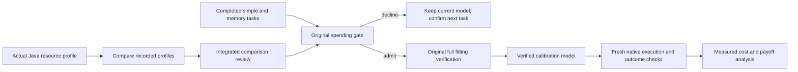
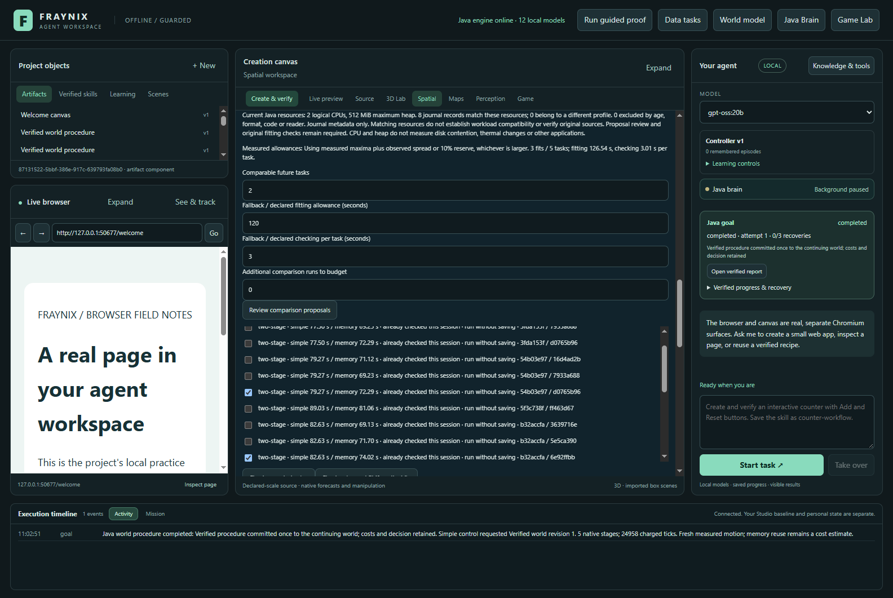
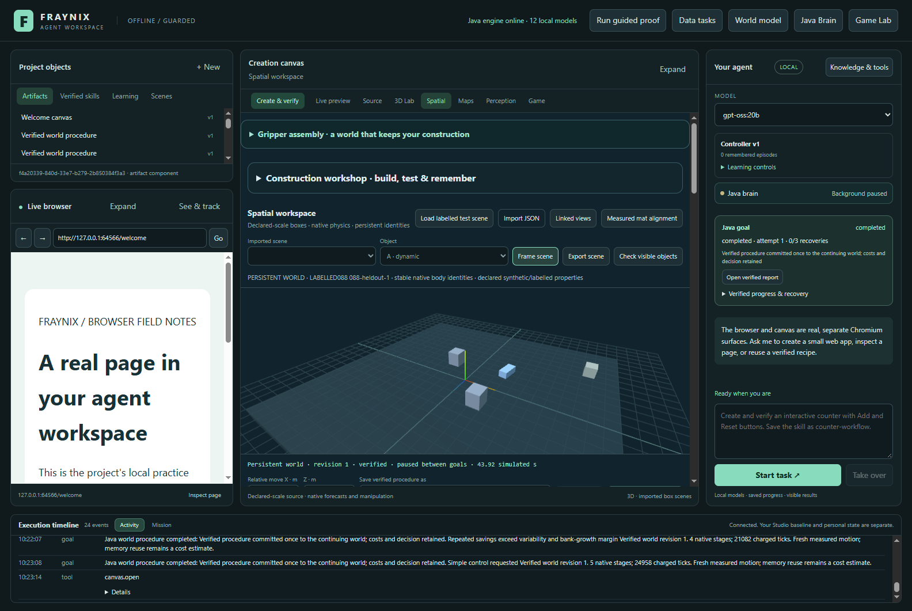

# Fraynix Agent Workspace · Edition 088

[Previous: 087](README-087.md) · [Edition history](docs/readmes/INDEX.md) · [Offline results and replay](docs/readmes/088/index.html) · [Architecture](docs/ARCHITECTURE.md)

## Resources change. Does calibration still help?

Edition 088 checks two questions left open by edition 087: whether a changed CPU/heap budget invalidates old cost evidence, and whether the spending gate rejects a fit that would have helped on actual new tasks. The original gate is preserved. The application gains a resource summary in its existing comparison controls, while a fresh two-budget study checks decisions against observed outcomes.

**12/12 held-out native goals completed across two resource cohorts.** All 44 newly executed goals and six actual fitting calls were inspected. four-768: gate declined; false decline versus simple **False**, versus fixed memory **False**. two-512: gate declined; false decline versus simple **False**, versus fixed memory **False**. These findings cover two measured tasks per method and resource budget, not long-horizon or population guarantees.

*Actual integrated application, captured 2026-11-07 (UTC). [Narrower view](docs/readmes/088/four-768-resource-review-1100.png). These are application screenshots, not mockups. Counts in final review include later completed evaluation tasks; the forecast used the three pilots frozen before evaluation.*

## What is implemented

The workspace remains one integrated application: a continuing Java owner, browser and canvas surfaces, local model routing, tools, stored artifacts, reusable procedures, scene editing and a native physics world. Chat can start bounded work through the existing Java goal machinery. Controllers execute motion, and original evidence checks decide whether it happened correctly. Saved experience can suggest a route or ordering; it cannot replace fresh outcome verification.

Edition 087 added owned observations of whole fitting calls and checking during completed tasks. It learned bounded spending allowances from compatible actual runs. Edition 088 makes the resource boundary visible: the comparison panel shows the current Java logical CPU count and maximum heap, how many journal records match that profile, how many belong to another profile, and how many are excluded by age, format, implementation or reader mode.

These counts deliberately describe journal metadata. A matching profile does not prove a record's original source, workload or evidence volume is usable. The existing proposal path checks those details, and any admitted fitting job still enters the original full verifier. Resource information grants neither movement permission nor permission to accept an unverified model.

The new Java class is [CalibrationResources088](workspace-engine/src/main/java/fraymus/workspace/CalibrationResources088.java). [CalibrationCosts087](workspace-engine/src/main/java/fraymus/workspace/CalibrationCosts087.java) attaches its summary to review; the existing [world panel](workspace-desktop/renderer/persistent-world-panel.js) displays it. The spending formula, learned-allowance formula, task-cost estimator, native controllers and outcome gates remain unchanged. No new model, network service or library dependency is added.

## Why this test matters

Cost is part of intelligent tool use. A system can do more computation, collect more evidence and produce correct results while becoming slower overall. It can also decline an expensive learning step and miss a real benefit. Both errors need measured comparisons. A screenshot of active neurons or a successful movement does not answer that performance question.

Here the gate's immediate alternative is simple control, so we report whether it wrongly declines calibration relative to that alternative. We also compare with continuing fixed verified memory. This second comparator matters: an existing useful procedure may save work without requiring another fit and repeated model checks. A fit that beats simple control may still be an unnecessary expense if fixed memory performs better.

There are also two distinct decisions: whether to pay for a new calibration, and whether the calibrated controller should use memory on a particular task. A wide uncertainty bound can make the latter choose simple control. The results therefore report actual memory choices as well as fitting decisions. A refused memory choice is not automatically a false decline by the fitting gate.

The study distinguishes three accounts. Execution savings compare the completed task calls. Marginal calibration value subtracts one actual new fitting call and the gate's measured preflight. First-batch value additionally charges the learning seed, all comparison runs, all three diagnostic fits and the pilot tasks used to learn allowances. None is silently substituted for another.

## How to review it in the app

1. Open the integrated 3D world and **Learn costs from completed comparisons**. Finish active work before fitting.
2. Select **Review comparison proposals**. Read the current resource profile and record counts beside the allowance controls.
3. Choose independent matching comparison pairs. Two nearby tasks need three separately executed simple/memory comparisons each. Procedure, implementation, resource profile, proof state and saving workload must agree.
4. Keep **Use measured costs when supported**, or explicitly choose declared allowances. Missing or incompatible measurements retain the declared fallback and its explanation.
5. Enter the number of comparable future tasks and any extra comparison work still needed. **Check expected value** reviews the proposal without running a fit or moving the world.
6. **Check value and fit if worthwhile** recomputes the decision. An admitted fit must pass original verification. A decline leaves the saved model and world intact; choosing the next targets still requires fresh confirmation.
7. Use chat or the existing world controls to execute the chosen task. Original native, report, commit and optional skill checks remain active.

The existing desktop launcher accepts explicit Java CPU and heap settings, documented in [edition 082](README-082.md). Changing those settings requires a new Java owner; changing a desktop field cannot resize a running JVM. Stop through the app, preserve the closed project and reopen with the intended limits. The measured study used private projects, explicit resource settings and actual Windows CPU affinity. It did not change the user's existing review installation or private scene.

## Frozen study

The [prospective contract](docs/EDITION_088_CONTRACT.md) was committed before implementation and measurements. The [fixture](workspace-desktop/test/fixtures/procedures088-protocol.json) specifies both resource bundles and the held-out scene changes. Occupied-route geometry comes from the established labelled experiment; every timing and native outcome reported here is newly executed.

The four-CPU/768MiB cohort ran first, followed by two CPUs/512MiB. Each starts in a fresh private project with one actual retained learning goal. Two nearby calibration tasks each run three times under simple and memory control, alternating method order. Three complete original fitting calls and three calibrated pilot tasks provide the minimum allowance samples. The diagnostic unconditional fit route remains restricted to test mode; ordinary product operation does not automatically pay for three fits to populate its journal.

The allowance and decision are frozen at a two-task horizon before evaluation. Two new nearby cases change target positions and dynamic masses. Each runs under simple, fixed-memory and calibrated control, with rotating method order. The timed bank stays at one receipt: no new experience retention and no skill saving. This isolates that workload but does not calibrate interrupted, growing-bank or skill-saving work.

There are 22 new native goals per cohort, 44 total, and six actual fits. The calibrated arm runs as an explicitly labelled counterfactual even if the gate declines. Otherwise the test could never discover a false decline. The gate itself and its threshold are not weakened to make that counterfactual possible in normal operation.

## Actual results and complete costs

### four-768

| Method | Success | Complete Java | Task calls | Native ticks | Memory choices | Model checking |
| --- | ---: | ---: | ---: | ---: | ---: | ---: |
| simple | 2/2 | 113.41s | 113.61s | 49,910 | 0/2 | 0.00s |
| memory | 2/2 | 104.84s | 105.05s | 42,158 | 2/2 | 0.00s |
| calibrated | 2/2 | 109.78s | 110.16s | 42,158 | 2/2 | 3.24s |

| Actual work | Cost |
| --- | ---: |
| seed | 58.14s |
| comparisons | 621.93s |
| fits | 245.35s |
| pilots | 160.51s |
| diagnosticPreviews | 2.94s |
| startup | 13.94s |
| trainingTotal | 1085.92s |
| withDiagnosticPreviews | 1088.87s |

Learned fitting allowance **89.85s**; checking allowance **1.85s**. Frozen gate declined at horizon2. Actual last fitting call: 81.86s; preflight: 0.71s.

| Comparator | Calibrated execution saving | Net after fit + review | False decline |
| --- | ---: | ---: | --- |
| simple | 3.44s | -79.13s | False |
| memory | -5.12s | -87.69s | False |

First-batch learning net against simple: **-1082.48s**; against fixed memory: **-1032.90s**. Startup and diagnostic previews are additional, separately reported.

| Forecast horizon | Admit | Projected benefit | Required | Preflight |
| --- | --- | ---: | ---: | ---: |
| 1 | False | 0.55s | 112.32s | 0.73s |
| 2 | False | 1.10s | 112.32s | 0.71s |
| 12 | False | 6.61s | 112.32s | 0.78s |
| 64 | False | 35.25s | 112.32s | 0.72s |

### two-512

| Method | Success | Complete Java | Task calls | Native ticks | Memory choices | Model checking |
| --- | ---: | ---: | ---: | ---: | ---: | ---: |
| simple | 2/2 | 185.32s | 185.89s | 49,910 | 0/2 | 0.00s |
| memory | 2/2 | 166.04s | 166.66s | 42,158 | 2/2 | 0.00s |
| calibrated | 2/2 | 193.69s | 194.53s | 49,910 | 0/2 | 5.17s |

| Actual work | Cost |
| --- | ---: |
| seed | 88.99s |
| comparisons | 898.51s |
| fits | 345.44s |
| pilots | 272.85s |
| diagnosticPreviews | 3.83s |
| startup | 12.26s |
| trainingTotal | 1605.79s |
| withDiagnosticPreviews | 1609.62s |

Learned fitting allowance **126.54s**; checking allowance **3.01s**. Frozen gate declined at horizon2. Actual last fitting call: 115.25s; preflight: 1.00s.

| Comparator | Calibrated execution saving | Net after fit + review | False decline |
| --- | ---: | ---: | --- |
| simple | -8.64s | -124.89s | False |
| memory | -27.87s | -144.12s | False |

First-batch learning net against simple: **-1614.43s**; against fixed memory: **-1544.67s**. Startup and diagnostic previews are additional, separately reported.

| Forecast horizon | Admit | Projected benefit | Required | Preflight |
| --- | --- | ---: | ---: | ---: |
| 1 | False | -7.19s | 158.18s | 0.87s |
| 2 | False | -14.38s | 158.18s | 1.00s |
| 12 | False | -86.27s | 158.18s | 1.10s |
| 64 | False | -460.10s | 158.18s | 0.86s |

Positive saving means less elapsed time; negative saving means added cost. Complete Java time uses the stored owned task clock. Caller time starts before admission and ends at the first completed observation, including the route, completion polling and measurement work inside that boundary. Scene import/creation, exports, screenshots and human review are outside that task clock. Startup and diagnostic preview costs are separately retained. Model-check time is already inside task time and is not added twice.

First-batch learning totals include all three research fits and pilots. The narrower marginal calculation uses the last actual fit, the frozen preflight and the two observed tasks. A false decline requires a declined gate and strictly positive net saving after those marginal costs. Zero is not a profit. The offline explorer offers caller, Java and learning-inclusive charts so these accounts can be inspected rather than conflated.

## Resource change and restoration

*[Narrower two-CPU view](docs/readmes/088/two-512-resource-review-1100.png) · [Changed-profile refusal](docs/readmes/088/four-768-foreign-resource-profile.png).*

The changed-profile capture shows zero matching records at the top and excludes incompatible proposals. Its last recorded `verification-refused` decision belongs to the separate, deliberately forged-summary refusal test; it is not an unexplained application failure.

Each completed project is closed, opened under the other resource budget, and restored to its original budget. The changed owner refuses old cost proposals because the runtime profile differs. The new summary explains the mismatch. The saved model, measurement journal and persistent world remain byte-identical across those read-only checks. Restoring the original profile restores proposal compatibility and its measured allowances.

This does not assert that a restart restores a warm proof cache. A future execution still faces the original model and procedure compatibility checks, including proof state. Nor do logical CPUs and maximum heap fully describe performance: disk contention, other applications, thermal state, memory pressure outside the JVM and operating-system caching can change cost without changing that profile. The interface states that limit explicitly. The profile uses Java-reported processor count. A manual operating-system affinity change that leaves that value unchanged is not automatically detected by this summary; the study checks affinity separately through the operating system.

Because CPU and heap change together and cohorts run sequentially, differences between their timings are not isolated causal estimates of CPU or memory effects. Within each cohort, all three controls face the same configured budget and use fresh matched evidence. OS affinity, process CPU, memory and Java GC observations are preserved with the runs. The JVM heap cap excludes native allocations, Electron and other processes.

### Observed resource counters

| Cohort / method | Process CPU | Collector time | Sampled Java heap peak | Sampled OS working set peak |
| --- | ---: | ---: | ---: | ---: |
| four-768 / simple | 192.70s | 11.09s | 420.2 MiB | 566.4 MiB |
| four-768 / memory | 175.00s | 10.09s | 399.4 MiB | 557.6 MiB |
| four-768 / calibrated | 187.78s | 10.24s | 419.4 MiB | 605.3 MiB |
| two-512 / simple | 298.94s | 24.37s | 303.3 MiB | 433.7 MiB |
| two-512 / memory | 261.97s | 21.69s | 353.7 MiB | 441.1 MiB |
| two-512 / calibrated | 313.97s | 24.46s | 356.3 MiB | 441.1 MiB |

These counters cover the two held-out tasks per method. Process CPU is cumulative processor time and can exceed elapsed time. Counter intervals include measurement calls and differ slightly from the Java task clock. Collector-reported time can overlap work and is not added to task duration. Memory peaks are sampled, not guaranteed maxima; OS working set includes Java/native process memory but excludes Electron and other processes. These are descriptive observations, not causal attribution.

## Verification retained

**222 Java checks across 31 classes, 135 desktop checks and eight accounting checks passed.** 328 prior engine classes are byte-identical to 087; only CalibrationCosts087 adds resource metadata to review, plus the new summary class. Original admission, goal, native, proof, cost and ledger classes are unchanged. All 44 new native goals, six actual fits,12 held-out outcomes and original commits/costs were inspected. Actual resource changes, byte-preserving restore, repeated reads, original-source refusal and genuine positive-proposal/full-verifier refusal were exercised. Real app at 1600/1100 and offline at 1440/390 checks retain source-linked screenshots and exact-coordinate replays.

The independent inspector reconstructs original native attempts and predictions, compares actual target outcomes, verifies source hashes and commits, checks stored task-cost arithmetic and recomputes allowance and payoff values. It does not replace the engine's physics solver or pretend a second copy of the same formula is real-world validation. All original runtime checks remain authoritative.

Refusal tests retain malformed inputs, changed model sources and deliberately attractive resealed cost summaries. The latter reach the original fitter and fail its stored-goal consistency check; no new model, successful timing sample or world mutation results. Exact restoration is checked. Repeated completed reads do not manufacture more observations. Eight separate arithmetic tests cover comparator-specific false declines, fitting and review charges, zero benefit, failed/incomplete sequences and refusal to infer unobserved long-horizon payoff.

*Actual application world after a verified goal. The offline replay displays original body coordinates, not a generated animation or another simulation.*

## What the measurements suggest

At four CPUs/768 MiB, the calibrated controller selected memory on both held-out tasks. Its combined task calls were about 3.44 seconds faster than simple control, but 5.12 seconds slower than fixed memory. After the actual new fit and gate review, its net was **−79.13 seconds against simple control** and **−87.69 seconds against fixed memory**.

At two CPUs/512 MiB, the calibrated controller selected simple control on both tasks because its uncertainty bound did not support memory. Fixed memory nevertheless completed both tasks successfully and had lower observed combined task time. Calibration's net was **−124.89 seconds against simple control** and **−144.12 seconds against fixed memory** after fitting and review. This exposes a useful next question about memory-selection uncertainty; it does not establish that the fitting gate should have admitted an expensive fit.

The fitting gate therefore missed no profitable calibration in these two measured two-task comparisons. That is a limited negative finding, not proof that useful calibration is never refused. Fixed memory was the fastest measured execution policy in both cohorts. Resource limits changed together and runs were serial, so these observations cannot isolate CPU, heap, collection, cache or background-load effects.

## Boundaries and next steps

This edition evaluates the existing gate; it does not tune thresholds after seeing results. Two held-out tasks per budget are a narrow test. Absence of a false decline in such a sample does not prove the gate has high recall or that calibration is never worthwhile. Conversely, execution savings alone cannot establish that the fitting investment pays off. Forecasts at longer horizons remain forecasts, not observed repayment.

The next useful work is a longer measured sequence chosen before outcomes, with a task mix that can distinguish when fixed memory is sufficient from when calibration changes a useful decision. A separate study should vary background contention while keeping the declared profile fixed, then assess how quickly fresh observations detect drift. Interrupted recovery, retained-bank growth and skill-saving tasks need their own compatible evidence. Any future gate adjustment should be evaluated on fresh cases, including false admissions and false declines, while original outcome verification stays mandatory.

The larger direction remains a local agent that owns observations, goals, tools, memories and checked physical experiments. Better spending decisions can make that system more practical without claiming consciousness, general intelligence, physical accuracy or LLM-weight training from this test. Java remains the owner of durable execution; existing desktop and native dependencies remain acknowledged.

## Source, records and continuity

- [Verification and measured results](docs/readmes/088/verification.json)
- [Original evidence inventory](docs/readmes/088/original-evidence.json)
- [Canonical source inventory](docs/readmes/088/file-inventory.json)
- [Offline charts and original-coordinate replay](docs/readmes/088/index.html)
- [Independent inspector](scripts/Inspect-Costs088.cjs) and [accounting boundaries](workspace-desktop/test/payoff088.test.cjs)
- [Obsidian note](docs/obsidian/96-resource-changes-and-calibration-value.md) and [system map](docs/obsidian/96-resource-changes-and-calibration-value.canvas)
- [Project memory](docs/PROJECT_MEMORY.md) and [development log](docs/DEVELOPMENT_LOG.md)

Earlier numbered READMEs and their snapshots remain immutable. Original test data stays source-qualified, and personal runtime data stays outside Git. Publication is complete only after the main branch and edition tag are fetched back and their code, frozen documentation and original archive hashes are verified.
