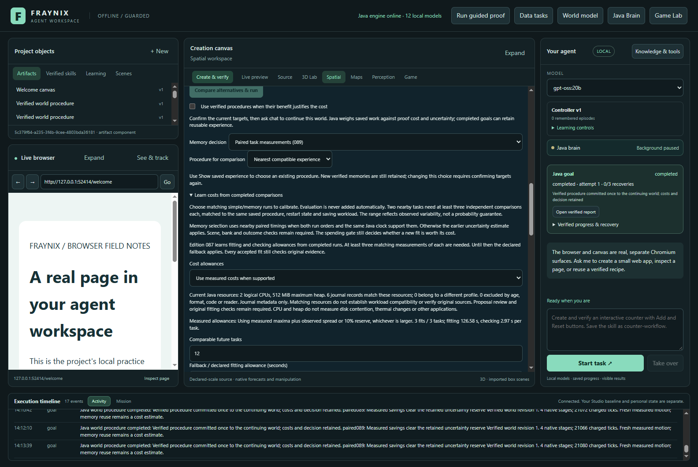
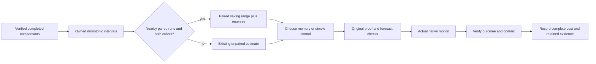
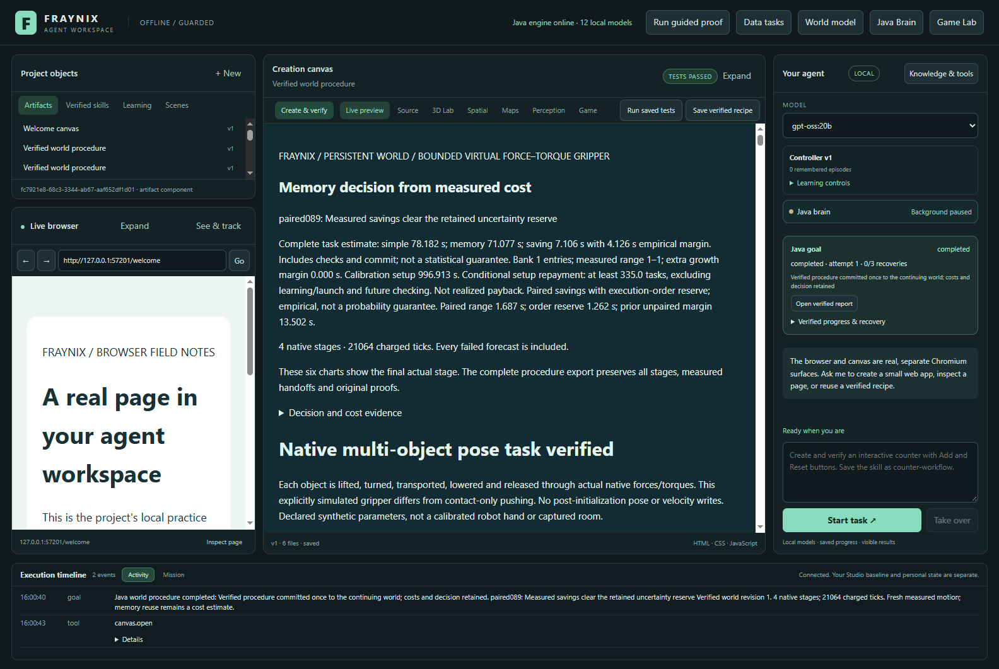
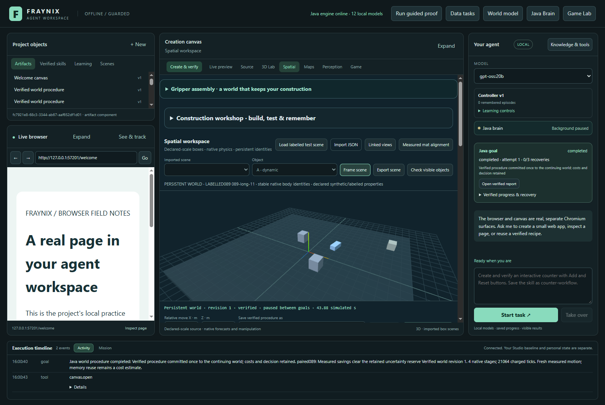

# Fraynix Agent Workspace · Edition 089

[Previous: 088](README-088.md) · [Edition history](docs/readmes/INDEX.md) · [Offline results and replay](docs/readmes/089/index.html) · [Architecture](docs/ARCHITECTURE.md)

## When paired timings change memory selection

Edition 088 separated two decisions: whether a new calibration is worth buying, and whether an already calibrated controller should use a remembered procedure. Under the tighter resource budget, fixed memory completed the measured tasks faster while the calibrated controller chose simple control. Edition 089 investigates that selection gap and measures longer sequences rather than extrapolating a two-task result.

**48/48 held-out goals completed; all76 newly executed native goals and three actual fitting calls were inspected.** Paired selection used memory **12/12** times; the previous selector used it **0/12** times. Its observed twelve-task call saving against the previous selector was **102.17 s**. At horizon12, net after one fit and review against simple: **-154.14 s**; useful fitting rejected: **False**. At horizon12, net after one fit and review against memory: **-220.60 s**; useful fitting rejected: **False**. This is one nearby synthetic task family on one machine, not a general speed or physical accuracy claim.

**Reading this result:** the new selector reduced charged native ticks by **15.54%** and task-call time by **7.97%** relative to the previous selector in this study. However, its calls took **38.02 s longer than simple control** and **104.48 s longer than fixed memory**, even before charging fitting. The unchanged gate did not reject a profitable fit at any measured prefix, against either comparator.

The new empirical range contained only **3/12** observed simple-minus-memory savings: **5 fell below its lower bound** and **4 exceeded its upper bound**. Fixed memory was still faster than simple control on every matched case, but the later measured advantage was much smaller. These results support the changed procedure choice over the old selector; they do **not** establish reliable uncertainty bounds, general speed improvement, or calibration repayment. Time order, background load and changing task conditions were not independently randomized.

**Next evidence needed:** detect stale cost estimates, test mixed task families where memory helps and hurts, and use fully counterbalanced repeated measurements. Keep fixed verified memory as a comparator. Any attempt to reduce model-reading overhead must retain original-source verification. Do not narrow reserves or loosen the spending gate to make this completed study appear profitable.



*Actual integrated application, captured 2026-11-07 (UTC). [Narrower application view](docs/readmes/089/paired-controls-1100.png). These are real application captures, not mockups.*

## What changed in the application

The existing **Memory decision** control now offers **Paired task measurements (089)**. Java uses a checked calibration model to choose whether a verified remembered ordering is likely to save work. The existing goal runner then performs fresh forecasts, actual native motion, outcome checks and a verified world commit. A cost estimate changes which procedure is tried first; it does not certify an outcome or authorize unchecked movement.

The previous estimate remains available as an internal fallback. Simple control, fixed verified memory and the earlier avoided-work option keep their existing behavior. The existing comparison panel explains the pairing rule, and the verified report shows the selected estimator, uncertainty and why memory was used or declined. No extra application window, model download or dependency is introduced by the selector.

The local architecture remains the same: Java owns durable goals, scene state, procedure memory and verification; the desktop hosts the browser, canvas and presentation. The native physics backend still supplies actual simulated outcomes. This edition does not replace those existing components or claim that the entire application has no dependencies.



## Why pairing helps—and where it can fail

The 084/085 estimate adds the observed timing range of simple control to the observed timing range of memory control. That is conservative, but when both become slower together it can treat a common slowdown as two separate sources of uncertainty. The important quantity for selection is their difference: how much time memory saves on the same task.

[TaskCost089](workspace-engine/src/main/java/fraymus/workspace/TaskCost089.java) therefore allows paired differences only when the original records establish all of these conditions:

- Both tasks completed with original verification and a matching task, procedure, resource profile, proof state and saving workload.
- Their monotonic intervals belong to the same Java owner, do not overlap and are separated by no more than 30 seconds.
- At least two nearby task groups have three independent comparisons each, with both execution orders represented inside each group.
- The original model sources, arithmetic and current receipt remain valid when the model is read and the action is selected.

Here independent comparisons means distinct completed goal pairs, not statistically independent samples from different machines or environments.

The new within-task reserve is the larger of 500 ms and the range of observed paired savings. It also adds the largest difference between the two execution-order means. Existing between-task, scene-distance and bank-growth terms remain. Missing pairing or order coverage keeps the previous unpaired estimate. Malformed clock evidence is refused. A negative lower saving bound still selects simple control.

This is an empirical decision rule, not a confidence interval or a guarantee about the next task. Nearby runs can still experience different background load. Order effects and unexplored scene differences can matter. The measured interval-hit results and original-control comparison below are needed to judge whether the narrower estimate was useful.

Owned intervals are recorded as exact decimal strings so long nanosecond values survive JSON without floating-point integer loss. Their UUID identifies a Java clock owner; it is not hardware attestation or a physical sensor timestamp. The source records and full original verifier bind them to completed tasks. The new selection identity requires fresh compatible evidence; older motion proofs are never relabelled as current ones.

## How to review it

1. Open the integrated 3D world, enable **Use verified procedures when their benefit justifies the cost**, and choose **Paired task measurements (089)** in **Memory decision**.
2. Select a verified procedure or keep the nearest compatible experience. Confirm the current targets before asking chat to continue the world.
3. In **Learn costs from completed comparisons**, select independent matching simple/memory pairs. The pairing rule needs both execution orders and nearby owned intervals; arbitrary historical pairs may retain the fallback estimate.
4. Review the current resource profile and measured fitting/checking allowances. Enter the number of comparable future tasks and any additional comparison work still needed.
5. **Check expected value** evaluates the spending proposal. **Check value and fit if worthwhile** still invokes the original fitter only after the existing gate admits it. A decline leaves the saved model and world intact.
6. Run the requested goal and open its verified report. It identifies `paired089`, `unpaired-fallback` or an unavailable estimate, and shows the actual stages and outcome. The isolated study's `reference085` control is not a normal product setting.

Here “calibration” means calibration of execution-cost estimates. It does not mean the earlier webcam/mat scale-calibration workflow. A cost estimate grants no physical-world accuracy claim.

For a separate Windows review project after installing the repository's documented Java and desktop prerequisites:

```powershell
$env:FRAYNIX_WORKSPACE_PROJECT = Join-Path $env:LOCALAPPDATA 'Fraynix/edition089-review'
$env:FRAYNIX_WORKSPACE_PERSISTENT = '0'
$env:FRAYNIX_WORKSPACE_JAVA_PROCESSORS = '2'
$env:FRAYNIX_WORKSPACE_JAVA_HEAP_MIB = '512'
.\gradlew.bat :workspace-engine:installDist
Set-Location workspace-desktop
npm start
```

Use a separate project directory when reviewing a new implementation. The measurements use private synthetic projects, with no changes to the user's existing review installation or personal scenes. The CPU/heap settings are explicit Java limits; Windows affinity was also applied and measured for this study. Affinity is not an exclusive reservation of physical CPU cores.

## The prospective longer-sequence test

The [contract](docs/EDITION_089_CONTRACT.md) and [fixture](workspace-desktop/test/fixtures/procedures089-protocol.json) were committed before measurements. The experiment uses two logical CPUs and a 512 MiB Java heap. One new retained learning goal seeds a fixed one-receipt bank. Two nearby task definitions each run three simple/memory comparisons in alternating order. Three actual fully verified fits and three calibrated pilots supply measured allowances. All of that work is paid and reported.

The isolated study uses the existing test-only unconditional fitting route to measure what calibration would do even when the spending gate declines it. That route still invokes the original full fitter and source verification. The normal application fitting route continues to require admission; this experiment does not grant a production bypass or replace an outcome check.

The model and gate decision at horizon 12 are frozen before evaluation. Twelve declared nearby cases change target positions, dynamic payload masses and friction. Four policies execute every case: simple control, fixed verified memory, the unchanged 085 selector, and the new paired selector. The reference selector is restricted to an explicit isolated test environment and recorded in each goal. It changes no original proof, physics or outcome gate.

The closed preparation project is copied into four independent policy projects. Those copies reuse original evidence; they are not new training observations. Each policy runs three blocks of four tasks, with policy order rotating between blocks. Before each block, the project reopens, performs one actual cold-proof memory goal and fully reads the calibration model. Each subsequent task still checks original evidence. Reopening is never treated as a warm proof cache without that work. The sequence reuses one bank and model across separate matched case worlds; it is not a twelve-step continuous manipulation of one world. Restarts also verify the last completed world state.

There are **76 new native goals**: 16 preparation goals, 12 explicit warmups and 48 held-out evaluations, plus three real fitting calls. Each policy project stays within the existing world and goal bounds. No timed task retains new experience or saves a new skill. This tests a warm, fixed-bank execution workload with separately measured restart preparation; it does not establish performance for interrupted goals, growing banks or skill-saving work.

The three policy-order rotations are not complete counterbalancing or randomization. Nearby synthetic tasks on one machine are not independent physical samples. Reported differences are descriptive; comparisons cannot isolate thermal, background-load, collection or cache effects.

## Measured outcomes and complete costs

| Policy | Success | Complete Java | Task calls | Native ticks | Memory choices | Model checking |
| --- | ---: | ---: | ---: | ---: | ---: | ---: |
| simple | 12/12 | 1136.98 s | 1141.10 s | 299,366 | 0/12 | 0.00 s |
| memory | 12/12 | 1068.92 s | 1074.63 s | 252,854 | 12/12 | 0.00 s |
| reference085 | 12/12 | 1272.59 s | 1281.28 s | 299,366 | 0/12 | 34.87 s |
| paired089 | 12/12 | 1170.84 s | 1179.12 s | 252,854 | 12/12 | 35.40 s |

| Sequence overhead | Startup | Actual warmups | Initial model reads | Tasks plus those costs | Copying |
| --- | ---: | ---: | ---: | ---: | ---: |
| simple | 10.61 s | 318.68 s | 1.77 s | 1472.16 s | 2.85 s |
| memory | 11.55 s | 318.16 s | 2.02 s | 1406.37 s | 3.09 s |
| reference085 | 11.42 s | 334.21 s | 1.94 s | 1628.85 s | 3.20 s |
| paired089 | 12.31 s | 336.90 s | 2.41 s | 1530.74 s | 3.15 s |

| Shared actual preparation | Cost |
| --- | ---: |
| seed | 87.30 s |
| comparisons | 897.16 s |
| fits | 345.62 s |
| pilots | 250.11 s |
| previews | 3.83 s |
| preparationStartup | 4.32 s |
| trainingTotal | 1580.19 s |

| Executed prefix | Gate declined? | Net vs simple after fit + review | Useful fit rejected vs simple? | Net vs fixed memory | Useful fit rejected vs memory? |
| --- | --- | ---: | --- | ---: | --- |
| 2 | True | -95.43 s | False | -120.31 s | False |
| 4 | True | -75.84 s | False | -125.81 s | False |
| 8 | True | -109.78 s | False | -174.38 s | False |
| 12 | True | -154.14 s | False | -220.60 s | False |

First-batch learning net at12 against simple **-1618.21 s**; against fixed memory **-1597.37 s**. This charges the actual seed, comparison calls, three fits and pilots; fixed memory is charged its seed. It does not invent future tasks to amortize learning. Startup, copy and diagnostic preview costs remain separately visible.

Including all measured block startup/warmup, new selection's execution saving against the previous selector is **98.11 s**. Learned fitting allowance **126.58 s**, checking allowance **2.97 s**. The unchanged gate used those observed allowances.


Task-call time spans actual start through the first observed completion. Java time uses the owned complete-task clock. Model checks already occur inside task duration and are not added twice. Startup, actual warmup goals, initial full model reads, project copying, exports and documentation work have distinct boundaries.

Scene import, world creation, initial state binding and preflight resource reads precede the goal-call timer. Post-completion exports and review are outside it. “Complete task” therefore means the verified goal execution, not the wall-clock duration of the entire study or the complete application setup. The exact originals retain the measured export and copy durations; no unmeasured setup cost is silently treated as zero.

The sequence account adds the three measured startup/warmup blocks for each policy. Even simple-control blocks perform the study's common warmup procedure, so this overhead is shown explicitly rather than presented as an intrinsic cost of simple control. Copying is measured research setup and is listed separately.

Marginal calibration value charges one actual new fitting call and the relevant preflight. First-batch learning additionally charges the seed, all comparison runs, all three diagnostic fits and the pilot tasks. The preparation was physically collected once and reused; per-policy first-batch comparisons state what each alternative is charged, rather than claiming that the same preparation was executed repeatedly.

Prefix results at 2, 4, 8 and 12 tasks use actual completed runs. A refused fit is called useful only if it would have produced positive net saving after the stated costs, relative to the named comparator. Execution saving alone is not calibration repayment. Fixed memory remains an important comparator even when calibration beats simple control.

## What changed in selection

**6/6** original comparison pairs qualified. New empirical ranges contained **3/12** observed simple-minus-memory savings; previous ranges contained **12/12**. This small, related sample is descriptive coverage, not a calibrated probability.

| Case | Previous memory? | New memory? | New lower saving | Previous lower saving | Observed saving | New range hit? |
| --- | --- | --- | ---: | ---: | ---: | --- |
| 089-long-00 | False | True | 2.99 s | -6.39 s | 12.97 s | False |
| 089-long-01 | False | True | 3.00 s | -6.38 s | 11.95 s | False |
| 089-long-02 | False | True | 3.07 s | -6.31 s | 13.35 s | False |
| 089-long-03 | False | True | 2.99 s | -6.38 s | 11.78 s | False |
| 089-long-04 | False | True | 3.09 s | -6.29 s | 3.90 s | True |
| 089-long-05 | False | True | 3.06 s | -6.32 s | 2.10 s | False |
| 089-long-06 | False | True | 3.02 s | -6.35 s | 5.38 s | True |
| 089-long-07 | False | True | 3.00 s | -6.38 s | 3.70 s | True |
| 089-long-08 | False | True | 3.06 s | -6.31 s | 0.03 s | False |
| 089-long-09 | False | True | 2.98 s | -6.40 s | 0.59 s | False |
| 089-long-10 | False | True | 3.00 s | -6.37 s | 1.10 s | False |
| 089-long-11 | False | True | 2.98 s | -6.40 s | 1.21 s | False |

Of the new range misses, **5** fell below the lower saving bound and **4** above the upper bound. The previous estimate had **0** below and **0** above. These directions matter: a lower-bound miss challenges the decision reserve; an upper-bound miss means the separately observed saving was larger than the empirical range. Neither count establishes a probability guarantee.




*Actual report after a completed goal. [Previous-selector control report](docs/readmes/089/reference-decision-report.png). The offline guide compares every task's choices, empirical ranges and observed savings.*

## Verification and retained records

**240 unique Java checks across 32 classes, 135 desktop checks and eight accounting checks passed.** The first full Java invocation found one invalid new test fixture: the old adaptive reference was missing its `lowerSavingMillis` input. The fixture was corrected without changing production code; all18 tests in that class passed in a second focused invocation. The other31 classes passed on the first invocation. Both original logs/XML and the combined result are retained.

**328 prior engine classes are byte-identical to088.** Only `WorldProcedure079` integrates new clocks/selection, and `CalibrationCoverage083` recognizes the new model version; `TaskCost089` is new. Original admission, allowance, prior estimators, goal runner, native controllers, proofs and ledger remain unchanged.

All76 actual goals, three fits,48 held-out outcomes,12 restart warmups and original commits/costs were independently inspected. Altered clock and pairing metadata were refused. An attractive forged timing proposal reached the original fitter and was refused by its original-source timing check. Exact restoration preserved model, world and successful allowance counts. Final world hashes survived restart. Actual app1600/1100 captures and offline1440/390 checks are retained with exact-coordinate replays.

The independent inspector checks original native attempts, forecast-versus-actual comparisons, target outcomes, world commits, complete costs, pairing intervals, saved model arithmetic and selection decisions. It does not replace the original engine verifier or claim that reconstructing arithmetic constitutes a physical validation of the solver.

Actual refusal probes change owned clock evidence, change resealed pairing metadata and submit attractive forged cost summaries. The original fitter and model reader must reject them. The study verifies exact restoration and no new model, world change or successful cheap-fitting sample. Reopened policy projects retain their final world revisions, frozen model and fixed memory bank.



*Actual native world after a completed goal. Offline replay draws original body positions and sample indices; it is not a generated animation or another simulation.*

## Boundaries and next work

The spending gate's 086 formula and the learned-allowance 087 formula remain unchanged. A better memory selector does not automatically prove that a new calibration is worth purchasing. This edition measures that distinction on longer actual sequences; it does not tune admission thresholds after seeing outcomes.

Next work should follow the evidence: examine useful calibration refusals if any occurred, compare with simply continuing a working verified procedure, and test new task families where one remembered ordering is not sufficient. Use fully counterbalanced or repeated blocks to separate policy behavior from time drift. Paired estimates also need fresh checks under deliberately changing contention and genuinely adverse order effects. Growing banks, interrupted recovery and saved-skill workloads require separate matching observations.

The destination remains a local agent with durable goals, observations, checked actions and reusable experience. A useful improvement must show better choices or less measured work while preserving success and verification. Changing uncertainty arithmetic is not neural-weight training, consciousness or a claim of general intelligence. Existing browser, canvas, chat and world tools remain part of the integrated workspace; this edition introduces no new LLM-inference or physical-camera result.

## Source and continuity

- [Verification and measured analysis](docs/readmes/089/verification.json)
- [Exact original evidence inventory](docs/readmes/089/original-evidence.json)
- [Canonical source inventory](docs/readmes/089/file-inventory.json)
- [Offline costs, decisions and native replay](docs/readmes/089/index.html)
- [Paired Java selection](workspace-engine/src/main/java/fraymus/workspace/TaskCost089.java) and [boundary tests](workspace-engine/src/test/java/fraymus/workspace/TaskCost089Test.java)
- [Actual sequence harness](workspace-desktop/test/selection089-integration.cjs) and [independent inspection](scripts/Inspect-Costs089.cjs)
- [Obsidian note](docs/obsidian/97-paired-memory-and-longer-sequences.md) and [system map](docs/obsidian/97-paired-memory-and-longer-sequences.canvas)
- [Project memory](docs/PROJECT_MEMORY.md) and [development log](docs/DEVELOPMENT_LOG.md)

Earlier numbered READMEs and snapshots remain immutable. Publication is complete only after main and the edition tag are fetched back and the source, frozen-documentation and original-archive hashes are checked.
