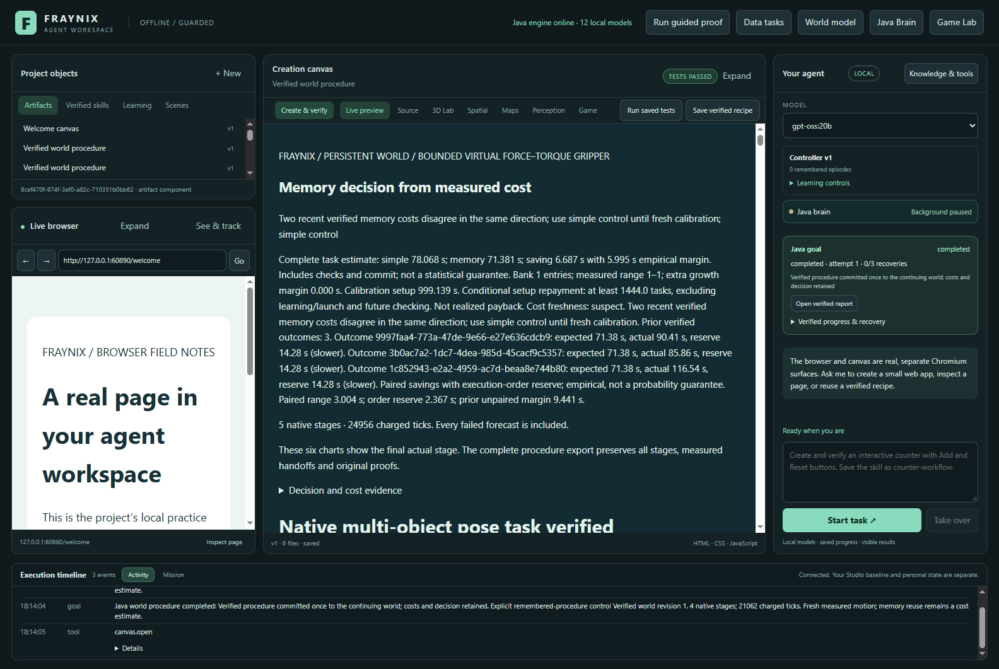
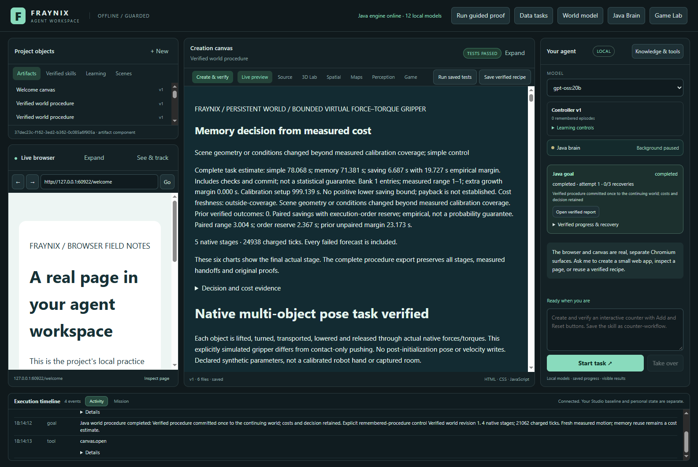
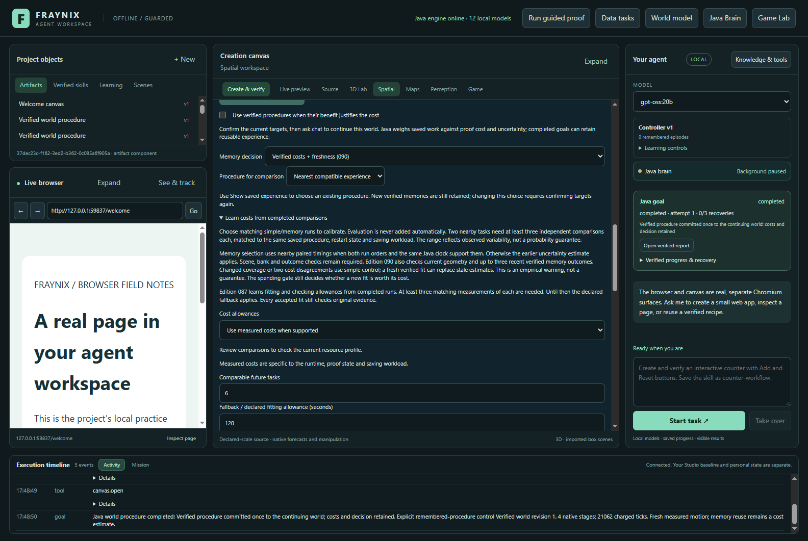
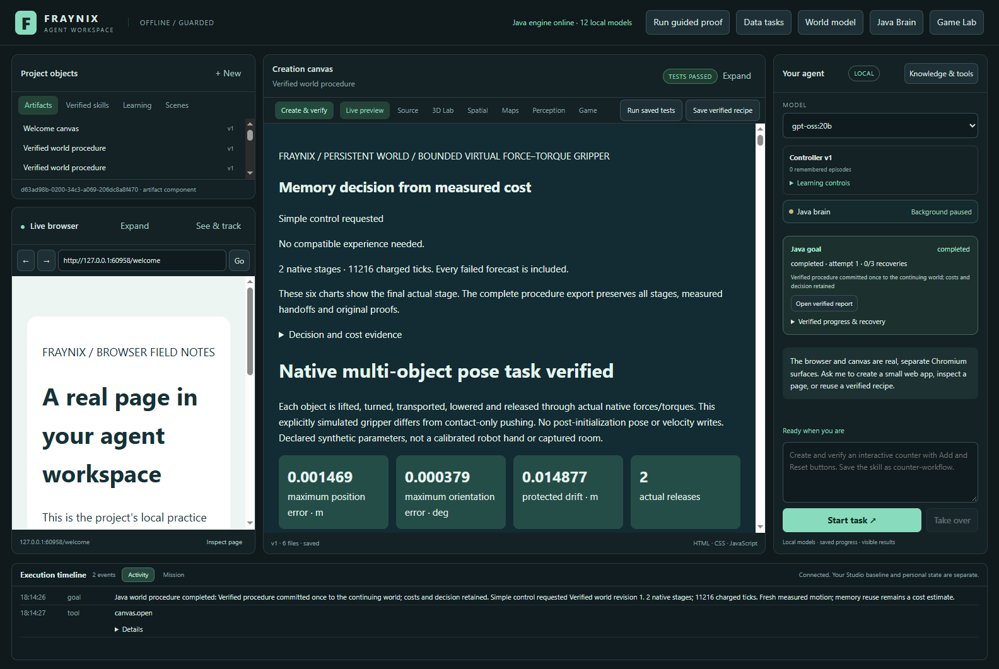
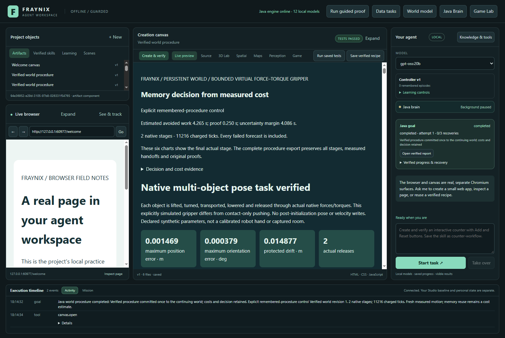
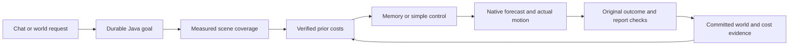

# Edition 090 — Cost freshness and mixed tasks

[Previous: edition089](README-089.md) · [README history](docs/readmes/INDEX.md) · [Interactive offline results](docs/readmes/090/index.html) · [Prospective contract](docs/EDITION_090_CONTRACT.md)

## What changed

Memory mode was faster on all six original long-route cases and slower on all three separately declared shorter-trip diagnostics. The guard detected repeated cost disagreement in one original case and rejected the old calibration's scene coverage in three others. Guarded selection still took **104.08 s longer than simple control** across the six original task calls, before charging the shared fit. Detection worked; a net speed benefit was not established.

The application remains a local Java agent workspace with integrated chat, durable
goals, physics, browser/canvas tools, procedures and evidence. Edition090 improves
one decision inside that system: whether an old complete-task cost estimate still
fits the current scene and recently verified outcomes. It does not add a new LLM,
claim consciousness, or turn changing weights into proof of useful learning.

Java now checks normalized geometry and conditions before trusting calibration.
It then reads at most three qualifying post-fit memory outcomes. Each source job,
native trace, timing interval and committed outcome must verify. Two residuals in
the same direction beyond max(1 second, 20% of predicted memory duration, retained
empirical margin) flag the estimate. A single measured policy does not establish
what the unexecuted alternative would have cost.

Calibrated selection uses simple control when coverage is missing or costs are
suspect. A warning persists for that model and scene neighborhood until replacement
by a new verified fit. Explicit simple and forced-memory choices remain available.
Original physics, protected-object, prediction/actual, report, commit, calibration
admission and proof checks remain required. The guard never creates a success proof.

## Actual application

Captured 2026-11-08 in the isolated edition090 application, using labelled synthetic scenes.





[Narrow covered view](docs/readmes/090/covered-report-visible-1100.png) · [Narrow changed view](docs/readmes/090/changed-scene-report-visible-1100.png) · [Cold restart](docs/readmes/090/cold-restart-report.png)



## Complete measurements

All **31 newly executed native goals** were independently inspected: one fresh
receipt, 12 comparison goals, and 18 mixed-task goals. A single original full fit
was measured after preparation. The six task definitions and thresholds were
frozen before outcomes. Three policy orders rotate twice, with both obstacle
conditions represented in every order position. The run is small and not randomized.

| Policy | Success | Complete Java tasks | Task calls | Native steps | Memory choices |
| --- | ---: | ---: | ---: | ---: | ---: |
| simple | 6/6 | 568.69 s | 570.95 s | 149,684 | 0/6 |
| memory | 6/6 | 513.80 s | 516.09 s | 126,428 | 6/6 |
| guarded090 | 6/6 | 671.37 s | 675.03 s | 141,932 | 2/6 |

| Task condition | Forced-memory saving vs simple | Guarded saving vs simple | Guard status |
| --- | ---: | ---: | --- |
| 090-mixed-1 · occupied | 7.07 s | -12.60 s | consistent-so-far |
| 090-mixed-2 · relocated-obstacles | 10.05 s | -3.91 s | outside-coverage |
| 090-mixed-3 · occupied | 8.30 s | -22.41 s | consistent-so-far |
| 090-mixed-4 · relocated-obstacles | 6.36 s | -8.55 s | outside-coverage |
| 090-mixed-5 · occupied | 12.30 s | -51.84 s | suspect |
| 090-mixed-6 · relocated-obstacles | 10.78 s | -4.76 s | outside-coverage |


Positive savings beat simple control; negative savings cost more. Native steps
include unsuccessful attempted forecasts as well as actual motion. Verification
and monitor work count in complete task duration. Task calls also include polling
and transport. The Java clock ends before final cost-record and anchor creation;
the task-call clock includes that bookkeeping. Source checks used to choose and
verify the action remain inside the Java clock. Setup, scene import, exports and final audit are not hidden in a
claim about total experiment time.

Shared preparation: seed **85.84 s**, comparisons
**898.61 s**, fit **115.38 s**.
Final full verification **202.42 s** and actual
app startup **17.24 s** are separate. Selection does not erase
those investments; useful repeated-task savings would need to repay them.
The extra read-only cold-check completion cost **47.93 s**,
including **3.14 s** of startup already included
in the startup total above; do not add that startup twice.

## Separately declared shorter-trip diagnostics

In the first matrix, moving static obstacles did not
remove the direct stage's recorded 12-second simulated timeout. We retained all
six cases and [declared a separate follow-up](docs/EDITION_090_FOLLOWUP.md) before
running its three shorter trips. No controller limit, success rule, model or
freshness threshold changed. This is a diagnostic response to a result, not a
retroactive replacement of the frozen evaluation or a new held-out claim.

Separately declared shorter-trip diagnostics: forced memory was faster on 0/3 and slower on 3/3. These cases follow the observed long-trip timeout; they are not independent held-out confirmation. Warmup, copying and startup costs are separate.

| Policy | Success | Complete Java | Task calls | Native steps |
| --- | ---: | ---: | ---: | ---: |
| simple | 3/3 | 157.91 s | 159.48 s | 33,648 |
| memory | 3/3 | 168.84 s | 171.01 s | 33,648 |
| guarded090 | 3/3 | 180.88 s | 182.82 s | 33,648 |

| Diagnostic | Memory saving vs simple | Guard saving vs simple | Memory extra native steps |
| --- | ---: | ---: | ---: |
| 090-short-1 | -5.16 s | -9.33 s | 0 |
| 090-short-2 | -5.26 s | -8.99 s | 0 |
| 090-short-3 | -1.11 s | -5.02 s | 0 |


Memory mode fell back from its requested procedure on 3/3 diagnostics. Selection of a receipt is not proof that its procedure executed. The retained rejected-program reasons include: No supported clear lifted route/order; target occupancy, cyclic swaps or overhangs require a different plan. Native-step totals count executed forecasts and actions; a rejected plan before motion adds no native steps. Task-call totals still include its lookup and planning work. This differs from the predicted extra physical intermediate stop and is reported as observed.

Nine additional task goals and nine actual cold-proof warmups were inspected.
Each branch starts from a byte-verified closed copy of the first study. Copied
preparation evidence is not counted as new observations. Warmups cost
**585.39 s**, startup **35.04 s**, copying
**58.05 s**, separate from the task calls above. There are **49
new native outcomes** overall:13 preparation,18 original comparisons,9 diagnostic
warmups and9 diagnostic comparisons.





[Interactive diagnostic results and native replay](docs/readmes/090/shorter.html) · [Diagnostic definitions](workspace-desktop/test/fixtures/procedures090-followup.json)

## How to review

Use this edition's checkout and a new local project directory. With the repository's
Java and desktop prerequisites installed, run in PowerShell from the checkout:

```powershell
$env:FRAYNIX_WORKSPACE_PROJECT = Join-Path $env:LOCALAPPDATA 'Fraynix/edition090-review'
$env:FRAYNIX_WORKSPACE_PERSISTENT = '0'
$env:FRAYNIX_WORKSPACE_JAVA_PROCESSORS = '2'
$env:FRAYNIX_WORKSPACE_JAVA_HEAP_MIB = '512'
.\gradlew.bat :workspace-engine:installDist
Set-Location workspace-desktop
npm start
```

Only build when this checkout has no running Java owner. The older review app uses
its own checkout and private project. The new directory starts a fresh workspace;
it does not silently attach to the study or to the older database.

1. Launch this isolated checkout with its own project directory; keep the older
   live045 application and private camera data separate.
2. Open the 3D world workspace, choose saved experience, and confirm the current targets.
3. Select **Verified costs + freshness (090)** for guarded calibration, or use
   **Simple control / Prefer verified memory** for explicit comparisons.
4. Review completed comparison pairs before fitting. The production spending gate
   still controls fitting; the study uses its explicit isolated test-only full-fit
   route to measure a calibration without claiming it paid off.
5. Open the goal report. It shows scene coverage, warning status, prior outcome IDs,
   predicted/actual durations and the resulting choice inside the same app.
6. Export the original procedure. Restart restores the exact goal, sources and
   committed world. A verified goal can be rechecked through the readonly
   `/api/procedures090/verify` route.

An absence of recent evidence is labelled **unobserved**. Smaller scene changes
inside the declared coverage can still invalidate a forecast. The residual threshold
is an empirical engineering guard, not a confidence interval. A warning can reflect
the guard's own checking overhead as well as scene or runtime changes; it does not
identify the cause. Resource identity
matches process settings; it cannot completely characterize background contention.

## Verification and limits

**256 distinct Java cases** across source-qualified initial and final
invocations, **135 desktop checks**, full actual goal audits, and independent native
inspection passed. Original stdout/XML, measurements and refusal receipts are
included. The initial run caught eight failed new coverage tests: normalized
bodies no longer contain the import-only shape field. The implementation was
corrected to use normalized body type; all 16 freshness tests then passed, along
with 29 other affected checks. The 240 earlier checks passed in the first run.
This is a source-qualified union, not one uninterrupted final broad invocation.
The first native-study invocation also had an invalid cold-check assertion that
compared a complete export with the abbreviated display summary. All timed goals
were preserved. Read-only completion compared full original exports, repeated full
goal audits and world-hash checks after another restart, and captured the final UI.
The original failure and completion receipt are retained. The final build
receipt pins input and installed JAR hashes before and after the study.

The first screenshot automation stayed on the world view instead of reliably
showing the intended older report. Its captures and failed visibility checks are
retained. Final visual review opens the exact saved artifact through the real
canvas tool, waits for world restoration, and checks the visible preview, artifact
identity and actual decision text. No timed goal was changed for these captures.

The mixed evaluation uses one bank receipt and one fit; there is no automatic
refit, new weight training, personal webcam observation, or real-world calibration.
The study compares guarded selection with simple and forced memory; it does not
measure an incremental speedup over an unguarded089 selector. Prior measured outcomes can affect later guarded decisions; simple/memory controls
are explicit, so this is an online shared-history study, not isolated independent
policy populations. Each case starts a separate matched world. Numerical threshold
tests are synthetic Java checks and must not be presented as measured runtime drift.

See [verification](docs/readmes/090/verification.json), [complete analysis](docs/readmes/090/comparison-data.json),
[original compressed evidence](docs/readmes/090/original-evidence.json), [source inventory](docs/readmes/090/FILE_TREE.txt),
and [architecture note](docs/obsidian/98-cost-freshness-and-mixed-tasks.md).

## Architecture and next proof



Next: measure whether the guard itself earns back its evidence-reading cost,
expand independent procedures and scene families, and collect fresh matched pairs
only when expected decision improvement justifies the expense. Keep a simple
baseline and report false warnings, missed drift and time to recover. Additional
models and sensors remain optional; this phase stays in the owned Java runtime.

The next implementation should first separate repeated evidence parsing from
necessary source-byte checking. Reusing an earlier verification would require
the same complete source hashes, engine identity and recorded outcome binding;
any changed input must force the original full checks. Measure that approach
against this edition, simple control and fixed memory, including cold starts.
Counterbalance repeated long/short tasks, record false warnings and unnecessary
memory lookups, and count fitting and checking expense before claiming net benefit.
These are next-phase acceptance criteria, not capabilities added in090.
