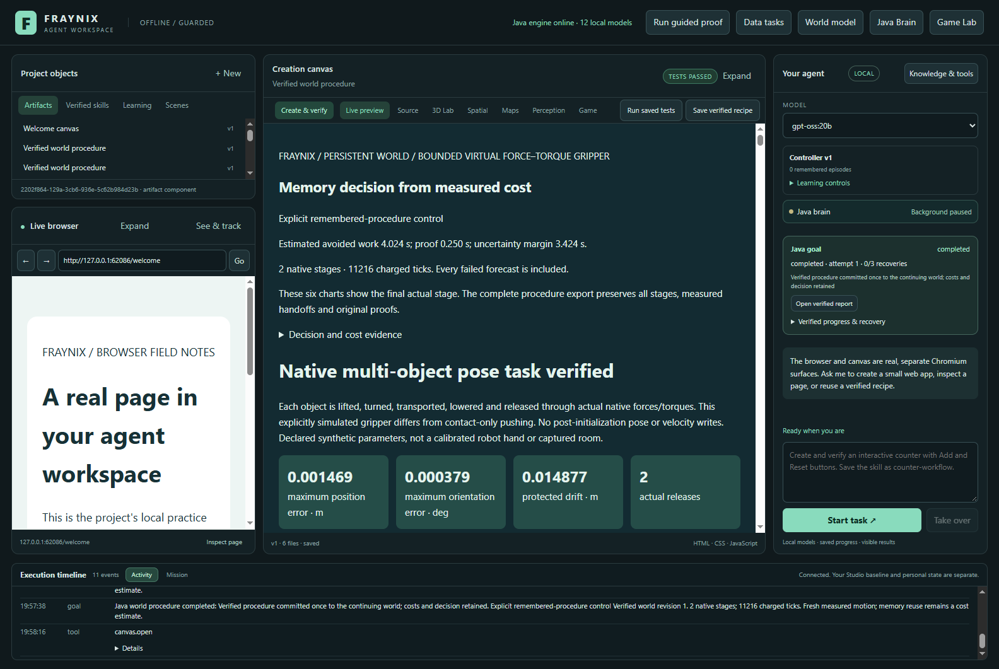
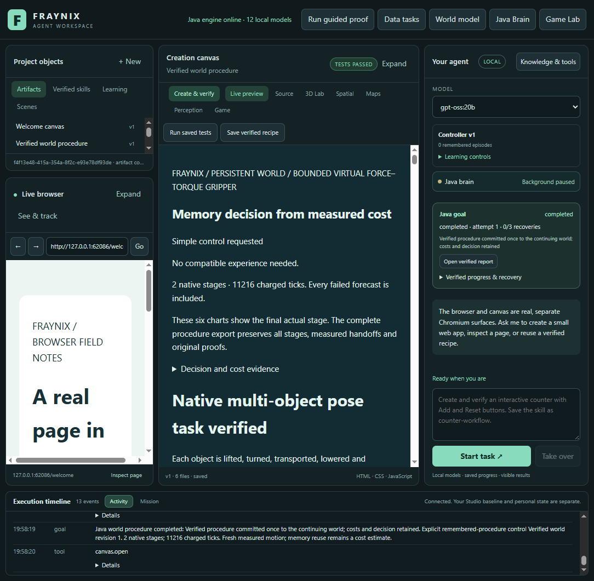

# Edition 091 — Less repeated verification work

[Previous: edition090](README-090.md) · [README history](docs/readmes/INDEX.md) · [Interactive offline evidence](docs/readmes/091/index.html) · [Prospective contract](docs/EDITION_091_CONTRACT.md)

## What changed and why

Digest reuse reduced canonical verification passes by 94.2% and took 40.07 s less across the eight task calls (four paired comparisons). All nine new native goals completed and verified. Every original outcome check remains active.

Edition090 showed that checking the cost of using memory could itself be expensive. Edition091 narrows one repeated part of that work: rebuilding the canonical digest of large, unchanged native motion records. Java still reads every byte, decodes new data and executes all original outcome checks.

This is the same integrated local agent workspace: chat requests become durable Java goals; the world runtime performs bounded actions; reports and verified commits retain what actually happened. This release makes evidence handling cheaper. It does not add a new model, claim consciousness, or substitute cached success for measured behavior.

## The actual application

Captured 2026-11-08 UTC from the isolated edition091 app after fresh labelled synthetic tasks, using saved reports opened through the real canvas tool.

[Memory at 1100 pixels](docs/readmes/091/verified-memory-1100.png) · [Short trip at 1600 pixels](docs/readmes/091/verified-short-1600.png)

## The precise reuse boundary

1. Check that the native file belongs to this owner, exists as a regular unredirected file and fits the 32 MB format limit.
2. Read all bytes with a bounded read. Hash the complete envelope using SHA-256. File timestamps and sizes are not evidence of unchanged contents.
3. Decode a fresh JSON object on every call. A bounded table may supply the canonical digest only when the complete byte digest matches an earlier authenticated envelope.
4. Check envelope format/digest and the caller's current goal ID, attempt ID and expected canonical digest.
5. Run the original motion, chronology, work admission, forecast/actual, protected-body, task, report and committed-world checks at their existing boundaries.

The table holds at most **64 digest pairs**, and no JSON object, trajectory verdict, goal result or persistent proof. Invalid envelopes are not admitted. Different bytes need full canonical checking. Eviction and restart also require a new canonical pass. Concurrent callers receive independent data. Mode changes for testing clear the table.

All **329 existing compiled engine classes** outside the three integrations are byte-identical to090. `WorldVerify`, `WorldFrames`, `Procedure079`, the native controller, proof memo, calibration reader and selection formulas remain unchanged. New `NativeEnvelope091` owns only digest reuse; `WorldProcedure079`, `GoalRunner` and `WorkspaceServer` integrate it. The engine identity includes the new class. Old motion proofs and old cost fits are not relabelled as091 evidence.

## Complete task measurements

The study used one fresh retained two-stage receipt and eight new task goals: long and short trips, each under simple and forced-memory policies, each in reference and reuse mode. Scene specifications derive from090; these are fresh executions, not newly held-out conditions. The same compiled engine ran both modes with 2 configured processors, OS affinity pinned to two CPUs and a 512 MiB Java heap. Every comparison starts a fresh matched world. There is one fixed memory receipt and no timed skill saving or calibration fitting.

| Task / policy | Reference call | Reuse call | Saving | Native ticks per mode |
| --- | ---: | ---: | ---: | ---: |
| 091-long / simple | 65.13 s | 52.82 s | 12.31 s | 24,948 |
| 091-long / memory | 62.43 s | 48.92 s | 13.51 s | 21,072 |
| 091-short / simple | 35.08 s | 28.06 s | 7.02 s | 11,216 |
| 091-short / memory | 37.10 s | 29.88 s | 7.22 s | 11,216 |

Positive saving means reuse was faster. Both modes selected the same final procedure and charged the same native ticks in each pair. A remembered route may be rejected before native execution; choosing memory is not proof that its requested route executed.

Across the four paired tasks, reference calls total **199.74 s** and reuse calls total **159.67 s**. Reference performs 226 canonical checks; reuse performs 13, with 213 authenticated digest hits. Every read still hashes all source bytes. Raw read counts and bytes are retained in [complete measurements](docs/readmes/091/comparison-data.json); any difference in call counts must not be represented as skipped outcome checks.

The reference mode performs **one** full canonical pass per read;090 performed two. This comparison isolates reuse against an already simplified full-check baseline. It does not directly measure the entire release against an090 executable.

Four repeated full goal audits per mode took **17.52 s** in reference mode and **10.71 s** with reuse. They returned exactly the same source-bound outcome and decision. Cold and warm table states are recorded separately; every native outcome is still reconstructed and checked.

Separate costs: seed receipt **57.63 s**, application startup **6.40 s**, exports **16.38 s**, cold-restart full verification **4.74 s**. Task-call timing includes transport, polling and final cost bookkeeping. The existing Java cost timer ends before the final cost record and anchor write. Post-task audits and screenshots do not disappear into a claimed end-to-end saving.

## Verification

268 Java cases passed across 35 classes; 1 host-dependent case skipped; 135 desktop checks passed. A separate Windows directory-junction refusal probe passed. Nine fresh native goals and eight full post-task audits were independently inspected.

Tests cover same-size/timestamp tampering, current goal/attempt/digest substitution, malformed formats, invalid UTF-8, size limits, missing or escaped paths, eviction, restart, reference mode and mutation of previously returned JSON. A warmed native regression rejects forged metrics, source and plan digests, charged ticks, success and prediction comparisons. Even a newly signed envelope with a false final motion result fails the unchanged native verifier. Failed probes restore exact original bytes.

Windows denied creation of a symbolic link in the optional host-specific test. It is recorded as skipped, not passed; no claim is made that this host executed that fixture. A separate actual Windows directory-junction probe successfully tested redirected-parent refusal against identical warmed bytes. All other cases passed in the final broad invocation. The original first focused invocation and the broad run remain available with their source identities.

The Electron study also rechecks the completed saved report, cost record and persistent world, rejects warmed same-size file corruption, and verifies the same goal after restarting Java with an empty digest table. A separate JavaScript reader independently reconstructs original native arithmetic, procedure decisions, costs and world commits. That reader is not a separate physics engine.

Documentation assembly was retried after waiting for the inspector's completed output and enabling Windows long-path reads for original unit-test evidence. These packaging failures and their recovery are retained in the logs; no measured task or runtime implementation was changed.

[Verification receipt](docs/readmes/091/verification.json) · [Exact original archive index](docs/readmes/091/original-evidence.json) · [Source inventory](docs/readmes/091/FILE_TREE.txt) · [Obsidian map](docs/obsidian/99-native-envelope-verification.md)

## Run and review

Use Java21 and the existing Node/Electron dependencies. Start `Launch-Agent-Workspace.bat` from this checkout, or use `scripts/Start-Agent-Workspace.ps1` with a distinct project directory for a review. Preserve existing private projects and live installations. Do not silently point a new checkout at the running user's database. The app is local; optional remote models and browser activity use their configured services. Offline test mode requires no cloud model.

In the app, import or select a labelled world, choose simple control or an available verified memory procedure, submit the arrangement goal, and inspect the resulting report. Verify final positions, motion comparisons and the committed revision. This change requires no new user-facing toggle. The local diagnostics route `/api/procedures091/diagnostics` reports reads, bytes, canonical checks, hits and failures. `/api/procedures091/test-mode` is restricted to idle isolated test runtimes; it offers full reference checking or bounded reuse, never a skip-verification mode.

To reproduce the declared comparison after a successful build, run `node scripts/Study-Build091.cjs --stamp`, then `node workspace-desktop/test/envelopes091-integration.cjs`, then `node scripts/Inspect-Envelopes091.cjs`. Use a fresh study output; keep failed attempts. The build receipt binds all current inputs and installed JARs before and after measurement. The protocol is in `workspace-desktop/test/fixtures/procedures091-protocol.json`.

## System direction

The Java brain retains task ownership, policies, current-world binding and recovery; the desktop presents the browser, canvas and controls. Physics supplies testable consequences. Memory contributes verified procedures and measurements rather than authority by assertion. The intended evolution remains better task performance that survives restart and unfamiliar conditions, measured against a simple controller and charged for its actual work.

## Next and limits

Next, measure longer mixed and restarted workloads as the memory bank grows, including calibrated selection. Determine whether freshness checking now repays more of its cost. Profile the remaining decode and native arithmetic before changing any check; prefer bounded streaming or lower allocations to caching outcome authority.

This small study has four paired comparisons, alternating order, on one host. It is not randomized, a general latency guarantee or a demonstration of real-world physics accuracy. It does not measure larger banks, fit payback or calibrated-policy task latency. No LLM weights were trained, no physical sensor was used, and original090 evidence remains historical. Publication is recorded separately after remote fetch verification so the frozen edition does not claim an unobserved push.
