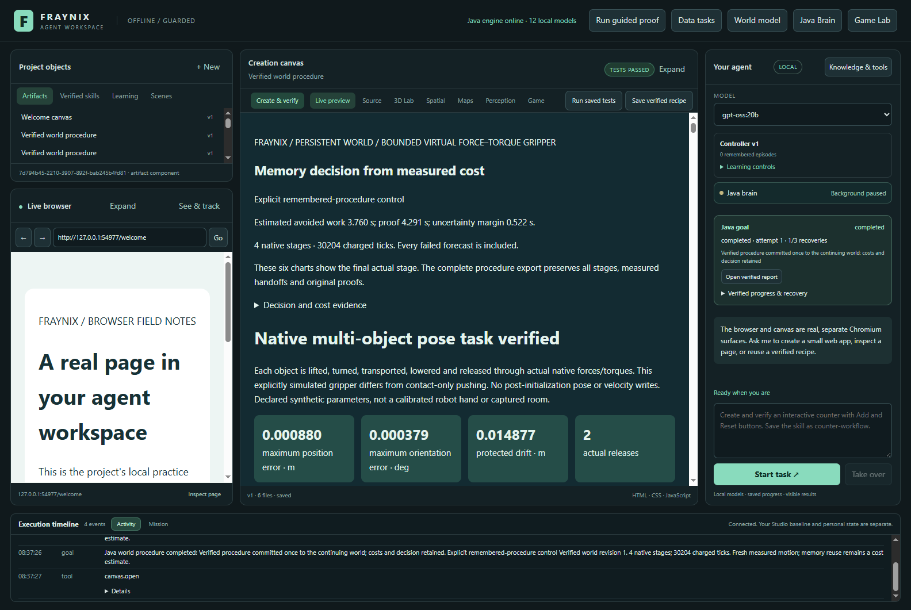
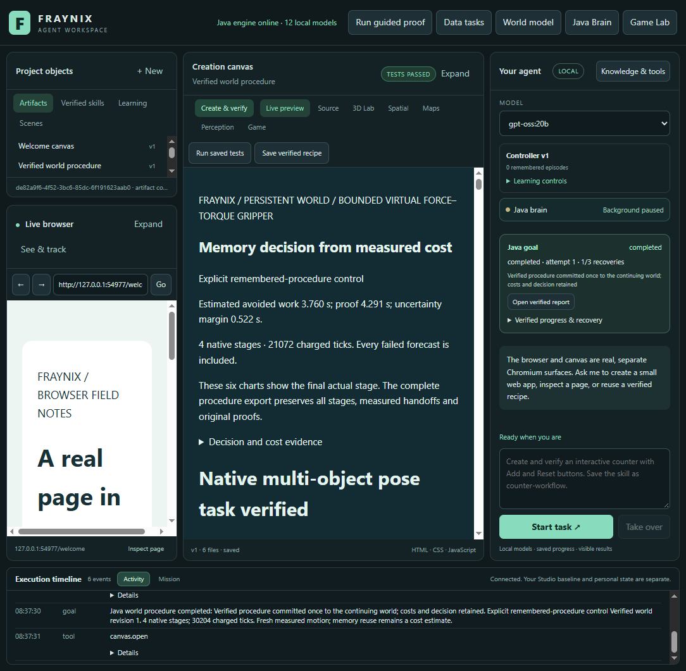
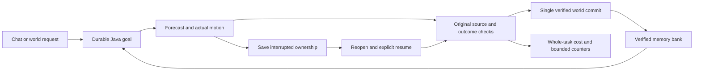

# Edition 092 — Growing banks and restarted tasks

[Previous: edition091](README-091.md) · [README history](docs/readmes/INDEX.md) · [Offline evidence explorer](docs/readmes/092/index.html) · [Declared protocol](docs/EDITION_092_CONTRACT.md)

Client date: **2026-11-08 · America/Los_Angeles**. Images below are actual captures of this edition's isolated app and synthetic test data.

## What this edition establishes

Across six paired comparisons, digest reuse took 103.08 s less total caller time, with 86.1% fewer canonical checks in the observed counter windows. All twenty goals in the final-stage follow-up verified, including six final-stage interrupted and resumed tasks. An earlier-stage restart was correctly refused after its next source state changed; that remains an unresolved recovery limit.

Edition091 made one repeated part of verification cheaper: calculating the canonical digest of an unchanged native motion record. Edition092 asks whether those savings survive a growing memory bank and a real interruption. It grows a bank through eight newly executed, verified procedures, then compares full reference checking with digest reuse at banks of one, four and eight receipts. At each size it measures both an uninterrupted task and a task stopped during actual motion, reopened and explicitly resumed.

This is a measurement and recovery-validation edition. **All333 compiled production Java engine classes are byte-identical to091.** The new work consists of a prospective experiment, a real application harness, independent accounting, regression checks and inspectable evidence. No dummy handler, replacement physics result, guessed screenshot or cached success verdict was added. Source identity is unchanged because the executable is unchanged; no older evidence is relabelled as a fresh092 execution.

The application remains a local agent workspace. Java owns durable goals, procedural memory, world state and verification. The desktop presents chat, the browser, canvas and runtime views. A remembered procedure can guide a task, but successful execution still needs an original motion record, a validated outcome and a committed world revision. The purpose of this phase is to make that accountability practical as retained experience grows.

## Recovery limit discovered first

An earlier attempt resumed actual stage0 successfully, but the recovered motion slightly changed the starting state of stage1. Its precomputed forecast therefore had a different exact source binding. The unchanged verifier refused the stage comparison and no world revision was committed. The difference included approximately0.066mm of bystander position and small residual velocities; numerical size does not authorize changing a source hash or waiving a check.

The completed comparison matrix below deliberately interrupts final stage1, which has no later dependent forecast. This scope was selected **after** observing the earlier failure, so these are diagnostic results, not held-out evidence of general restart recovery. The full earlier attempt and an independent refusal inspection are archived. No production check was weakened to obtain a pass. **Early-stage recovery needs a fresh forecast from the recovered state before the next actual stage. That is the immediate next implementation.**

[Early restart refusal evidence](docs/readmes/092/early-restart.json)

## Complete task measurements

| Verified receipts | Lifecycle | Reference caller time | Reuse caller time | Observed saving |
|---:|---|---:|---:|---:|
| 1 | uninterrupted | 70.40 s | 59.44 s | 10.97 s |
| 1 | restarted | 92.39 s | 70.72 s | 21.67 s |
| 4 | uninterrupted | 78.90 s | 58.00 s | 20.91 s |
| 4 | restarted | 99.77 s | 84.93 s | 14.84 s |
| 8 | uninterrupted | 77.25 s | 59.73 s | 17.52 s |
| 8 | restarted | 107.39 s | 90.23 s | 17.17 s |

Positive saving means less elapsed time with reuse; negative saving means a slower observed run. These are six paired observations on one machine, not population estimates or a latency promise. The same first receipt is explicitly selected in each comparison. All measured tasks use the same existing long-trip scene family. Preparation variants introduce small declared changes in mass, friction and target position; they are similar memories, not eight unrelated task families.

The Java process is limited to **two actual OS-affined processors and512MiB heap**. Affinity, runtime profile and resource snapshots are recorded at each boot. Electron and the operating system are outside that Java budget. Each measured task starts after a new application boot with an empty fingerprint table; we do not silently compare a warmed arm against a cold arm. Mode order alternates across sizes and lifecycle conditions.

The bank and project history grow together. Consequently, the differences between the one-, four- and eight-receipt rows cannot isolate the causal cost of bank size. Explicit receipt selection also means this is not a benchmark of searching every bank member or of the calibrated selector choosing the best memory. It measures the same policy's full work with different retained histories and cold starts.

## What restart actually means here

Six comparison goals were interrupted while the final native actual stage was moving, after a recorded tick of at least1200. The isolated app was closed, Java restarted and the goal reopened as interrupted. The unchanged world head and pending owner were checked before explicit resume. The tests then confirmed that every original attempt ID and saved sample prefix survived, the uncertain interruption tail was charged conservatively, and exactly one verified world revision was committed.

This is stronger than reopening a completed report: the motion was unfinished at closure. It is still a **graceful application interruption**, not a power-failure or abrupt process-kill test. The earlier abrupt-recovery tests remain historical evidence;092 does not claim to repeat them.

Caller time is measured by the surviving test process from request through completion. It includes app closure, restart, OS pinning, prefix export and explicit resume. The in-app taskCost080 complete timer is unavailable after process restart: totalMillis is0. It remains **ineligible for calibration**, has no promoted clock089 record, and is never substituted for the whole caller interval. Independent inspection verifies this distinction.

Reopening and exporting the interrupted prefix use ordinary production reuse in both arms. The requested reference or reuse mode is restored before actual resume. That common recovery work is included in time and added explicitly to the observed counter totals. Reference execution segments require zero hits; the common recovery operation may have hits. The last pre-close counter snapshot cannot prove how many reads shutdown might perform afterward; full caller time still includes the entire closure. This boundary is documented rather than presenting partial counters as a perfect process-wide profiler.

## A working set larger than the fingerprint table

After execution, the study audits all twenty completed goals in three ordered passes. The original working set contains **88 distinct native envelopes**, exceeding the unchanged64-entry table.

| Audit pass, twenty goals each | Elapsed | Original reads | Canonical checks | Digest hits |
|---|---:|---:|---:|---:|
| reference | 153.39 s | 336 | 336 | 0 |
| cold-table | 109.11 s | 336 | 88 | 248 |
| second-pass | 107.89 s | 336 | 88 | 248 |

The second reuse pass is not assumed to be fully warm. A finite table evicts older fingerprints as the reader walks through more than64 distinct records. Every reread still hashes all file bytes and decodes fresh JSON; a miss requires a new canonical calculation. The audit checks that all three passes return the same original result for each goal, with no failure or changed world outcome. This distinguishes bounded reuse from retaining an unlimited proof cache.

All source and outcome checks remain active: owned paths and size bounds; complete envelope bytes; current goal/attempt/digest identities; original source and action plan; native chronology and charged work; final positions and protected bodies; forecast-versus-actual comparison; completed report and cost identity; and a single persistent-world commit. A same-size mutation with the original modification time is made to a warmed, resumed goal's native envelope. Verification must refuse it. Exact byte restoration must restore verification.

## Costs outside the paired task totals

Eight native preparations took **503.85 s**. Initial boots outside task intervals took **51.40 s**. Final original exports took **45.34 s** and the individual full post-task checks took **108.16 s**. The three later twenty-goal audit passes are listed separately above.

Restart boots totalled **19.96 s**, already included in restarted caller times. They must not be added again. None of these preparation, export or inspection costs is hidden inside a claim of free learning. They purchase test data and assurance; whether calibration or another memory policy repays its own cost remains a separate experiment.

## Verification and original evidence

56 Java checks passed across 9 focused classes; 1 optional host-dependent test skipped. 135 desktop checks and five new cross-boot accounting checks passed. Twenty fresh native goals and sixty repeated full goal audits passed.

The nine focused Java classes exercise native envelope integrity, forged outcomes, cost freshness, reconstruction compatibility, procedure behavior, proof reuse, world ledger and resource limits. The optional symbolic-link creation case is recorded as skipped when Windows denies creating the fixture. Edition091's separate successful junction test remains linked historical evidence; it is not counted as a fresh092 check. The existing091 broad suite is likewise not relabelled as rerun.

The first independent092 inspection stopped because its new resumed-cost check incorrectly compared the full archived cost object with the deliberately smaller goal summary. That was corrected to check the exact summary projection. Inspection also checks the actual restart contract: totalMillis is0 because the original monotonic start clock is unavailable, executionMillis matches retained active time, and the record is excluded from calibration. The failed inspector log is retained; no production code or measured result changed.

The first study attempt completed three goals and interrupted a fourth, then stopped on an incorrect harness assertion: a newly booted recovery process had already checked an original during startup, so its post-startup fingerprint table contained one entry. That did not establish cache persistence or lost verification. The corrected harness permits entries backed by the new process's own canonical checks and charges constructor recovery from zero. The entire twenty-goal matrix was restarted with a fresh project; the first attempt remains archived separately and is excluded from its paired totals. Production Java was unchanged throughout.

Five new accounting tests reject counter resets inside a segment, missing reads, invalid timings, omitted prefix-export work, falsely eligible resumed costs and changed paired tasks. The independent inspector recalculates source/plan hashes, native motion metrics, charged work and ledger commits from exact originals. It is an independent evidence reader, not a second physics solver. Tests of the existing desktop pass; no fresh LLM, webcam or physical-accuracy claim is made in this phase.

[Verification and limitations](docs/readmes/092/verification.json) · [Complete comparison data](docs/readmes/092/comparison-data.json) · [Original compressed evidence with raw hashes](docs/readmes/092/original-evidence.json) · [Source inventory](docs/readmes/092/FILE_TREE.txt) · [Obsidian system map](docs/obsidian/100-growing-bank-restarts.md)

## Actual integrated app

*Actual app capture,2026-11-08,window1600×1100 (content1584×1061). A verified task after an actual interruption, with an eight-receipt bank. The capture shows the existing report surface; it does not imply a new bank-management UI.*

*Actual app capture,2026-11-08,window1100×1100 (content1084×1061). An uninterrupted comparison task and its saved report. All four capture files are included in the original evidence index. The center canvas is the selected report; the right goal panel and timeline retain the most recent task. Controller v1’s remembered-episode counter is a separate memory system, not the world-procedure bank count.*

The offline companion displays every comparison, separates recovery costs, and lets you inspect exact retained native samples. Its top-down projection is a view of recorded data, not regenerated physics. The original records retain full state and rotation even though the compact projection displays body extents without full3D rotation. The guide has no CDN or model dependency.

## Run and reproduce

Use Java21 and the existing Node/Electron dependencies. Launch the existing app with `Launch-Agent-Workspace.bat`, or use `scripts/Start-Agent-Workspace.ps1` with a distinct project directory. Preserve any live installation and private database. This edition used `D:/Codex-Work/fraynix-workspace-edition092`; the original live045/qa046 projects were not migrated or overwritten.

For an isolated reproduction, build `:workspace-engine:installDist`, run `node scripts/Study-Build092.cjs --stamp`, run `node workspace-desktop/test/envelopes092-integration.cjs`, then run `node scripts/Inspect-Envelopes092.cjs`. Keep a fresh output directory and retain failed attempts. The prospective scene matrix is in `workspace-desktop/test/fixtures/procedures092-protocol.json`. The build receipt binds installed artifacts and inputs before and after the experiment.

In ordinary use, select a world and an available verified procedure, request the arrangement, and inspect the resulting report and world revision. Resume an interrupted goal explicitly. There is no new speed toggle in the product. The existing diagnostics route reports work counters; changing reference/reuse mode remains restricted to an idle test runtime. Reuse never means disabling outcome verification.

## Direction and next acceptance gates

First, implement bounded reforecasting after an early-stage restart. Preserve the prior forecast as evidence, require a new source-bound forecast before later actual motion, charge its cost, and test changed-state refusals plus successful recovery. Do not normalize away measured differences or relax identity checks.

Then measure **calibrated procedure selection** with fixed project snapshots, varied eligible procedures and randomized paired order. Count bank preparation, stale-cost checking, calibration fitting and task completion together. Acceptance requires a verified improvement in complete-workload cost or task success; a faster isolated digest does not automatically prove the selection policy earns its overhead.

Then profile remaining fresh JSON decoding and native evidence arithmetic under a larger working set. Any optimization must preserve source identity, per-call fresh data and every outcome check, with mutation, restart and eviction tests. Prefer lower allocation and bounded streaming where profiling supports it; do not replace current verification with remembered success.

Finally broaden task families and restart conditions. Independent obstacles, payload distributions and resource budgets should be declared before measuring. Separate familiar-family diagnostics from held-out results, retain failure traces and keep partial recovery clocks outside calibration. The destination remains an agent whose abilities improve measurably and survive interruption, with evidence a user can inspect. This edition establishes a bounded piece of that path, not general intelligence, consciousness or new neural weight training.

Publication is recorded separately after an actual remote fetch and Git-tree audit. Frozen001–091 documentation is preserved; this092 snapshot records its own source and measured originals.
