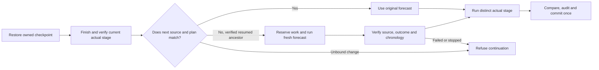
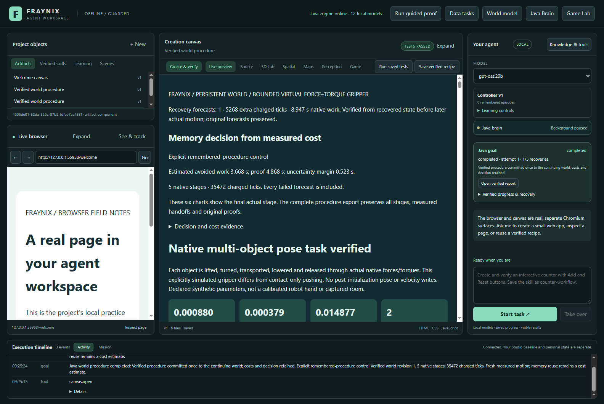
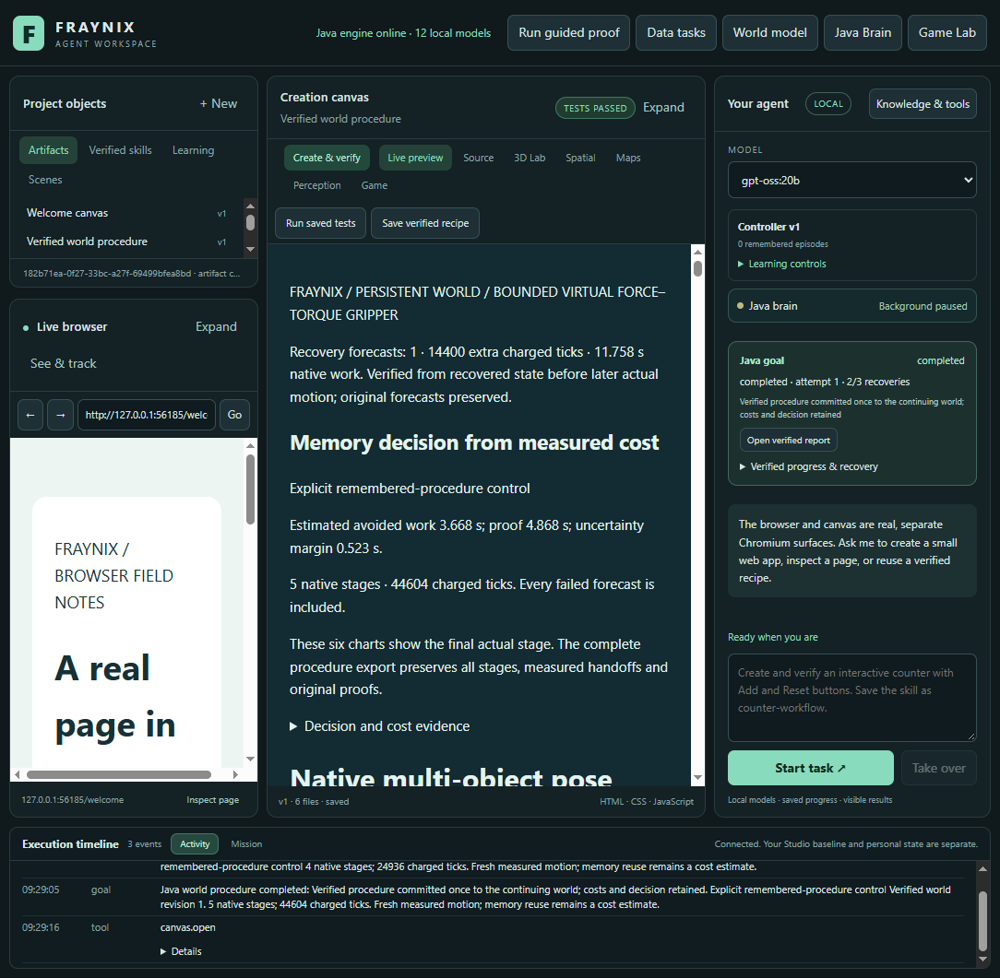

# Edition 093 — Forecast from the world you recovered

[Previous: edition 092](README-092.md) · [All editions](docs/readmes/INDEX.md) · [Offline evidence explorer](docs/readmes/093/index.html) · [Current project](README.md)

**Java now creates and verifies a distinct forecast from recovered state before later actual motion. Both declared early-restart cases completed; a second interruption during forecasting also recovered. Stopping during forecasting prevented the next actual stage and any world commit.**

This edition closes the observed early-stage recovery gap without changing what counts as a successful prediction, a valid physical outcome, or permission to commit a world revision. A restart can restore a native physics checkpoint accurately enough to finish the current stage, while still changing a few values in its final state. The following stage must be predicted from those actual values. Treating the old prediction as current would break the link between a forecast and the world it describes.

The original092 refusal remains a correct historical result. Its archived evidence is [here](docs/readmes/092/early-restart.json). All093 successes are fresh executions under the new code identity, not upgrades of old outcomes.

## What changed in the application

Java still owns the durable task, bounded procedures, physics execution, proof checking and persistent world. The integrated desktop still presents chat, world tools, saved reports and the canvas. There is no extra window or external orchestration service for recovery.

Before each later actual stage, the runner compares its reconstructed starting scene and action plan with the original forecast. When they match exactly, the ordinary path continues. When they differ, continuation requires a completed, independently checked earlier actual stage with recorded native resume provenance. A mismatch without that provenance is refused.

The runner derives the next frame from the immediate previous actual result. It reserves enough of the existing goal budget, creates a new native forecast with a new identity, and checks its original outcome and protected-body trace before starting the later actual stage. It saves an explicit relationship between the original forecast, previous actual result, resumed ancestor, current frame and action plan. Those identities and content hashes are checked again during the final audit.

The original forecast sequence is retained unchanged. The replacement forecast is evidence of a new prediction from a changed starting point. It is never relabelled as actual motion. The actual stage remains a separate native run with its own samples and comparisons. Only the verified actual sequence can produce the final world revision.

## Measured outcomes

61 Java checks passed across 11 focused classes; 1 optional host-dependent case skipped. 135 desktop checks passed. Five new native goals completed and one was deliberately cancelled.

The native study used one newly retained successful procedure and five further tasks on an isolated project, with two assigned logical processors and a 512 MiB Java heap. The conditions were declared in the [protocol](workspace-desktop/test/fixtures/procedures093-protocol.json) before these trials. The variant changes selected payload mass by 5%, friction by 0.02, and one target coordinate by −0.05 m. These are labelled synthetic rigid-body scenes with declared parameters, not camera observations or physical laboratory measurements.

| Case | Outcome | Explicit resumes | Total charged ticks | New forecast charged ticks | New forecast native wall time | Complete caller time |
|---|---|---:|---:|---:|---:|---:|
| seed | Completed | 0 | 24948 | 0 | 0.00 s | 63.17 s |
| baseline | Completed | 0 | 21072 | 0 | 0.00 s | 53.85 s |
| early-restart | Completed | 1 | 35472 | 5268 | 8.95 s | 92.75 s |
| varied-early-restart | Completed | 1 | 35452 | 5263 | 7.09 s | 84.98 s |
| reforecast-restart | Completed | 2 | 44604 | 14400 | 11.76 s | 107.83 s |
| reforecast-cancel | Stopped | 1 | 26960 | 2024 | 2.14 s | 50.45 s |

The seed is preparation, not a held-out comparison. The baseline required no replacement forecast. Both early actual-stage restart cases generated a fresh forecast before the second actual stage. The twice-restarted task was interrupted during that new forecast, then explicitly resumed with the same native identity and preserved sample prefix. It completed with one world commit. The cancellation case stopped the replacement forecast: no later actual stage started, no success was committed and no eligible cost record was produced.

These timings describe this local run. Complete caller time includes closure, reopening, resource pinning, reading interruption evidence and explicit resume. It excludes initial boot, later exports, screenshots and final audits. Native forecast wall time is the recorded attempt time across its runs. Charged ticks conservatively reserve a full 14,400 ticks for an attempt with an unknown interruption tail; observed ticks remain separately inspectable. These are different measures and should not be interchanged.

After a process restart, the original monotonic task clock cannot be recovered. The existing cost record deliberately has totalMillis=0 and eligible=false. Zero means unavailable, not instantaneous completion. Retained execution time and the surviving test caller clock provide separately labelled measurements. This edition does not train a cost fit on incomplete timing.

## Boundaries that remain enforced

One replacement is permitted per later stage. The original two explicit resumes, 115,200 charged ticks, 20-minute active goal and 90-second native-attempt limits remain. Admission reserves the new forecast and remaining actual work before starting it. The pure arithmetic test checks the exact tick boundary and refusal one tick beyond it. Three-stage reservation arithmetic is covered, but this native study exercises two-stage procedures only.

The full audit reconstructs the starting state, action plan, waypoint, original metrics, protected-body motion, forecast comparison, logical order, timestamps, ownership and charged work. The next actual attempt must be planned after the completed replacement forecast. A saved metadata claim alone cannot authorize execution. A stopped, failed, changed or unbound forecast cannot become a successful continuation.

Tests deliberately alter the original forecast reference, predecessor, resumed ancestor, frame and plan hashes, forecast identity, extra fields, stage number, chronology, admission reserve, charged work, interruption charge, status, metrics and waypoint. Those changes are refused. A warmed native-evidence read also refuses same-length original-byte corruption with its timestamp preserved; exact restoration restores verification. Cold reopening rechecks all five completed goals. The independent JavaScript reader separately reconstructs these bindings and checks native arithmetic and the single world commit from exported originals. It is not a second physics simulator.

The production change is limited to WorldProcedure079 and the new RecoveryForecast093 helper. The [compiled comparison](docs/readmes/093/verification.json) identifies the changed and unchanged classes. Original physics, tolerances, native checkpoint mechanics and world-commit rules remain. Code identity includes the new helper; old-code proofs stay historical.

## See it in the integrated app

Actual isolated093 application, captured 2026-11-08 in America/Los_Angeles after completion. The saved report states the additional recovery forecasts and charged work. Requested window 1600×1100; captured client area 1584×1061. The charts show the final actual stage, while the procedure export retains every original and replacement forecast.

Actual twice-resumed task, requested window 1100×1100; client area 1084×1061. Existing chat, Java brain, world controls and report remain in one application. The generic goal panel shows a three-recovery ceiling for the outer goal/report workflow; this native procedure separately enforces two execution resumes. The catalogue's displayed models are not evidence of new inference or model-weight training. These tests ran offline without asking an LLM to invent or certify a result.

To inspect the evidence, open the [offline companion](docs/readmes/093/index.html) locally. Filter completed and stopped tasks, select an original forecast, recovered forecast or actual stage, and step through retained native samples. The map is an X/Z projection of original positions, not a new physics run or a full rendering of3D rotation. Every replay is labelled by task, stage and native identity.

## Files and reproducibility

The [source inventory](docs/readmes/093/FILE_TREE.txt) and [hash manifest](docs/readmes/093/file-inventory.json) cover the canonical application sources. The [original archive index](docs/readmes/093/original-evidence.json) records compressed and raw-byte hashes for the generated evidence, including checkpoints and logs. Personal runtime state, credentials and model weights stay outside Git. Published 001–092 documents and screenshots remain frozen.

| Role | Source |
|---|---|
| Durable continuation and final audit | [WorldProcedure079.java](workspace-engine/src/main/java/fraymus/workspace/WorldProcedure079.java) |
| Recovered-state binding, reserve and chronology | [RecoveryForecast093.java](workspace-engine/src/main/java/fraymus/workspace/RecoveryForecast093.java) |
| Prospective acceptance gates | [Edition093 contract](docs/EDITION_093_CONTRACT.md) |
| Actual application interruption tests | [recovery093-integration.cjs](workspace-desktop/test/recovery093-integration.cjs) |
| Independent inspection | [Inspect-Recovery093.cjs](scripts/Inspect-Recovery093.cjs) |
| Evidence mutation tests | [RecoveryAudit093Test.java](workspace-engine/src/test/java/fraymus/workspace/RecoveryAudit093Test.java) |

Use an isolated checkout and a new private project for these tests. Build the Java engine, stamp its input/artifact receipt, then run the integration script. It refuses an existing study checkpoint. Run the independent inspector after completion. The optional native-evidence JUnit probe uses an explicit copied project supplied through FRAYNIX_RECOVERY093_PROJECT; the recorded validation includes that probe. Do not rebuild a user's live installation or point a second process at its private data.

## What this establishes, and what comes next

This is a concrete improvement in continuity: the agent can recognize that a recovered state invalidates a downstream prediction, spend bounded work on a replacement, check it, and continue from evidence. It preserves the user's core design of a local Java agent operating inside a stateful, observable world. It does not establish consciousness, general intelligence, physical accuracy, arbitrary learned procedures or new LLM weights.

The tests cover controlled isolated-app closure and reopening, not sudden power failure. They cover nearby two-stage box tasks and one host, not universal checkpoint recovery. A changed condition still has to satisfy the existing forecast and final-task tolerances. Recovery may refuse when no valid forecast fits the remaining budget. That refusal is part of correct behaviour.

Next, test native three-stage recovery at more than one boundary and abrupt-process termination with original evidence retained. Then measure whether recovery remains worth its complete cost on longer mixed tasks, including repeated interruptions near the budget boundary. Keep the simple controller and uninterrupted execution as comparators. Continue the pending calibrated-selection work only with complete clocks and all original source and outcome checks.

Publication is recorded separately after a real push and fetched Git-tree verification. The immutable readme-093 tag identifies this evidence snapshot; later publication receipts do not rewrite it.
