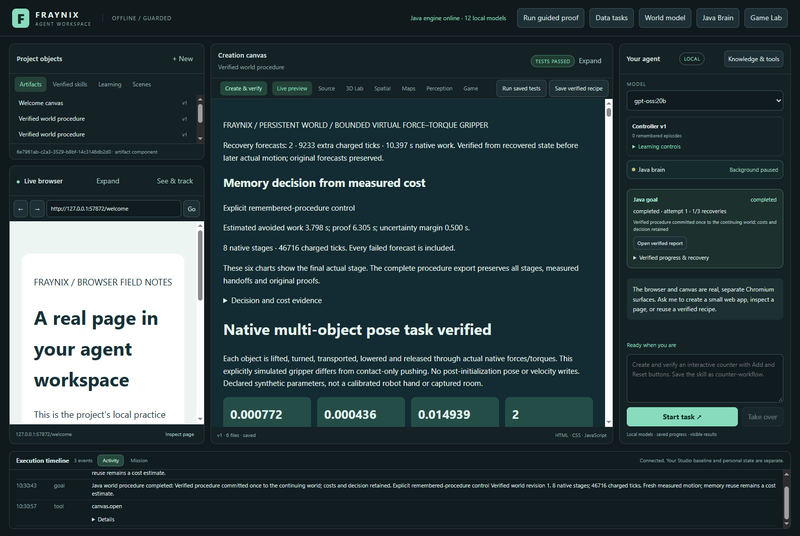

# Edition 094 — Three stages, abrupt interruptions, preserved evidence

[Previous: edition093](README-093.md) · [All editions](docs/readmes/INDEX.md) · [Offline results and replay](docs/readmes/094/index.html) · [Contributor guide](README-CONTRIBUTORS.md) · [Dated repository review](docs/TRAJECTORY_REVIEW_094.md)

**Seven fresh three-stage goals completed and verified, including five recovered matrix tasks. Five abrupt Java terminations preserved committed progress; fresh downstream forecasts and actual report checks preceded each single world commit.**

Recorded November 8, 2026, on the existing Windows workstation. This edition tests whether a longer remembered procedure can survive losing its Java process while keeping the same world, committed motion and verification. It also gives future contributors a current map of the application and its intended direction. The existing integrated interface, Java brain, browser, creation canvas, original game and native world remain the product.

## What was found and corrected

The first study completed its preparation and uninterrupted task, then exposed a new harness race: the next procedure file did not yet exist because Java creates it asynchronously. The harness now waits for creation. That entire attempt is retained. A later harness safety guard refused to terminate Java because it was given the Windows launcher PID instead of the actual Electron owner PID. An independent process probe established the relationship; the corrected guard retains all identity checks. That refused attempt, including its successful graceful recovery, is also archived.

The second study completed preparation and uninterrupted execution but stopped before its intended interruption. A Windows reader briefly denied replacement of the native checkpoint. Three tests using actual Windows deny-delete handles reproduced the missing retry: temporary lock, prolonged lock and interruption of a retry. All three failed before correction. Their original XML and logs remain in the evidence archive.

The native checkpoint now uses the existing AgentFiles042 forced atomic writer. It retries only access-denied replacement within the existing bounded schedule. It never falls back to a non-atomic write. An exhausted lock or interrupted retry retains the previous committed generation and forced pending bytes. The original checkpoint envelope, digest, source, plan, body, controller and trace checks remain.

The writer is included in native implementation identity. A previous 093 closed world can enter the new engine only through an explicit compatible frame handoff, which preserves the entire frame and records a new revision. A pending old world cannot be upgraded or reassigned. Old checkpoint/procedure proofs cannot be relabelled as current-engine evidence. Two additional compatibility checks cover those boundaries.

Only **WorldNativeCheckpoint and WorldLedger** changed among production engine classes; **332 of 334** remain byte-identical to 093. In particular, the planner order, native physics, controllers, source/outcome verifier, forecast bindings, goal completion and cost-selection formulas did not change. [Class comparison](docs/readmes/094/verification.json).

## The actual experiment

The predeclared fixture derives from the existing 076 train-distance scene. It contains two movable target bodies, a protected bystander, ground and an obstacle. Its masses, friction, dimensions and units are declared synthetic inputs. It is not webcam or instrument data.

Preparation uses the ordinary simple selector and must genuinely earn a successful three-stage procedure. It cannot inject a memory, skip failed alternatives or force a chosen result. The remaining six tasks use that newly retained exact procedure in fresh worlds. The changed-condition case was declared before trials: selected mass +5%, friction +0.02 and the first target's X coordinate minus 0.05 m.

The Java process runs on two pinned logical CPUs with 512 MiB heap. Execution remains limited to two explicit resumes, 115200 charged ticks, 20 minutes active work and 90 seconds per native attempt. Missing tails are conservatively charged. No limit was expanded to obtain a pass. The general goal card also shows its separate outer-workflow recovery counter; that does not increase the native procedure limit of two execution resumes.

| Case | Outcome | Resumes | Charged ticks | New-forecast ticks | New-forecast time | Complete caller time |
|---|---|---:|---:|---:|---:|---:|
| seed | Completed | 0 | 31624 | 0 | 0.00 s | 72.63 s |
| baseline | Completed | 0 | 27700 | 0 | 0.00 s | 71.32 s |
| graceful-first | Completed | 1 | 46716 | 9233 | 10.40 s | 124.43 s |
| crash-first | Completed | 1 | 46716 | 9233 | 10.40 s | 126.66 s |
| crash-middle | Completed | 1 | 42099 | 4616 | 5.65 s | 109.20 s |
| crash-reforecast | Completed | 2 | 56499 | 19016 | 14.73 s | 133.95 s |
| varied-crash | Completed | 1 | 46688 | 9225 | 11.68 s | 120.14 s |

All times are observed complete task-call intervals in this local test, including controlled restarts and evidence inspection where applicable. They are not isolated throughput measurements, randomized speed comparisons or evidence of calibration repayment. Preparation is shown separately rather than hidden from the account.

## What survives a crash

A forced interruption ends only the identified isolated Java owner. The harness checks executable, checkout, exact PID, start time, parent and project ownership. It does not terminate by process name or touch the user's live app. The original process identity and exit evidence are retained.

After process exit and before reopening, the harness saves the checkpoint, native state and procedure bytes. The checkpoint defines the durable sample prefix. A later observation in RAM is not treated as saved progress. On reopening, the same goal is interrupted, the same pending owner still holds revision 0, and no work continues before explicit Resume.

The resumed native run keeps its identity and committed sample prefix. The initial forecast content and identities remain unchanged; original files remain in the evidence archive. Each actual stage remains a separate native run. If recovery changes a later starting state,093's existing mechanism produces a new source-bound forecast and verifies it before that actual stage. The three-stage cases exercise both downstream forecast bindings; the second-interruption case also terminates the Java owner during a replacement forecast.

Independent inspection recomputes original source and plan hashes, motion metrics, protected-body bounds, stage chronology, recovery bindings, charged work and the final commit. It checks every committed prefix against the final native record. Completion requires the actual rendered report checks as well as native outcomes. A prediction cannot stand in for physical execution.

Resumed tasks retain `totalMillis=0` only as an unavailable-clock marker and remain ineligible for cost calibration. The surviving caller supplies the external whole-task duration. A later clock redesign would need its own restart tests; this edition does not turn partial intervals into complete training observations.

## Corruption, restoration and limits

A separate copy of a stopped task receives a deliberately corrupted checkpoint. Reopening and trying Resume must refuse motion and leave the pending world uncommitted. Restoring only the checkpoint bytes does **not** clear the procedure's recorded recovery error: it remains quarantined. That conservative behavior is measured and documented, not silently bypassed.

Restoring the complete original stopped-state backup into a fresh isolated project allows an explicit same-goal resume. That copy completes its full native sequence, actual report verification and single world commit. It is an additional restoration test of the saved task, not another independent new task condition. No recovery flag or success receipt is manually forged.

Abrupt Java termination is not a power-cut, disk corruption or hardware durability test. The source worlds are synthetic. Native reconstruction does not promise bit-identical hidden solver caches; later forecasts remain tied to recovered measured state. No new camera accuracy, local-model inference, LLM weight training or general autonomous intelligence claim follows from these runs.

## Verification and retained originals

72 Java checks passed across 15 focused classes; 1 optional host-dependent case skipped. 135 desktop checks passed. Seven fresh native goals and the separate full-backup restoration completed. Three initial lock tests failed before the fix; all five new locking/compatibility checks passed afterward.

The final native matrix has seven fresh goals, including preparation. Five matrix tasks recover, involving five abrupt Java terminations and one graceful close. The separate backup-restoration copy exercises one more completed continuation. Three source-qualified preliminary attempts, their successful preparation/baseline runs and their failures remain archived. They are not pooled into the final matrix or relabelled under the corrected identity.

The native-evidence probes alter both downstream forecast bindings, IDs, source/plan hashes, chronology, reserves, charging, outcomes and waypoint receipts. Warm original-byte corruption is tested without relying on changed length or timestamp; exact restoration is rechecked, followed by cold full audits. Relevant source, compatibility, budget, ledger, envelope and desktop regressions run with the original assertions.

- [Complete results and limitations](docs/readmes/094/verification.json)
- [Raw evidence index with compressed and original hashes](docs/readmes/094/original-evidence.json)
- [Frozen protocol and follow-up declaration](docs/EDITION_094_CONTRACT.md)
- [Canonical source inventory](docs/readmes/094/file-inventory.json)
- [File tree](docs/readmes/094/FILE_TREE.txt)
- [Offline tables, filters and recorded-sample replay](docs/readmes/094/index.html)

## The actual application

These are real captures after verified tasks, taken November8. The report is inside the same workspace. Requested windows were 1600×1100 and 1100×1100; recorded client images are 1584×1061 and 1084×1061. The offline companion offers original-coordinate top-down replays; it is not a new simulation.

## Preserve the trajectory

The full-tree inventory read 26,849 tracked files and indexed 1,754 text files plus all 93 prior README editions. The semantic review followed the core ownership/recovery chains and the merged contributor diff. This is not a fresh line-by-line certification of every historical archive. [The dated review](docs/TRAJECTORY_REVIEW_094.md) states that coverage and lists concrete gaps.

The found Copilot Windows CI repair was already merged; it did not redirect production architecture. Older mutable notes contain obsolete ownership/private-repository descriptions. GitHub currently reports public visibility; no visibility setting changed. The new [contributor README](README-CONTRIBUTORS.md) names the correct repository, Java ownership, integrated-app purpose, source/data isolation, immutable evidence rules, dated progress and actual publication requirements. It also identifies inherited incomplete experimental physics and compile-stub proposal code so those cannot be mistaken for verified capability.

The destination remains a local environment where a request becomes observable action, measured consequences and useful retained experience. Next, measure complete mixed-task costs including recovery and skill saving, compare simple and fixed-memory controls, and test new task families. Keep browser/creation/game workflows connected to that shared Java owner. Expand real-world claims only after fresh physical calibration and independent outcomes.
