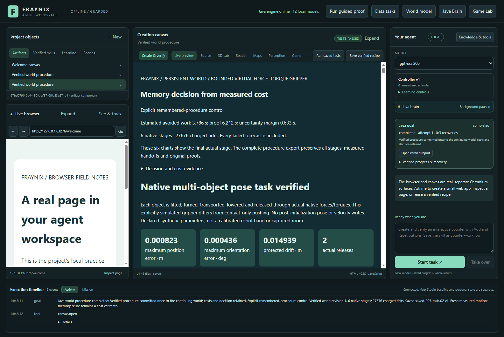
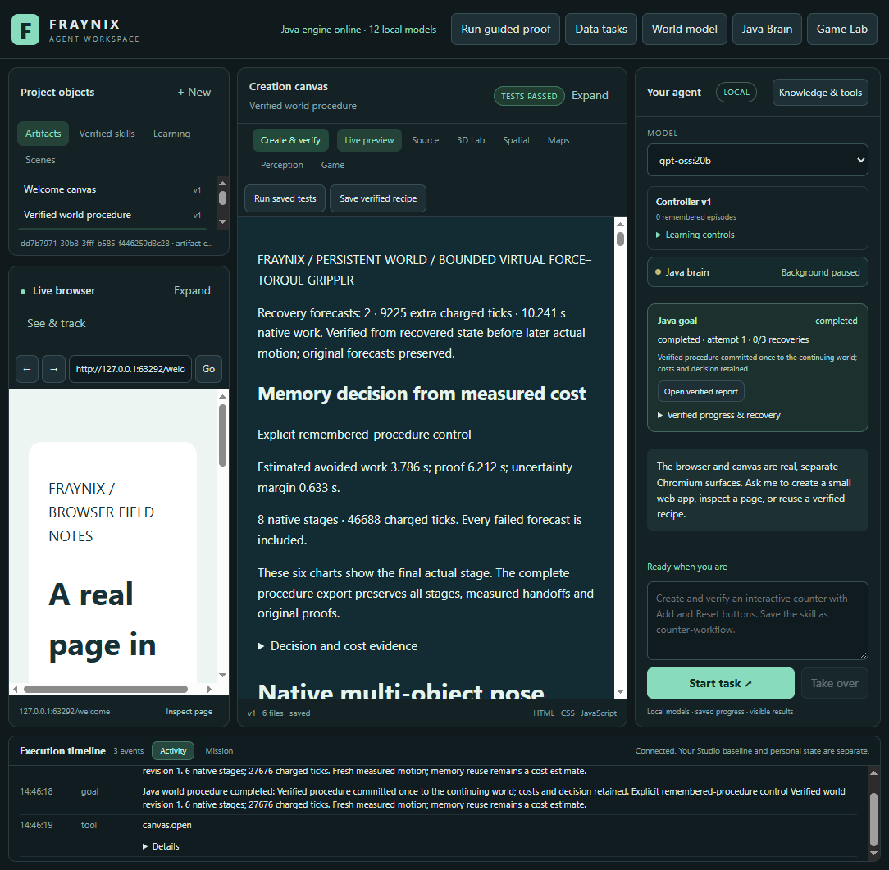

# Edition 095 — What a complete task actually costs

[Previous: edition 094](README-094.md) · [All editions](docs/readmes/INDEX.md) · [Offline cost explorer](docs/readmes/095/index.html) · [Contributor direction](README-CONTRIBUTORS.md)

**24 of 24 mixed tasks completed. Fixed memory took 60.94 s more time across complete goal calls and 49.33 s more across whole study iterations than simple control. Charging preparation once, the first batch took 155.79 s more time.**

Recorded November 8, 2026. The question is practical: does recalling a verified procedure save useful work after the app has paid for startup, original evidence, recovery, memory retention, skill saving and checking the saved state after reopening?

This edition measures the existing integrated Java application. All **334 production engine classes match edition 094 byte for byte**. Physics, planning order, native controllers, source and outcome checks, recovery limits, skill handlers and calibration admission are unchanged. The new code records and independently checks costs; it does not substitute a faster simulation or a successful-looking report.

## What was actually run

Preparation earns one fresh three-stage memory through ordinary simple control. Its failed alternatives and successful execution are retained. The closed preparation project is copied and byte-checked before each comparison so every control begins with the same memory bank and a cold first lookup.

There are two declared synthetic task geometries: a longer route derived from edition 094's changed-condition case, and a shorter route derived from edition 090's diagnostic with a changed B mass/friction and A target. These are related test variants, not new physical observations or independent population evidence.

Each geometry has three workloads:

1. Complete the task without retaining another memory or skill.
2. Complete it, retain the verified experience and save a named procedural skill.
3. Perform the same saving workflow after an abrupt Java interruption during actual stage zero, followed by explicit recovery.

Each condition is tested simple-first and memory-first, with the second block reversing condition order: **24 evaluated goals, one preparation goal and two additional saved-skill executions**. The two skill demonstrations run the saved Java procedure after reopening on a fresh world. They are reported separately from the comparison totals.

Every native process runs on two pinned logical processors with a 512 MiB heap. The existing two-resume, 115200-tick, 20-minute active-work and 90-second attempt limits remain. Interrupted tails are charged conservatively. The stop trigger is a committed checkpoint of at least 1200 ticks; actual stop ticks are retained. A direct controller and a three-stage controller can be interrupted at different fractions of their whole task.

The [prospective contract](docs/EDITION_095_CONTRACT.md) fixes the design and its limits before trials. Memory retention occurs only inside each task's copy; this is a fixed-bank comparison, not a growing-memory or warm-session study. No calibration fit or automatic model promotion occurs. Cold means a fresh Java process and an unwarmed application proof lookup; the operating system file cache is not flushed. Other host activity remains possible. Opposite execution orders reduce one ordering bias but do not remove every timing confound.

## Measured results

The final matrix completed 24/24 goals. Memory was faster over the whole iteration in 2 of 12 paired comparisons and slower in 10. Eight abrupt Java terminations were recovered. Both additional saved-skill executions completed after reopening on fresh worlds. These successes required the original native and report checks. Across compared tasks, simple control charged 312,514 native ticks and memory charged 288,970: 23,544 fewer with memory. Earning the preparation separately charged 31,624 ticks. Lower native work did not produce lower complete elapsed cost in this cold-start cohort.

Positive savings mean memory took less elapsed time; negative savings mean it took more. A failed task cannot earn a speed-benefit label.

| Condition | Block / first control | Simple goal | Memory goal | Goal saving | Simple whole iteration | Memory whole iteration | Whole saving |
|---|---|---:|---:|---:|---:|---:|---:|
| short-plain | 1 / simple | 32.14 s | 35.75 s | -3.60 s | 45.66 s | 51.63 s | -5.97 s |
| long-save | 1 / memory | 79.87 s | 87.42 s | -7.55 s | 106.26 s | 110.71 s | -4.45 s |
| short-recover-save | 1 / simple | 42.66 s | 54.90 s | -12.24 s | 58.25 s | 70.83 s | -12.57 s |
| long-plain | 1 / memory | 64.96 s | 72.72 s | -7.76 s | 91.45 s | 95.82 s | -4.37 s |
| short-save | 1 / simple | 35.46 s | 41.63 s | -6.17 s | 49.08 s | 57.98 s | -8.90 s |
| long-recover-save | 1 / memory | 142.49 s | 138.53 s | 3.96 s | 182.73 s | 168.66 s | 14.07 s |
| long-recover-save | 2 / simple | 136.25 s | 125.85 s | 10.40 s | 172.01 s | 160.02 s | 11.99 s |
| short-save | 2 / memory | 34.14 s | 44.62 s | -10.48 s | 51.16 s | 59.46 s | -8.30 s |
| long-plain | 2 / simple | 60.98 s | 68.70 s | -7.72 s | 86.52 s | 90.72 s | -4.20 s |
| short-recover-save | 2 / memory | 44.61 s | 50.01 s | -5.41 s | 60.95 s | 67.61 s | -6.66 s |
| long-save | 2 / simple | 72.76 s | 77.44 s | -4.67 s | 96.48 s | 103.19 s | -6.70 s |
| short-plain | 2 / memory | 30.78 s | 40.48 s | -9.70 s | 44.14 s | 57.38 s | -13.25 s |

The preparation cost is **106.46 s**. It is shown separately, then charged once against memory for the first-batch adoption comparison. Both arms receive identical experimental copies, but simple control does not need to earn or use that seed in deployment. Prefix results show the observed balance after each paired condition rather than hiding an unfavorable setup cost.

## What the clocks include

The surviving external process uses one monotonic clock. It records the complete goal call even when Java is terminated. Each whole iteration contains disjoint phases: verified copy, initial startup, world setup, goal call, export/full audit, shutdown, cold reopening/verification and final shutdown. Small gaps are retained as unattributed orchestration overhead. The measured iteration ends after final app closure; subsequent harness bookkeeping, screenshots and this independent analysis are outside that interval. They are not hidden inside a production-task speed claim.

The goal interval includes execution, the actual report, the world commit, requested retention and skill saving. For recovered tasks it also includes detecting the stop point, exact process termination, capturing committed bytes, reopening, checking that work stays paused, and explicitly resuming. Restart intervals are displayed as a nested explanation and **are not added to the goal interval a second time**.

Copying, raw exports and additional study audits are visible separately. They are real measured study costs, not claimed production requirements for every user task. Whole-iteration totals include them; goal-call totals let readers inspect the narrower app workflow. Neither total is a pure physics throughput benchmark.

Original Java cost records are preserved. After restart their `totalMillis=0` remains an unavailable-clock marker and they stay excluded from calibration. The external study clock does not silently become Java training data. No synthetic duration or invented cross-boot timestamp fills that gap. These stops terminate only the owned Java process; they do not test power loss, a machine reboot or loss of the external clock process.

## Saving and recovery costs

The following differences keep geometry, control and block visible. Negative values can occur from ordinary timing variation; they do not imply a free or negative-cost save operation.

| Geometry | Block | Control | Saving minus plain goal | Recovery-and-saving minus saving goal |
|---|---|---|---:|---:|
| long | 1 | simple | 14.90 s | 62.62 s |
| long | 1 | memory | 14.70 s | 51.11 s |
| long | 2 | simple | 11.79 s | 63.49 s |
| long | 2 | memory | 8.74 s | 48.41 s |
| short | 1 | simple | 3.32 s | 7.20 s |
| short | 1 | memory | 5.88 s | 13.28 s |
| short | 2 | simple | 3.36 s | 10.47 s |
| short | 2 | memory | 4.14 s | 5.40 s |

The separately measured saved-skill demonstrations are:

| Skill source workload | Fresh-world execution after reopening |
|---|---:|
| long-recover-save | 84.89 s |
| short-recover-save | 45.45 s |

These demonstration intervals include reopening, creating a fresh world, running the named Java skill, exporting/checking its original result and closure. They are excluded from the 24-goal comparison totals.

These are observed differences between complete task calls. Saving includes both retaining a verified experience and creating a procedural skill; it does not isolate one file write. Recovery changes native reconstruction and later forecast work as well as adding process lifecycle work. Two counterbalanced observations per condition give a useful local comparison, not a population confidence interval or a stable cost predictor.

## Verification remained authoritative

Every successful goal required its distinct actual native execution, protected-body checks, original source/plan identities, forecast comparisons, rendered report checks and one matching atomic world commit. The inspector recomputes these from originals. Both downstream recovery bindings remain covered by the inherited verifier.

The interruption recorder targets only the isolated owned Java PID after checking executable, parent, start time, checkout and project. Saved checkpoints are captured after process exit and before reopening. Every committed sample prefix and native run identity survives in the final record. No task continues automatically before explicit Resume. Actual later states receive fresh verified forecasts where needed.

Cold reopening must recover the same world revision/hash, retained receipt, saved skill identity, source goal, defaults and report. The two separate demonstrations exercise the actual registered Java skill handler on fresh worlds. A screenshot or a serialized object alone does not establish executable skill behavior.

110 Java checks passed across 19 focused classes; 1 optional host-dependent case skipped. 135 desktop checks and 7 new interval/accounting tests passed. The independent inspector verified 24 evaluated goals, preparation, eight abrupt interruptions and two saved-skill executions, with 22 altered-accounting/provenance refusals. The unchanged recovery regression also reused source-identical 094 originals; those are not counted as new motion.

No preliminary native cohort was discarded. After it finished, a new arithmetic test exposed a missing clock-owner equality check in the pairing helper. The existing independent inspector already required every actual row to use the study clock. The helper now refuses cross-owner comparisons too; the new test failed before that guard and all seven arithmetic tests passed afterward. Both logs are retained. Original095 intervals and summaries are unchanged; no production Java code or measured workload changed. The separate parent full-CI failures are detailed below.

### Broader GitHub check remains unresolved

The [parent094 full GitHub run](https://github.com/eyeoverthink/Fraynix-Agent-Workspace/actions/runs/42512948198/job/128829759943), for commit `88b60a6d`, completed 735 engine tests with four failures and two skips. `DesignPolicy053Test` failed its construction-schema assertion; `WorldReservedTest` rejected a changed `WorldLedger.java` source hash; `UncertainNative071Test` and `UsefulNative072Test` exhausted Java heap space. Original failed XML and the downloaded artifact digest are retained in the 095 evidence archive. These are separate from the focused local095 checks above. This edition does not claim a green full suite, change those tests, overwrite historical locks or increase production task limits. Resolve the schema/extension contracts and isolated long-test resource budget before claiming complete CI health.

- [Verification record and limits](docs/readmes/095/verification.json)
- [Independent cost and motion analysis](docs/readmes/095/comparison-data.json)
- [Original evidence archive with raw and compressed hashes](docs/readmes/095/original-evidence.json)
- [Canonical source inventory](docs/readmes/095/file-inventory.json)
- [Offline explorer and recorded motion](docs/readmes/095/index.html)

## Actual app screenshots

The captures come from the real Java/Electron app after the measured work. The canvas “Tests passed” badge refers to that report, not the full repository CI suite. The existing generic sidebar recovery badge does not summarize nested native-procedure recovery; use the report and original job records for those counts. The selected model display does not imply that a new LLM inference was performed. Screenshot sessions are outside the paired timing windows. The offline replay shows selected final-stage recorded samples, with all other stages retained in the original archive; it does not generate replacement motion.

## Direction and next acceptance gate

Resolve the inherited full-CI schema/source-lock and long-test resource failures with explicit contracts and preserved originals. Then repeat complete mixed sequences in a continuing warm workspace with changing bank contents, keeping cold-start costs visible separately. Compare a cost-aware selector against these fixed controls only after matched calibration coverage exists. Cross-boot timing needs its own durable clock contract before recovered tasks can train cost estimates. Keep useful browser/creation/game goals in view; a faster failed task or an unverified saved skill is not progress.

Keep the existing Java owner, browser, creation canvas, game/runtime and evidence-driven skills integrated. The [contributor guide](README-CONTRIBUTORS.md) and [dated architecture review](docs/TRAJECTORY_REVIEW_094.md) remain the entry points. This edition adds no new physical accuracy, camera calibration, LLM inference, weight training or general intelligence claim. Editions 001–094 and the user's live private projects remain preserved.
