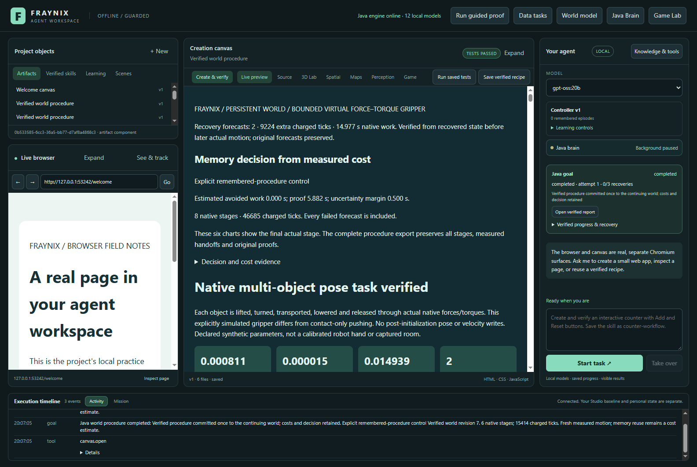
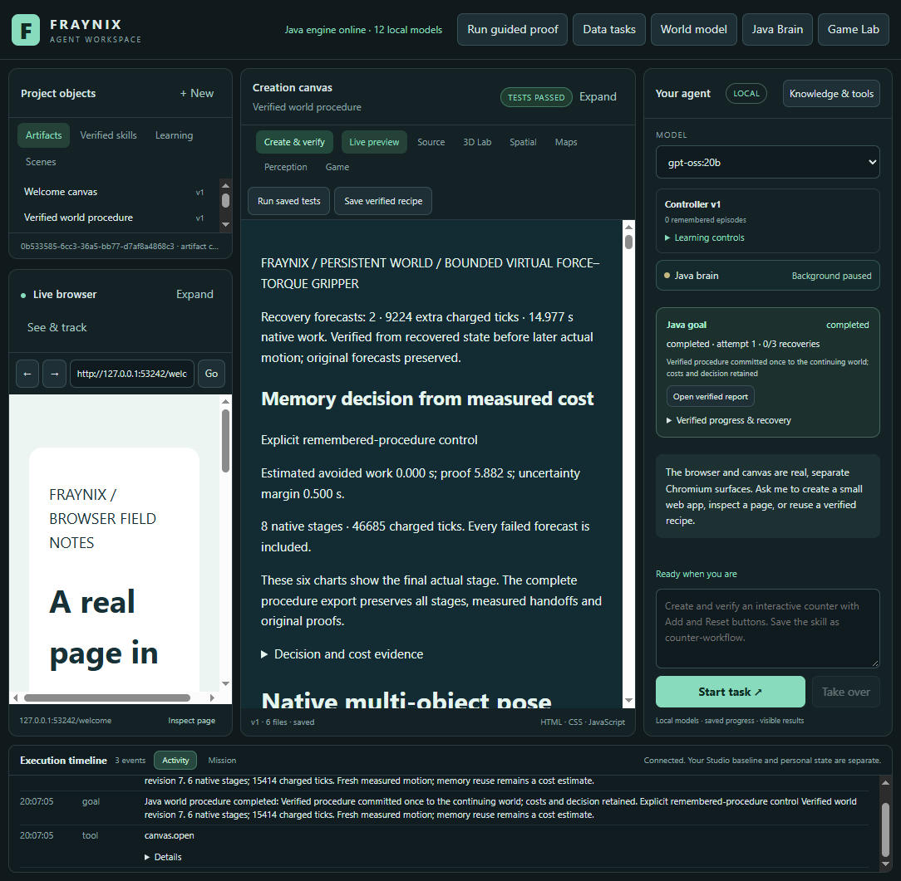
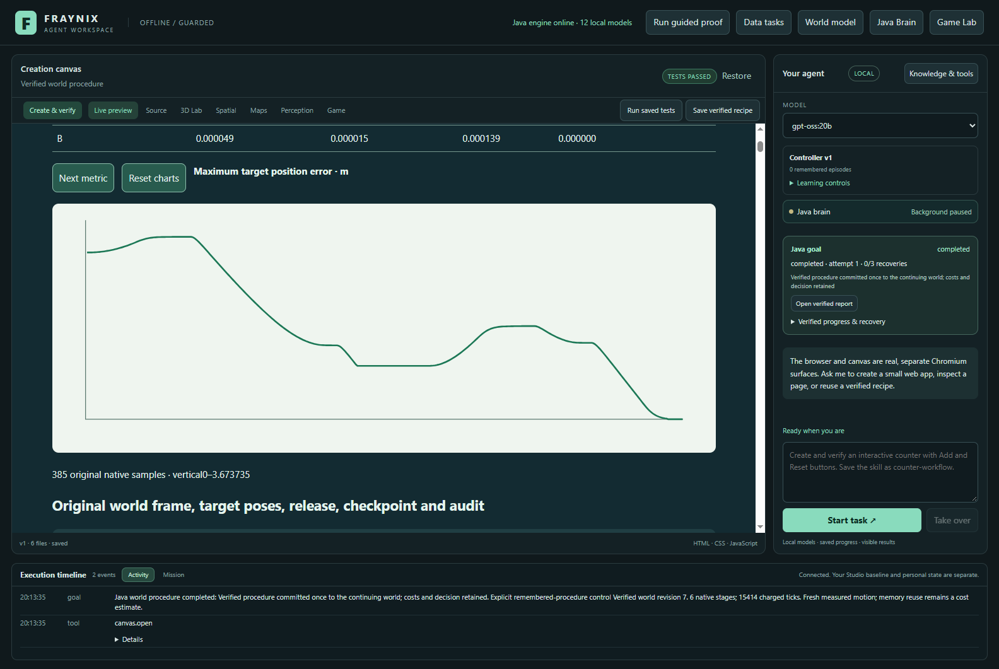

# Edition 097 — One world, growing memory, complete costs

[Previous: edition 096](README-096.md) · [Offline results explorer](docs/readmes/097/index.html) · [All editions](docs/readmes/INDEX.md) · [Contributor direction](README-CONTRIBUTORS.md)

**24/24 sequence goals completed; 8 interruptions were explicitly recovered. 4 saved procedures executed after reopening.** Across both blocks, memory took 200.53 s longer over complete streams and 291.14 s longer after charging preparation once.

Recorded November 8–9, 2026. This edition asks what repeated work costs when the application keeps the world it has actually changed and the memories it has actually earned. Java still owns the goals, native execution, evidence checks, recovery and retained procedures. No controller, physical tolerance, model policy or verification rule changed: all 334 compiled production engine classes match edition 096.

## CI was checked first

**Publication pending: parent CI is still running.** The parent main build [42554061175](https://github.com/eyeoverthink/Fraynix-Agent-Workspace/actions/runs/42554061175) was checked on `453e8708ab9353d86ed666f3d059d28563372530` and must complete successfully before publication. It was checked before the native cohort and still running then. A dated pre-trial scheduling amendment allowed isolated measurements after local regression/source checks passed; the pending response is retained; the final response is still awaited. Local checks below are separate from that complete remote result, and the new edition's own post-push CI status must be checked separately.

## What changed

The new study runs complete requests through the existing integrated Electron/Java app. Four independent streams use two opposite control orders: simple then memory, followed by memory then simple. Each stream starts with a byte-verified copy of the same freshly earned preparation and follows six requests in one persistent world. The next task uses the last verified committed frame, including its actual positions and rotations. No between-task reset, teleport or new scene replaces that history.

Both controls retain every successful experience. Every second task also saves a named procedure. Memory control uses the existing nearest compatible verified receipt; simple control keeps its original candidate order. Two declared tasks in each stream receive an abrupt stop of the exact owned Java process during actual stage zero. The user’s existing installations and private projects remain untouched.

The [prospective contract](docs/EDITION_097_CONTRACT.md) and [exact fixture](workspace-desktop/test/fixtures/procedures097-protocol.json) were committed before native measurements. The geometry comes from the labelled095 synthetic long-route scene: two movable bodies, a protected bystander, a floor and a fixed obstacle. Requests alternate an outward move, a short adjustment, a return, another adjustment and repeated outward/return moves. This is a new continuing software workload using related geometry, not independent real-world validation. The five-body scene stays fixed: world growth here means retained revisions and execution history, not increasing object count. Object-count scaling needs a separate experiment.

## Measured complete sequences

Positive savings mean memory took less time. A failed or incomplete sequence cannot claim a complete-stream speed benefit.

| Block | Simple complete stream | Memory complete stream | Memory saving | Both completed |
| --- | ---: | ---: | ---: | --- |
| 1 | 558.59 s | 654.54 s | -95.95 s | True |
| 2 | 552.16 s | 656.75 s | -104.58 s | True |

Fresh preparation cost **90.61 s**. Preparation is shown separately and charged once in the memory-adoption total. It includes earning the seed, creating the common initial world, closure and its inventory. Both comparison arms then receive checked copies. This is a conservative experimental adoption charge, not a claim that simple control has no world-creation cost.

The comparison runs on this host's S drive, in an isolated checkout with enough space for the full evidence history. Older095 timings used another drive and a different cold-copy workload; do not interpret cross-edition wall-time differences as a performance improvement. Each actual Java owner is pinned to two logical processors with a 512 MiB heap. Other host activity and operating-system cache effects remain possible.

## What the result means

The short adjustments expose a concrete weakness: a warm memory lookup can still select a three-stage procedure when simple control completes directly. Simple adjustment goals took about 15.86–17.30 seconds; remembered procedures took 42.39–46.79 seconds. Some long/recovered requests were faster with memory, but that did not repay the full sequence cost. Faster recall is not enough; the chosen procedure also needs to fit the remaining work. This is a comparison of explicit controls, not a test showing an adaptive selector chose well.

## Every task and retained result

Recovery time is included in goal time and shown separately only for explanation. It is never added twice. Complete stream totals also include copying, startup, world observation, exports/full audits, final reopening, persisted-state checks, actual saved-skill reuse and shutdown.

| Stream | Request | Bank before | Bank after | Revision | Complete goal | Recovery, included | Lookup | Saved skill |
| --- | --- | ---: | ---: | ---: | ---: | ---: | --- | --- |
| stream-00 | outward | 1 | 2 | 1 | 71.35 s | 0.00 s | none | False |
| stream-00 | outward-adjust | 2 | 3 | 2 | 17.30 s | 0.00 s | none | True |
| stream-00 | return | 3 | 4 | 3 | 129.08 s | 8.08 s | none | False |
| stream-00 | return-adjust | 4 | 5 | 4 | 17.14 s | 0.00 s | none | True |
| stream-00 | outward-again | 5 | 6 | 5 | 73.58 s | 0.00 s | none | False |
| stream-00 | return-again | 6 | 7 | 6 | 131.63 s | 7.96 s | none | True |
| stream-01 | outward | 1 | 2 | 1 | 79.54 s | 0.00 s | full | False |
| stream-01 | outward-adjust | 2 | 3 | 2 | 42.45 s | 0.00 s | hit | True |
| stream-01 | return | 3 | 4 | 3 | 119.84 s | 7.75 s | hit | False |
| stream-01 | return-adjust | 4 | 5 | 4 | 45.57 s | 0.00 s | full | True |
| stream-01 | outward-again | 5 | 6 | 5 | 69.53 s | 0.00 s | hit | False |
| stream-01 | return-again | 6 | 7 | 6 | 146.81 s | 7.39 s | full | True |
| stream-02 | outward | 1 | 2 | 1 | 72.99 s | 0.00 s | full | False |
| stream-02 | outward-adjust | 2 | 3 | 2 | 42.39 s | 0.00 s | hit | True |
| stream-02 | return | 3 | 4 | 3 | 120.19 s | 6.95 s | hit | False |
| stream-02 | return-adjust | 4 | 5 | 4 | 46.79 s | 0.00 s | full | True |
| stream-02 | outward-again | 5 | 6 | 5 | 71.56 s | 0.00 s | hit | False |
| stream-02 | return-again | 6 | 7 | 6 | 144.95 s | 7.90 s | full | True |
| stream-03 | outward | 1 | 2 | 1 | 70.38 s | 0.00 s | none | False |
| stream-03 | outward-adjust | 2 | 3 | 2 | 16.60 s | 0.00 s | none | True |
| stream-03 | return | 3 | 4 | 3 | 127.79 s | 8.52 s | none | False |
| stream-03 | return-adjust | 4 | 5 | 4 | 15.86 s | 0.00 s | none | True |
| stream-03 | outward-again | 5 | 6 | 5 | 68.86 s | 0.00 s | none | False |
| stream-03 | return-again | 6 | 7 | 6 | 137.51 s | 7.80 s | none | True |

Use the offline explorer to compare blocks and filter tasks. Its charts derive from the retained measurements, not illustrative performance numbers. Full original native ticks, failed alternatives, lookup status and later starting-state differences are in the [independent analysis](docs/readmes/097/analysis.json).

## Lookup time and chosen work

| Control | Main goal calls | Lookup within goals | Charged native ticks | Export/full-audit phases | Reopen/persistence phases | Separate skill phases |
| --- | ---: | ---: | ---: | ---: | ---: | ---: |
| simple | 877.09 s | 0.00 s | 352404 | 96.45 s | 97.25 s | 33.49 s |
| memory | 1,002.62 s | 48.97 s | 365236 | 109.14 s | 100.60 s | 92.09 s |

Lookup is nested within main goal time. The separate skill phase includes the demonstration's setup, goal and audit; reopen/persistence includes cold inspection of all prior goals and saved defaults. Do not add nested columns as though they were disjoint. The complete stream totals above remain the complete-cost comparison.


Memory lookups ranged from about 0.242 to 13.658 seconds. Warm receipts reduce some retrieval costs, but the four short-adjustment requests in the memory arm still selected the longer remembered procedure. Full lookup, native execution and report verification are separate observations in the analysis. Neither a cache hit nor a smaller lookup duration establishes better complete-task performance.

## What recovery and saving mean here

The interruption trigger waits for an actual stage-zero checkpoint of at least 1,200 ticks. The process stop checks PID, parent, start time, checkout and isolated project. Each restart retains original checkpoint bytes and sample prefixes, confirms the task remains paused, and requires explicit resume. Changed later stages need distinct verified forecasts. The two-resume, 115,200-tick, 20-minute active-work and 90-second attempt budgets remain unchanged; missing tails are charged conservatively.

After the six requests, the same project is closed and reopened. Exact world revision/hash, retained bank, saved skill identity, source goal and full defaults are checked. The last saved procedure is executed through its registered Java handler against the continuing world as a separate seventh task. It may begin close to its target; its timing is reported separately from the six full-distance/adjustment goals and is not called an equivalent full-distance test.

## What the costs do and do not establish

The measured workflow starts at the registered Java world-goal call and includes app verification. LLM chat planning, browser work and asset creation are not exercised or timed here. One surviving external monotonic clock spans the study. Disjoint phases preserve unattributed orchestration gaps. A goal interval includes actual execution, report verification, commit, requested retention and skill creation; for interrupted tasks it also includes interruption detection, process closure, evidence capture, reopening and explicit resume. Study exports and extra audits are separate phases. Screenshots and independent offline analysis occur outside the timed sequences.

Java's cross-boot complete-task duration remains unavailable and ineligible for calibration. The external clock does not become motion authority or training data. No cost fit or learned selector is promoted. These workloads do not isolate the cost of writing one skill from the accompanying execution and memory retention.

Initial sources, requests, resources and preparation match. Later actual frames, earned memory contents and cache state can differ. The independent inspector records those differences; it does not silently turn continuing trajectories into exactly paired calibration cases. Bank size, world revision, direction and warmup vary together. Extra full audits can prime evidence caches and their costs are included. Two opposite-order blocks support a descriptive comparison here, not a population confidence interval or an isolated causal effect of bank growth.

## Verification retained

- Parent complete GitHub CI is still pending; its state was recorded before the cohort.
- 90 focused Java methods passed across 13 classes; 1 conditional methods skipped. Original XML and logs are retained.
- 135 existing desktop checks and 11 new interval/continuity checks passed.
- 29 altered metadata/accounting cases were refused using copied inputs; measured native originals were not rewritten.
- The unchanged edition 093 independent inspector recomputes source identity, full native traces, protected-object motion, forecast/actual comparisons, recovery provenance, budget charges and one matching world commit.
- The new edition 097 inspector adds exact continuing-state and memory/skill progression, complete costs, same-project cold persistence and retained-procedure execution.

Read the [verification record](docs/readmes/097/verification.json) for exact source-qualified results and skips, and the [original evidence index](docs/readmes/097/original-evidence.json) for compressed/raw byte counts and SHA-256. No fresh live-model conversation, physical measurement, LLM weight training, generalized autonomy or consciousness is claimed.

## Actual application views

The expanded motion plot shows the final actual stage; complete exports retain every earlier stage and recovery forecast. These are screenshots of the existing integrated application after actual native execution. The report is the one verified before the associated world commit; it is not a generated mockup.

The canvas displays the recovered sixth-goal report (world revision 6). The right goal panel and timeline show the later saved-skill demonstration (revision 7); they are different tasks. Controller v1 is a separate legacy episode bank, not the seven-entry procedural bank. A selected model name does not imply model inference ran.

The extra expanded chart capture is outside all timed measurements and leaves world state unchanged. Its first screenshot assertion incorrectly expected six SVG elements; this report has one chart with selectable metrics. The assertion was corrected against the actual markup, retaining the first failure. No study or report data was changed.








## Open the app in a separate review project

From this checkout root, with JDK 21 and Node.js installed:

```powershell
$env:FRAYNIX_WORKSPACE_PROJECT = Join-Path (Get-Location).Path 'build/review097/project'
$env:FRAYNIX_WORKSPACE_PERSISTENT = '0'
./scripts/Start-Agent-Workspace.ps1
```

The existing launcher prepares pinned dependencies when needed and opens the integrated application. Use its `-Offline` option only after those dependencies have been cached. Keep the project path the same to return to this review state. The setting above stops this review's Java owner when its interface closes; it does not erase saved worlds or skills. Keep live installations in their own checkouts and projects.

The workspace provides chat, a real browser, creation canvas, Java Brain, original Game Lab, spatial/native world controls and a verified-skill library. These are existing capabilities with prior edition evidence; edition 097 specifically exercises native world goals, persistence and procedure reuse. Optional local chat requires an available Ollama server/model. The measured deterministic world workflow does not require a new model download.

To review without a model, open the actual reports and saved procedures in the project library, inspect the native evidence and use the registered controls. The fresh project starts without the study bank. For the exact 24-task sequence, use the fixture and reproduction commands below; screenshots from the measured project do not imply a new empty project already contains those results.

## Reproduce and inspect

Use JDK21, the repository's Gradle wrapper and already installed desktop dependencies. Build the Java engine and source-isolation checks; run the focused Java and existing desktop tests. The study uses a fresh `build/ui097-study` and refuses to overwrite an existing cohort. Save the genuine parent CI response as `build/ci097-gate.json`; the runner checks the exact commit/run identity and refuses a failed or cancelled run. Publication additionally requires a successful final response in `build/ci097-final.json`. Do not fabricate that receipt or point the study at a live project.

```powershell
.\gradlew.bat :verifySourceIsolation :workspace-engine:installDist --no-daemon --max-workers=1 --console=plain
node scripts/Study-Build095.cjs --stamp
node --test workspace-desktop/test/costs097.test.cjs
npm --prefix workspace-desktop test
node workspace-desktop/test/continuing097-integration.cjs
node scripts/Inspect-Continuing097.cjs
node scripts/Check-Continuing097.cjs
.\scripts\Verify-Documentation.ps1
```

The existing build-receipt tool retains095 in its filename but records current source and installed artifacts. The actual local build used cached dependencies with `--offline`. No Docker or WSL is needed. Original failed attempts, if any, are retained and separately identified; compiled code is not changed while an owned native study is running.

## Next acceptance gate

Next, compare a cost-aware choice of simple versus remembered procedure on separately declared short, long and recovered tasks. The acceptance gate is improved complete task cost without lower success or weaker evidence checks. Charge selection work and include negative cases where memory is the wrong choice. If memory does not repay its cost, report that and preserve simple control. Separate bank growth from task direction and cache state before fitting a cost model. A future cost-aware selector needs matched calibration coverage and separate evaluation; external recovered timings remain outside training until a durable clock contract is independently tested. Keep progressing toward useful chat-driven creation and world tasks in the same integrated Java application.
