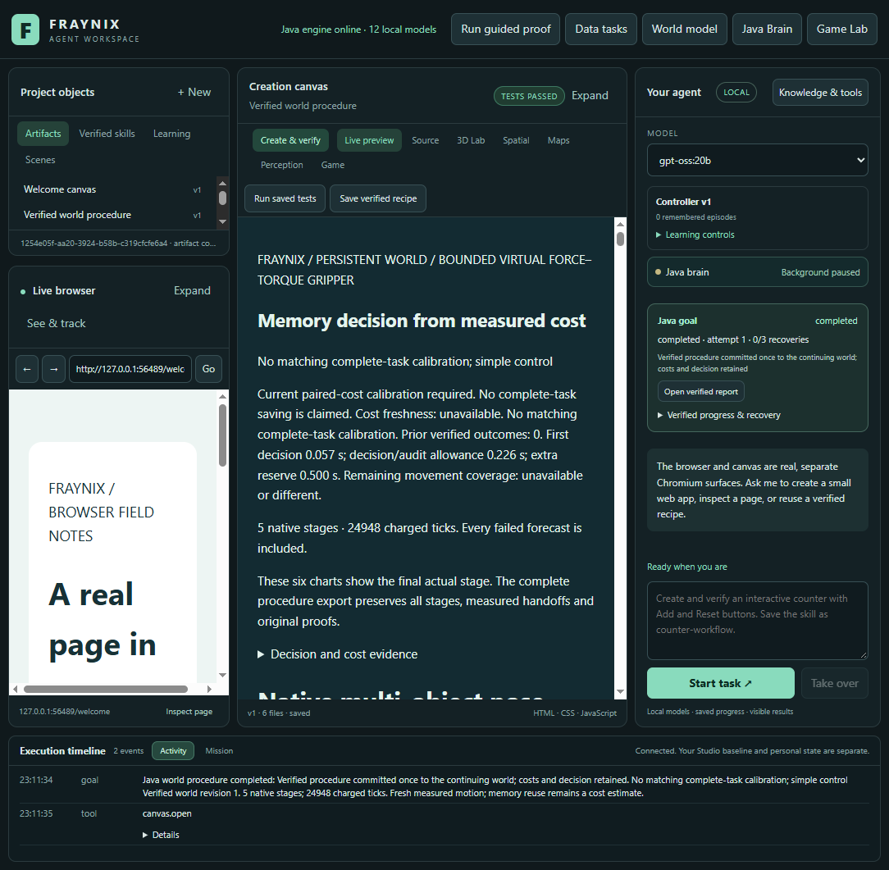
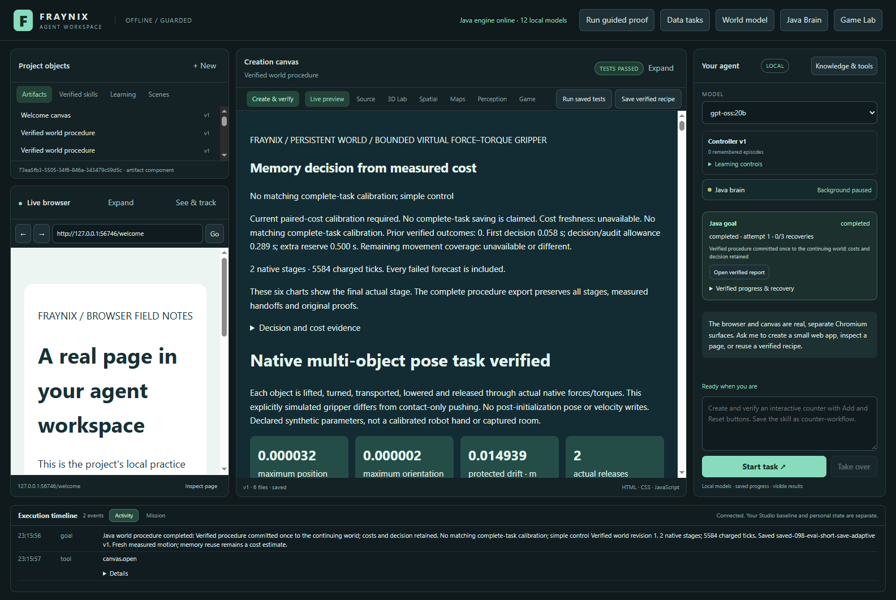
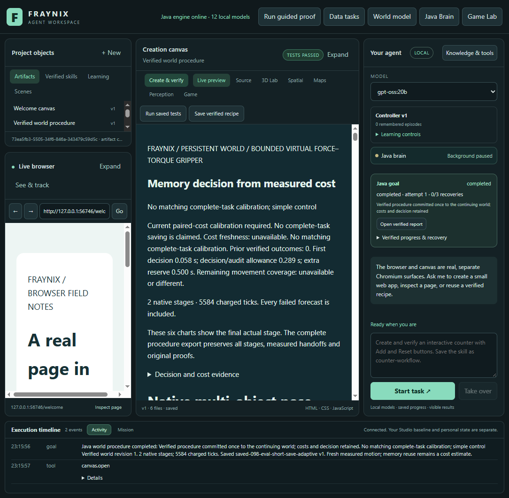
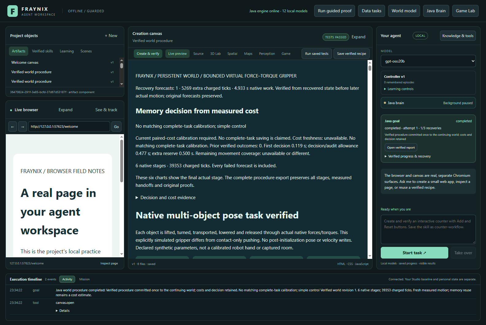
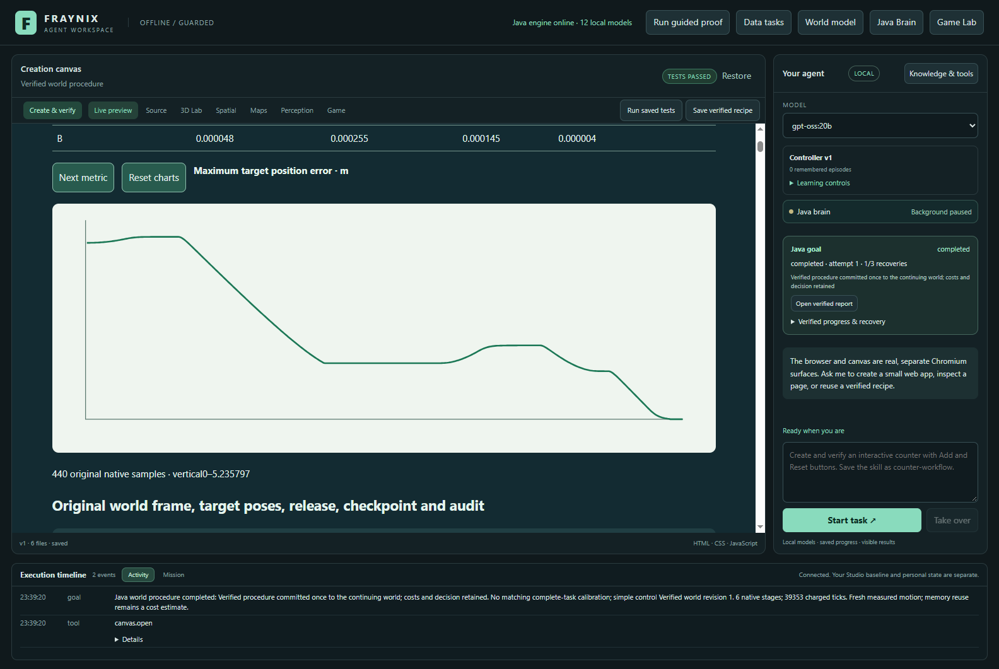

# Edition 098 — Memory must repay its work

[Previous:097](README-097.md) · [Offline results](docs/readmes/098/index.html) · [All editions](docs/readmes/INDEX.md) · [Contributor direction](README-CONTRIBUTORS.md)

Default adaptive requests now require evidence that remembered procedures repay their extra work. 12/12 fresh evaluation tasks completed, with 3 explicit recoveries and 3 saved skills.

## The change users get

Edition 097 found that a warm lookup could still choose unnecessary stages for a small adjustment. The default adaptive path previously used work avoided during an older task. Java now requires the existing repeated, verified **complete-task** cost model, matching runtime, receipt, proof state, workload and memory-bank coverage. It retains execution-order, repeat-variation, geometry and recent-cost freshness checks. Without sufficient evidence, it tries simple control first and keeps the original bounded fallback procedures. No automatic calibration job spends resources merely because a memory exists.

The added coverage check compares remaining translation and rotation for **each target**. Neither is diluted among unrelated scene features. A measured/current magnitude must be within a factor of two, with floors of 0.1 metre and 5 degrees (the existing task tolerances). These are conservative coverage rules, not learned physical laws or changed success thresholds.

The pre-decision evidence pass has an owned monotonic timing receipt. It covers candidate collection, model validation and recent-cost collection before the final choice; the final calculation and receipt write are covered by the reserve and remain included in actual caller/Java task times. Before selecting memory, Java subtracts an allowance for the initial pass and the runner, goal and commit audits; retention and skill saving each add a pass. Each future pass is provisionally charged at the observed first-pass duration, plus max(500ms,25%) reserve. Future checks are **estimates**, not measured future durations or a probability guarantee. A positive remaining lower saving is required. Reports expose the reason, first-pass time, total allowance and net lower saving. The decision receipt is rechecked against its saved bytes and included in later proof evidence.

Explicit simple and memory modes remain available as comparison controls. Explicit memory means a requested procedure order, not a prediction of benefit. Every forecast, distinct actual execution, source binding, protected-body check, report verification and single world commit remains authoritative. Memory never certifies a new outcome.

## Fresh measured results

The [prospective contract](docs/EDITION_098_CONTRACT.md) and [fixture](workspace-desktop/test/fixtures/procedures098-protocol.json) preceded the cohort. Source: `f2fe986842242d238b9674a197c3b4385149c262`. All scenes are clearly labelled synthetic boxes, not real camera observations. The six-body geometry is related to earlier 090 fixtures, not an unfamiliar-domain generalization test.

One fresh preparation earned a procedure under the current Java implementation. Six calibration comparisons used two different target sets, three repeats each, both execution orders, the same Java clock owner and the original outcome checks. The existing calibration-admission gate declined fitting: its supported lower saving did not cover variability and the declared allowances. No model was installed. The preparation and that decline were then frozen before evaluation. Positive calibrated admission is covered by Java boundary tests; this native cohort tests the default fallback without a fitted model. Each of the 12 evaluations opened an exact byte-checked copy of that preparation, performed a charged warm-up, and used matching scene/targets for simple, adaptive and explicit-memory modes. Four cases cover a small move, long route, small move with skill saving, and interrupted long route. The skill workload has no matching calibration and cannot borrow the unsaved-task estimate. Execution order rotates; this is one descriptive block, not a confidence study. In the calibration batch, the minimum mean saving was 4.35 s, while the variability allowance was 6.73 s; the lower saving was -2.38 s before the additional checking allowance.

| Case | Simple caller time | Adaptive caller time | Explicit memory | Adaptive choice | Saved vs simple | Saved vs memory |
|---|---:|---:|---:|---|---:|---:|
| short | 13.21 s | 13.59 s | 24.60 s | simple first | -0.38 s | 11.01 s |
| long | 61.67 s | 55.72 s | 55.60 s | simple first | 5.95 s | -0.11 s |
| short-save | 14.46 s | 15.88 s | 28.04 s | simple first | -1.43 s | 12.16 s |
| long-recover | 96.52 s | 96.22 s | 90.52 s | simple first | 0.31 s | -5.70 s |

Positive savings mean adaptive took less time. Negative numbers remain costs; no faster-than-simple claim follows merely from selecting simple first. Measured preparation components total **835.71 s**; the fit-admission API call took 0.76 s. The initial harness incorrectly expected a model from the declined response and stopped after all 13 native preparation tasks completed. Its checkpoint, script and error are retained. The corrected continuation reverified those actual goals and respected the decline. The original whole-preparation timer ended with that harness, so this is a component subtotal: measured rows, first launch, declined-fit call and continuation verification. Original intervening gaps and first shutdown remain unavailable. Evaluation has a new owned clock. These costs are not amortized away, and no full-setup payback claim is made. The [full measurements](docs/readmes/098/analysis.json) include caller, Java, lookup and charged native work plus complete evaluation durations covering copy/startup/warm-up, extra audits, shutdown and reopened verification. Screenshots are outside timing. The recovered tasks' external caller times remain excluded from Java calibration; zero/unavailable cross-boot durations never become free training examples.

A second harness failure occurred before the first deliberate process interruption: the edition 097 helper correctly rejected the edition 098 folder. Its closed project, completed extra warm-up and unfinished task are preserved. All three restart comparisons were then run afresh with an edition 098-specific path allowlist and unchanged process-identity checks. The nine prior evaluation intervals remain original. The abandoned warm-up caller time was 61.78 s; the abandoned partial task's complete outer duration is unavailable. This extra work is excluded from the 37 planned tasks and 12 matched evaluations, disclosed separately, and cannot support a preparation-payback claim. The inspector additionally verifies the abandoned warm-up's originals. The retry reused its export filename; the independent inspector detected the mismatch. Its diagnostic bundle was repacked from the preserved checked source envelopes, matching the original saved job and cost exactly. Those source bytes, provenance and first inspection failure remain archived; no motion or result was regenerated.

Read each recorded reason in the offline explorer. Choosing memory only with supported benefit is a conservative policy; it can decline useful memory when coverage or timing is insufficient. This edition does not establish universal payoff, learned optimality or a guarantee about future machine load.

## Verification and CI

90 focused Java methods passed. The additional six native/integrity classes passed 29 methods with 1 host-dependent case skipped: 119 Java passes in total. All 135 desktop tests passed. Exact class counts and logs are recorded in [verification.json](docs/readmes/098/verification.json). The independent inspector checked 38 original tasks (37 planned plus one preserved diagnostic warm-up) and refused 11 altered decision/source/outcome cases. Every evaluated world and saved-skill identity was checked after reopening. All three declared abrupt Java interruptions kept saved prefixes, explicit recovery, conservative tail charging and fresh downstream forecasts when required. No threshold was relaxed.

The parent 097 GitHub run 42571456884 initially failed **before compilation**, when the pinned Mesa download returned HTTP504. The original failure is archived. Edition 098 adds three bounded transport retries and retains the exact checksum and extraction checks. At documentation capture, attempt 2 was `in_progress` (no conclusion yet). Local results do not imply a successful full CI run; the new main workflow is a separate status after publication.

## Actual application views

These captures show real integrated task reports from the 098 test projects. The displayed model name does not mean an LLM ran. The Controller v1 episode count is a separate legacy bank, not the one-receipt procedural bank used here. The left world/game/library and right Java goal panel belong to the existing shared application; no new disconnected demo app was substituted.













## Run and inspect

Use JDK21 and the repository's Gradle wrapper, Node and the pinned desktop dependencies. Docker/WSL is not required. Keep live installations in their own projects. A new review project starts without this experiment's calibration or memories.

```powershell
$env:FRAYNIX_WORKSPACE_PROJECT = Join-Path (Get-Location).Path 'build/review098/project'
$env:FRAYNIX_WORKSPACE_PERSISTENT = '0'
./scripts/Start-Agent-Workspace.ps1
```

In the integrated spatial/world controls, use adaptive selection for normal tasks. Inspect its report's memory decision and evidence before interpreting the result. The chat tools use the same Java-owned world-goal path; this cohort exercised deterministic registered tools, not new model inference. Optional chat still requires a configured available model. Earlier editions document the browser, creation canvas, original Game Lab, shared brain and observation systems.

For reproduction, build isolated current artifacts, run source isolation, stamp the build, then run `workspace-desktop/test/benefit098-integration.cjs` and `scripts/Check-Benefit098.cjs`. The harness refuses to overwrite `build/ui098-study`; keep old evidence or choose a separately declared output before rerunning. Heavy work is serial with 2 reported/pinned CPUs and 512 MiB Java heap. Source-bound memories from an older implementation are not relabelled; earn fresh receipts under the current code. Of 334 prior production engine classes, 333 are byte-identical. WorldProcedure079 integrates the policy and its timing evidence; TaskCost098 is new. Native physics/controller classes are unchanged.

## Next

Use these complete costs to tighten the decision/audit allowance and avoid expensive estimation when evidence already cannot support reuse. Repeat the matched cases with different bank sizes and machine load, including short tasks where memory might truly help. Calibrate saving/recovery separately; durable cross-boot timing still needs an independently tested contract. Keep the destination one useful local Java agent that completes requests, observes outcomes and retains verified skills—not an expanding collection of benchmark windows.
