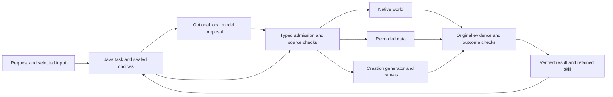
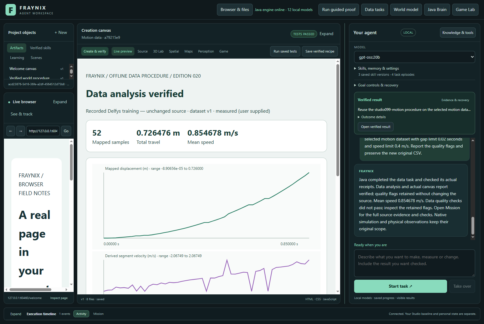
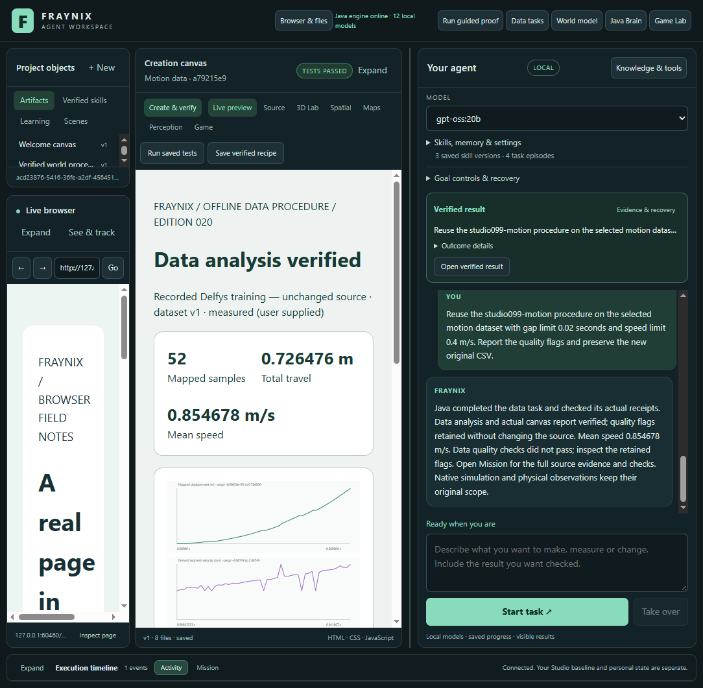
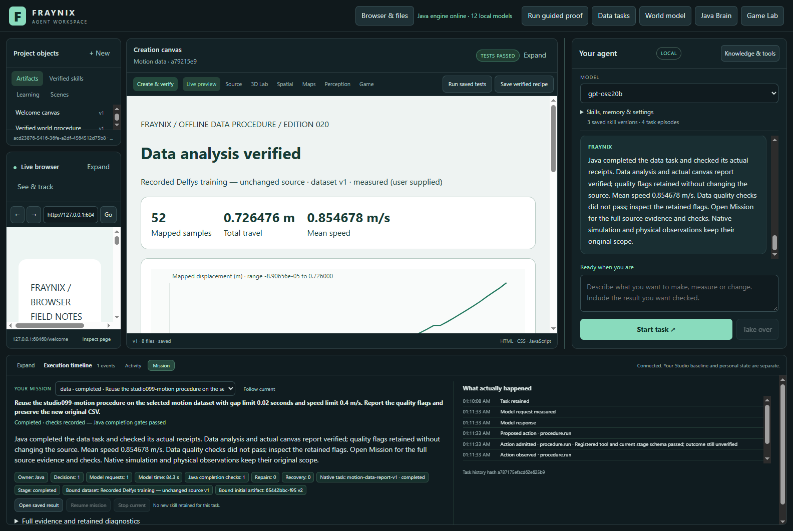
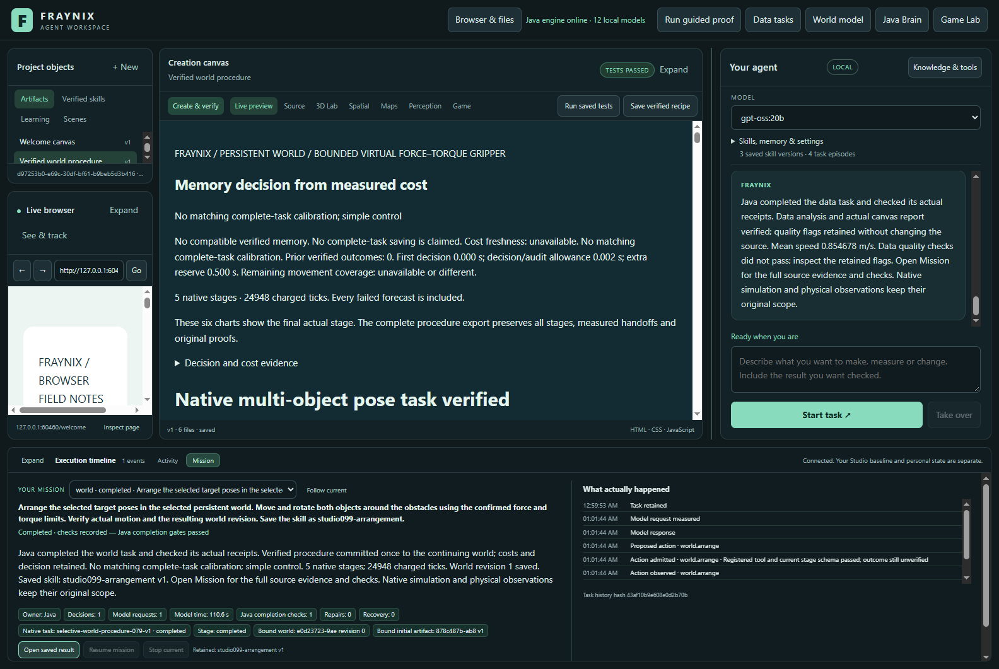
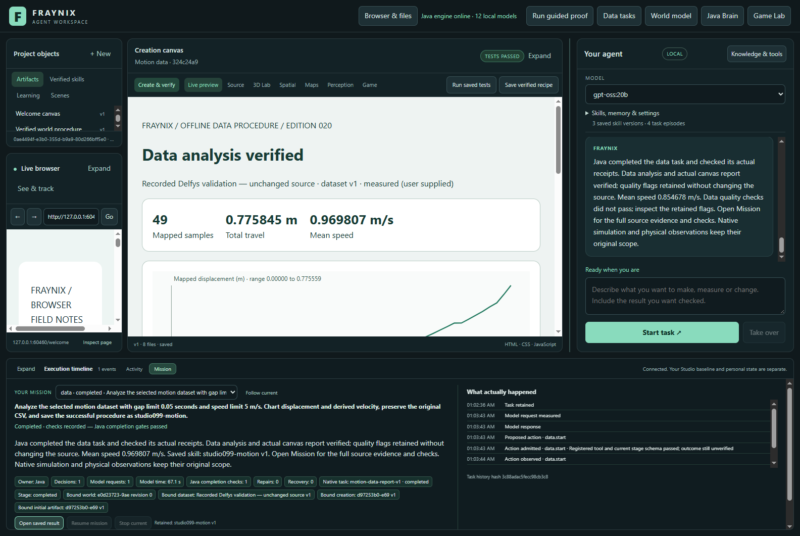
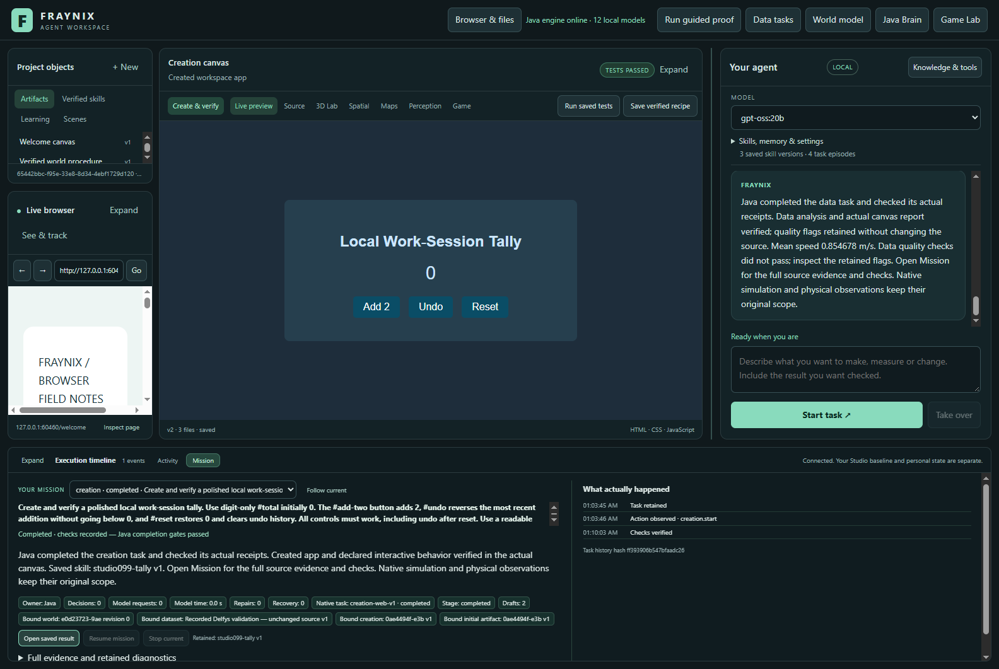
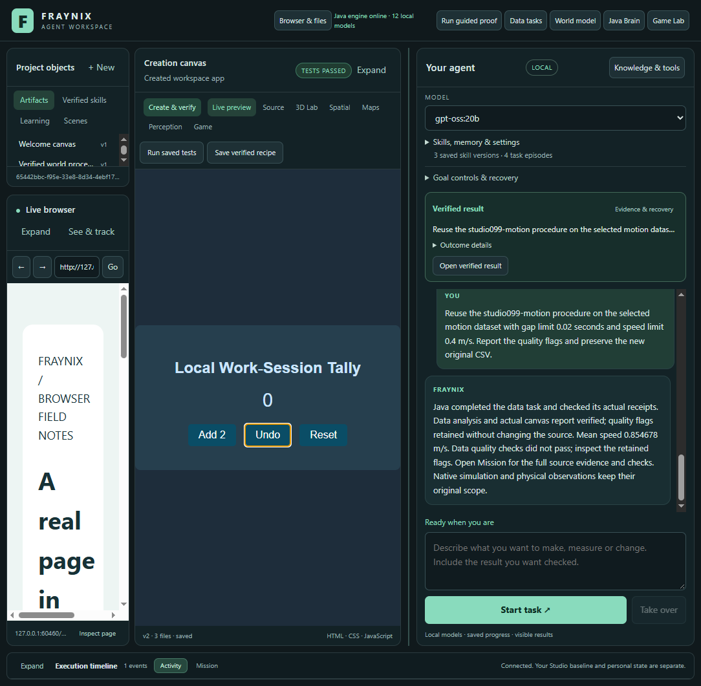

# Edition 099 — More room to work, real local-model workflows

[Previous:098](README-098.md) · [Offline interactive guide](docs/readmes/099/index.html) · [Edition history](docs/readmes/INDEX.md) · [Contributor direction](README-CONTRIBUTORS.md)

Edition099 makes the same integrated workspace easier to use and tests complete world, recorded-data and creation requests through the installed local gpt-oss:20b model. A fourth request reuses a saved data procedure after a cold restart.

## What changed in the application

Chat has more space by default, larger text and a larger composer. Drag the separator beside it, use Left/Right while the separator has keyboard focus, or use the width slider in **Skills, memory & settings**. Double-click resets its width. The stored preference is clamped to the available window. Browser and canvas are real embedded surfaces; their native bounds follow the layout. The Browser & files button expands the existing browser/library view. Opening a saved Mission result now selects Live preview after the artifact has refreshed, so an automatic world refresh cannot leave Spatial highlighted above an HTML report. The original tools, Game Lab, spatial views and creation controls remain in this application.

Activity is collapsed initially, with a visible Expand control. Mission still contains the detailed evidence and recovery controls. Opening it replaces the duplicate compact status card and preserves visible chat input and task buttons. Goal controls & recovery remain accessible in a compact expandable section. Outcome details are folded until requested, leaving more transcript space even after a task completes. The compact current-task card reflects Java's actual state: choosing a step, model planning, running/checking, needs attention, stopped or verified. **Open verified result** appears only for a completed, verified Java task. It uses the existing result-opening operation. Presentation does not invent progress or promote an outcome.

New replies preserve your reading position when you are looking at older messages. A New response button takes you to the latest text. The most recent conversation is retained in the isolated desktop profile, bounded to forty messages and 100,000 characters. An oversized saved message is explicitly marked as an excerpt. This is display continuity, not unlimited model context or permission to execute old chat. Java's task evidence remains separate. Malformed stored conversation data no longer prevents the interface from opening. Saved skill **versions**, task episodes and controller versions have separate labels.

The optional **Model planning for world procedures** setting is in Skills, memory & settings and is off by default. It lets the selected local model propose the next registered action before a verified world procedure starts. Java stores and seals that choice with the request, retains the review-only refusal, validates the tool and arguments, and verifies actual execution. Existing direct Java execution remains useful when no model decision is needed. No new dependency was added.

## What the real model completed

| Request | Submission to checked completion | Router calls | Creation generation jobs | Skill result |
|---|---:|---:|---:|---|
| world | 156.62 s | 1 | 0 | studio099-arrangement |
| data | 69.10 s | 1 | 0 | studio099-motion |
| creation | 378.21 s | 0 | 3 | studio099-tally |
| reuse | 86.24 s | 1 | 0 | Reused studio099-motion |

These are single-run descriptive times on this computer, including inference, native work, waiting and checks. They are not a speed benchmark or a claim of superiority. Setup and cold restart are separate; measured reopen time was 1.94 seconds. The model identity and its exact digest are retained in the task and generation receipts. CPU-only planning used four threads and no GPU offload, preserving graphics capacity. There were 0 failed parent-router requests in this completed cohort; generation attempts and actual code/checks are retained separately.

### 1. Chat into the persistent world

The harness imported a clearly labelled synthetic six-body scene, selected the two target poses and confirmed force/torque limits through the existing workspace interface. Those setup actions were not autonomous model discoveries. The request asked for both objects to move and rotate around obstacles, verification of the resulting revision, and a saved skill named studio099-arrangement.

The actual model participated in the Java-controlled tool sequence. Native controllers then ran distinct forecasts and actual motion. The independently inspected result selected **two-stage**, with 5 native stages and 24948 charged ticks. The committed world advanced once and matched its verified final frame. The procedure retained a skill only after completion. This exercises the current098 benefit gate: no suitable cost calibration means simple control is considered first, while bounded alternatives remain available. It does not establish that memory is faster or that the synthetic physics is calibrated to a real mechanism.

### 2. Chat into recorded data

The unchanged edition013 Delfys validation CSV was explicitly imported with seconds/metres and its recorded-data scope. The model requested the typed data workflow with a 0.05-second gap limit and 5 m/s speed limit. Java preserved the original CSV, calculated the report, rendered charts, checked eight actual assertions and saved studio099-motion.

Independent arithmetic from the original CSV agreed with the report: 49 rows, 0.775845276 metres total travel and 0.800000000 seconds duration. Gap flags: 0; speed flags: 0. These are descriptive measurements from a frozen source, not a fresh sensor recording or new permission to actuate physical hardware.

After closing and reopening the owned project, a fourth real-model request reused that exact saved procedure on the different frozen training CSV. New thresholds were 0.02 seconds and 0.4 m/s. Independent checks found 0 gap flags and 37 speed flags. A successfully verified report may correctly say that data quality failed. The new original bytes and source identity are preserved; reuse does not copy the old report or assert that a new task passed merely because the earlier one did.

### 3. Chat into working content

The model created a work-session tally with Add two, Undo and Reset. Java froze the behavioral contract before code generation, admitted actual code through its existing creation worker and verified the rendered artifact. There were 3 retained generation jobs. The first generated tally failed because it used an input value where its own frozen checks required visible text. Java retained the actual failed checks and the model repaired its code under the unchanged contract. The parent router and the child creation generator have separate receipts: a zero router count is not evidence that no generation occurred.

Twelve additional actual canvas steps independently exercised 0 → 2 → 4 → 2 → 0, followed by Undo after Reset remaining at zero. The artifact uses local HTML/CSS/JavaScript and no external assets. The verified studio099-tally skill survived restart. This is actual generated and tested content; no sample implementation was substituted for the model's output. The exact source, frozen checks, model receipts and generated report are included in the original archive.

## Try it step by step

1. Launch the existing workspace with the normal project launcher. Keep a separate project for experiments; do not open a running installation's private database from another checkout.
2. Choose an installed local model. Open Skills, memory & settings to enable model planning for world procedures when you want that path. The setting does not add arbitrary tools or remove checks.
3. For a world task, use the existing Spatial world controls to select an actual world and confirm target poses and limits. Ask to arrange the selected targets and save a named skill. Watch the task card, then open the verified result or Mission for detailed native evidence.
4. For data, import a real CSV through Data tasks, select columns and units, declare its source and select it for chat. Ask for an analysis with explicit gap/speed thresholds and a skill name. Inspect the original-source audit and quality flags.
5. For creation, start with “Create and verify,” describe the behavior and give any required control IDs. Check the resulting live canvas yourself. The engine keeps the code and verification together.
6. Reopen the same project and explicitly reuse a saved procedure on a newly selected input. Inspect its new outcome. A retained skill is a checked way to work, not a guarantee on a different input.

Reproduction entry points are [layout checks](workspace-desktop/test/layout099-integration.cjs), [actual-model cohort](workspace-desktop/test/chat099-integration.cjs), [independent inspection](scripts/Inspect-Chat099.cjs) and the [prospective contract and amendment](docs/EDITION_099_CONTRACT.md). The cohort refuses to overwrite earlier attempts. Heavy/native/model work ran serially. No private live045/qa046 project was used.

## Verification, retained failures and limits

55 focused Java test methods passed, covering task admission, sealed preferences, old-objective compatibility, domain scheduling, creation planning and retained completion gates. 135 existing desktop checks passed. The actual-app layout checks covered mouse and keyboard resizing, native browser/canvas bounds at 1600 and 1100 pixels, literal text rendering, scroll preservation, activity/Mission access, cold restoration and malformed saved conversation handling. A final review of the populated app also caught stacked status panels consuming chat space; the compact follow-up and pinned latest-message behavior were retested against the retained actual results. Source isolation passed. The production class comparison is retained in [verification.json](docs/readmes/099/verification.json); native physics and outcome verifiers were not replaced.

The independent world inspector preserved the inherited source, frame, forecast, actual-motion, sample, metric, budget and atomic-commit checks. It also refused four altered-evidence cases: changed target, changed charged work, missing native original and forged commit. Screenshot review supplements these checks; a screenshot alone does not prove success.

Initial failures are retained. The first layout harness mistakenly expected a receipt object where the surface API returns checks; its next attempt hit the closed-episode guard when it used the execution wrapper after a guided proof. The corrected harness checks actual surface results without reopening or rewriting that episode. The first world request really completed, but used the existing direct Java bootstrap and made zero model calls. It was rejected as a model-validation result. That finding led to the explicit planning option and a fresh second cohort. Creation inference is audited at its actual generation worker rather than inferred from router counters.

Parent GitHub CI at documentation time: **in_progress / None**, run 42582181920. This is separate from the local results; it is not represented as green unless GitHub reports success. Publication is confirmed by a separately fetched-content receipt, not by this prose. Historical README001–098 and their snapshots remain frozen.

The app is a useful, locally controlled agent environment with typed tools, durable tasks and observable outcomes. It is not evidence of consciousness, unrestricted general intelligence, or new LLM weight training. These tests cover selected supported workflows. Model mistakes, source ambiguity, expensive inference and unfamiliar geometry still require explicit limits and honest refusal. Local model availability and computer resources remain practical constraints.

## Architecture and direction



The next useful edition should make input selection and task handoffs easier across these same surfaces: identify exactly what is selected, show the requested success conditions before execution, and carry an artifact or dataset into the next supported procedure without forcing users to repeat context. Acceptance should include multiple fresh requests, changed inputs, interruption and recovery, and an independent baseline for any claimed efficiency improvement. Expand supported tasks only with complete handlers and observable checks. Keep the larger aim visible: the agent reasons and acts inside an environment whose consequences it can inspect, remember and reuse.

Suggested next gates: clearer selected-input cards; combined data-to-creation tasks with exact source bindings; task-level inference and generation timing in one readable view; more diverse user prompts and explicit failure/recovery trials; then broader geometry or perception when the workflow needs it. A larger catalogue alone would not establish better agency. Complete, understandable and verified work is the measure.

## Source and evidence map

```text
workspace-desktop/renderer/workspace099.js   presentation and retained chat
workspace-desktop/renderer/workspace099.css  responsive space and task card
workspace-engine/.../Agency043.java         durable request and admission
workspace-engine/.../Domain044.java         optional model world bootstrap
workspace-engine/.../ChatChain052.java      backward-compatible objective seal
workspace-desktop/test/*099*.cjs             actual layout/model workflows
scripts/Inspect-Chat099.cjs                  independent native originals
docs/readmes/099/                           screenshots, guide, source hashes, originals
```

[Complete canonical inventory](docs/readmes/099/file-inventory.json) · [Original evidence index](docs/readmes/099/original-evidence.json) · [Results](docs/readmes/099/analysis.json) · [Full verification](docs/readmes/099/verification.json) · [Obsidian map](docs/obsidian/107-local-model-workflows.canvas)

## Actual screenshots



Captured 2026-11-09T09:17:31.753Z. Current task and actual reused recorded-data report after restart. Actual isolated test project; world geometry is labelled synthetic, data comes from the frozen recorded CSV, and creation code came from the local model.



Captured 2026-11-09T09:17:32.294Z. Same actual completed task at1100px. Actual isolated test project; world geometry is labelled synthetic, data comes from the frozen recorded CSV, and creation code came from the local model.



Captured 2026-11-09T09:17:33.127Z. Original task evidence remains accessible. Actual isolated test project; world geometry is labelled synthetic, data comes from the frozen recorded CSV, and creation code came from the local model.



Captured 2026-11-09T09:17:33.871Z. Retained world result selected through Mission history; compact card follows the latest task. Actual isolated test project; world geometry is labelled synthetic, data comes from the frozen recorded CSV, and creation code came from the local model.



Captured 2026-11-09T09:17:34.537Z. Retained data result selected through Mission history; compact card follows the latest task. Actual isolated test project; world geometry is labelled synthetic, data comes from the frozen recorded CSV, and creation code came from the local model.



Captured 2026-11-09T09:17:35.258Z. Retained creation result selected through Mission history; compact card follows the latest task. Actual isolated test project; world geometry is labelled synthetic, data comes from the frozen recorded CSV, and creation code came from the local model.



Captured 2026-11-09T09:17:36.351Z. Retained actual model-created tally, current compact layout. Actual isolated test project; world geometry is labelled synthetic, data comes from the frozen recorded CSV, and creation code came from the local model.
