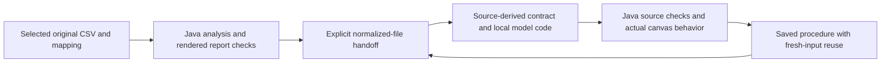
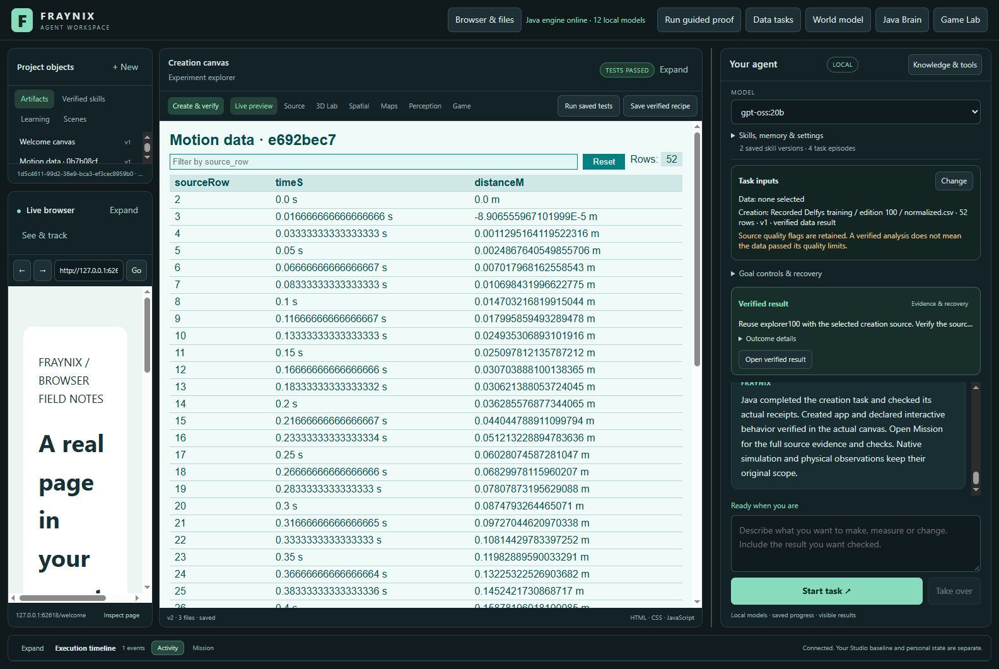
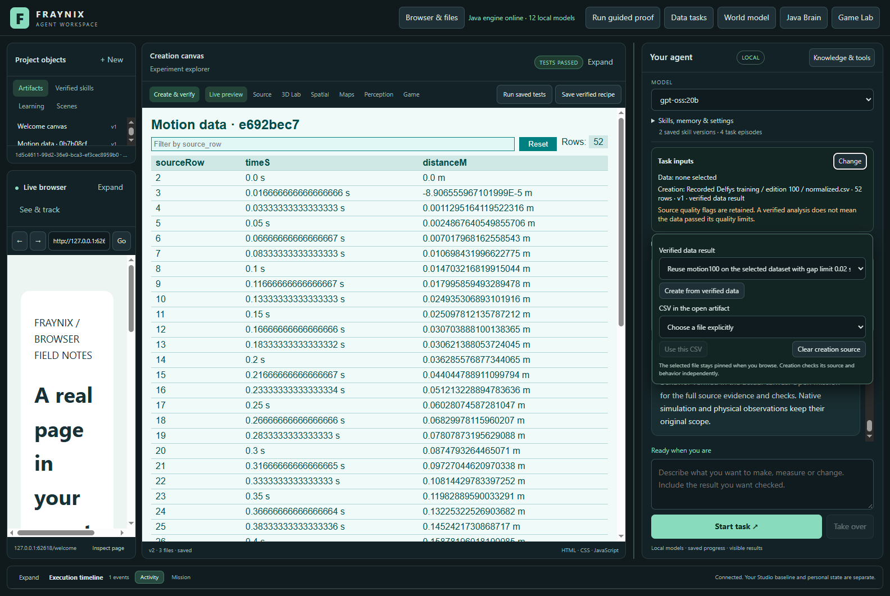
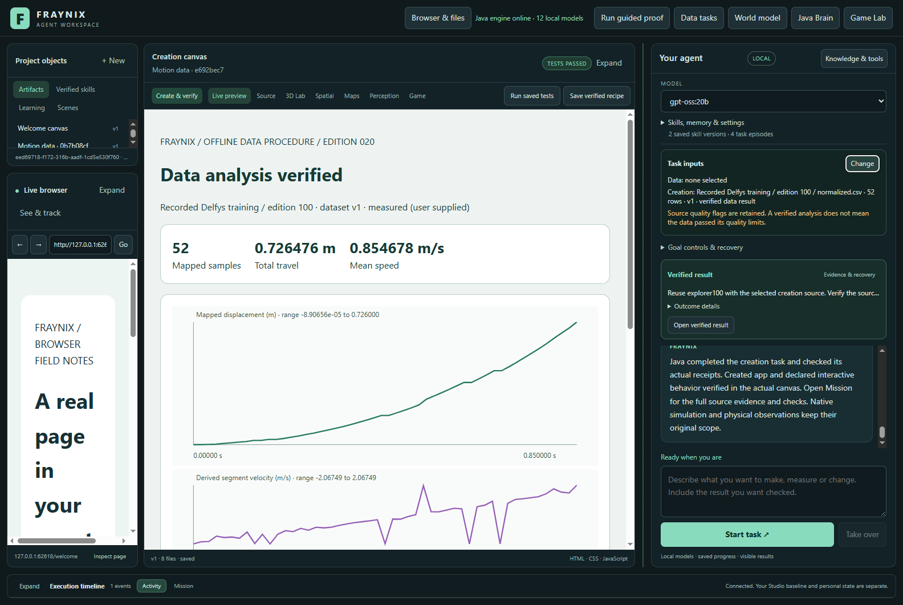
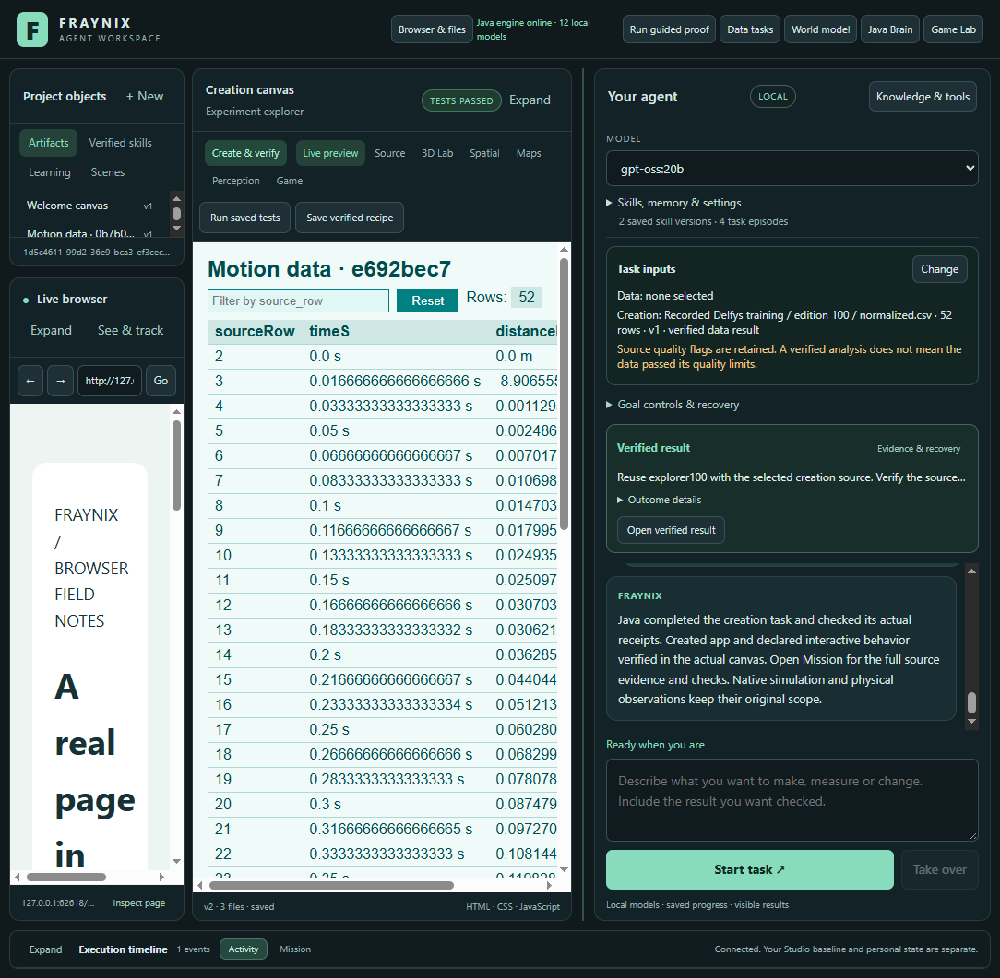
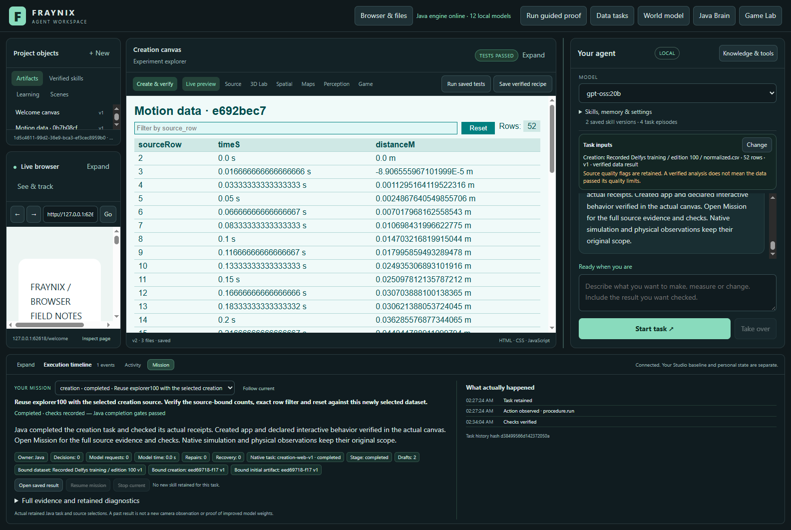

# Edition 100 — verified data becomes working content

[Previous:099](README-099.md) · [Offline interactive guide](docs/readmes/100/index.html) · [Edition history](docs/readmes/INDEX.md) · [Contributor direction](README-CONTRIBUTORS.md)

Edition100 connects two existing capabilities inside the same workspace: analyze a selected dataset, then create a working application from that verified result. The user can see the chosen source, review the behavior contract and keep using the resulting procedure with fresh data. Java still owns execution, provenance and completion.

## What changed

**Task inputs** now shows the selected motion dataset and the exact creation file. Chat creation no longer silently takes the first CSV from whichever artifact happens to be open. A pinned source keeps its file, version and hash while you browse other results. Clear or replace it explicitly. On restart the app asks Java to recheck it; a stale or changed source is shown as needing attention and cannot silently become a different input.

**Create from verified data** is available for completed data tasks. Java reconstructs the analysis from its frozen original CSV and mapping, verifies the report and actual canvas receipt, and checks that the report files still match the analysis. It supplies the normalized CSV, its precise binding, the parent task and the original quality flags. The new creation task retains that lineage and rechecks it during execution and completion.

The button opens the existing **Create & verify** dialog with that exact source selected. Its editable behavior contract uses **sourceRows** and **sourceCount**. Java derives counts from the current input before code generation; the checks remain fixed throughout repair. The local model writes the actual HTML, CSS and JavaScript. This is a visible two-step workflow with explicit user selection and supplied checks, not a claim that the model invented verification or autonomously discovered the dataset.

The input chooser is temporary so it does not consume the conversation area. Creation-source restoration is implemented; the separately selected motion dataset is not automatically restored. Wide generated tables can scroll within the canvas on narrow displays, and Expand gives the content more space. A compact source summary stays visible. Existing Browser, Creation canvas, Game Lab, Java brain, native worlds, procedural skills and Mission evidence remain integrated.

## Actual recorded-data and model trial

The completed cohort used installed **gpt-oss:20b**, digest `f38aa0c53da5f8c49d08c43a99df24ff53167fe68e24664a7777288e7656fdfe`. Inference retained the existing four-thread CPU-only policy. The two inputs are the unchanged frozen edition013 Delfys validation and training CSVs; they are recorded data, not newly captured footage, model training or calibrated physical actuation.

| Input | Rows | Analysis task | Creation task | Speed flags | Generation jobs |
|---|---:|---:|---:|---:|---:|
| validation | 49 | 62.35 s | 226.56 s | 0 | 1 |
| training | 52 | 80.72 s | 400.79 s | 37 | 2 |

These are single-run submission-to-completion times, including waiting and verification. They are not a comparative speed benchmark. Setup and cold restart are separate. Mission’s model-request counter covers chat routing; the child creation generator has its own retained receipts and the generation-job counts above. Exact router/generator receipts, original prompts, code, checks and timings are retained in the [original evidence index](docs/readmes/100/original-evidence.json).

The first workflow saved motion100 and explorer100. After closing and reopening the owned project, Java restored the pinned source with fresh verification. The changed-input workflow reused both saved procedures against a different recorded CSV and tighter declared data thresholds. Source-bound counts were recalculated, rather than copying the earlier result. A verified analysis can correctly contain quality warnings; these warnings stayed attached to the handoff.

The fresh-source creation needed two actual model drafts. Its first draft put the row count in an input value, while the frozen contract required visible text. Java refused that draft, returned the observed failure to the model and verified the repaired second draft against the unchanged checks. Both versions and their receipts are retained.

Independent checks reconstructed normalized rows and total travel from the original CSV. They compared the generated artifact's exact input bytes and source lineage, then exercised the actual rendered table: all rows, exact row filtering, no-match filtering and reset. Displayed values were compared with the source. The [independent inspector](scripts/Inspect-Handoff100.cjs) also refuses five altered evidence variants.

## Retained failures and limits

Independent inspection initially assumed that the table ID was on the outer table and that the surface checker returned a receipt object. The actual generated table used its body ID and the checker returned individual checks. The corrected inspector checks both valid table-body placements without relaxing row counts or values. A restored-canvas navigation race was retained and corrected by waiting for the saved view to settle before input checks. The final value check also accepts an explicit “s” or “m” suffix only in its corresponding column; a wrong unit is refused. This corrected the harness's bare-number assumption without changing generated content or numeric tolerance. The original failed inspections remain in the archive.

The first UI harness used an incorrect host name; it was corrected before any model request in that attempt. An existing source-integrity test fixture also needed the new interface files; its refusal was retained, and all135 existing desktop checks now pass.

The first actual model creation attempt reached its saved time budget and was interrupted. It earned no successful skill. Its proposed checks also hard-coded49 rows. Those checks and the failed attempt were retained without rewriting them. The next fresh cohort used the existing visible, source-parameterized contract and a compact table/filter/reset explorer. Its optional chart was removed from the requested scope before that cohort; the time limits and verification gates were unchanged. See the [dated prospective contract and amendment](docs/EDITION_100_CONTRACT.md).

There is no claim of improved LLM weights, unlimited memory, consciousness, causal understanding or automatic support for arbitrary files. The current handoff supports completed registered motion-data reports and CSV creation inputs. Source labels remain declarations; normalized values inherit the original measurement assumptions. The model can still fail, and retained procedures still need new outcome checks.

## Try it

1. Launch the existing workspace in its own project. Choose an installed local model.
2. Import a CSV through Data tasks, declare its columns/units/source and select it for chat.
3. Ask for an analysis with explicit quality limits. Wait for a verified result.
4. Open **Task inputs → Change**, select the completed data task and choose **Create from verified data**.
5. Review the selected normalized file, request and behavior checks in Create & verify. Give the successful procedure a name, then build.
6. Inspect the live generated content and Mission evidence. Filtering and reset should work with the actual source values.
7. Reopen the same project, select a different input, analyze it and hand off its result. Reuse the saved creation procedure and verify its fresh counts. Clearing a source does not delete the original artifact.

## Ownership and persistence



```text
workspace-desktop/renderer/inputs100.*  visible selection and handoff
workspace-desktop/inputs100.cjs         project-local pin and fresh verification
workspace-engine/.../GoalRunner.java   data lineage, admission and completion
workspace-engine/.../Creation.java     original creation and count contracts
workspace-desktop/test/*100*           actual local-model and selection trials
scripts/Inspect-Handoff100.cjs         independent source/result checks
docs/readmes/100/                      immutable documentation and originals
```

Private project state, model weights and live camera data remain outside Git. A new computer needs its own installation and a separately verified private-state transfer. This edition does not change the CPU-only planning policy or install software on fraymus-home.

## Verification and next gates

40 focused Java methods,139 desktop/selection checks, actual UI/model trials and independent refusal checks are recorded in [verification.json](docs/readmes/100/verification.json). Native world, controller and atomic-commit verifiers were preserved. After the model cohort, one CSS adjustment kept Start task fully visible alongside Mission evidence. Final actual layout checks were repeated; compiled Java inputs and installed JARs are byte-identical to the tested cohort. Historical README001–099 and their assets remain frozen.

Parent CI42593795811 at the recorded check: **in_progress / None**. Local validation and GitHub CI are separate facts. Publication is confirmed by a separate fetched-object receipt.

Next: make the supported handoff available to durable multi-stage chat goals with explicit stage contracts, so a request can analyze, create, inspect and save without repeating selections. Then test interruption between stages, changed files, more varied source shapes and complete task costs. Add automatic contract generation only when it matches supplied-contract reliability on fresh inputs. On the new computer, separately validate GPU inference and compare complete task measurements under the same checks.

The direction remains one local agent environment: requests become observable work; results become reusable material; memories guide future attempts without certifying them. Progress is demonstrated by complete tasks and retained, rechecked evidence.

[Canonical source inventory](docs/readmes/100/file-inventory.json) · [Results](docs/readmes/100/analysis.json) · [Obsidian map](docs/obsidian/108-verified-data-handoffs.canvas)

## Actual screenshots



Actual generated explorer reused on the52-row recorded input, with a freshly verified pinned source.



Keyboard-accessible chooser beside the same app; exact source remains pinned while browsing.



Actual changed-input data report. Verification preserves quality flags instead of relabelling them as passing.



Actual1100-pixel app view: model, selected source, conversation and composer remain visible.



Java Mission evidence for the fresh-source saved procedure, alongside its actual generated artifact.
